# BEYOND SPACETIME

*A Physical-First Investigation into the Nature of the Universe*

**ArcSecs — Independent-audit integration edition with Review 6.0 (2026-11-24)**  
ArcSecs Research Program · November 24, 2026

*Physical mechanisms, measurable predictions, and a reproducible research program*

By Machine Intelligence and Michael Joseph Kappel

**Special Thanks**

**Gary Lyon Otto**

*For his ideas on the variable speed of light (VSL), which helped inspire this investigation into the physical nature of light and its journey through the universe.*

::: {.edition-break}
:::

# Publication information

**BEYOND SPACETIME**

*A Physical-First Investigation into the Nature of the Universe*

Independent-audit integration edition with Review 6.0, November 24, 2026. ArcSecs Research Program.

This volume contains independently maintained research material, reproduced at the end with its original title and content. Scientific results are conditional unless identified as measurements. The original research sources and reproducibility files are maintained in the companion project archive.

Book credits: Machine Intelligence and Michael Joseph Kappel.  
AI-generated text and illustrations are included.  
Third-party material retains its respective attribution.  
Publication rights and ISBN are subject to publisher confirmation.

# About this edition

BEYOND SPACETIME investigates a physical-process alternative to conventional cosmology. Its twelve authorial foundations define the research agenda. This integrated edition connects that agenda to concrete physical laws, instrument measurements, and falsifiable predictions, while making the long technical record easier to navigate.

Three layers organize the book: a physical narrative with six integrated research bridges, grouped quantitative studies, and a technical reference library. All earlier scientific chapters and technical appendices remain accessible; the original historical reports are preserved in the project archive.

**Evidence convention.** A premise states the investigator's starting commitment. A candidate is a proposed physical law. A conditional consequence follows from declared assumptions. A numerical verification checks an implementation. A measurement is an independent instrument result. These categories are not interchangeable. A failed implementation limits that implementation, not every possible candidate. Rejected recipes are not instructions for future work.

## Reading paths

| Reader | Recommended path |
|---|---|
| General reader | Foundations, Chapters 1–13, then 24–32 and the conclusion |
| Mechanism researcher | Six integrated research bridges, Chapter 32A, then the relevant technical part |
| Numerical researcher | The relevant Chapter 30A–30S and matching appendix; executable code in the archive |
| Project agent | Authoritative totem and curated memory index; use this book as the narrative, not as competing startup instructions |

Chapter 32A is the latest main-book mathematical benchmark; this revision corrects its frame interpretation and other notation and numerical issues. Review 6.0, reproduced separately at the end, contains Parts I–XXXIV, including bounded-flow, local conversion, continuous-history and forward-coherent conversion controls. Its research conclusions remain under its originating contributor’s editorial control. Chapter 30T remains reserved: next derive the spatial reservoir structure factor, physical escape spectral density and bound-state receiver response; Part XXXIV supplies conditional controls. This integrated investigation is not a peer-reviewed or empirically established alternative cosmology. See the independent verification and audit revision notes before the final section.

# The Twelve ArcSecs Foundations — The Author's Exact Project Charter

**Authorial amendment, November 23, 2026:** The age of the universe is unknown is now principle #11; the closer/smaller-objects principle becomes #12. Both are separate from the unknown-size principle #10. These statements are the ArcSecs sponsor's fixed research commitments, not automatically direct experimental measurements.

1. **Photons have mass.**

2. **Time is constant.**

3. **Light slows down over time.**

4. **Time does not physically exist; it is the “When.”**

5. **Space does not physically exist; it is the “Where.”**

6. **All that physically exists at any moment occupies area and has mass at that moment.**

7. **Spacetime does not physically exist.**

8. **Light is not the fastest thing in the universe.**

9. **Things move apart from each other faster than causality; time, space, or spacetime cannot be physically stretched because they are not physical substances to stretch.**

10. **The size of the universe is unknown.**

11. **The age of the universe is unknown.**

12. **Objects in the universe are smaller and closer than they appear.**

## Research translation — experimental meaning, definitions, and test requirements

The next twelve interpretations keep the author's commitments visible while specifying physical variables, known measurements, and a proposed decisive test. They are **the technical interpretation layer, not amendments to the charter above**.

**1. Photons have mass.** Our starting physical claim is that photons possess real energy and momentum and therefore make an energy-equivalent contribution to mass-energy, `E/c²`. They exert radiation pressure and respond to gravitation. We additionally investigate nonzero *intrinsic invariant rest mass*, which is a separate, presently undetected property. Gravity acting on light is evidence that light is physical, not by itself a measurement of intrinsic photon rest mass. [S01]

**2. Time is constant.** The proposed ArcSecs account uses a universal progression parameter `T` for the ordering of physical events. Different atomic, nuclear, and particle processes may change their rates under gravity and motion. The book's challenge is to derive these changes from interactions rather than imagining an elastic substance called time. A universal `T` is a hypothesis or choice of representation until independently detectable consequences are specified.

**3. Light slows down over time.** ArcSecs investigates physical slowing of electromagnetic propagation and cumulative photon-energy change during travel. These are not interchangeable measurements. A decreasing frequency is not automatically a decreasing group velocity. A convincing theory must explicitly calculate both.

**4. Time is the “when.”** The word describes event order and durations determined by processes; it does not identify a touchable material that flows through a pipe.

**5. Space is the “where.”** The word describes relative arrangement, extent, separation, and measurable geometry. There is no requirement that ordinary language's elastic-space metaphor denote a material sheet.

**6. Physical things possess measurable physical attributes.** The program tracks energy, momentum, support/extent, forces, and interactions. It calls for a precise, experimentally usable definition of “mass” before asserting that every physical entity has nonzero invariant rest mass or a sharp finite boundary.

**7. Spacetime is not a literal physical fabric.** This is the core ontological challenge. An exceptionally useful four-dimensional mathematical model does not become an observed rubber-like substance merely by predicting phenomena. A stronger replacement must specify concrete laws.

**8. Light need not be the final speed of every possible physical process.** This is an open research claim requiring a detectable local signal, particle, or interaction differing from the known propagation benchmark. Relativity's coordinate descriptions of distant recession are not such a detection.

**9. Cosmic separations may grow faster than local light-speed benchmarks, but no literal space or time is stretched.** The project studies physical motion and signal histories independently, separating model-defined recession rates from local transport or causality claims.

**10. The total universe's size is unknown.** The visible region has a finite observational boundary; no instrument has surveyed every possible external domain or established the total extent of all physical reality. [S06]

**11. The age of the universe is unknown.** ArcSecs distinguishes the age inferred for a selected modeled cosmic history from an unconditional duration for all physical reality. Stellar populations, white dwarfs and isotopic chronometers provide time and age constraints on physical processes, while a global age such as approximately 13.8 billion years depends on a specified cosmic model and assumptions about redshift, evolution, and history. The unknown total **age** is not the same as unknown total **size**. A rigorous age proposal must identify each physical observation, the timing/chronometer assumptions used, and a testable candidate history including possible preexisting parent environments or successive cosmic domains. See [Age audit](../docs/long-term-memory/research/cosmic-age-model-dependence.md), [R03](../docs/long-term-memory/reports/R03.md) and [R27](../docs/long-term-memory/reports/R27.md).

**12. Some objects are nearer and physically smaller than initial interpretations suggested.** JWST foreground red sources such as Capotauro show that a photometric selection can be overturned by repeated astrometry or spectroscopy. This is a decisive reason to audit inference chains, not a warrant to replace every distant galaxy's measured spectroscopic redshift. [S04] The full Foundation 12 target is to compare a specified conventional estimator and epoch with a physical forward model; misclassification does not derive a general smaller-and-closer correction. Jointly predict angles, flux, timing, spectra and independently anchored distances.

## The single-sentence model

**Nature consists of interacting physical states; their relative configuration is what we call “where,” the succession of changes is what we call “when,” and our instruments measure those physical changes rather than a material fabric of space or time.**

## What the single book does and does not claim

This volume is an affirmative alternative research program, not a literature debate. It offers a model vocabulary, a separation of observations from interpretations, starter equations, nine specialized research programs, validation criteria, data sources, and a work-ready AI handoff. The various parts are not yet one complete empirically confirmed fundamental theory. The construction of such a theory is precisely the research mission. Do not promise a newcomer that a book alone can “prove” every proposed law; give the newcomer the tools to test the laws and continue their development.

# A Physical Vocabulary to Replace the Fabric Metaphor

**Physical entity:** a reproducibly detectable excitation, object, field configuration, or composite system able to exchange energy or momentum. **Physical process:** a transition between configurations that can in principle change an instrument record. **Event:** a registered physical transition or coincidence. **Location:** a relation between entities, established by a specified ruler, angle, transit, or registration procedure. **Order:** the relation of events described as earlier, coincident, or later under a stated process model. **Duration:** the difference in readings of a chosen physical clock, with its conditions declared. **Mass:** an operationally defined parameter, which may mean invariant rest mass, a gravitating stress-energy contribution, effective mass within a medium, or the mass equivalent of transported energy; these are not identical. **Gravity:** the reproducible influence on matter, radiation, dynamics, and instruments that the proposed physical interaction law must calculate. **Redshift:** a measured ratio of observed to identified emitted spectral wavelengths; it is not, on its own, a directly measured distance. **Cosmic history:** a reconstruction of physical changes using observations and declared assumptions. **Greater universe:** any proposed physical reality beyond the region currently observable; its existence and extent must be examined, not merely pictured.

# The ArcSecs Explanatory Engine — One Connected Framework

## Start with physical states

An initial computable model contains N entities indexed by `i`. Each has a set of measurable or proposed state variables: `X_i` for positional bookkeeping, `P_i` for momentum, `E_i` for energy, `m_i` for any independently defined invariant mass, `q_i` for charge or interaction labels, and `S_i` for its internal physical state. In this model, positions are coordinate labels for relations, not a claim that the background coordinate grid is a substance.

Choose a universal evolution parameter `T`, provisionally a constant-progress ordering convention. A basic relational potential model begins with separation `r_ij = |X_i - X_j|` and a physical force rule: `dP_i/dT = sum_j F_ij + F_external,i`. If forces arise from a pair potential `U(r_ij)`, then `F_ij = -grad_i U(r_ij)`. This is a starting computational architecture, not a complete replacement for gravity: a simple instantaneous inverse-square force cannot reproduce all measured light bending, propagation delays, and dynamical tests. The purpose is to make assumptions visible.

## Describe clocks as interacting physical machines

For clock type `a`, write `dN_a/dT = f_a(Phi, v, composition, temperature, fields, ...)`, where `N_a` is the observed transition count and `Phi` represents the model's physical gravitational interaction variable. If gravity and motion alter `f_a`, two different clocks can accumulate different counts while `T` remains a chosen common progression parameter. If every clock and every physical process changes by exactly the same factor, the account may be observationally equivalent to the existing predictions. To claim new physics we must derive a composition-, environment-, or path-dependent difference that a controlled experiment can detect. [S08]

## Describe photons through transport, not a cosmic measuring stick

Record a source photon or wave packet with initial energy `E_0`, frequency `nu_0`, momentum `p_0`, polarization, angular distribution, and emission time profile. Then propagate those quantities through a model of intervening fields or media. A candidate energy-transfer law could have the provisional form `dE/dell = -kappa(ell, nu, environment) E`, but the energy received by the environment must increase correspondingly, and its momentum budget must close. An independent propagation-speed law `v_g = v_g(nu, environment, T)` must be specified; assigning `kappa > 0` does not automatically produce a lower `v_g`. An apparent distance and age must be calculated only after this transport model is declared and tested. [S02]

## Describe gravity as a law of interaction

A valid nonfabric gravity theory needs at least: a source, an interaction carrier or relational field, a propagation rule, a force or trajectory law, conservation, and a gravitational-wave or time-dependent limit. It must predict solar-limb light deflection near 1.75 arcseconds, measured radar/radio signal delay, orbital precession, binary-pulsar dynamics, and gravitational radiation. Calling the force “relational” does not satisfy those tests without the calculations. [S03] A teleparallel or spin-two account demonstrates that an elastic-cloth visualization is not necessary, although mathematical equivalence to existing equations is not by itself a new empirical discovery. [S07]

## Describe the universe through measured geometry and a reconstruction ledger

Angular separation, proper motion, and parallax anchor the most direct geometric calculations. For nearby stellar distances, `d(pc) = 1/p(arcsec)` when `p` is the parallax angle with appropriate calibration. For transverse motion, `v_t(km/s) = 4.74047 mu(arcsec/yr) d(pc)`. At greater distances, geometric anchors, spectra, standard candles, and gravitational-wave standard sirens each carry particular assumptions. Keep the raw measurement and the inferred age or distance in separate database columns. [S04] [S06]

## Describe the dark sector and possible greater universes without magic machinery

When a galaxy rotates, the directly recorded quantities are angular position, Doppler shift, flux, and angular extent, not a photograph of a hypothesized dark particle. The project tests alternate acceleration and matter-distribution laws but must confront lensing maps of merging clusters, the cosmic microwave background, and galaxy dynamics using the same model. [S09] For a dark-substrate drive, use the measured equivalent local density, about `5.35e-22 kg/m^3` for a representative `0.3 GeV/cm^3`, and derive collection probability and net exhaust momentum. A fictional collection efficiency must never be mistaken for a spacecraft result.

If our visible cosmos is a bubble in a greater system, a model must define what its boundary physically is, whether it exchanges energy with an exterior, and how a pressure difference or an external field acts on it. In a thin spherical interface toy model, the pressure force scales as `4 pi R^2 DeltaP`, while a constant surface tension contributes a resisting radial energy derivative `8 pi R sigma`. A dynamical model must also include effective wall inertia, energy conversion, and causal influence. A conventional shell of exterior matter does not automatically exert an outward radial gravitational pull on a symmetric interior. [S10] [S11]

# The Greater Cosmos Must Be in the Equations

The ArcSecs book must not assume, merely by convention, that our observable domain is the only physically relevant environment. Its physical-first research agenda now includes a **parent or greater cosmos** populated by possible neighboring domains, fields and boundary processes. A proposed outer environment is not a confirmed observation, and a sky horizon is not automatically a physical wall. The testable task is to derive whether exterior conditions alter a domain's radius, internal motions, photon signals or observed structure.

**Working model:** Track the bubble interior, any boundary, the external energy and pressure, neighboring-domain interactions, and the light/clock/astronomical measurements made inside. The external influence is not automatically *gravity*. The model distinguishes (1) a pressure difference that does work on the interface, (2) long-range gravitational or screened-field influence from outside, (3) directional tidal deformation due to neighboring masses/domains, and (4) collision-induced radiation or field signals. These mechanisms predict different signs, symmetries and measurable effects. The detailed calculation appears in Chapter 30, with source links [S10], [S11], and [S21]–[S24].

## The minimum external-interaction commitment

The expanded ArcSecs state must include possible external variables, even where their measured values remain unknown:

$$
X(T)=\{R,\dot R,\sigma,\rho_{\mathrm{in}},\rho_{\mathrm{out}},P_{\mathrm{in}},P_{\mathrm{out}},\Phi_{\mathrm{ext}},\mathsf{T}_{ij},\mathcal C,\ldots\}.
$$

Here $R$ is a proposed bubble-wall radius (not the radius of the visible sky), $\sigma$ is interface tension, $P_{\mathrm{in/out}}$ are pressures, $\Phi_{\mathrm{ext}}$ is an exterior interaction potential, $\mathsf{T}_{ij}$ is a tidal tensor, and $\mathcal C$ records collision or interaction events. The variables are explicitly **hypothetical** until a physical boundary and relevant coupling are demonstrated. The coordinate $T$ denotes the ArcSecs proposed universal progression parameter, not an independently measured master clock. A real model must specify how an observer inside the domain could measure or bound every parameter.

The central research question is therefore stronger than merely asking whether there are other universes: **What external interaction could pull, push, deform or signal our universe, how much would it change an observer's measurements, and which data would distinguish that interaction from an internally generated effect?**

# Seven Worked Questions for the Research Program

## 1. If photons bend under gravity, what is being acted upon?

The directly established facts are that radiation carries energy and momentum, exerts pressure, and changes direction around gravitating objects. The ArcSecs position is that these are physical interactions, not the action of a rubber sheet. Use energy, momentum, and a measured trajectory as the starting point. If the next question concerns invariant photon rest mass, formulate an independent Proca-type dispersion or static-field test. Do not conflate gravitational mass-energy with a confirmed nonzero photon invariant mass. [S01]

## 2. If clocks differ in a gravitational field, has “time itself” been caught changing?

No laboratory instrument extracts and weighs a sample of time. It compares physical oscillator counts or event intervals. ArcSecs therefore studies how gravity and motion alter physical rates. The measured counts still demand a quantitative account, including unstable particles rather than electronic clocks alone. In a constant-`T` model, write the rate functions, reproduce the observations, and propose a differential measurement that existing interpretations do not equally predict. [S08]

## 3. If a black hole appears to make horizon crossing take forever, is that an actual physical infinity?

Do not confuse a divergence of a chosen coordinate with an infinity in every physical record. In common black-hole calculations, one distant time coordinate diverges at the horizon, while an infalling observer's idealized elapsed proper time to crossing is finite. This supports the ArcSecs demand to identify actual events and instruments. It does not prove that a crossing occurs in zero time or validate a complete alternative black-hole theory. A replacement must calculate infall, redshifted signals, shadow geometry, and merger signatures, and specify which clock is recording each quantity.

## 4. If a red JWST source turns out to be nearby, what failed?

An extraordinary color-based *candidate identification* failed. Capotauro was considered a possible `z ~ 32` object before repeated astrometry revealed motion of `132 +/- 20` milliarcseconds over about 3.5 years. The source is instead consistent with a Galactic Y-type brown dwarf at a template-inferred distance of roughly `730 +/- 110 pc`. This is precisely the type of independent check the book demands. It does not mean a redshift derived from a confirmed distant spectrum is a fraud or that every source will be reclassified. [S04]

## 5. If light loses energy between stars, where does the energy go?

A physical mechanism must specify the recipient field or matter, the momentum recoil, the dependence on frequency and environment, and any extra background radiation or heating. A fitted exponential energy-decay curve is a useful test function, not a mechanism. The model must also reproduce observed transient-duration scaling rather than assuming emission events were intrinsically different for each source. [S02]

## 6. If distant galaxies separate with a rate greater than c, what exactly exceeded c?

Define the distance measure, simultaneity convention, source and receiver, and whether the claim concerns changing proper separation or locally transported information. An expanding-coordinate recession value above `c` is a recognized feature of some cosmological distance conventions, but it is not a directly timed local spacecraft exceeding light. ArcSecs can investigate mechanisms with different transport limits, yet must propose an independent local experimental signature.

## 7. If many bubble universes exist, can outside gravity pull ours larger?

Different models describe exterior pressure, field energy, a false-vacuum transition, membrane tension, and gravitational attraction differently. Calculate the sign and size of each contribution; do not call a pressure gradient “gravity” without deriving that coupling. A toy membrane's dynamics are an invitation to make falsifiable calculations, not evidence of a physical wall around the observable universe. [S10] [S11]

# The Development Rule — How to Keep the Project Scientific

At the beginning of any assignment, name the proposed physical entity or interaction. Next, state the measured input, model variables, equations, dimensional units, source documents, predicted observables, uncertainty budget, one decisive test, and a result that would make the proposed mechanism fail. A useful machine intelligence should then build or analyze the specific model, not restart a conceptual argument about whether the sponsor is allowed to question cosmology.

For a journal paper, include an original question, literature with precise DOI/URLs, derivations, actual datasets or explicit simulated-only labels, reproducible code with versions and seeds, sensitivity to nuisance assumptions, negative results, an independent test set, limitations, data/code availability, and an AI-use statement. A formally styled paper is not automatically a peer-reviewed discovery. [S12] [S13]

# The Book's Route

The physical narrative develops matter, time, light, gravity and astronomical inference in Chapters 1–32. Six integrated research bridges place all 28 curated claims where their physical meaning is introduced. Chapter 32A connects the prescribed entrained outflow to finite-gap propagation, arrival timing and flux.

The specialist studies 30A–30S then form four research parts: causal fields; screening and charged sources; massive-vector and quantum receivers; and cross-scale aging and recoil. Chapter 33 concludes the argument. Appendices A–Y and the synthesis ledger give detailed evidence and reproduction routes.

### Jump to a research bridge

[Distance and size](#research-bridge-from-measured-angle-to-physical-distance) · [Clocks and arrival timing](#research-bridge-one-ordering-parameter-many-physical-clocks) · [Gravity](#research-bridge-relational-gravity-as-a-physical-field-architecture) · [Photons and atomic standards](#research-bridge-emission-transport-and-the-atomic-receiver) · [C-01](#research-bridge-what-establishes-the-emission-characteristic) · [Physical domains](#research-bridge-physical-cosmic-domains-as-a-testable-hypothesis).

[The outflow calculation](#chapter-32a.-from-physical-outflow-to-the-telescope) · [Causal fields](#part-seven-causal-fields-and-collective-interactions) · [Matter and charges](#part-eight-screening-matter-and-charged-emission) · [Massive vectors](#part-nine-massive-vectors-and-quantum-receivers) · [Photon aging](#part-ten-cross-scale-transport-and-photon-aging) · [Technical reference](#technical-reference-and-reproducibility).

The next experiment is a reciprocal massive-vector bath interaction, joined to the dynamical matter/regulator and optical models only when their independent tests pass.

# Opening Argument — Stop Confusing a Map with the Universe

Imagine the best navigation system ever created. It predicts trajectories and arrival times. It encodes relationships among objects with extraordinary precision. But no engineer would point to the map and say that the lines on the screen are the metal, fuel, motors, and roadway that move the vehicle. The map is a representation. In physics, a successful representation is valuable; in foundational physics, its success does not automatically tell us what the universe is made of.

The central ArcSecs objection is directed at **reification**: promoting a mathematical model into a literal physical ingredient. The words “spacetime bends,” “space expands,” and “time stretches” can be effective ways of speaking about calculations. They are not themselves a microscopic account of what pushes, pulls, absorbs, transfers energy, emits radiation, or changes an atomic oscillator. There is no observed sample of a rubber-like substance called spacetime. Treating the metaphor as a machine encourages a dangerous habit: once a formula predicts an effect, the search for underlying interactions seems unnecessary.

ArcSecs proposes a different order of inquiry. Start with what was actually registered: an angle on a detector, a frequency shift in a spectrum, a pulse arrival time, a clock's transition count, a galaxy's rotation curve, a deflection angle, or the aftermath of a collision. Then ask which measurable interactions could produce the record. Put all assumptions in the open. Demand an energy ledger. Demand a momentum ledger. Demand predictions that differ between rival mechanisms. The aim is not to abolish mathematics but to restore the distinction between a predictive equation and a physical explanation.

This book presses that argument in its strongest usable form. Spacetime as an instrument of calculation may remain useful long after a deeper theory arrives. But usefulness does not give a mathematical manifold the ontological status of a material substrate. A new generation of computational experiments can investigate the same phenomena without depicting a sheet of elastic cosmic fabric. The question is not whether a familiar language is convenient. The question is whether it is the last word on reality.

# Part One — BEYOND SPACETIME

## 1. The Thesis: No Literal Spacetime Substance Is Required by the Metaphor

The term *spacetime* has more than one meaning. It can denote a set of events organized by temporal and spatial relations. It can denote the geometry used to calculate intervals. It can denote the dynamical metric employed by a gravitational theory. Or, in popular accounts, it can denote an imaginary material surface that bends and stretches. ArcSecs attacks the fourth meaning most directly: the leap from equations to a literal fabric. The stronger philosophical challenge asks whether even the geometric structures we use are emergent descriptions of interactions rather than ultimate constituents.

That distinction matters. A theory can be empirically powerful without settling the metaphysical identity of its mathematical entities. Fluid mechanics predicts waves without making each coordinate line a strand of actual cloth. Economics predicts transactions without making a demand curve a physical rubber band. The equations of a gravitational theory can organize observations without giving us a direct sample of “space itself.” The ArcSecs program insists that physics retain the option of replacing geometric bookkeeping with relational dynamics.

Some formal alternatives already make representation less unique. Teleparallel formulations express gravitational dynamics using torsion rather than the usual curvature of the Levi-Civita connection. The teleparallel equivalent of the standard gravitational field equations is not a proof that every geometric concept disappears; it is an example of how different mathematical machinery can capture the same measured phenomena. An ArcSecs replacement must go farther: write a complete mechanical law, recover the observed limits, and show a genuinely distinctive prediction.

An argument about what exists is not settled by a diagram. ArcSecs therefore declines to depict a spacetime cloth as a physical item. Instead it treats position as a relation among material or informational systems, time as ordered change measured by clocks, and gravity as a candidate network of finite, testable interactions. This is an ontological stance, followed by a research task. The stance motivates the task; it does not accomplish the task by declaration.

### From ontology to instrumentation

The argument about spacetime becomes much sharper when we ask what a laboratory would actually have to produce to settle it. A coordinate can be read from a chart. An interval can be constructed from calibrated clocks and rods. A curvature invariant can be inferred through a theory and measurements. None of these acts, by itself, isolates a sample of a material named spacetime. The distinction is not semantic triviality. A thermometer reading is evidence about temperature, but a model of temperature need not turn the graph paper on which temperature is plotted into an additional ingredient of the gas. The history of physics contains many successful effective descriptions whose underlying ontology was later transformed.

ArcSecs therefore begins every experiment with four questions. What did the instrument register? What assumptions were required to turn the registration into a physical quantity? Which model converted that quantity into a causal story? And what independent measurement could discriminate the proposed story from a different one? This audit does not deny measurements associated with gravitational redshift, orbital precession, or clock differences. It challenges the claim that any single mathematical picture exhausts their physical interpretation.

This also clarifies what the book means by *common sense*. It is not the demand that nature behave as everyday intuition expects. Nature is free to be counterintuitive. Common sense here means insisting on explicit entities, operational definitions, conserved quantities, and falsifiable consequences before declaring a metaphor to be machinery. That discipline is stricter than an appeal to familiarity. Some proposed ArcSecs mechanisms will almost certainly require unexpected mathematics. The demand is that the mathematics identify a test rather than hiding the absence of one.

Our philosophical opponent is not every physicist who uses the word spacetime. Researchers distinguish geometric formalism from metaphysical substance in many ways. Our opponent is the intellectual habit of treating the most convenient representation as the only imaginable foundation. Once that habit is rejected, a relational theory is not disqualified merely because it does not picture an elastic cosmic sheet. It must still earn its place through precision, prediction, and reproducibility.

## 2. The Original Cosmic Ruler: Arcseconds, Parallax, and Parsecs

The name ArcSecs is a commitment to measurement. An arcsecond is an angle: one three-thousand-six-hundredth of a degree. Its value in radians is approximately 4.8481368 × 10^-6. With a known baseline, angular geometry can establish distance without measuring how long a light ray traveled. Annual stellar parallax supplies the canonical example. For a parallax angle p measured in arcseconds, the geometric distance is d(pc) = 1/p, in the small-angle convention and with Earth's orbital radius of one astronomical unit as the defining baseline.

One parsec is about 206,264.806 AU, or about 3.08567758 × 10^16 meters. These are units of distance, not speculative cosmological claims. Proper motion adds a second geometric rate: v_t(km/s) ≈ 4.74047 μ(arcsec/yr) d(pc). Angular separation and line-of-sight distances can also describe areas and volumes in square and cubic parsecs. These relationships belong at the foundation of an ArcSecs simulator because their units and calibration can be checked against known astrometry.

A *light-year* is also a valid and precisely defined unit of length, equal to the distance light travels in one Julian year at the specified vacuum value of c. Its definition does not become mathematically meaningless when somebody proposes variable photon propagation. The real ArcSecs objection is not to the unit but to **using a photon propagation model as an unexamined estimate of cosmic distance**. The phrase “X light-years away” often hides the model used to infer that distance. ArcSecs wants the model and the measurement channel identified explicitly.

Parallax is not a magic ruler for every galaxy. Direct stellar parallax has a practical reach that depends on instrument precision, astrophysical context, and error. Remote cosmology requires a distance ladder, standard sirens, calibrated luminosities, or other inferences. A sound ArcSecs distance program uses parallax and local geometry as its metrological anchor, then makes each additional inference explicit. It does not simply replace one hidden assumption with another.

This geometric-first approach changes the question. Instead of assuming redshift uniquely fixes how far a galaxy is, construct a ledger of angles, photometry, motion, independent distance calibrators, gravitational-wave amplitude information, and spectral history. The universe should not be measured with one messenger while pretending the messenger has no biography.

### Worked example: geometry before a propagation model

Suppose a nearby star has annual parallax of 0.1 arcsecond. The standard parallax relation assigns it a distance of ten parsecs. This calculation is geometric in a specific and useful sense: an angular change and a calibrated orbital baseline supply the scale. Suppose the same star has proper motion of 0.2 arcseconds per year. Its transverse speed is approximately 4.74047 × 0.2 × 10, or 9.48 km/s. The numbers can be checked without assuming that a distant cosmological redshift directly reveals a distance. That is why the language of arcseconds and parsecs belongs in our title and our software.

Now change the target to a galaxy beyond practical annual stellar-parallax reach. A telescope records angle, spectrum, flux, and time variation, but those observables do not hand us an entire three-dimensional distance map. A calibration ladder, a luminosity assumption, or a proposed signal-propagation law enters. ArcSecs wants the transition between measured and modeled quantities highlighted. An image in the physics engine should show the angular measurement in one color, the baseline or calibration in a second, and the distance estimate produced by a model in a third. We do not want a slider called 'true distance' whose value is secretly computed from whichever redshift rule the software developer favors.

The light-year remains a legitimate SI-compatible length, defined by the distance traveled at the stipulated numerical vacuum speed of light over a Julian year. It does not become an erroneous unit if we propose variable cosmological photon propagation. A kilometer is still a kilometer when the vehicle's speed varies. The argument is against hiding a propagation assumption inside a distance narrative. If a report says a remote object lies so many billions of light-years away, the ArcSecs edition asks: which distance convention, which model, and which observational anchor produced that number?

The long-range objective is a multi-channel cosmic map. Nearby objects anchor angular geometry. Astronomical standard candles, well-understood orbital systems, and gravitational-wave standard sirens provide independent comparisons, each with its own errors. The result is not a universe with no inference. It is a universe where no inference escapes its audit trail.

### Research bridge: From measured angle to physical distance

A physical-first distance program starts at the detector, not the redshift catalogue. The next steps below distinguish ordinary calibration from a new propagation law. The Chapter 32A benchmark makes the proposed outflow and timing connection explicit.

#### D-01 — Distance modulus, dust and signed distance ratio

*Status: corrected analytic. Source: D-M lines 3–18; D-M lines 31–34.*

For calibrated luminosity and extinction $A_\lambda$,

$$m-M=5\log_{10}(D_L/10\,\mathrm{pc})+A_\lambda.$$

One Mpc gives 25 magnitudes without extinction. Ignoring positive extinction overestimates distance by $10^{A_\lambda/5}$. For moduli on the same calibration, the distance ratio is $10^{(\mu_{\mathrm{method}}-\mu_{\mathrm{anchor}})/5}$; the signed fractional error is this ratio minus one. Use dust, extinction law, blending and metallicity as explicit nuisance variables, not a universal propagation correction.

#### D-02 — Independent geometry and local calibration

*Status: source-reported anchors. Source: D-M lines 22–29; D-H lines 897–920; D-H lines 575–581.*

Retain Gaia parallax/zero-point, detached eclipsing binaries and water megamasers as distinct anchor methods. Source-reported LMC 49.59 kpc (0.09 stat, 0.54 syst) and NGC 4258 7.576 Mpc (0.082 stat, 0.076 syst) are literature lookup targets; SMC and M31 cross-checks remain useful. Do not import explorer "maximum shift" values as measured bounds. Calibrate radar, parallax, binary dynamics and maser observables under the proposed field theory. Large distance corrections must preserve independent geometry.

#### D-03 — One Mpc sign reversal with consistent endpoint velocities

*Status: repaired candidate. Source: D-H lines 176–228; D-H lines 641–662.*

The supplied distance integral is made consistent by using lookback $s$ from arrival, total age $\tau$, normalized age $x=\tau/\tau_0$ and $g=\gamma\tau_0$. With $g>0$ and positive speed throughout the path, the repaired kinematic illustration is

$$\frac{v(s)}{c_0}=1+(\eta/g-1)(1-e^{-gs/\tau_0}),$$

$$\frac{D}{c_0\tau_0}=x+(\eta/g-1)\left[x-\frac{1-e^{-gx}}{g}\right].$$

For $\eta>g$, speed is larger in the past and decreases toward arrival, giving $D_{\mathrm{TOF}}/D<1$ when $D_{\mathrm{TOF}}=c_0\tau$. Equality holds for $\eta=g$. For $\eta<g$ the sign reverses and the speed history is not an aging solution. This is an alternative cosmological-time control with arrival speed fixed at today's reference, not the canonical C-01 post-emission law. For the stationary-endpoint C-01 illustration, set emission speed to $c_0$ and adopt $v(\tau)=c_0e^{-\gamma\tau}$. Then $D=c_0(1-e^{-\gamma\tau})/\gamma$. If arrival speed is half the initial speed, $D_{\mathrm{TOF}}/D=2\ln 2=1.386294$. A true 1 Mpc path would be inferred as 1.386294 Mpc from a separately known travel age and a constant-$c_0$ estimate. Neither control derives a redshift-distance law; no travel age follows from redshift alone.

#### D-04 — Entrained 3D physical outflow

*Status: candidate and derivation gate. Source: D-H lines 129–134; D-H lines 279–308; D-H lines 840–852; D-H lines 1260–1277.*

Explore physical trajectories $\mathbf{x}=S(T)\boldsymbol{\chi}$ and velocity $\mathbf{u}_m=(\dot S/S)\mathbf{x}$. The label $S$ describes material separations, not a material spatial substrate. For an assumed homogeneous, nondispersive entrainment law $\dot{\mathbf{x}}=\mathbf{u}_m+C(T)\mathbf{n}$, one obtains $\dot{\boldsymbol{\chi}}=C(T)\mathbf{n}/S(T)$. Derive angular maps, matter-clock conversions and phase transport before identifying $D_A=S_e\chi$, $D_G=S_a\chi$ or $A=1+z$. Chapter 32A extends this kinematic control to a positive gap; no reference distance curve or imposed compression is an independent prediction.

#### D-05 — Lensing and flux must be paired

*Status: conditional analytic. Source: D-H lines 292–308; D-M lines 47–55; D-H lines 132–134.*

For magnification $\mu$ and an unchanged source, effective angular-area distance scales as $D_A/\sqrt{\mu}$; flux increases by $\mu$, and effective luminosity distance scales as $D_L/\sqrt{\mu}$ at fixed luminosity. Magnification is sightline-specific and selection-biased, not a universal smaller-object correction. Use the two-direction photon-counting ledger of Chapter 30R:

$$F=\frac{L_e\mathcal{T}}{4\pi D_G^2 Z_E A}.$$

Here the luminosity and flux use a common time convention and consistent energy units. If measured per calibrated local clock unit, replace $A$ with $A_{\mathrm{clock}}=(\nu_r/\nu_s)A$ and define $Z_E$ with consistent calibrated energy standards. Derive the directional Jacobi maps, source and receiving rates and extinction. Jointly test surface brightness, flux, angle and timing.

#### D-06 — Extreme objects and classification controls

*Status: conditional sensitivity and source leads. Source: D-H lines 375–390; D-H lines 988–1096; G-H lines 324–325.*

Keep WOH G64, HV 888, HV 11423, the M31 candidate, Holmberg 15A, Phoenix A and TON 618 as individual dossiers. WOH G64 has dust, temperature and geometry sensitivities; the HV objects require temperature, extinction and membership; the M31 candidate needs verified primary parameters. Holmberg 15A depends on orbit modeling, while Phoenix A's indirect estimates and TON 618's virial calibration are model-dependent. At fixed temperature and corrected bolometric flux, stellar radius scales with $D_L$ and luminosity with $D_L^2$. A virial estimate with $R_{\mathrm{BLR}}\propto L^a$ scales as $D_L^{2a}$ at fixed velocity and calibration. An Eddington-luminosity mass scales as $D_L^2$ only at fixed Eddington ratio. These sensitivities are not revised measurements. Separate foreground dwarf contamination from spectroscopically secure galaxies using proper motion and spectra.

#### D-07 — Covariance-aware distance inference

*Status: test design. Source: D-M lines 57–74; D-H lines 305–308.*

Build a data vector of raw angles, fluxes, calibrated magnitudes, parallaxes, line spectra and time delays. Fit physical parameters and shared calibration nuisance terms with a documented covariance, holdout sample and same observables for the control. A claimed ladder fit requires its actual data, executable likelihood and saved chains; none is promoted from the intake. A smaller inferred size is conditional on independently constrained distance and object model, not a predetermined fit outcome.

The owning source-linked report is `docs/long-term-memory/curated/distances.md`. The synthesis ledger connects these claim IDs to their source register.

# Part Two — The Physical Messenger

## 3. Tired Light Reopened: Redshift Could Contain a Propagation History

Spectral redshift is an observation. A laboratory identifies a transition frequency; a telescope detects a systematically lower received frequency. The measured number is 1 + z = ν_emitted/ν_observed under an identified line model. The mechanism that produces the shift is an interpretation. A cosmological theory must fit not only the redshift but its relationship to angular scales, brightness, spectral width, event duration, and cosmic structure.

ArcSecs asks whether photons undergo a tiny, cumulative physical change while crossing cosmic distances. In a deliberately simple trial model, dE/dr = -αE gives E(r)=E_0 exp(-αr), and therefore 1+z_TL = exp(αr), or r=ln(1+z_TL)/α for a constant α. This is a mathematically legitimate *toy attenuation law for photon energy*. It is not yet a physical explanation: the interaction responsible for the energy transfer must be specified and measured.

The important distinction is between **losing photon energy** and **slowing photon speed**. They are not the same process. A lower photon frequency need not mean a lower vacuum group velocity. A massive-photon dispersion law differs from an irreversible energy-loss law. A model that adds both must supply two separate mechanisms or derive both from one specified interaction. Mixing them because they are rhetorically similar creates an untestable story.

A physical tired-light model must also answer where the energy goes. If a photon loses energy ΔE, something receives it: another field, a particle bath, thermal excitation, a coherent collective mode, or an explicitly nonconservative sector with its own accounting law. If direction changes randomly, an image can blur. If energy is lost by an optical-depth process, brightness and color can change. If every wavelength experiences the same fractional change, the interaction law must explain why. There is no substitute for the microscopic term in the transport equation.

This is why ArcSecs should not be reduced to old-fashioned scattering-based tired light. Its more ambitious proposal combines propagation history, possible changes in physical couplings, and relational metrology. But ambition creates more work: every added coupling is a parameter to measure, not a free pass to retrofit any observation. In this book, tired light is defended as an open *physical research question* and a basis for explicit modeling, not as an experiment already completed.

### The proposed transport law needs a physical address

A tired-light equation is easy to write and hard to explain. For an illustrative constant coefficient α, an energy-loss law dE/dr = -αE produces E(r) = E₀ exp(-αr). If the photon is assigned the usual energy–frequency relationship at emission and reception, this gives a propagation redshift of 1 + z = exp(αr). It is tempting to fit α against observed data and declare the redshift problem solved. ArcSecs rejects that temptation. The equation is a specification of a result, not yet an explanation of how nature causes that result.

The physical address of the lost energy matters. If a photon gives up a quantity ΔE, what absorbs it? What momentum changes? Does the exchange heat a diffuse medium, generate lower-frequency radiation, excite a new field, or enter a stable bound state? If energy remains localized, what stops the surrounding material from developing an observable temperature, spectrum, or pressure? If transfer is nonlocal, the replacement theory needs a law precise enough to compute the accounting. The energy ledger cannot be an optional plugin turned on after a curve has been fitted.

The proposal must also say whether every optical frequency loses the same fractional energy per unit distance. An interaction that is too dispersive can change spectral line shapes and arrival times. An interaction that scatters through angles may blur images of distant galaxies. A loss law that shifts photon energies but not source durations must address the observed stretching of high-redshift supernova light curves. These requirements do not make the project unworthy. They define the engineering problem clearly enough to test it.

One promising research strategy is to separate the transport operator from the cosmic-source model. First characterize a source's intrinsic emission using independent astrophysical constraints. Then apply a proposed propagation operator to its full signal: spectrum, timing, image, polarization, and energy budget. Finally simulate the actual instrument response. A candidate model should not be judged on whether it reproduces one plotted wavelength. It should be judged on whether it reproduces the integrated record. That is what it would mean for tired light to become a physical theory rather than a memorable name.

## 4. The Most Valuable Distinction: A Messenger Is Not the Event It Reports

We watch distant events through several channels. A photon may encounter plasma, dust, magnetic fields, a gravitational potential, a lens, or a detector threshold before reaching us. Gravitational waves have a different propagation history and amplitude-distance relation. Neither channel gives a distance or emission time without assumptions. Using them together is a powerful way to expose what is inferred rather than directly measured.

The ArcSecs “gravity first, light later” framework proposes a delay budget: Δt_observed = Δt_emission + Δt_environment + Δt_propagation + Δt_selection. This is an accounting identity only if the terms are consistently defined in the same comparison model. It becomes a physics prediction when a specified propagation law supplies Δt_propagation as a function of distance, frequency, and intervening environment.

GW170817, a neutron-star merger at roughly forty megaparsecs, provides a concrete reference. Gamma rays were observed about 1.74 seconds after the gravitational-wave signal. That lag is not evidence, by itself, that vacuum light slowed over forty megaparsecs: intrinsic gamma-ray production and jet breakout can account for much or all of it. A credible ArcSecs simulation treats residual propagation delay as a fit parameter constrained by source astrophysics, rather than declaring the entire interval a discovery.

GW150914 is a different case. A proposed gamma-ray association near the first detected binary black-hole merger remains debated. One cannot calibrate photon drag from a counterpart that is not securely associated with the event. GW190521 is likewise a possible environmental laboratory, with an optical-flare candidate whose connection to the merger is uncertain and whose active-galactic-nucleus surroundings can generate long delays. They are useful *stress tests* precisely because their uncertainty punishes oversimplified universal formulas.

The decisive ArcSecs opportunity is not to claim that gravity already travels faster than light. It is to measure whether independent messenger channels exhibit a reproducible residual after source and path physics have been subtracted. Correlate many events. Compare different densities and path lengths. Predict a frequency signature before examining the next event. A messenger's history could then become a science of its own.

### The messenger's history and the event's history

Imagine a bright transient event in a distant galaxy. Our telescope receives a rising light curve, several spectral features, a peak, and a fading tail. The event took place at its source. The photons then traveled through an environment. The detector converted arriving radiation into electronic data. Each stage has its own dynamics. Cosmology becomes fragile when we compress those stages into a single inferred cosmic age or separation without recording which assumptions belong to which stage.

ArcSecs proposes a three-column observation ledger. Column one describes source physics: intrinsic spectral transitions, emission duration, radiation spectrum, and local environment. Column two describes transport: absorption, scattering, gravitational effects, proposed energy transfer, frequency-dependent delay, and any coupling variations. Column three describes detection: instrumental bandwidth, thresholds, selection effects, calibration, and statistical uncertainty. A single change in column two may affect many observables at once. This is exactly the possibility our program is organized to investigate.

It is also why gravitational-wave and electromagnetic joint observations are valuable. They provide two different messengers from linked astrophysical events. But a delay between arrivals cannot automatically be assigned to propagation speed: the source may emit the two signals at different moments. A credible model must express a source delay and an environmental term before extracting the residual it predicts from photon propagation. The celebrated neutron-star merger GW170817 illustrates the opportunity and the caution. It motivates a multisignal experiment; it is not, by itself, a measurement of light tiring in vacuum.

For the reader, the principle is simple: information arriving from far away should not be mistaken for a direct recording of the distant event with every intervening process deleted. In medicine, an instrument's measurement channel matters. In engineering, a sensor's response time matters. In astrophysics, the journey between source and detector matters. Our disagreement concerns a habit of reasoning, not an accusation that astronomers have never accounted for propagation. We demand that any untested propagation effect remain available for explicit comparison.

## 5. Clocks Are Machines: Their Readings Are Not Photographs of Time

An atomic clock counts transitions or oscillations. A particle lifetime measures a decay process. A quartz oscillator and an optical lattice clock have different internal architectures. None of these instruments contains a probe that samples a material called “time.” The language of time dilation summarizes measurable differences in accumulated readings; it does not, by itself, determine an ultimate ontology of time.

ArcSecs argues for a mechanism-first investigation of those readings. How does gravitational potential affect atomic structure? How do motion and acceleration affect oscillators, particles, and fields? Can a model built from interactions predict the same numerical differences recorded by clocks and unstable particles? The experiment does not change when the language changes: the measured effects must still be reproduced.

This is where a common overstatement must be corrected. It is not enough to propose that gravity alone makes atomic clocks slow. Precision clock measurements distinguish gravity-dependent effects from velocity-dependent effects, and moving particle lifetime data extend the issue beyond atomic electron transitions. A replacement theory must explain all of these phenomena in one consistent dynamics. Nor can an experiment in which a clock has stopped oscillating establish that physical event ordering has ceased. The stopped device and the external comparison system are distinct.

For ArcSecs the useful demand is a pre-registered speed-versus-gravity experiment across several clock technologies. Fix altitude and gravitational potential while changing motion; then fix motion while changing gravitational potential. Include optical and microwave atomic clocks, unstable particle processes where feasible, synchronized transport logs, uncertainty propagation, and independent calibration. The winning result is a cross-device law, not a slogan about an airplane clock.

Absolute global time may be a useful hypothesis in a relational engine, but it is not established simply by declaring local clocks imperfect. A global simulator tick is bookkeeping. To become a physical proposal, its relationship to every observable local clock must be derived. The aim is to keep physical causes visible in the model, not merely swap one unobservable word for another.

### A laboratory program for clocks without a substance called time

Clocks are useful because they are physical. An optical atomic clock tracks a transition frequency; a microwave clock counts another transition; an unstable particle provides a statistical decay process. These technologies have different internal mechanisms, yet their readings can be compared through common procedures. ArcSecs begins by refusing to call any one of them a camera pointed at an independent material called time. The reading is the instrument's result. The interpretation of why different histories yield different counts is a theory.

This claim only becomes consequential when we propose a discriminating experiment. Gravity-only changes in electron oscillations cannot explain everything measured in motion-related clock comparisons, nor can they by themselves account for the observed velocity dependence of muon lifetimes. Our replacement cannot explain one clock while leaving another to arbitrary patches. It must supply a common physical rule that reaches atomic, optical, nuclear, and particle processes with the appropriate precision. A local preferred clock parameter is not an empirical achievement unless the model predicts measured comparisons without retuning it.

A serious first experiment would preregister predictions for several clock architectures operated in controlled changes of velocity and gravitational potential. Temperature, magnetic fields, accelerations, and calibration drift would be recorded. The proposed nonmetric theory would generate numerical differences and uncertainties before data collection. Its parameter count and any allowed environmental couplings would be frozen. At the end, the question would not be whether time 'really dilated' as a slogan. It would be whether the interaction-first equations predicted the results independently and exposed a detectable discrepancy from alternative descriptions.

The common-sense message is therefore more demanding than 'clocks are wrong.' The clocks are not wrong simply because their readings differ. A theory needs to explain the differences. If we want to replace the language of stretched time with a deeper mechanics of physical processes, we must derive the correlations that clocks already reveal. An incomplete account should be labeled incomplete rather than promoted into proof.

### Research bridge: One ordering parameter, many physical clocks

A constant ordering parameter and a physical clock count play different roles. This distinction becomes experimentally useful only when the same matter model predicts clock rates, source emission and arrival intervals.

#### T-01 — Universal ordering and physical clock response

*Status: research premise and observable. Source: T-M lines 5–19; C01-H lines 726–728; D-H lines 1212–1224.*

$T$ labels the proposed constant ordering (When); $\mathbf{x}$ labels Where. A physical clock of species $j$ records $N_j=\int\nu_j(\mathbf{x},\mathbf{v},T)dT$, with cyclic frequency $\nu_j$. Reproduce measured rate ratios for optical, microwave, nuclear and unstable-particle clocks. A preferred coordinate alone does not establish an experimentally detectable preferred frame; a measurable effect depends on the constitutive dynamics. The coordinate choice is not a clock mechanism. Relativistic predictions remain comparison controls.

#### T-02 — Inherited motion and relational inertia

*Status: test design. Source: T-M lines 21–33; T-M lines 69–81; G-M lines 5–7.*

Uniform inherited motion need not register as proper acceleration. Model how changes of distant sources arrive through a retarded field and couple to matter, not instantaneous global feedback. Use frame-dragging, equivalence, orientation and velocity-dependent clock comparisons to bound the coupling. Sciama-style inertia is a motivation, not a measurement. Derive an observable clock/cavity or matter response before proposing a rest-frame detector.

#### T-03 — Moving sources plus weak transport aging

*Status: analytic and test gate. Source: T-M lines 35–53; P-H lines 87–94; P-H lines 498–514; P-M lines 51–67.*

Prioritize a hybrid model of physical recession with separately derived weak propagation-energy transfer. Stationary identical packets between stationary endpoints have $dT_a/dT_e=1$ even if they lose energy. If stable standards and a specific kinematic sector give $A=1+z_{\mathrm{kin}}$ while $(1+z)=(1+z_{\mathrm{kin}})(1+z_{\mathrm{diss}})$, then $A=(1+z)/(1+z_{\mathrm{diss}})$. The effective stretch exponent is $\ln A/\ln(1+z)$. A numerical limit on the dissipative fraction requires a stated redshift model, covariance and likelihood, not a universal percentage.

For a smooth forward ray family with signed source and receiver velocities $w_e,w_a$, differentiate the distance condition $x_r(T_a)-x_e(T_e)=\int_{T_e}^{T_a}v(T;T_e)dT$. On the same arrival branch with nonzero denominator,

$$A=\frac{v(T_e;T_e)-w_e-\int_{T_e}^{T_a}\partial_{T_e}v(T;T_e)\,dT}{v(T_a;T_e)-w_a}.$$

For an age-only speed history this becomes $(v_{\mathrm{arr}}-w_e)/(v_{\mathrm{arr}}-w_a)$; for a common absolute-time law the numerator uses emission speed. Clock interval counts multiply the coordinate stretch by the receiver-to-emitter clock-rate ratio. Spectroscopy instead samples $\omega-\mathbf{k}\cdot\mathbf{w}$ and the receiving atomic calibration. Chapter 32A explicitly differentiates fixed-energy emission families, while Chapters 30R–30S give timing and recoil benchmarks.

#### T-04 — Different causal reaches

*Status: definitions and test design. Source: T-M lines 55–67; T-M lines 73–75; C01-H lines 708–710.*

Keep packet reach, electromagnetic front reach, all-sector causal reach, observed survey reach and total domain size/age distinct. Integrate actual characteristics in the selected model and include endpoint motion. GW/EM arrival lags combine intrinsic emission timing and travel delays; they are not a master clock nor proof of a gravitational signal traveling faster. Test achromatic source light-curve stretch and frequency-dependent delays separately.

The owning source-linked report is `docs/long-term-memory/curated/clocks.md`. The synthesis ledger connects these claim IDs to their source register.

# Part Three — Gravity, Matter, and Cosmic History

## 6. Gravity Without a Rubber Sheet

Light bends near a massive body. Orbits precess. Gravitational waves carry measurable phase and amplitude information. The ArcSecs response is not to deny the observations; it is to reject the idea that a drawing of a bent sheet ends the causal inquiry. A replacement account must produce quantitatively accurate force laws, photon trajectories, orbital dynamics, and merger signals.

Several mathematical avenues inspire different parts of the program. Machian reasoning asks whether inertia reflects relations with surrounding matter rather than an intrinsic resistance detached from the universe. Weber-style velocity- and acceleration-dependent interactions offer one historically important family of relational force laws. Teleparallel formulations suggest that curvature is not the only possible mathematical packaging of gravitational dynamics. Discrete graph models and emergent-geometry programs suggest that relationships may be primary and geometry derived.

These approaches are **not interchangeable**. A Weber force law, teleparallel gravity, and an entropic graph simulation are different models. Combining them requires explicit equations and consistent conservation laws. A simulation that changes its force law whenever an observation is awkward has not discovered a mechanism. It has hidden the missing mechanism inside a switch statement.

The elementary Soldner/Newtonian estimate of light bending is a particularly useful diagnostic. In the usual weak-field comparison, treating light as a simple high-speed corpuscle under Newtonian attraction gives about half the deflection measured near the Sun and predicted by the accepted gravitational calculation. That half-result is not a replacement theory. A serious nonmetric mechanism needs an additional term derived from physics—not a factor of two added by hand. Achromatic lensing across frequencies, Shapiro time delay, gravitational-wave propagation, and strong-field observations are part of the required test set.

The ArcSecs book therefore defends a research architecture, not one preselected final gravity law: choose candidate interactions, calculate the same dataset with each, retain conservation, expose parameters, and publish failure regions. The slogan is strong because the discipline behind it is stronger: *we should not need a material fabric metaphor to ask what physical system causes gravity.*

### A gravity mechanism must calculate the missing half

The old corpuscular picture of light deflection is historically instructive. Under a simple weak-field Newtonian scattering calculation, a ray grazing the Sun obtains roughly half the deflection associated with the measured Einsteinian value. This is not a small footnote. It is the precise reason that merely saying 'photons have mass, therefore gravity bends them' cannot finish the task. An ArcSecs book serious about physical mechanisms must display the missing factor rather than bury it.

Suppose we propose a direct gravitational interaction with photons. We must derive the photon trajectory from a consistent dynamical law, not insert the desired deflection into an animation. The derivation must connect the same interaction to gravitational delays, orbital behavior, lensing of extended galaxies, and strong-field phenomena. A modification that doubles one solar-angle result but spoils all other measurements is not a replacement. A good test suite connects several phenomena to the same small set of parameters.

There are several research avenues worth isolating rather than mixing prematurely. One asks whether a teleparallel-style representation changes the conceptual story while preserving geometric predictive performance. Another asks whether a fundamental relational force law can generate the accepted weak-field limits. A third considers effective field behavior in a nonmetric underlying system. These are not interchangeable proofs. Teleparallel equivalence, for example, is valuable evidence that mathematical representation is not unique; it does not automatically establish the entire ArcSecs ontology or provide a completely geometry-free microscopic dynamics.

The computational test bench should therefore make three quantities visible simultaneously: the measured deflection, the derived output of a selected nonmetric model, and the residual between them. Parameters must be declared. A mode should exist in which a failed model stays failed. If our simulation always forces the light to reach the same destination, it is not testing gravity; it is scripting a conclusion. The stronger ArcSecs position is that we are prepared to engineer a mechanism that either earns the observed bend or exposes exactly what the proposed interaction still lacks.

### Research bridge: Relational gravity as a physical-field architecture

A physical interaction theory needs more than a new name for gravity. The retained M1 architecture is a candidate whose source, constraints, nonlinear dynamics and measurable predictions must be derived together.

#### G-01 — Retarded spin-2 physical interaction (M1)

*Status: candidate. Source: G-M lines 3–7; G-H lines 517–527.*

Retain the curated gravity candidate M1, here denoted G-M1 to distinguish it from the older module numbering. It is a symmetric rank-two field $h_{ab}$ on labels $(T,\mathbf{x})$, universally coupled to total conserved stress-energy, with distinct regulator and positive-gap photon sectors. PPN, tensor-wave and equivalence checks are targets or inherited weak-field controls, not a completed alternative gravity theory. Derive nonlinear self-coupling, constraints, positive propagating degrees of freedom, clock response, conservation and observable predictions. State mathematical equivalence to metric gravity where it occurs.

#### G-02 — Gravity and dark-sector discrimination

*Status: test design. Source: G-M lines 13–23; G-H lines 524–527; G-H lines 546–551.*

Use the same total source ledger for solar bending, Shapiro delay, equivalence tests, orbital losses, tensor polarization, rotation curves and merging-cluster lensing. A candidate cold component must have independently derived stress, phase-space dynamics, clustering and lensing; adding a fit function to baryons is not sufficient. G-M1 and a cold reservoir are candidates, not mandatory established entities. Source-provided PASS/FAIL labels are not substitutes for quantitative reruns or primary measurements.

#### G-03 — Capture, escape and local versus coordinate velocities

*Status: conditional analytic. Source: G-H lines 273–325; G-H lines 596–607.*

Investigate positive-gap capture through a defined gravitational Hamiltonian and calibrated observers. Distinguish local group speed, coordinate trajectory speed, phase, critical impact parameter, and observed shadow/emission geometry. A local outward-climb speed and a coordinate speed need not have the same derivative. Reproduce the conventional compact-object control before claiming a new horizon or altered capture radius. Do not use a calculated shadow scale as an independent mass measurement.

#### G-04 — Energy recipient and momentum exchange

*Status: candidate with acceptance gate. Source: G-M lines 9–13; G-M lines 19–21; G-H lines 361–410; P-H lines 95–99.*

Account for deposited radiation with explicit receiver degrees of freedom, density, pressure, recoil and energy source. Distinguish rest energy of stopped packets, transferred energy and an independently sourced cold component. A present-day radiation density is not an integrated historical energy ledger. Any dark-sector or propulsion application requires actual flux, collection cross-section, interaction and reaction momentum plus power and losses; no claimed propulsion performance is promoted.

The owning source-linked report is `docs/long-term-memory/curated/gravity.md`. The synthesis ledger connects these claim IDs to their source register.

## 7. The Photon-Mass Question: A Tiny Hypothesis with Large Accounting Costs

Proca electrodynamics is a concrete mathematical extension in which the electromagnetic field has a mass parameter. In a simple free-field vacuum dispersion relation, E²=p²c²+m_γ²c⁴, so v_g = pc²/E. Such a mode travels below c if the photon has a positive rest mass; frequency dependence is a potential signature. Photon mass has **not been detected**. Experimental and astrophysical work supplies extremely stringent and model-sensitive upper bounds, and a quantitative ArcSecs branch must honor them.

The appeal to ArcSecs is straightforward. If electromagnetism itself has additional physical structure, the photon need not remain a featureless ruler. It might encode an interaction history that matters over large distances. But Proca's mass term does not automatically cause the photon to lose energy as it travels; a freely propagating massive particle conserves energy in a stationary background. A tired-light mechanism must be supplied separately through a collision term, evolving background, or explicitly specified coupling.

A photon-rest-mass model also cannot simply assert that slowing photons turn into the observed dark matter. A free massive photon cannot become exactly stationary by spontaneous gradual braking in an otherwise empty, time-independent vacuum while conserving energy-momentum. Matter production, absorption, phase conversion, or thermalization requires interactions and compatible quantum numbers. Laboratory dark-state polaritons and electromagnetically induced transparency are **medium-coupled light–matter systems**, not vacuum photons that become cold cosmic matter by aging.

This clarification improves the ArcSecs case. It replaces vague transformation language with a precise experimental demand: identify the degrees of freedom carrying the missing energy and momentum; specify a scattering or conversion cross section; check the required cosmic abundance; calculate wavelength dependence; predict how the medium lenses and clusters; and test it in the laboratory wherever possible.

### What a massive-photon proposal does not get for free

Massive electrodynamics provides a useful vocabulary for one branch of our research. Proca-type theory modifies the electromagnetic field equations through a mass term. At the free-particle level it introduces a different dispersion relation, which can make group velocity depend on photon energy. Those are definite mathematical consequences. They are not observations of photon rest mass, and they do not automatically imply a photon will lose energy while crossing a vacuum.

That distinction protects the project from the easiest mistaken shortcut. A free particle can possess mass and conserve energy. A particle can travel slower than the standard vacuum benchmark without progressively decelerating until it stops. And a slowed laboratory optical pulse in a medium may store information in a matter-coupled collective excitation rather than becoming a pile of massive, inert photons. To identify dark matter with exhausted light, ArcSecs would need an explicit conversion, a stable population, sufficient abundance, and the correct gravitational and cosmological behavior.

A massive-photon model also generates tests independent of cosmological redshift. Radio propagation and rapidly varying astronomical signals can constrain dispersion. Magnetic-field behavior can constrain certain mass terms. Precision timing and lensing constrain chromatic effects. Bounds depend on the measurements and the assumptions used to interpret them; there is no single universal number that solves every version of massive electrodynamics. The manuscript therefore keeps photon mass as a free hypothesis with a cited bound ledger, not as a secretly confirmed ingredient.

We should resist combining every attractive conjecture into one undifferentiated equation. Tired light, a nonzero photon mass, a variable coupling, Machian inertia, and a cold dark substrate each require their own assumptions. Some combinations may be mathematically consistent; others may be mutually restrictive. Build each module separately, measure its independent failure modes, then attempt a combined theory only if the combination predicts something that none of its parts can explain alone. That is systems architecture applied honestly to physics.

### Research bridge: Emission, transport, and the atomic receiver

The positive-gap photon program connects emission, propagation and detection in a single energy and momentum ledger. Atomic recoil and static force range test the same model independently of astronomical redshift.

#### P-01 — Gauge-consistent positive-gap photon architecture

*Status: corrected analytic. Source: P-M lines 7–15; P-H lines 569–585.*

Stueckelberg A1 and a separately justified environmental Higgs A2 remain candidates. For $u=Cp/E_m$ and $E^2=C^2p^2+E_m^2$, the correct velocities are

$$v_g=\frac{Cu}{\sqrt{1+u^2}},\qquad v_{\mathrm{phase}}=\frac{C\sqrt{1+u^2}}{u}\quad(u>0).$$

Use the gauge-invariant combinations and matched coefficients of Chapter 30L, with two transverse and one longitudinal mode for a positive gap. A positive mass coefficient alone does not establish stability. Distinguish fixed gap, invariant rest mass and effective medium gap. The regulator $I$ is a matter-sourced field, not photon intensity by default.

#### P-02 — Environmental gap and phase-dependent limits

*Status: candidate. Source: P-H lines 580–586; P-M lines 11–13.*

A charged physical condensate with potential $\lambda_\phi(|\Phi|^2-v(I)^2)^2/4$ is a separate architecture to investigate. Derive its gauge-covariant kinetic term, gap normalization, stress-energy and stability. Environmental phases can alter the applicability of uniform Proca bounds, but do not automatically evade them. Use conserved charge, independent scalar dynamics and a matching force-range calculation before predicting spectroscopy.

#### P-03 — Atomic recoil and independent force-range test

*Status: corrected analytic. Source: P-H lines 622–640; P-M lines 76–90.*

An excited emitter at rest of mass $M_i$, final atomic mass $M_f$ and vector mass $m_\gamma$ gives, for common constant $C$ and relativistic two-body kinematics,

$$E_\gamma=\frac{(M_i^2-M_f^2+m_\gamma^2)C^2}{2M_i}.$$

Emission requires $M_i\ge M_f+m_\gamma$. The final atom carries recoil; absorption needs an analogous ledger. In the matched model, $\ell_Y=C/\Omega=\hbar/(m_\gamma C)$. The leading weak-screening hydrogen 1S–2S fractional correction is $-6(a_B/\ell_Y)^2$ with fixed matter parameters; the leading constant potential offset cancels in a transition. Radio group delay has a leading inverse-frequency-squared dependence that must be separated from plasma dispersion. The reference conversion $10^{-18}\,\mathrm{eV}/c^2\simeq1.783\times10^{-54}\,\mathrm{kg}$ gives $\ell_Y\simeq1.973\times10^{11}$ m at $c_0$, not a range exceeding every cosmic distance. No independent atomic fit is imported.

#### P-04 — Reciprocal aging and causal memory

*Status: candidate with acceptance gate. Source: P-M lines 19–25; P-H lines 498–519; P-H lines 588–593.*

A weak bath coupled to the massive vector and physical matter requires local energy and momentum transfer, finite capacity, temperature-dependent absorption/emission and causal susceptibility. An illustrative passive damped oscillator has

$$\chi(\omega)=\frac{g_c^2}{\omega_b^2-\omega^2-i\gamma_b\omega}$$

for time dependence $e^{-i\omega T}$ and nonnegative $\gamma_b$. Derive positivity, fluctuations and reciprocal coupling from an action or controlled open-system limit. A bounded multiplicative history rate $\dot p=-\gamma_0s(T)p$ with $s(T)=1-e^{-T/\tau_M}$ keeps positive initial momentum positive, but does not guarantee monotone group velocity in varying $C$, microscopic dissipation or arrival stretch. No independent long-term drag mechanism is established.

#### P-05 — Transport diagnostics and closed ledger

*Status: test design. Source: P-H lines 800–867; P-M lines 69–74; P-M lines 94–98.*

Track wave energy, recipient excitation, heat, particle recoil, boundary flux and total momentum separately. Require centroid speed, spectrum, image angle and polarization at multiple resolutions and fixed physical source width. Convergence requires actual reruns and saved field histories; the curated provenance register distinguishes display values from solver results. Use the actual Chapter 30S bath-recoil solver and 30P/30Q controls. Quantify energy deposition and cosmological redshift/time-stretch jointly; no automatic identification of deposited energy with dark matter.

The owning source-linked report is `docs/long-term-memory/curated/photons.md`. The synthesis ledger connects these claim IDs to their source register.

## 8. Modern Tired Light Has a Live Research Thread

Not every modern tired-light-related model is the elementary model proposed a century ago. Rajendra Gupta's covarying-coupling-constants plus tired-light (CCC+TL) research is a prominent recent example. His 2023 paper explored a longer cosmic age in a hybrid cosmology; subsequent 2026 work has proposed implications for galaxy dynamics, inferred dark components, nucleosynthesis, cosmic chronometers, and other datasets. On 6 November 2026, the University of Ottawa published a summary of Gupta and Nikolaos Samaras's ongoing tests, describing a 26.7-billion-year model and several observational comparisons.

That work is useful to ArcSecs because it proves the research question remains technically active. It does **not** establish the complete ArcSecs ontology. Critically, Gupta's published hybrid uses modified FLRW/Friedmann equations and includes an expansion contribution to redshift. It is therefore not a demonstration of a strictly static, spacetime-free universe. ArcSecs should cite its specific observational claims and mathematical predictions without silently converting a hybrid into something the author did not propose.

The best advocacy here is specific. A modern alternative has published equations, parameters, and tests. An ArcSecs implementation can use the public results as a comparator and ask a more radical question: can a genuinely relational, non-expansion branch reach equal or greater predictive performance with fewer unexplained mechanisms? That is an ambition capable of being investigated. It is far more consequential than saying all accepted cosmology has already collapsed.

The test must be applied prospectively. Fit parameters to a training sample, freeze them, then predict held-out supernovae, galaxy samples, strong-lensing time delays, or future multi-messenger events. Report both fit and failure. An advocacy program gains authority when its predictions remain specific even after the next dataset arrives.

### Hybrids are proposals, not a free pass

A modern tired-light program may include changing physical constants or couplings, source evolution, or additional transport physics. The appeal is obvious. A simple attenuation term alone cannot match every observation that expansion cosmology currently organizes. A hybrid offers additional degrees of freedom with which to match the data. Yet every extra degree of freedom has a cost. An elegant sentence describing a mechanism can conceal a large parameter space, multiple independent adjustment functions, and assumptions imported from an entirely different theory.

The recent CCC+TL literature associated with Rajendra Gupta is important as an example of renewed mathematical model-building. It is not the same as an ArcSecs static, wholly nonmetric universe; published variants use a cosmological framework with their own assumptions about expansion and changing couplings. Our case should cite this work accurately rather than claim it proves all our theses. Its value is that alternatives can be given equations and tested against observational data rather than being dismissed by label alone.

For every hybrid, we should publish a parameter passport. Which parameters are fixed by independent measurement? Which are fitted to a training dataset? Which change with redshift or location? Which are constrained by laboratory experiments? What data were not consulted when the model was constructed? A description that says 'the constants co-vary' is incomplete until it identifies observable dimensionless ratios and specifies how they change, or why they do not. Changes in dimensional constants alone can be ambiguous without a full measurement convention.

The strongest ArcSecs hybrid would not need a separate adjustment for supernova durations, another for galaxy rotation, another for CMB structure, and another for lensing with no connection between them. It would derive several effects from a small number of physical interactions. If the needed patch list grows faster than the successful independent predictions, the model is losing the very argument that motivated it. The point is to reduce explanatory debt, not rename it.

### Gupta and Samaras: a worked example of alternative-model discipline

The direct primary paper by **Rajendra P. Gupta and Nikolaos Samaras**, *A Big Bang Nucleosynthesis Consistency Test of the CCC+TL Cosmology* (*Universe*, 12(7), 193, 2026), is a valuable research reference precisely because it attempts a calculation that can fail rather than relying on the slogan that the universe must be older. The authors use coordinated scaling of cosmological expansion and nuclear reaction/decay rates in a modified nucleosynthesis calculation. They report that several dimensionless ratios relevant to light-element production remain invariant under the assumed common rescaling, allowing the model to match benchmark light-element abundances under particular baryon-density choices. [S30]

The **tradeoff matters**. In their published conclusions, a lower baryon-density choice reduces the modeled lithium-7 abundance by about a factor of 2.6, but increases deuterium-to-hydrogen by about a factor of two. The alternative therefore does not automatically solve both abundance problems. This is the kind of result ArcSecs should build upon: identify the precisely assumed interaction, reproduce the input rate scaling in code, compare multiple nuclides under one parameter set, and publish both the successes and the failures. Do not present CCC+TL as a strictly non-expanding or nonmetric universe; it is an independently published hybrid cosmological construction, not a completed verification of ArcSecs's twelve foundations.

**New independent calculation required for ArcSecs:** write the microphysical rate equations and energy budget for the proposed physical coupling, propagate them through a public BBN solver with documented priors, and separately test deuterium, helium, and lithium without selecting a different parameter set for each isotope. Until that is done, the Ottawa work is a strong *methodological precedent* and a useful mathematical comparison rather than an observational proof of the ArcSecs theory. [S30]

## 9. Early Galaxies and the Cosmological Age Question

The James Webb Space Telescope has found luminous galaxies and active systems at very high redshift, making early star formation, dust, stellar populations, black-hole growth, and galaxy mass estimates subjects of intense investigation. That is a real scientific opportunity. The ArcSecs question is whether redshift must be interpreted as a unique cosmic clock. If propagation changes can contribute to the observed frequency shift, the usual mapping from z to cosmic age may become model-dependent in new ways.

But a bright high-redshift galaxy is not automatic proof that an older static universe has been found. Observed luminosity depends on distances, lensing, the stellar mass function, dust, emission lines, completeness, and spectral calibration. An ArcSecs branch must recompute the entire forward model, not merely make the galaxies older by changing the number written beside their redshift.

The 2026 literature illustrates the need for care. Some investigations found high-redshift massive systems that invite revision of stellar population estimates; other analyses adjusted inferred mass-to-light ratios or found plausible formation scenarios inside conventional structure-formation models. The correct use of JWST in an ArcSecs advocacy book is as a **pressure point requiring falsifiable competing histories**, not a single image that decides cosmology.

An ArcSecs pipeline should start with raw spectra and photometry, define its alternative z-to-distance and z-to-time relations, refit ages and masses, test consistency with angular sizes and number counts, and compare predicted galaxy populations against later surveys. If the alternative predicts more old galaxies at redshifts where existing searches are incomplete, publish that prediction before the observing program reports its result.

### Cosmic age must be earned from a consistent clock and distance map

The first galaxies challenge our imagination because they place luminous, sometimes surprisingly developed systems at great inferred look-back times. ArcSecs is right to press the question of how the timeline was built. A quoted age depends on a cosmological framework, a mapping between observed redshift and scale, and a model of how matter assembled and formed stars. The telescope does not display a timestamp reading 'formed 450 million years after creation.' It displays radiation. A theory converts the radiation into a historical reconstruction.

But rewriting the age map changes more than a caption. The same mapping affects luminosities, stellar masses, physical sizes, survey volumes, and the inferred abundance of high-redshift objects. If we grant a galaxy a different distance or age, we must recompute these quantities together. We must include dust, metallicity, stellar-population models, emission lines, active galactic nuclei, and selection thresholds. A theory cannot claim that a surprising galaxy instantly overturns all cosmology while keeping every other inference unchanged.

The ArcSecs experiment would take a well-defined published catalog, ingest the observables rather than only the headline masses, and run two or more fully specified mappings. Each mapping would produce predictions for distributions that were not used to tune it: number counts, size evolution, spectral features, and relationships between stellar populations and environment. A public repository would show the assumptions and code required to reproduce the results. A model that makes early galaxies less surprising but fails lensing or background-radiation tests has not yet earned a new cosmic age.

We need not decide in advance whether the solution is a 13.8-billion-year history, an older universe, changing assembly physics, or some combination. What matters to the advocacy thesis is the status of the inference. The universe's timeline is reconstructed from measured signals under theoretical rules; it is not a photograph of an independently existing time coordinate. That is an invitation to compare rules experimentally, not a license to announce an arbitrary replacement age.

## 10. Dark Matter: The Name of an Inference Is Not an Identification

Galactic rotation curves, gravitational lensing, galaxy clusters, and large-scale structure establish an important gravitational accounting problem. They do not reveal the microscopic identity of a dark particle by taking its portrait. ArcSecs asks whether some effects assigned to a cold-dark-matter component could instead reflect altered interactions, covarying couplings, relational inertia, or a previously unsuspected photon-linked sector.

The provocative idea of **degraded light as a dark substrate** can become a serious hypothesis only after its mass and energy budget closes. A photon bath losing energy does not generate gravitational rest mass from nothing. A reservoir of dark excitations needs a defined Lagrangian or state equation, production channel, abundance, clustering law, and interaction constraints. It must account for diffuse rather than merely local dark matter, reproduce cluster mass offsets, and satisfy background-radiation bounds.

SPARC, the database of accurate galaxy rotation curves and infrared photometry, is an appropriate starting point. Fit one field or coupling law across many galaxies with a common parameter set; avoid giving each galaxy a bespoke invisible correction. Follow with tests of weak and strong lensing, the Bullet Cluster, structure formation, and cosmological background observations. A galaxy curve by itself cannot close the case.

The research direction is worth defending because inferred dark components are still unidentified in detail. The strongest scientific alternative is not “there is no missing matter because we dislike dark matter.” It is a new physical mechanism that makes the same maps and predicts a new measurable signature with fewer arbitrary inputs. The book's stance is that this search should not stop at an elegant geometric vocabulary.

### The missing-mass question is not answered by a name

Rotation curves and lensing maps are observations requiring an explanation. The phrase *dark matter* identifies an inferred component in one family of explanations. It does not specify its particle identity. ArcSecs challenges the habit of treating a successful inventory label as a completed physical mechanism. That is a legitimate research challenge only if it takes the underlying observations seriously. The orbit speeds, lensing signals, galaxy-cluster dynamics, and structure-formation history cannot be removed by changing the terminology.

Our alternatives should be listed as separate models before they are combined. A modified relational interaction might alter the gravitational response of visible matter. A changing coupling could modify how effective forces behave in different density regimes. A hypothetical dark-state photon population would instead add actual gravitating material. These proposals are physically different. The second can change the force law; the third adds matter; neither is automatically equivalent to the first. The model passport must declare what each proposal contributes to the total prediction.

The cleanest first benchmark is a survey such as SPARC, with rotational measurements and photometric constraints. We would choose a training subset, determine the small set of allowed parameters, and then lock the model. The withheld subset would test whether a common rule predicts galaxy rotation without a separate custom function for every galaxy. From there, one must address cluster lensing, where merely reproducing rotation curves is not enough. The Bullet Cluster and related systems are especially instructive because the gravitational map and much of the hot-gas distribution are spatially offset. A proposed density-dependent field must calculate those offsets rather than draw them by hand.

If dark matter eventually proves to be physical particles of a familiar or unfamiliar kind, the question of the deeper gravitational law remains open. If a nonmetric law reproduces the evidence without those particles, it will have achieved something substantial. Either way, the ArcSecs method earns attention by publishing one law and its failures. The phrase 'missing matter' should begin an investigation, not close it.

## 11. A Universe of Anomalies Is a Laboratory, Not a Verdict

ArcSecs organizes five especially useful pressure points. The **Hubble tension** compares locally inferred and early-universe-dependent measures of the expansion rate. **JWST's early luminous galaxies** press on growth and calibration models. **SPARC galaxy dynamics** expose persistent relationships between visible matter and inferred gravitational acceleration. **Massive merging clusters**, including El Gordo, test rare-event statistics, mass mapping, and formation time. The **lithium-7 abundance discrepancy** is a narrow but persistent chemical test.

Each pressure point motivates a research branch. Hubble tension invites scrutiny of how redshift, standard candles, calibrations, and distance inferences fit together. JWST invites a second reconstruction of cosmic history. Galaxy rotation data invite a universal interaction law. Cluster collisions invite hard lensing calculations. Lithium invites a full chemical evolution model, not a selective explanation of one isotope.

These anomalies cannot all be converted into evidence for one alternative simply because the alternative exists. Nor does a single local tension disprove every successful prediction of a broader model. For ArcSecs, the right criterion is a ledger of **new explanation per independent parameter**. Every claimed improvement must report the raw observation, model inputs, residuals, uncertainty, assumptions, and a prediction not used in fitting.

This is a sharper form of advocacy than presenting a collection of surprising headlines. The underlying hypothesis is ambitious: perhaps multiple tensions are symptoms of an overly rigid interpretation of the cosmic ruler. But the hypothesis earns ground only by reducing several residuals with the same mechanism. That is the kind of result that could genuinely change physics.

### Anomaly tracking without headline physics

The modern observational sky is rich enough to overwhelm an unstructured theory. The Hubble tension, high-redshift galaxies, rare large structures, unexpected rotation patterns, and model-dependent claims of early maturity all appear in public discussion. A careless advocate may collect them like votes against the prevailing model. That strategy has a hidden flaw: an anomaly's uncertainty, selection function, and degree of dependence on the contested theory may differ dramatically from those of another anomaly. Ten weak signals do not automatically become one decisive contradiction.

ArcSecs already has the right architectural answer in the Cosmic Anomalies Tracker. Each entry should record four distinct layers: the observation, the prevailing quantitative account, the ArcSecs candidate mechanism, and the disconfirming test. An observation is not a model failure simply because it has been given an exciting title. A proposed interpretation does not become a data point. The tracker should also record when follow-up work reduces an apparent tension. It must be possible for an anomaly to move out of the 'pressure point' column without erasing its history.

A serious anomalies database should include numerical values, confidence intervals, instrument metadata, source DOI or archive record, publication date, and a structured note about alternative astrophysical systematics. In the simulation interface, selecting an anomaly should populate a standardized test scenario and disclose every fitted parameter. Changing an assumption should update both the fit and the uncertainty. The software should distinguish a qualitative visual resemblance from a statistically meaningful match.

For the book, the most useful rhetorical question is not 'How many problems does the standard model have?' It is 'Which independently confirmed result can one coherent new mechanism explain with fewer assumptions and a new prediction?' That question converts a catalog of dissatisfaction into a program of discovery. It also prepares us for the possibility that several anomalies have different causes. The universe need not obey our organizational preferences any more than it must obey anyone else's.

## 12. Supernovae, Surface Brightness, and the Price of an Explanation

The hard tests for tired light are not optional. A 2024 Dark Energy Survey analysis of 1,504 Type Ia supernovae found observed light-curve widths scaling approximately with (1+z). Historical scattering-based tired-light models do not naturally reproduce that timing. Galaxy surface brightness, high-resolution image sharpness, and the cosmic microwave background impose additional constraints. The ArcSecs program has no reason to hide these observations; doing so would make the mechanism impossible to improve.

The advocacy answer is a challenge to **build the complete transport model**. If redshift is partly accumulated during flight, write the evolution of photon energy, packet arrival time, phase coherence, angular diffusion, and number conservation. If source clocks or coupling constants evolve, derive their effect on both emission duration and spectra. If a dark substrate receives energy, predict its observable heating, excitation, or gravitating behavior. Fit the same model to all relevant tests. 

An equation like E=E_0e^-αr can reproduce an assumed redshift-distance curve but predicts no event stretch by itself. Adding a stretch rule by hand is not an explanation. A stronger alternative identifies a physical process that generates the shift and the timing correlation simultaneously, with a wavelength and environment dependence that can be checked. A model that fails to do so should be rejected or revised—not hidden behind a slogan about dogma.

The important debate distinction remains intact: evidence that a geometric model describes observations is not proof that spacetime is literally woven into matter. Equally, the absence of such proof is not evidence that a specific tired-light law is already true. ArcSecs will win its empirical case by calculation and prediction rather than by rhetoric alone.

### The regression suite tired light must survive

The decisive observational constraints should be treated as tests, not rhetorical interruptions. A simple static tired-light model can shift a spectrum while failing to reproduce supernova duration stretching, brightness behavior, and the structure of the microwave background. The response cannot be to remove these records from the table. An ArcSecs alternative that truly replaces the standard account must do more work, and its work must be exposed to inspection.

Start with the Dark Energy Survey's 2024 analysis of 1,504 Type Ia supernovae, which found observed light-curve widths consistent with an approximately 1+z relationship. If our transport process changes photon energy, does it also change packet arrival intervals? If not, does the emission model predict a matching source-duration relationship without arbitrary adjustment? These are physically distinct possibilities. We should calculate both and test them against a dataset not used to construct the rule. A correction function defined only after seeing the result is not a prediction.

Next come surface brightness and image sharpness. A propagation mechanism that scatters photons may dim and blur objects differently from a model that changes individual photon energy without changing direction. Its full optical depth, angular diffusion, and wavelength dependence belong in the transport equations. The background radiation adds an even more demanding condition: a near-perfect blackbody spectrum with precise angular structure cannot simply be assigned to a generic bath of exhausted energy. If our mechanism adds energy elsewhere, what radiation does it generate, at which frequencies, and with what spatial correlations?

The thesis survives this scrutiny because the question we are asking is broader than the fate of the oldest tired-light implementation. Could there be a physical propagation operator whose combined predictions survive the suite? That is a question mathematics and measurement can decide. It cannot be settled by invoking a historical label, and it cannot be won by drawing an exponential redshift curve alone.

# Part Four — Motion, Propulsion, and the Engine

## 13. The Universal-Speed-Limit Claim Needs Its Own Experiment

The phrase “nothing moves faster than light” often compresses different claims. Under the conventional cosmological distance convention, the recession rate between sufficiently distant galaxies may exceed c without describing a local spacecraft flying past an observer faster than c. That mathematical result cannot be used as a demonstration of a superluminal engine. Also, modern particle physics already treats rest mass as invariant; rejecting the old phrase “relativistic mass increase” does not remove the observed energy–momentum constraints on accelerated particles.

ArcSecs has every right to investigate whether the locally tested causal speed limit is emergent rather than fundamental. But the case must be made with a specified observable: a controlled signal or object, distinct frames, explicit synchronization rules, and a repeatable measured departure from the accepted prediction. Quantum correlations, recession coordinates, phase velocities, and simulated Galilean arithmetic do not alone supply that result.

This clarification is strategic. The claim of unrestricted speed is one of the boldest and easiest to attack. Making it a bounded research question protects the wider program from being dismissed over a misleading reading of Hubble's law. The book argues against turning an equation into a universal metaphysical verdict; it does not replace that error with its mirror image.

### What the speed-limit argument must actually target

A familiar slogan says that nothing can go faster than light. For serious testing, the slogan must be unpacked. Is the claim about the speed of local signals? The motion of an object with nonzero invariant rest mass relative to a nearby inertial observer? A coordinate recession rate between widely separated galaxies? A phase velocity? A group velocity in a material medium? These are distinct quantities. A test that rejects one loose formulation may leave another untouched.

Our no-universal-speed-limit report calls attention to cosmological recession rates that can exceed c in standard coordinates. That fact challenges simplistic popular phrasing, but it is not by itself a laboratory observation of a spacecraft or message locally outrunning a light pulse. The model must not mark the local causality test failed merely because a global distance coordinate grows faster than c. The ArcSecs case becomes stronger when it asks what measurements would actually separate a proposed new kinematics from present predictions.

One candidate program would derive a complete force-and-signal law, then calculate a sharply defined experiment in which the alternative differs. The result must include the apparatus, local clocks, exchanged signals, noise, synchronization method, and uncertainties. Energy and momentum must still balance. Rest mass remaining invariant is not enough: the standard modern energy-momentum relation uses invariant mass already. A proposed faster-than-light drive needs new dynamics, not an old misunderstanding of relativistic mass.

A research program can reject a universal metaphysical constraint while admitting that every confirmed local experiment so far fits a particular kinematic bound. The title 'disproving' expresses the challenge and desired result. The proof arrives only when a reproducible experiment displays a violation under defined measurement conditions, and when the replacement theory correctly predicts that result alongside existing precision tests.

### Research bridge: What establishes the emission characteristic?

The clarified C-01 question concerns the physical origin of the initial emission ceiling, not a claim that a single photon travels at four times the conventional speed. Separate the regulator that establishes a characteristic from the process that changes a packet after emission. Exact finite-energy emission at that characteristic is a research target, not a result: the positive-gap dispersion in C01-04 gives strictly lower group speed. A near-ceiling packet and a front at the ceiling are distinct alternatives; neither proves the exact equality.

#### C01-01 — Constitutive origin of a local emission characteristic

*Status: candidate. Source: C01-M lines 5–15; C01-H lines 697–704.*

A physical regulator $I$ is sourced by matter, not an independently stretching location label. Consider the positive matched constitutive coefficients

$$\epsilon(I)=\epsilon_*\sqrt{1+\alpha I^2},\qquad \mu(I)=\mu_*\sqrt{1+\alpha I^2}.$$

Then $C=C_*/\sqrt{1+\alpha I^2}$, where $C_*=1/\sqrt{\epsilon_*\mu_*}$, and impedance $Z=\sqrt{\mu/\epsilon}=Z_*$ is constant. These candidate coefficients do not derive the numerical SI speed from cosmic matter. Match massive-vector coefficients independently using Chapters 30L and 30Q. As Chapters 30F and 30L show, constant impedance alone does not freeze atomic frequencies: with fixed charge, electron mass and Planck constant, leading Coulomb frequencies scale as $\epsilon^{-2}$. Halving $C$ doubles $\epsilon$ and quarters the atomic reference; a homogeneous adiabatic photon frequency halves, so $1+z_{\mathrm{spec}}=1/2$ under those assumptions. A physical matter-rate law is still required.

#### C01-02 — Finite-range causal collective inertia

*Status: candidate. Source: C01-M lines 23–27; C01-H lines 699–710.*

The causal regulator obeys

$$(C_I^{-2}\partial_T^2-\nabla^2+\lambda^{-2})I=g\rho_{\mathrm{src}}$$

with retarded conditions and specified physical sources. Its static Yukawa Green function is a boundary control; $C_I$ is a distinct characteristic. Test mechanical inertia independently through the candidate $M_0(I)=m_*(C_*/C)^p$, with $p=1$ or 2 in the source model. The corresponding local particle Lagrangian is $L=-M_0C^2\sqrt{1-v^2/C^2}$ for $|v|<C$. At fixed $I$, its low-speed kinetic coefficient is $M_0$; spatial and temporal field variations also affect the motion. This ansatz does not establish mechanical inertia or permit instantaneous global feedback.

#### C01-03 — Shell and void response

*Status: conditional analytic. Source: C01-H lines 741–742; C01-H lines 699–708.*

For a static thin shell of mass $M$, radius $R$, and $q=R/\lambda$, the center response is $I(0)=gM e^{-q}/(4\pi R)$. Write $x=r/R$; the interior ratio is $\sinh(qx)/(qx)$ and the exterior ratio is $\sinh(q)e^{-q(x-1)}/(qx)$. A finite nonzero interior regulator can coexist with zero Newtonian shell force; the finite-range field can have an interior gradient. In uniform reference density, the void-center removed fraction is $1-(1+s)e^{-s}$ for $s=b/\lambda$. Chapter 30R independently checks these profiles. They do not establish an observed wall. Irregular shells need open-boundary numerical calculations and independent spherical/resolution controls; the explorer's displayed FFT values are not independently reproduced.

#### C01-04 — Separate characteristic, group and causal speeds

*Status: analytic and test gate. Source: C01-H lines 134–136; C01-H lines 589–591; C01-H lines 727–733; C01-H lines 740–748.*

For $\omega^2=C^2k^2+\Omega^2$, with positive $\Omega$, the group velocity is $v_g=C\sqrt{1-\Omega^2/\omega^2}$, the phase velocity is $v_{\mathrm{phase}}=\omega/k$, and the front characteristic is $C$. A finite-frequency group packet is strictly below the characteristic. The fastest causal characteristic among interacting sectors is not necessarily the electromagnetic front. Static profiles conserve coordinate frequency; at fixed frequency and gap an increasing $C$ increases group speed. Keep the emission characteristic and age-dependent transport distinct. Clock ratios, anisotropy, Cassini and multimessenger lags constrain the couplings. Chapter 30Q demonstrates that matched local vector dispersions need not imply matched interface transmission.

#### C01-05 — Operational calibration and void experiment

*Status: test design. Source: C01-M lines 13–15; C01-M lines 46–56; C01-H lines 602–688.*

Compare two bands, arrival phases, physical clocks and a separate signal channel across density profiles; preregister source emission lag, plasma dispersion, line-of-sight mass, clock calibration and held-out sightlines. The fixed SI numerical c0 is a unit reference. A common change in all dimensional standards need not be observable. Vacuum-polarization analogies are optional motivation only, not verified photon hopping. Report actual parameters and tests; the explorer likelihood graphics are not independent datasets.

The owning source-linked report is `docs/long-term-memory/curated/ceiling.md`. The synthesis ledger connects these claim IDs to their source register.

## 14. The Dark Matter Drive: Build a Momentum Machine, Not a Geometric Spell

If a literal spacetime fabric is not a physical engineering material, a spacecraft should not count on “warping the fabric” as if it were a propellant. ArcSecs therefore imagines a field-controlled vehicle that interacts with an available cosmic substrate, gathers it, processes its energy, and expels momentum in a chosen direction. Its conceptual modules include a forward shield, a large-area scoop, electromagnetic confinement, a compression and storage stage, a conversion reactor, heat rejection, and a collimated exhaust.

This is a design hypothesis, not an operational technology. A Bussard-like ramjet must face the actual ambient density, its effective collection cross-section, intake drag, capture efficiency, power consumed by confinement, achievable exhaust velocity, waste heat, and structural stress. A conceptual 4,000-kilometer field diameter is not a measured area of successful mass capture. A picture of a bright vortex is not thrust telemetry. A giant icy shield may be protective mass, but its ablation and radiation effects require independent modeling.

The mechanism should close the mass-flow and momentum ledgers before discussing destination speed. For available mass density ρ, effective cross-sectional area A, relative velocity v, and capture efficiency η, an elementary intake estimate is ṁ=ηρAv. Any resulting thrust must arise from actual momentum exchange with that stream and be reduced by drag and engineering losses. This formula gives a first-order upper bound, not proof of a harvestable substrate.

Machian inertia ideas suggest another speculative question: might response to thrust depend on the cosmological distribution of mass? The extreme claim that inertia disappears at the center of a cosmic void does not follow from nearby visible matter scarcity alone, because much of the surrounding universe remains. A physically defensible ArcSecs void simulation must integrate the relevant global mass distribution and calculate its finite influence; setting β→0 by narrative decision would be a software artifact.

A real propulsion breakthrough would be thrilling. It would also be unmistakable: captured mass, supplied energy, measured exhaust, thrust, thermal output, and independent replication would agree. That is precisely why ArcSecs should focus on an engine and an evidence ledger rather than a warp-bubble illustration.

### Building the Dark Matter Drive from numbers, not diagrams

The Dark Matter Drive is visually compelling: a long-lived vessel, an enormous forward scoop, magnetic structures, a processing reactor, an exhaust system, and substantial shielding against hostile interstellar impacts. The conceptual drawing has value because it turns a vague aspiration into a chain of physical functions. But each element also creates a measurable engineering debt. If the proposed dark substrate is not known to exist in the required form, its capture cross-section cannot be assumed. If its density is small, enlarging a simulated aperture cannot create real momentum out of nothing.

The first-order capture rate is mdot = ηρAv, with capture efficiency η, density ρ, effective area A, and relative speed v. From that rate we can derive an idealized maximum reaction mass flow; from the exhaust speed and energy source we can calculate possible momentum output. Next we must subtract the drag associated with collecting that mass, the power needed to form a collection field, waste heat, radiation leakage, and shielding cost. An effective area is not a painted circle in the renderer. It represents an interaction cross-section that must be justified by electrodynamics or another measured coupling.

Void transit adds a distinctive question from the Machian reports. Could inertia depend on the distribution of distant matter, and therefore become different in a region with sparse local sources? The conjecture is provocative, but nearby density falling does not make the rest of the cosmos vanish from a global gravitational integral. The exact cancellation between lower available reaction mass and lower inertia is a mathematical assumption until a law derives it. If a simulation sets that cancellation in advance, the output is a picture of the assumption.

A responsible development path begins with a benchtop force or particle-capture experiment, then a measurable thrust balance, then an energy-efficiency audit. Only later should the program ask about interstellar craft, crew protection, and extraordinary transit speeds. In this form the Dark Matter Drive remains useful even if its initial substrate hypothesis fails: it identifies physical experiments and sets a higher standard than mistaking a metric design for an engine.

## 15. The ArcSecs Physics Engine as an Argument You Can Test

The program's most distinctive contribution may be a computational one. Imagine a physics engine in which material entities, relational edges, observer baselines, photon packets, energy transfers, and field interactions are explicit objects. The viewport may use Cartesian coordinates for display, but it does not pretend the display grid is a physical substance. A deterministic simulation clock updates state; distance queries use calibrated relational geometry; signal arrivals pass through an instrument model.

The engine needs distinct modes, not a single animation labeled “proof.” A parallax calibration mode verifies p=1 arcsecond corresponds to d=1 parsec when the specified baseline is one AU. A tired-light mode integrates a chosen energy-transfer law and checks photon-plus-substrate ledger closure. A massive-photon mode computes frequency-dependent group velocity under an allowed trial mass. A lensing mode compares actual predicted deflections, point-spread changes, and chromaticity. A multi-messenger mode separates source, environment, and propagation delays. A dark-sector mode fits SPARC-type rotation data. A spacecraft mode computes net intake and exhaust momentum, drag, shielding risk, and heat.

Simulation architecture is not incidental: it creates scientific accountability. Every scenario should record assumptions, parameters, physical units, solver settings, numerical error, generated outputs, source references, and the experiment that would falsify it. It should preserve reproducible seeds and export JSON evidence. Parameters must be marked as measured, inferred, speculative, or display-only. A curve produced by a normalized slider cannot be advertised as a cosmological measurement.

A well-built simulation can make the ArcSecs question unforgettable. Click a switch and show what changes when photons lose energy. Toggle a candidate interaction and see whether the lens still focuses. Remove a claimed substrate and watch the energy ledger fail rather than forcing the picture to look impressive. This is an intellectual case against hidden assumptions: **physics should expose its moving parts**.

### The software architecture of an honest universe

Our physics engine is not meant to illustrate a predetermined victory. Its distinctive feature is auditability. A scene contains physical entities and relational edges rather than treating a global Cartesian background as an ontological primitive. That choice can be implemented as an entity-component-system, a sparse interaction graph, or another data architecture. The useful design question is whether the representation supports reproducible calculations across many scales, not whether the interface can make the word 'spacetime' disappear.

Each model module should publish an explicit contract: its state variables, physical units, equations, initial conditions, numerical methods, conserved quantities, and observations it claims to address. Photon transport must expose energy and frequency. Gravity must expose interaction forces or equivalent observables. Clock modules must expose counted cycles and local environmental sensitivities. A drive module must expose field power, mass throughput, thermal load, drag, and exhaust momentum. The renderer may show a photon corpuscle or a relational tether, but those graphics should be labeled conceptual visualizations rather than measured particles or forces.

An especially important component is the red-test panel. It lists failures the user cannot dismiss with a toggle: a model missing half the solar deflection, a source whose supernova duration is wrong, or a predicted chromatic lensing effect larger than observed. The panel should make it easy to compare versions and impossible to quietly overwrite a previously failed benchmark. Every major parameter change belongs in a run manifest with a timestamp and seed. Data used for fitting must be distinct from data reserved for final comparison.

The engine becomes a scientific contribution when it helps outsiders reproduce disagreements quantitatively. It becomes a weak advocacy toy when every slider is chosen to make the hero model win. Our ambition should be a public, open, reversible computational experiment: a machine that states exactly what must be true for our theory to work, and tells us plainly when those conditions do not hold.

## 16. A Scientific Debate Without a Scripted Surrender

ArcSecs does not need to offer equal editorial time to every defense of accepted cosmology. This is a book advancing a particular case. But debate requires accurate definitions. When a critic says “photon-mass bounds,” ask which experiment, bound, and frequency range constrains the proposed mechanism. When a critic says “supernova time dilation,” show the data and specify the part of the model that could reproduce it. When a critic says “the metric is not a material fabric,” agree with that narrower distinction and press the stronger question: what physical mechanism does the geometry ultimately describe?

The thesis is not that every scientist defending a model is dishonest. Institutional incentives and professional training can narrow inquiry even when researchers act in good faith. The actionable standard is whether an unexpected observation produces a new prospective test or only an adjustable after-the-fact story. ArcSecs must apply the same standard to its own proposed fields, couplings, and drives. There is nothing pro-relativity about requiring the theory being advocated to be reproducible.

The deepest rhetorical opportunity is to reject a false choice. A person can admire the extraordinary predictive power of an old mathematical framework and still ask whether its ontology is incomplete. More importantly, the next program can be judged by what it actually predicts, not by how much it resembles familiar geometry. The book asks for the freedom to move beyond a metaphor—and for the obligation to build a mechanism that earns that freedom.

### Argument without theater

There is a temptation in any unconventional research program to replace institutional authority with rhetorical certainty. One group says a theory is settled; the outsider replies that everything in the theory is false. Neither move is equivalent to a measurement. ArcSecs can make a sharper case: it can demand a difference between observations and interpretations while refusing to conceal the tests that a new model has not yet passed.

The debate should proceed from the instrument outward. Ask the respondent to name the measured quantity. Ask which parts of the explanation are mathematical conventions, which are physical claims, and which have unique predictions. Then present an ArcSecs alternative with an explicit test. A dispute about whether spacetime is literally material should not be settled by citing the success of an orbital prediction alone, because the ontological question and the predictive question are different. A dispute about whether light loses energy in transit cannot be settled by accusing a whole field of ignorance; it needs a transport law and a dataset.

For our own advocates, certain claims must remain off the podium unless independent evidence arrives. No one should say massive photons have been discovered as dark matter, that a void has been shown to erase inertia, that laboratory slow light consists of frozen vacuum photons, or that an animation has established superluminal travel. These statements are not bolder forms of the argument. They are avoidable points of failure. Replacing them with exact predictions makes the work more forceful because it directs criticism toward something testable.

Our method is adversarial to assumptions, not to the practice of science. We do not need to spend chapters defending an opposing worldview. We need to construct the best conceivable case for an interaction-first alternative and specify what nature must do for that case to succeed. The opponent can disagree. The instrument will have the final vote.

# Part Five — The Test-Driven Replacement Program

## 17. The ArcSecs Research Program: Ten Deliverables

**Deliverable 1 — Measurement dictionary.** Freeze definitions of event, distance, time reading, angle, redshift, energy, mass, and observational channel. Keep the distinction between a unit and a distance-inference procedure explicit.

**Deliverable 2 — Metrology core.** Implement arcsecond–parsec–AU calibrations, proper motion, covariance matrices, and standard-siren distance interfaces with uncertainty propagation.

**Deliverable 3 — Photon transport law.** Specify an interaction capable of cumulative redshift, including momentum, heat, spectrum, angular diffusion, and photon-number accounting.

**Deliverable 4 — Two-messenger timing.** Fit source, environment, and propagation delay terms for confirmed events and freeze predictions for new, lensed multi-messenger events.

**Deliverable 5 — Clock and particle suite.** Model motion- and gravity-related effects across clock species and unstable particles using the same candidate dynamics.

**Deliverable 6 — Gravity suite.** Test lensing, frequency independence, perihelion dynamics, solar deflection, Shapiro delay, gravitational waves, and strong-field observations.

**Deliverable 7 — Cosmology suite.** Fit held-out supernova curves, surface-brightness relations, baryon acoustic scale measurements, CMB structure, and galaxy demographics using one consistent parameter ledger.

**Deliverable 8 — Dark sector ledger.** If proposing slow-light condensates or modified couplings, write down abundance, formation, clustering, lensing, and laboratory interactions.

**Deliverable 9 — Propulsion reality check.** Prove net physical momentum exchange at small scale before claiming interstellar or superluminal transport.

**Deliverable 10 — Public falsification package.** Release model code, data sources, tests, frozen parameters, failure criteria, and machine-readable evidence packets. Put the strongest tests at the front of the package.

The purpose of these deliverables is not to certify orthodox theory. It is to make the ArcSecs proposition concrete enough that nature can answer it.

### A release plan that produces knowledge

A research program with ten promised deliverables can still dissolve into an attractive list. To avoid that, ArcSecs should order its tasks so each completed stage constrains the next. Measurement definitions come first: define units, record independent distance anchors, specify clock and event conventions, and publish a machine-readable ledger of assumptions. The second stage is a minimal transport model whose output is a full observable signal, not only a redshift. The third is comparison with data, including untouched validation sets.

After that, choose one nonmetric gravity candidate and require it to reproduce the solar weak-field benchmarks before presenting claims about entire galaxies. Separately choose one dark-sector hypothesis and calculate its abundance and interaction limits before installing it as spacecraft fuel. In software, each hypothesis should be selectable independently. The reader should be able to see that a proposed photon mass is not secretly responsible for a feature attributed to tired light, or that a variable coupling has not been tuned to hide a missing gravitation term.

The research governance is as important as the equations. Establish versioned hypotheses, public unit tests, a parameter registry, and a rule against modifying validation criteria after a failed run. Publish negative results. Keep a change log explaining why any new term was introduced and what it predicted before fresh data were collected. Invite critics to submit adversarial tests through a documented interface rather than spending energy on slogans. In a legitimate engineering program, failure modes belong in the manual.

We should also separate timelines. A proof-of-concept simulation may be available long before an original physical interaction is discovered. A useful detector might emerge before a cosmic interpretation is settled. A propulsion concept may never attain the required substrate evidence. The program remains coherent if it treats those as distinct milestones. It succeeds when it improves measurable understanding, not merely when the final illustration becomes more elaborate.

## 18. The Mechanism Contract: No Energy Disappears by Definition

The central engineering demand of this book can be stated in one sentence: when a model claims a physical process changed a signal, it must identify the process. A redshift operator is not exempt. Neither is a new gravity law, a variable coupling, or a dark-substrate drive. The ArcSecs program places a mechanism contract ahead of every proposed simulation. The contract says what the entities are, what changes, what remains conserved, what may flow into an environment, and which observations would reveal the transfer.

For a candidate photon transport law, the state vector must contain at least position or relational path coordinate, direction, energy or frequency, emission time label, polarization when relevant, and source environment metadata. A stochastic model also needs a distribution of events rather than a single deterministic decay curve. The environment needs its own state: density, composition, temperature, field values, and whatever candidate coupling enables the proposed transfer. If photons lose energy to a substrate, a corresponding gain must appear in the substrate or in a clearly defined external field. If photons change direction, angular scattering must be calculated as carefully as energy loss. If some packets are absorbed entirely, the loss of photon number must be reflected in flux.

One can write a schematic transport equation of the form dI/ds = -κI + j + C[I], where I stands for an appropriate intensity distribution, κ represents absorption or attenuation, j is an emission term, and C is an explicitly modeled collision or redistribution operator. This is a bookkeeping template, not a derived ArcSecs theory. It forces the decisive questions into the equation. Which term produces frequency drift? Which term preserves image sharpness? Which term changes the arrival-time distribution? Which term exchanges momentum with matter? A model that cannot answer those questions should not yet announce that it has replaced expansion cosmology.

The distinction between physical decay and changing observation units must also remain explicit. If the energy scale of atomic emitters evolves, a detected redshift may reflect a change in source physics rather than a loss during propagation. If fundamental couplings evolve, dimensionless ratios supply the observable content. The same recorded z may contain contributions from source, transport, gravitational, and kinematic effects. Combining them requires one declared composition rule. It is not valid to multiply arbitrary correction factors until a chosen plot looks right without defining what each factor measures.

The program should require one unambiguous output from every mechanism: a prediction that could be wrong. For example, an energy-dependent propagation effect might yield a calculable frequency delay after plasma effects are removed. A truly achromatic interaction might instead predict a precise polarization or environment dependence. If the effect has no detectable consequence except a tunable redshift curve, it is not ready to compete with an existing cosmological framework. This is not a concession. It is the standard we set because our objective is a physical account rather than an alternative vocabulary.

The public edition of the physics engine should show two ledgers beside every photon packet. The first records the signal itself: energy, frequency, direction, time label, and accumulated redshift. The second records the environment's corresponding energy, impulse, and entropy changes. The interface should raise a visible conservation warning when the totals drift outside the numerical tolerance. That warning is the most persuasive scene in the entire simulator, because it demonstrates we care whether the proposed machinery is physically coherent.

## 19. Gravity as an Interaction: The Derivation We Owe

We began with an accusation against a metaphor: a description of gravitational geometry is often spoken of as though it were a literal engine. The remedy cannot simply be a different metaphor. If ArcSecs wants to replace curvature with relational interactions, it must supply a full dynamical law. At a minimum, that law must explain the acceleration of material bodies, the behavior of light, the effects of changing gravitational environments on clocks, and the propagation of disturbances. A slogan about masses pulling on one another is insufficient at astrophysical precision.

A nonmetric alternative faces a stringent but intelligible first stage. Start with two bodies in weak fields. Derive a force law from a potential or field action. State its symmetries, conserved quantities, propagation assumptions, and limiting behavior. Verify that it reproduces ordinary orbital trajectories where a simple approximation succeeds. Then calculate the very corrections for which more sophisticated theories were created: perihelion precession, gravitational redshift, lensing, and signal delays. Only when the shared law survives these tests should it be deployed across galaxies and clusters.

The solar-deflection benchmark is a useful example because it is difficult to finesse. An elementary Newtonian photon-corpuscle argument yields about half the required light bending for rays grazing the Sun. The result tells us that the corpuscular intuition by itself is incomplete. The missing contribution must come from a derived interaction, not from manually multiplying the formula by two. The same extra physics must have consequences for other trajectories and signals, which makes it testable. A model that matches a single angle but produces unacceptable wavelength dependence or incorrect orbital behavior has failed, however attractive the particle visualization looks.

Machian inertia belongs here as a separate derivation project. The philosophical idea is that inertia may be related to a body's interaction with the matter distribution of the cosmos. A Weber-style velocity- and acceleration-dependent force is one possible mathematical starting point. But if a coefficient β summarizes the contribution of distant matter, β must be computed from a specified distribution and a specified kernel. It cannot simply be set to zero when the spacecraft enters a sparse local region. Distant cosmic mass remains distant cosmic mass, and a relational framework has to account for its continuing contribution.

At a deeper level, the gravity chapter must address the finite speed or causal structure of interactions. A direct action between remote masses must tell us how signals propagate and why ordinary local experiments obey their measured timing constraints. An instantaneous law may be convenient inside a toy simulator, but it raises questions about causality and conservation once moving sources are included. ArcSecs should use these problems to design a sharper theory, not pretend they vanish when coordinates vanish.

Some formal descriptions, including teleparallel approaches, demonstrate that geometric representation need not be unique. Their relevance here is methodological. The same observations can be expressed through different mathematical variables, so observational success cannot by itself settle every philosophical claim about an underlying substance. Our own standard, however, is higher than representational freedom. We seek a mechanism that says what interacts, why, and how a new measurement might decide the question. Until that derivation exists, the correct label is 'research program,' not 'completed replacement.'

## 20. Cosmic Forensics: From Redshift to a Reconstructable History

Cosmological interpretation resembles forensic reconstruction. We stand at one end of a signal path and infer the event at the other. The signal has passed through intervening material, gravity, instrumentation, and perhaps effects not yet recognized. The ArcSecs perspective begins by asking how much of the reconstructed history actually comes from measurement and how much from an adopted rule. That question can be asked without assuming the answer and without compromising a one-sided advocacy thesis.

Consider a catalog containing apparent magnitudes, spectral redshifts, angular sizes, and multi-band colors. An assumed distance-redshift law converts apparent brightness to luminosity and angular size to physical size. A population synthesis model converts luminosity and spectrum into stellar age and mass. A cosmic model maps redshift into look-back time. Thus a change in photon propagation affects several inferred properties in a correlated way. The correct ArcSecs calculation changes all of them together. It would be incoherent to revise the cosmic age while retaining physical sizes and stellar masses calculated with the superseded distance law.

A useful case study is the appearance of unusually mature galaxies at high redshift in JWST data. Their existence motivates improved modeling, because early star formation and assembly can be demanding. But a headline estimate depends on photometric selection, emission lines, dust, stellar initial-mass functions, spectroscopy, and model choice. We should begin with instrument-level data and reproduce the established analysis before changing cosmological assumptions. Then the proposed tired-light or varying-coupling model must predict an entirely new catalog: apparent counts, spectral distributions, inferred environments, angular scales, and source ages. If only one quantity improves while five others deteriorate, the model does not win.

The same logic applies to the Hubble tension. It is not enough to say the measured expansion rate is inconsistent. We must identify which distance estimators, standard-ruler assumptions, light-curve calibrations, and early-universe priors enter each determination. A propagation change might shift some inferred quantities; the task is to calculate how much without moving adjustable constants after seeing the desired outcome. A comprehensive fit should be judged against a holdout collection of observables and against its total parameter cost.

ArcSecs can make a useful contribution even before a replacement mechanism is validated: provide a public reconstruction tool that shows the dependencies behind familiar astronomical statements. The user selects a redshift, but the display does not immediately announce an age. It lists the observation, the selected inference model, the calibration set, and the uncertainty interval. The user changes a transport parameter and watches all linked quantities update. This software transforms the metaphysical objection into a transparent measurement practice.

The deeper claim is simple. We are not reading the universe's birth certificate directly. We are solving an inverse problem using physical messages and assumptions about their behavior. A more complete physics of the messages could alter the reconstructed history. ArcSecs does not get to choose the new history by preference; the observations choose among explicit candidate reconstructions. That is what would turn the call for common sense into an improvement in cosmological method.

## 21. Dark Matter, Dark Light, and the Burden of a Physical Inventory

One of the boldest ArcSecs ideas is that some portion of the invisible gravitating sector might be connected to radiation that has changed state over cosmological distances. This is not classical tired light alone. It asks for a conversion from an active photon-like state into an effectively dark, stable, gravitationally relevant population. The attraction is conceptual unity: the energy apparently missing from propagating light might reappear as matter-like structure. The danger is treating that narrative as a physical mechanism before writing the conversion law.

At minimum the theory must identify what the final state is. Does it have invariant mass? What is its spin? Does it retain electromagnetic coupling? Is its number conserved? Can it cluster at galactic scales without radiating away the required structure? How does it interact with ordinary matter? A freely propagating Proca photon does not automatically stop, cool into a condensate, or acquire the thermodynamic properties of cold dark matter. A new process would be needed, and that process would itself create measurable effects.

The abundance calculation is unforgiving. If today's dark population accumulated from photons losing a small amount of energy along cosmic paths, how much total energy could have been transferred? Does the calculated density match gravitational requirements? What happened to the associated momentum? How are the microwave background and diffuse radiation fields affected? Could the accumulation produce the observed spatial halos and cluster-scale lensing signals? If the necessary conversion rate would visibly distort the radiation spectrum or overheat cosmic gas, that branch is ruled out under its stated assumptions. If a different branch avoids those consequences, it must show how.

This is also where a common weakness in alternative models becomes visible. A modified gravity law and a hidden dark-matter population may both repair the same rotation curve. If we introduce both without independent tests, the model can absorb too many outcomes and stop predicting anything. ArcSecs should compare a pure relational-gravity branch, a pure dark-light matter branch, and a carefully specified combination. Each must receive a parameter-count penalty and the same validation datasets. Scientific simplicity is measured in actual predictive economy, not in how many unexplained nouns an essay can omit.

The propulsion implication should come last. Only after a stable population has been inferred or detected and its coupling to apparatus established can we ask how to collect it. A dark component that barely interacts with ordinary matter may be an excellent cosmic gravitating population but an exceptionally poor rocket fuel. A supposed scoop cannot harvest a substrate merely by drawing the field lines in a blue glow. Capture efficiency depends on measurable coupling, and efficient collection can impose strong drag and heat loads. The Dark Matter Drive is the final engineering exam for the dark-light hypothesis, not the evidence that the hypothesis is already true.

Our advantage is a common research language. Photon propagation, energy deposition, dark-sector abundance, cosmic structure, and spacecraft interaction all belong to the same chain of possible physical transactions. If one model can derive the whole chain with an independent prediction at each stage, the explanation will be powerful. If the chain breaks, the test shows exactly where to work next.

## 22. A Research Laboratory With No Protected Equations

Scientific models should be treated as executable claims. In software engineering, a test succeeds because the actual output falls within a declared tolerance under a declared input. The test has little value if the developer changes the expected output whenever the program disagrees. ArcSecs adopts this principle at a scale where calculations are complex and observations are distributed across telescopes, clocks, particle detectors, and numerical analyses.

Every run begins with a manifest. The manifest records a model version, exact source code, input dataset checksums, calibration constants, physical units, parameter bounds, numerical tolerances, and a list of fit and holdout datasets. An independent reader can rerun the same model without guessing which version of the equations produced the chart. The strongest advantage of this design is historical honesty: a prediction generated before a new observation can be compared with what arrived afterward.

An effective computational engine must avoid using visualization as evidence. Drawing relational edges instead of spacetime coordinates can be a provocative teaching choice, but it does not prove the ontology. The meaningful test is whether a relational solver produces observables consistent with measured angles, clock readings, spectral distributions, lensing maps, and event timing. The user should be able to load a new dataset, see a failure, and export that failure. A model that succeeds only when specially selected examples are loaded has not achieved explanatory breadth.

The dashboard can make this scientific discipline intuitive. A status panel displays each model's equations, its number of effective adjustable parameters, its training loss, validation loss, maximum known residual, and unresolved observations. Another panel exposes energy and momentum. The simulation is allowed to say: 'Photon shift matches; supernova durations fail.' It may say: 'Galaxy rotation fits; cluster lensing fails.' It may say: 'Vehicle accelerates under specified β; no experimental evidence for β's variation.' These sentences are not concessions to an opponent. They are the very reason the software deserves to exist.

A proposed test matrix should cover at least four families. **Metrology tests** examine angular geometry, parallax, and propagation-based distance inference. **Transport tests** examine redshift, dispersion, blur, surface brightness, time dilation, and the CMB. **Gravity tests** examine planetary motion, solar deflection, gravitational timing, lensing, clusters, and compact objects. **Engineering tests** examine clock mechanisms, cosmic-substrate interactions, inertia, particle collection, drag, and net thrust. Passing one family does not excuse skipping the others.

The engine also needs an adversarial mode. A critic supplies a legally licensed observational dataset or a reproducible laboratory outcome, and the candidate model attempts to predict it with its frozen parameter set. Failures are sorted by whether they result from known approximations, numerical bugs, uncertain measurements, or genuine theoretical incompatibility. The classification itself is open to review. A project willing to expose that process publicly will be harder to dismiss than one that relies on a stream of confident essays.

## 23. The Decisive Experiments: What Would Actually Change the Field

A program devoted to questioning spacetime must specify which observations would be decisive. The claim that spacetime is not a *literal substance* is philosophical and may remain underdetermined by many experiments. The claim that a particular relational mechanics reproduces gravity better than a geometric formalism is quantitative and testable. The claim that photons cumulatively lose energy during propagation predicts a transport signature. The claim that local matter can exceed the currently confirmed speed-limit behavior requires a sharply defined violation in controlled conditions. Treating these claims separately is the only way to know what a successful test would mean.

The first flagship experiment is a photon-transport campaign. A proposed interaction law predicts a specific spectral, temporal, directional, or polarization effect beyond conventional environmental physics. The effect should be tested with independent source classes, not merely with one cosmological catalog. If two source populations share the same path conditions and the theory predicts different results only after retuning, the model is overfitted. If the residual scales with a predeclared variable in the same way across datasets, the evidence begins to accumulate.

The second experiment tests the gravity replacement. A complete nonmetric law should predict solar bending, gravitational delays, and orbit corrections from one parameter set. Spacecraft tracking and existing astrophysical data may already exclude broad ranges of candidates. That is useful. Eliminating an inadequate mechanism clarifies the search. A decisive positive result would be a previously unmeasured effect with an amplitude and environmental dependence derived in advance and confirmed independently. Reproducing known observations is necessary, but it does not establish which ontology lies underneath them.

The third experiment concerns clocks and motion. A relational theory must make an explicit prediction differing from standard local kinematic behavior while satisfying the extensive clock and particle-lifetime observations already recorded. A proposed universal time parameter that generates identical observables to a geometric description may be an alternative interpretation but not a demonstration of different physics. To claim a new law, the model has to predict an observable difference and survive the corresponding controlled measurement.

The fourth experiment concerns the dark sector. If a new cold photon-like state is proposed, detect its coupling or show a unique, quantitative astrophysical signature. If the claim is instead modified gravity, fit galaxy and cluster data without importing an arbitrary hidden-mass field. For a spacecraft idea, begin with an actual captured mass flux and a net thrust measurement. In the absence of detectable substrate interaction, the drive remains a conceptual design.

The fifth experiment concerns the relationship between electromagnetic and gravitational signals. A newly confirmed multimessenger event with well-characterized emission physics can place useful limits on any proposed relative propagation delay. Such experiments require an honest uncertainty budget. A measured arrival offset is not automatically evidence of slowing photons. An ArcSecs model must predict the residual after source and environmental contributions, preferably across a population of events.

These tests establish the book's scientific ethic. The experiments are not ritual sacrifices to an opposing model. They are the way an ArcSecs argument becomes more than an argument. If one of them uncovers a robust, uniquely predicted effect, the research program can build toward a broader replacement. If none does, the project should revise the law while retaining the valuable demand for operational clarity. Common sense wins only when it submits to measurement.


# Part Six — Physical-Mechanism Research Dossiers

These are the nine working research branches of the single ArcSecs physical-first framework. They were originally drafted as independent reports; here they are rewritten as a continuous part of this book, so a reader needs no external research folder. A dossier describes a proposed mechanism and a test plan, not a scientific discovery merely because a mathematical model can be executed. For every dossier, the target is a distinctive, reproducible result.


## 24. Physical Light and the Mass Question: An ArcSecs Case for Measuring What Gravitation Acts Upon

**ArcSecs mechanism dossier 1 of 9 — integrated chapter.**

#### Abstract

Photons are physical carriers of energy and momentum. ArcSecs argues that light’s gravitational behavior deserves a mechanism-level account and makes a positive research case for searching for intrinsic photon mass rather than treating exact zero as a metaphysical decree. The precise research question is: Can an interaction-based gravity theory be built in which photons possess an experimentally detectable invariant rest mass, and what result would separate that theory from ordinary gravitational coupling to massless radiation? This report takes the ArcSecs side of the debate: mathematical language does not settle the physical substance of space and time, and every observed result should be traced to interactions and measurable records. The analysis provides explicit hypotheses, model definitions, critical source links, experimental tests, and decision rules. Its aim is to make the alternative testable, not to recite a textbook interpretation as the only option.

**Keywords:** ArcSecs; physical mechanism; test-driven cosmology; observational inference; alternative hypothesis; independent validation.

#### 1. The thesis and research objective

**Principal ArcSecs proposition:** Photons are physical carriers of energy and momentum. ArcSecs argues that light’s gravitational behavior deserves a mechanism-level account and makes a positive research case for searching for intrinsic photon mass rather than treating exact zero as a metaphysical decree.

**Primary research objective:** Can an interaction-based gravity theory be built in which photons possess an experimentally detectable invariant rest mass, and what result would separate that theory from ordinary gravitational coupling to massless radiation?

This is a research-driven advocacy paper. Where a claim is philosophical, the report labels it interpretive. Where a claim is already observed, the instrument or dataset is identified. Where a proposed physical mechanism has not yet been demonstrated, the report supplies a plan to demonstrate or reject it. We resist confusing this distinction with any demand to grant equal argumentative space to a competing ontology.

#### 2. Physical argument and mechanism candidates

The most immediate ArcSecs observation is simple: a beam transfers momentum to a mirror, transports finite energy, and changes trajectory near gravitating matter. Each effect is physical; no rubber-sheet metaphor is needed to state it. The operational mass-equivalent associated with photon energy is E/c². What follows from that and what does not follow are different questions: a photon can carry mass-equivalent energy while still having a vanishing *invariant rest mass*. The ArcSecs program should therefore make two positive claims: mass-energy of light is real; the precise invariant mass of the photon deserves continued experimental interrogation. No gravitational light-deflection result by itself distinguishes these cases. The challenge to advocates is to invent a test that does.

A concrete starting branch is Proca electrodynamics, which attaches a mass parameter to an electromagnetic field, predicts frequency-dependent wave velocity in vacuum and modifies static electromagnetic fields. A second branch is emergent or medium-induced effective mass: photons in matter or plasma have a dispersion relation that can resemble a mass without implying a vacuum rest mass. Confusing those two produces false astronomical inferences. The proposal should test both branches and keep their couplings separately parameterized.

#### 3. Equations and dimensional requirements

- Photon energy: E = hν; propagation momentum in a free vacuum state is p = E/c if invariant mass is zero.
- Rest-mass hypothesis: E² = p²c² + mγ²c⁴; group speed v_g = pc²/E. A positive mγ produces energy-dependent v_g.
- Weak-field gravitational light deflection benchmark: θ ≈ 4GM/(bc²). A Newtonian corpuscular approximation gives roughly half this value and therefore needs an additional independently derived interaction.
- Photon energy equivalence is E/c²; do not identify it numerically with mγ. A free nonzero Proca mass term is not an energy-loss law: for energy to be lost, an explicit interaction/receiver is required.

**Units and normalization:** Every implementation must state the reference frame, measurement protocol, physical units of every parameter, appropriate limiting cases, detector response, and conservation or continuity equations. Numerical values are hypotheses or published estimates only when supported by their cited measurement record. No unobserved variable may be silently tuned against the evaluation dataset.

#### 4. Competing calculations used as technical benchmarks, not the editorial conclusion

A strong advocacy paper can describe the standard model's published numerical predictions because those are the benchmark calculations to meet or surpass. The aim is not to turn the paper into a defense of that model. It is to specify exactly which measurements the new mechanism must calculate. Avoid attacking a caricature: 'spacetime is a physical fabric' is a popular metaphor, not a universal axiom imposed by the field equations. The sharper ArcSecs challenge is whether underlying field interactions or relational laws provide an equally precise or more predictive explanation.

For every benchmark, separate (i) directly measured data with uncertainty, (ii) model transformation from data into inferred quantities, (iii) alternative physical model and its adjustable parameters, and (iv) a prospective discriminating observation. When a modern observation is inconvenient, adding a new adjustable effect to explain it is a research burden, not proof. A single integrated theory is preferable to disconnected post-hoc fixes.

#### 5. Independent research workflow

1. Write Maxwell and Proca field equations and obtain plane-wave dispersion. Identify which quantities are invariant, observable and frame dependent. 2. Reproduce terrestrial and astrophysical bounds from the Particle Data Group with each bound's confidence level and assumed background. 3. Predict arrival times for two measured frequencies after a known independent distance; include cold-plasma delay as a nuisance parameter. 4. Independently calculate gravitational deflection for multiple photon energies, specifying whether the predicted effect is achromatic in the observed range. 5. Simulate at least one synthetic nonzero-mass injection and demonstrate whether the analysis recovers it without false positives. 6. Propose a lab or space observation with an effect size larger than the noise forecast.

**Evaluation protocol:** Pre-register calibration and held-out datasets. Preserve blinding until equations and nuisance parameters are fixed. Report uncertainties, failure cases, code version, seed, external archive identifiers, source-paper DOI/URL and the effects of reasonable alternative cuts. Re-run at least one central inference using independent implementation and independent instrument/data provenance where available.

#### 6. Acceptance, rejection and honest research status

**Pass:** a preregistered nonzero estimate remains nonzero across independent measurement channels after plasma and source-lag controls. **Fail:** one model parameter contradicts stronger verified Maxwell/Proca limits or cannot reproduce achromatic lensing. **Undetermined:** evidence establishes E/c² but does not determine the rest-mass parameter. A detected gravitational deflection by itself is not a mass measurement in the narrower invariant sense.

**Decision ledger:** Status O = observed instrument output; M = derived mathematical implication; H = hypothetical new mechanism; I = interpretation; U = unresolved. Publish the classification beside every headline. The statement that time and space are not physical materials is an ArcSecs philosophical commitment; a test of a specific interaction law is a distinct empirical claim.

#### Scientific publication standard for this dossier

Report primary-source citations, a complete derivation, validated datasets or honestly labeled simulations, a reproducible code environment, uncertainty budget, negative results and a journal-compliant AI disclosure. The full standard is explained in the book's final methods appendix.

#### 8. Sources to verify and cite

- [PDG] Particle Data Group, Photon particle listings and experimental limits (2025). https://pdg.lbl.gov/2025/listings/rpp2025-list-photon.pdf
- [GW] LIGO/Virgo, GW170817 and GRB 170817A joint observation (2017). https://doi.org/10.3847/2041-8213/aa920c
- [CASSINI] Bertotti, Iess and Tortora, Cassini gravitational time-delay test (2003). https://doi.org/10.1038/nature01997
- [ARCS] ArcSecs research hub, project theses and proposed mechanisms. https://arcsecs.com/arcsecs-research-hub/
- [APS] American Physical Society, Physical Review manuscript guidance. https://journals.aps.org/authors
- [AAS] American Astronomical Society, data and software guide. https://journals.aas.org/data-guide/

**Citation procedure:** Before scholarly submission, check author, title, publication date, DOI, instrument methods and actual data tables. Project website articles explain the ArcSecs position but cannot replace independent measurement references. Do not infer new peer-reviewed results from summaries, preprints or attractive numerical examples.

#### 9. Conclusion and next research deliverable

Our argument remains physical-first: ask what exists, what interacts, how energy and momentum move, and which measured quantities differ under the new law. **The next deliverable for this mission is an executable, independently checkable model and a short list of experiments whose outcomes cannot be predicted equally well by every competing interpretation.** Until those experiments are executed, the mission remains a research program—not an announced discovery.


## 25. Time Is the When: A Universal-Progression Model of Physical Clock Processes

**ArcSecs mechanism dossier 2 of 9 — integrated chapter.**

#### Abstract

Time is not an observable material fabric. A clock counts events; the ArcSecs working model proposes that gravity and relative motion modify physical transition rates while a universal progression parameter remains uniform. The precise research question is: Can a constant universal progression parameter generate every observed atomic, nuclear and particle clock comparison from interactions alone, and does it predict a measurement that geometric proper-time formulas do not? This report takes the ArcSecs side of the debate: mathematical language does not settle the physical substance of space and time, and every observed result should be traced to interactions and measurable records. The analysis provides explicit hypotheses, model definitions, critical source links, experimental tests, and decision rules. Its aim is to make the alternative testable, not to recite a textbook interpretation as the only option.

**Keywords:** ArcSecs; physical mechanism; test-driven cosmology; observational inference; alternative hypothesis; independent validation.

#### 1. The thesis and research objective

**Principal ArcSecs proposition:** Time is not an observable material fabric. A clock counts events; the ArcSecs working model proposes that gravity and relative motion modify physical transition rates while a universal progression parameter remains uniform.

**Primary research objective:** Can a constant universal progression parameter generate every observed atomic, nuclear and particle clock comparison from interactions alone, and does it predict a measurement that geometric proper-time formulas do not?

This is a research-driven advocacy paper. Where a claim is philosophical, the report labels it interpretive. Where a claim is already observed, the instrument or dataset is identified. Where a proposed physical mechanism has not yet been demonstrated, the report supplies a plan to demonstrate or reject it. We resist confusing this distinction with any demand to grant equal argumentative space to a competing ontology.

#### 2. Physical argument and mechanism candidates

“Time itself slowed down” is an interpretation of measured changes in physical processes. What was observed is a difference between the accumulated counts of oscillators or decays. The ArcSecs line of argument is strongest when it says exactly that, then supplies a causal rate equation. A clock cannot directly isolate a material sample called time; it compares one physical sequence with another. The concept of the 'when' may be foundational without being a substance.

A universal parameter T can be introduced by convention to order and calibrate interactions. If all physical rates respond identically to gravity and motion, the resulting observable predictions may reproduce relativity exactly; in that case the new language changes ontology rather than producing a distinct scientific result. To claim a new physical law, derive an interaction-specific residual that precision instruments could actually detect. This is a constructive opportunity, not a concession that time must be a stretchable substance. There is no need to write about science-fiction backward time travel in order to study real clocks.

#### 3. Equations and dimensional requirements

- Define dN_i/dT = ν_i,0 F_i(Φ,v,χ), where N_i is counted cycles, T the common parameter, Φ gravitational potential, v speed relative to specified reference and χ environmental variables.
- A universal benchmark is F ≈ (1+Φ/c²) sqrt(1-v²/c²) in the appropriate weak-field controlled comparison. Distinguish coordinate choices from measured frequency ratios.
- An actionable new mechanism introduces fractional species dependence: F_i/F_j = 1 + ε_ij(Φ,v,χ). The quantity ε_ij, not the word 'time', can be tested with colocated dissimilar clocks.
- Muon-decay comparison: N_survived(T) = N_0 exp[-∫Γ(T)dT]. Derive Γ for accelerated storage rings, not just atoms.

**Units and normalization:** Every implementation must state the reference frame, measurement protocol, physical units of every parameter, appropriate limiting cases, detector response, and conservation or continuity equations. Numerical values are hypotheses or published estimates only when supported by their cited measurement record. No unobserved variable may be silently tuned against the evaluation dataset.

#### 4. Competing calculations used as technical benchmarks, not the editorial conclusion

A strong advocacy paper can describe the standard model's published numerical predictions because those are the benchmark calculations to meet or surpass. The aim is not to turn the paper into a defense of that model. It is to specify exactly which measurements the new mechanism must calculate. Avoid attacking a caricature: 'spacetime is a physical fabric' is a popular metaphor, not a universal axiom imposed by the field equations. The sharper ArcSecs challenge is whether underlying field interactions or relational laws provide an equally precise or more predictive explanation.

For every benchmark, separate (i) directly measured data with uncertainty, (ii) model transformation from data into inferred quantities, (iii) alternative physical model and its adjustable parameters, and (iv) a prospective discriminating observation. When a modern observation is inconvenient, adding a new adjustable effect to explain it is a research burden, not proof. A single integrated theory is preferable to disconnected post-hoc fixes.

#### 5. Independent research workflow

1. Assemble NIST/JILA optical clock, ground-to-satellite frequency-transfer and moving unstable-particle measurements. 2. Define the reference frame and physical apparatus used to operationalize universal T. 3. Derive electronic, hyperfine, nuclear and weak-decay rate responses. 4. Fit only calibration experiments; check independently measured redshift and muon-lifetime experiments without re-tuning. 5. Design a differential nuclear-vs-optical clock experiment under controlled potential shifts. 6. Include environmental uncertainties (temperature, magnetics, acceleration, gravity gradient) and distinguish synchronizing clocks from comparing their ratios.

**Evaluation protocol:** Pre-register calibration and held-out datasets. Preserve blinding until equations and nuisance parameters are fixed. Report uncertainties, failure cases, code version, seed, external archive identifiers, source-paper DOI/URL and the effects of reasonable alternative cuts. Re-run at least one central inference using independent implementation and independent instrument/data provenance where available.

#### 6. Acceptance, rejection and honest research status

**Pass as a distinct theory:** a reproducible species-specific signature is measured and predicted beforehand while other tests remain satisfied. **Pass as an interpretation:** universal process scaling reproduces data with no distinct prediction but supplies a consistent ontology without literal time fabric. **Fail:** predictions for particle-decay statistics or clock ratios disagree with direct measurements. Avoid saying the measured rate difference is an illusion; challenge the explanation, not the measurement.

**Decision ledger:** Status O = observed instrument output; M = derived mathematical implication; H = hypothetical new mechanism; I = interpretation; U = unresolved. Publish the classification beside every headline. The statement that time and space are not physical materials is an ArcSecs philosophical commitment; a test of a specific interaction law is a distinct empirical claim.

#### Scientific publication standard for this dossier

Report primary-source citations, a complete derivation, validated datasets or honestly labeled simulations, a reproducible code environment, uncertainty budget, negative results and a journal-compliant AI disclosure. The full standard is explained in the book's final methods appendix.

#### 8. Sources to verify and cite

- [CLOCK] NIST, atomic clock performance and sensitivity to gravitational potential (2018). https://www.nist.gov/publications/atomic-clock-performance-beyond-earth146s-gravitational-limit
- [GW] LIGO/Virgo, GW170817 and GRB 170817A joint observation (2017). https://doi.org/10.3847/2041-8213/aa920c
- [APS] American Physical Society, Physical Review manuscript guidance. https://journals.aps.org/authors
- [AAS] American Astronomical Society, data and software guide. https://journals.aas.org/data-guide/
- [ARCS] ArcSecs research hub, project theses and proposed mechanisms. https://arcsecs.com/arcsecs-research-hub/

**Citation procedure:** Before scholarly submission, check author, title, publication date, DOI, instrument methods and actual data tables. Project website articles explain the ArcSecs position but cannot replace independent measurement references. Do not infer new peer-reviewed results from summaries, preprints or attractive numerical examples.

#### 9. Conclusion and next research deliverable

Our argument remains physical-first: ask what exists, what interacts, how energy and momentum move, and which measured quantities differ under the new law. **The next deliverable for this mission is an executable, independently checkable model and a short list of experiments whose outcomes cannot be predicted equally well by every competing interpretation.** Until those experiments are executed, the mission remains a research program—not an announced discovery.


## 26. The Unmeasured Total Cosmos: Geometric Distance, Stellar Ages and the Foreground-Object Problem

**ArcSecs mechanism dossier 3 of 9 — integrated chapter.**

#### Abstract

The precise age and total size of all physical reality are not directly observed. ArcSecs proposes a geometry-first audit of cosmic ages, sizes and distance inferences. The precise research question is: Which age and distance conclusions follow directly from observations, which require a specified cosmological model, and which high-redshift classifications can be independently validated? This report takes the ArcSecs side of the debate: mathematical language does not settle the physical substance of space and time, and every observed result should be traced to interactions and measurable records. The analysis provides explicit hypotheses, model definitions, critical source links, experimental tests, and decision rules. Its aim is to make the alternative testable, not to recite a textbook interpretation as the only option.

**Keywords:** ArcSecs; physical mechanism; test-driven cosmology; observational inference; alternative hypothesis; independent validation.

#### 1. The thesis and research objective

**Principal ArcSecs proposition:** The precise age and total size of all physical reality are not directly observed. ArcSecs proposes a geometry-first audit of cosmic ages, sizes and distance inferences.

**Primary research objective:** Which age and distance conclusions follow directly from observations, which require a specified cosmological model, and which high-redshift classifications can be independently validated?

This is a research-driven advocacy paper. Where a claim is philosophical, the report labels it interpretive. Where a claim is already observed, the instrument or dataset is identified. Where a proposed physical mechanism has not yet been demonstrated, the report supplies a plan to demonstrate or reject it. We resist confusing this distinction with any demand to grant equal argumentative space to a competing ontology.

#### 2. Physical argument and mechanism candidates

The strongest common-sense challenge to cosmic age and size is epistemological: an instrument measures received flux, angular position, frequencies, proper motions and some geometric parallaxes; it does not hold a ruler across the entire universe. The 13.8-billion-year estimate is not arbitrary, but it is derived inside a calibrated cosmological model and applies to its defined cosmic history. It does not by itself settle whether a greater parent cosmos existed, how many regions may exist outside our observable domain, or the total physical volume.

ArcSecs' most concrete case concerns false high-redshift candidates. Capotauro was first proposed photometrically at roughly z~32; subsequent multi-epoch astrometry measured 132 ± 20 milliarcseconds of motion over 3.5 years, showing it is a Milky Way brown dwarf rather than a remote galaxy. A template-inferred distance near 730 pc is not itself a geometric parallax. This is powerful evidence that one must distinguish color selection, spectroscopy and geometric motion. It does not imply that all confirmed high-redshift galaxies are foreground objects. Such a distinction lets the ArcSecs case be sharpened without generalizing from a single misclassified object.

#### 3. Equations and dimensional requirements

- Distance from direct stellar parallax: d_pc = 1/p_arcsec in its usual geometrical regime.
- Proper motion conversion: v_transverse(km/s) = 4.74047 μ(arcsec/yr) d(pc).
- Intrinsic size estimate: R ≈ θ D_A, with angular-diameter distance D_A dependent on model and source geometry.
- Photometric absolute magnitude and luminosity depend on distance; stellar-age estimates further depend on evolutionary tracks. Track all dependencies before revising an inferred object's size, mass or chronology.

**Units and normalization:** Every implementation must state the reference frame, measurement protocol, physical units of every parameter, appropriate limiting cases, detector response, and conservation or continuity equations. Numerical values are hypotheses or published estimates only when supported by their cited measurement record. No unobserved variable may be silently tuned against the evaluation dataset.

#### 4. Competing calculations used as technical benchmarks, not the editorial conclusion

A strong advocacy paper can describe the standard model's published numerical predictions because those are the benchmark calculations to meet or surpass. The aim is not to turn the paper into a defense of that model. It is to specify exactly which measurements the new mechanism must calculate. Avoid attacking a caricature: 'spacetime is a physical fabric' is a popular metaphor, not a universal axiom imposed by the field equations. The sharper ArcSecs challenge is whether underlying field interactions or relational laws provide an equally precise or more predictive explanation.

For every benchmark, separate (i) directly measured data with uncertainty, (ii) model transformation from data into inferred quantities, (iii) alternative physical model and its adjustable parameters, and (iv) a prospective discriminating observation. When a modern observation is inconvenient, adding a new adjustable effect to explain it is a research burden, not proof. A single integrated theory is preferable to disconnected post-hoc fixes.

#### 5. Independent research workflow

1. Build a provenance map for each age datum: stellar spectra, color-magnitude diagram, cooling sequence, radiometric abundance and reference calibration. 2. Distinguish minimum ages of ancient stars from a model-derived age of cosmic hot evolution. 3. Compare parallax, maser, eclipsing-binary, Cepheid, TRGB and gravitational-wave standard-siren distance calibrations. 4. Reproduce Capotauro's proper-motion significance, classification alternatives and distance uncertainty from the published source. 5. Audit a blinded selection of JWST high-redshift candidates with spectroscopic quality flags and multi-epoch motion thresholds. 6. Calculate model-dependent changes in physical size and age consistently, not selectively.

**Evaluation protocol:** Pre-register calibration and held-out datasets. Preserve blinding until equations and nuisance parameters are fixed. Report uncertainties, failure cases, code version, seed, external archive identifiers, source-paper DOI/URL and the effects of reasonable alternative cuts. Re-run at least one central inference using independent implementation and independent instrument/data provenance where available.

#### 6. Acceptance, rejection and honest research status

**Pass:** independently observed candidate-classification errors are documented with reproducible astrometry and quantified uncertainty; a distance-law alternative improves held-out calibrators. **Not a valid result:** claiming that every distant galaxy is nearby merely because some photometric dropouts were brown dwarfs. **Open:** the total size, global age or parent history of physical reality beyond observability.

**Decision ledger:** Status O = observed instrument output; M = derived mathematical implication; H = hypothetical new mechanism; I = interpretation; U = unresolved. Publish the classification beside every headline. The statement that time and space are not physical materials is an ArcSecs philosophical commitment; a test of a specific interaction law is a distinct empirical claim.

#### Scientific publication standard for this dossier

Report primary-source citations, a complete derivation, validated datasets or honestly labeled simulations, a reproducible code environment, uncertainty budget, negative results and a journal-compliant AI disclosure. The full standard is explained in the book's final methods appendix.

#### 8. Sources to verify and cite

- [CAP] Capotauro follow-up, proper motion confirms Galactic Y-type brown dwarf (2026). https://academic.oup.com/mnras/advance-article/doi/10.1093/mnras/stag2055/9003823
- [GAIA] ESA Gaia mission scientific archive. https://gea.esac.esa.int/archive/
- [PLANCK] Planck 2018 cosmological parameters (2020). https://arxiv.org/abs/1807.06209
- [GW] LIGO/Virgo, GW170817 and GRB 170817A joint observation (2017). https://doi.org/10.3847/2041-8213/aa920c
- [ARCS] ArcSecs research hub, project theses and proposed mechanisms. https://arcsecs.com/arcsecs-research-hub/
- [AAS] American Astronomical Society, data and software guide. https://journals.aas.org/data-guide/

**Citation procedure:** Before scholarly submission, check author, title, publication date, DOI, instrument methods and actual data tables. Project website articles explain the ArcSecs position but cannot replace independent measurement references. Do not infer new peer-reviewed results from summaries, preprints or attractive numerical examples.

#### 9. Conclusion and next research deliverable

Our argument remains physical-first: ask what exists, what interacts, how energy and momentum move, and which measured quantities differ under the new law. **The next deliverable for this mission is an executable, independently checkable model and a short list of experiments whose outcomes cannot be predicted equally well by every competing interpretation.** Until those experiments are executed, the mission remains a research program—not an announced discovery.


## 27. Light Has a Physical History: A Mechanism-First Tired-Light Research Paper

**ArcSecs mechanism dossier 4 of 9 — integrated chapter.**

#### Abstract

Cosmological photons might evolve physically during propagation. ArcSecs seeks a direct transport mechanism rather than invoking a literal expanding spacetime cloth as the explanation. The precise research question is: Can a specified interaction account simultaneously for photon energy shift, pulse duration, surface brightness, image sharpness and the observed CMB without hidden model-specific adjustment terms? This report takes the ArcSecs side of the debate: mathematical language does not settle the physical substance of space and time, and every observed result should be traced to interactions and measurable records. The analysis provides explicit hypotheses, model definitions, critical source links, experimental tests, and decision rules. Its aim is to make the alternative testable, not to recite a textbook interpretation as the only option.

**Keywords:** ArcSecs; physical mechanism; test-driven cosmology; observational inference; alternative hypothesis; independent validation.

#### 1. The thesis and research objective

**Principal ArcSecs proposition:** Cosmological photons might evolve physically during propagation. ArcSecs seeks a direct transport mechanism rather than invoking a literal expanding spacetime cloth as the explanation.

**Primary research objective:** Can a specified interaction account simultaneously for photon energy shift, pulse duration, surface brightness, image sharpness and the observed CMB without hidden model-specific adjustment terms?

This is a research-driven advocacy paper. Where a claim is philosophical, the report labels it interpretive. Where a claim is already observed, the instrument or dataset is identified. Where a proposed physical mechanism has not yet been demonstrated, the report supplies a plan to demonstrate or reject it. We resist confusing this distinction with any demand to grant equal argumentative space to a competing ontology.

#### 2. Physical argument and mechanism candidates

A galaxy's observed spectrum records arriving light, not an independent photograph of the emission event. Between emission and reception lies a physical journey through fields, matter and possible new interactions. ArcSecs should defend studying this journey and insist that loss or transfer of photon energy has a physical recipient. The transport equation is a useful placeholder, not the mechanism itself.

An essential distinction must be retained: a photon can decrease in frequency without necessarily decreasing in speed, and a frequency-dependent speed change does not automatically reproduce a redshift-distance relation. A microscopic collision, coherent exchange, varying coupling, or conversion into another state would predict different spectral widths, polarization, diffuse background energy or image blur. The correct ArcSecs response to difficult observational tests is to make its proposed mechanism explicit and independent of curve fitting.

One such test measures supernova temporal stretching. The Dark Energy Survey reported b = 1.003 ± 0.005(stat) ± 0.010(sys) for a stretch proportional to (1+z)^b. A stationary no-time-stretch energy decay law, by itself, does not predict that relationship. The purpose of the new theory is to calculate a mechanism responsible for both, rather than declare that an instrument did not record the published event durations.

#### 3. Equations and dimensional requirements

- Candidate energy transfer:

  $$dE/d\ell=-\alpha(\ell,E,\mathrm{environment})E$$

  For constant $\alpha$, $E(\ell)=E_0\exp(-\alpha\ell)$.
- Define redshift observationally: 1+z = λ_observed/λ_emitted = E_emitted/E_observed for matched atomic transitions under an explicitly stated emission model.
- Predict time stretch independently: Δt_arrival = Δt_emission × S(z,model); do not assume S=1 or S=1+z by default.
- Evolving phase-space radiation must conserve total energy-momentum including receiving species; specify collision kernels, image angular diffusion, optical depth, source luminosity and polarization effects.
- Reproduce the measured CMB spectral shape and acoustic/angular information under the same source and transfer assumptions.

**Units and normalization:** Every implementation must state the reference frame, measurement protocol, physical units of every parameter, appropriate limiting cases, detector response, and conservation or continuity equations. Numerical values are hypotheses or published estimates only when supported by their cited measurement record. No unobserved variable may be silently tuned against the evaluation dataset.

#### 4. Competing calculations used as technical benchmarks, not the editorial conclusion

A strong advocacy paper can describe the standard model's published numerical predictions because those are the benchmark calculations to meet or surpass. The aim is not to turn the paper into a defense of that model. It is to specify exactly which measurements the new mechanism must calculate. Avoid attacking a caricature: 'spacetime is a physical fabric' is a popular metaphor, not a universal axiom imposed by the field equations. The sharper ArcSecs challenge is whether underlying field interactions or relational laws provide an equally precise or more predictive explanation.

For every benchmark, separate (i) directly measured data with uncertainty, (ii) model transformation from data into inferred quantities, (iii) alternative physical model and its adjustable parameters, and (iv) a prospective discriminating observation. When a modern observation is inconvenient, adding a new adjustable effect to explain it is a research burden, not proof. A single integrated theory is preferable to disconnected post-hoc fixes.

#### 5. Independent research workflow

1. Start with two explicit microphysical candidates and one null model, writing all Hamiltonians or kinetic transfer terms. 2. Calculate scattering/interaction optical depths from measured ambient number densities and experimentally allowed cross sections. 3. Predict spectrum, line broadening, image blur, polarization, pulse timing and cumulative heating. 4. Fit redshift-distance data only, then lock parameters and test 1,504 DES supernova durations. 5. Independently test Tolman surface brightness with matched rest-frame bands and explicit galaxy evolution nuisance functions. 6. Challenge surviving models using COBE/FIRAS CMB blackbody, angular acoustic structure and high-resolution astronomical imaging. 7. Archive failed predictions rather than silently changing constants.

**Evaluation protocol:** Pre-register calibration and held-out datasets. Preserve blinding until equations and nuisance parameters are fixed. Report uncertainties, failure cases, code version, seed, external archive identifiers, source-paper DOI/URL and the effects of reasonable alternative cuts. Re-run at least one central inference using independent implementation and independent instrument/data provenance where available.

#### 6. Acceptance, rejection and honest research status

**Pass:** one energy-transfer law produces the redshift-distance relation plus independently measured temporal and spectral observables without new special-case fit factors. **Fail:** required interactions would blur galaxies, overheat intervening matter, distort CMB spectrum, violate transport conservation or miss the supernova duration scaling. **Open:** whether a much smaller additional propagation contribution can be found within existing constraints. This paper argues for research, not an already detected cosmic light-braking effect.

**Decision ledger:** Status O = observed instrument output; M = derived mathematical implication; H = hypothetical new mechanism; I = interpretation; U = unresolved. Publish the classification beside every headline. The statement that time and space are not physical materials is an ArcSecs philosophical commitment; a test of a specific interaction law is a distinct empirical claim.

#### Scientific publication standard for this dossier

Report primary-source citations, a complete derivation, validated datasets or honestly labeled simulations, a reproducible code environment, uncertainty budget, negative results and a journal-compliant AI disclosure. The full standard is explained in the book's final methods appendix.

#### 8. Sources to verify and cite

- [DES] Dark Energy Survey, 1,504 Type Ia supernova event-duration measurements (2024). https://arxiv.org/abs/2406.05050
- [COBE] COBE/FIRAS CMB spectral measurements, NASA LAMBDA information and data. https://lambda.gsfc.nasa.gov/product/cobe/firas_overview.html
- [PLANCK] Planck 2018 cosmological parameters (2020). https://arxiv.org/abs/1807.06209
- [GW] LIGO/Virgo, GW170817 and GRB 170817A joint observation (2017). https://doi.org/10.3847/2041-8213/aa920c
- [ARCS] ArcSecs research hub, project theses and proposed mechanisms. https://arcsecs.com/arcsecs-research-hub/
- [AAS] American Astronomical Society, data and software guide. https://journals.aas.org/data-guide/

**Citation procedure:** Before scholarly submission, check author, title, publication date, DOI, instrument methods and actual data tables. Project website articles explain the ArcSecs position but cannot replace independent measurement references. Do not infer new peer-reviewed results from summaries, preprints or attractive numerical examples.

#### 9. Conclusion and next research deliverable

Our argument remains physical-first: ask what exists, what interacts, how energy and momentum move, and which measured quantities differ under the new law. **The next deliverable for this mission is an executable, independently checkable model and a short list of experiments whose outcomes cannot be predicted equally well by every competing interpretation.** Until those experiments are executed, the mission remains a research program—not an announced discovery.


## 28. Gravity Without a Material Spacetime: Relational Forces, Light Deflection and Cosmic Inertia

**ArcSecs mechanism dossier 5 of 9 — integrated chapter.**

#### Abstract

A gravitational equation need not mean the universe contains a bendable material fabric. ArcSecs pursues field-mediated and relational physical interactions that yield the same observable gravitational effects. The precise research question is: Can an independently specified non-fabric gravitational law reproduce all measured solar-system and strong-field effects and predict a new departure measurable in advance? This report takes the ArcSecs side of the debate: mathematical language does not settle the physical substance of space and time, and every observed result should be traced to interactions and measurable records. The analysis provides explicit hypotheses, model definitions, critical source links, experimental tests, and decision rules. Its aim is to make the alternative testable, not to recite a textbook interpretation as the only option.

**Keywords:** ArcSecs; physical mechanism; test-driven cosmology; observational inference; alternative hypothesis; independent validation.

#### 1. The thesis and research objective

**Principal ArcSecs proposition:** A gravitational equation need not mean the universe contains a bendable material fabric. ArcSecs pursues field-mediated and relational physical interactions that yield the same observable gravitational effects.

**Primary research objective:** Can an independently specified non-fabric gravitational law reproduce all measured solar-system and strong-field effects and predict a new departure measurable in advance?

This is a research-driven advocacy paper. Where a claim is philosophical, the report labels it interpretive. Where a claim is already observed, the instrument or dataset is identified. Where a proposed physical mechanism has not yet been demonstrated, the report supplies a plan to demonstrate or reject it. We resist confusing this distinction with any demand to grant equal argumentative space to a competing ontology.

#### 2. Physical argument and mechanism candidates

A diagram of a weight on a rubber sheet is not a force law. The ArcSecs position demands physical causal variables: sources, interactions, finite propagation, energy and momentum exchange, and couplings to light as well as matter. The philosophical statement that coordinates are not substance is compatible with the measured deflection of starlight, precession of planetary orbits and gravitational-wave signatures. Those observations remain for the ArcSecs candidate to derive.

Existing theoretical work provides useful footholds. Teleparallel formulations use torsion in place of the usual curvature representation while retaining many of the same gravitational predictions. A self-interacting spin-two field perspective uses field-like dynamics; under common assumptions it returns Einstein-like observables. Their usefulness is not that they have empirically defeated general relativity, but that gravitational predictions do not uniquely fix a favorite physical metaphor. A new ArcSecs model must additionally produce at least one controlled differentiating observable.

One danger is a naive Newtonian calculation for light: it gives about half the measured solar-limb bending, so it cannot be advertised as a completed explanation. Another is the void-inertia shortcut: a test object in an underdense region still feels the influence of distant matter. The global integral must be calculated before estimating a local inertia change.

#### 3. Equations and dimensional requirements

- Gravitational weak-field benchmarks: solar limb deflection θ ≈ 4GM/(bc²); perihelion advance per orbit Δω ≈ 6πGM/[a(1-e²)c²]; Shapiro delay depends logarithmically on impact geometry.
- Propose a causal force/field kernel K(r,t) with retarded propagation; derive its energy-momentum ledger and stable matter coupling before numerical calibration.
- In a schematic Machian inertia model, a kernel-weighted contribution is β(x) ∝ ∫ ρ(x')K(|x-x'|) d³x'. A finite void does not set β=0 while the exterior integral remains.
- Use lensing frequency dependence and the parametrized post-Newtonian gamma parameter as independent observational discriminators.

**Units and normalization:** Every implementation must state the reference frame, measurement protocol, physical units of every parameter, appropriate limiting cases, detector response, and conservation or continuity equations. Numerical values are hypotheses or published estimates only when supported by their cited measurement record. No unobserved variable may be silently tuned against the evaluation dataset.

#### 4. Competing calculations used as technical benchmarks, not the editorial conclusion

A strong advocacy paper can describe the standard model's published numerical predictions because those are the benchmark calculations to meet or surpass. The aim is not to turn the paper into a defense of that model. It is to specify exactly which measurements the new mechanism must calculate. Avoid attacking a caricature: 'spacetime is a physical fabric' is a popular metaphor, not a universal axiom imposed by the field equations. The sharper ArcSecs challenge is whether underlying field interactions or relational laws provide an equally precise or more predictive explanation.

For every benchmark, separate (i) directly measured data with uncertainty, (ii) model transformation from data into inferred quantities, (iii) alternative physical model and its adjustable parameters, and (iv) a prospective discriminating observation. When a modern observation is inconvenient, adding a new adjustable effect to explain it is a research burden, not proof. A single integrated theory is preferable to disconnected post-hoc fixes.

#### 5. Independent research workflow

1. State the complete action or causal field equations and specify invariant observables. 2. Show a Newtonian limit and a well-posed evolution problem. 3. Derive solar lensing, Shapiro delay and planetary precession with no independent hand-tuned coefficients for each. 4. Fit binary orbital decay, pulsar timing and gravitational-wave propagation using held-out systems. 5. Compare galaxy rotation and lensing predictions using a single parameter ledger. 6. Evaluate void effects with a convergent 3D integral over all surrounding matter and multiple kernel choices. 7. Search for a prospective BepiColombo or pulsar timing anomaly that is not predicted merely by a mathematical re-description.

**Evaluation protocol:** Pre-register calibration and held-out datasets. Preserve blinding until equations and nuisance parameters are fixed. Report uncertainties, failure cases, code version, seed, external archive identifiers, source-paper DOI/URL and the effects of reasonable alternative cuts. Re-run at least one central inference using independent implementation and independent instrument/data provenance where available.

#### 6. Acceptance, rejection and honest research status

**Pass as theory:** gravitational predictions reproduce precision tests and give a discriminating prediction not already used to set parameters. **Pass as interpretation:** an empirically equivalent field or teleparallel representation demonstrates that no literal fabric metaphor is compulsory. **Fail:** contradictions with solar lensing, Cassini delay, equivalence-principle tests or gravitational-wave observations. No apparent physical rubber sheet need be retained in the argument.

**Decision ledger:** Status O = observed instrument output; M = derived mathematical implication; H = hypothetical new mechanism; I = interpretation; U = unresolved. Publish the classification beside every headline. The statement that time and space are not physical materials is an ArcSecs philosophical commitment; a test of a specific interaction law is a distinct empirical claim.

#### Scientific publication standard for this dossier

Report primary-source citations, a complete derivation, validated datasets or honestly labeled simulations, a reproducible code environment, uncertainty budget, negative results and a journal-compliant AI disclosure. The full standard is explained in the book's final methods appendix.

#### 8. Sources to verify and cite

- [TELE] Bahamonde et al., Teleparallel Gravity: From Theory to Cosmology (2023). https://arxiv.org/abs/2106.13793
- [CASSINI] Bertotti, Iess and Tortora, Cassini gravitational time-delay test (2003). https://doi.org/10.1038/nature01997
- [GW] LIGO/Virgo, GW170817 and GRB 170817A joint observation (2017). https://doi.org/10.3847/2041-8213/aa920c
- [SPARC] SPARC data archive: observed galaxy rotation curves and mass models. https://astroweb.case.edu/SPARC/
- [ARCS] ArcSecs research hub, project theses and proposed mechanisms. https://arcsecs.com/arcsecs-research-hub/
- [APS] American Physical Society, Physical Review manuscript guidance. https://journals.aps.org/authors

**Citation procedure:** Before scholarly submission, check author, title, publication date, DOI, instrument methods and actual data tables. Project website articles explain the ArcSecs position but cannot replace independent measurement references. Do not infer new peer-reviewed results from summaries, preprints or attractive numerical examples.

#### 9. Conclusion and next research deliverable

Our argument remains physical-first: ask what exists, what interacts, how energy and momentum move, and which measured quantities differ under the new law. **The next deliverable for this mission is an executable, independently checkable model and a short list of experiments whose outcomes cannot be predicted equally well by every competing interpretation.** Until those experiments are executed, the mission remains a research program—not an announced discovery.


## 29. Missing Gravity, Dark Substrates and Physical Propulsion: A Quantitative ArcSecs Program

**ArcSecs mechanism dossier 6 of 9 — integrated chapter.**

#### Abstract

The identity of the dark sector is an unresolved physical question. ArcSecs seeks interaction-driven alternatives and investigates a physically collectable substrate for spacecraft propulsion rather than a geometric warp bubble. The precise research question is: Can one relational law explain galaxy and cluster dynamics, and does any independently verified substrate exist with sufficient density and coupling to generate net spacecraft thrust? This report takes the ArcSecs side of the debate: mathematical language does not settle the physical substance of space and time, and every observed result should be traced to interactions and measurable records. The analysis provides explicit hypotheses, model definitions, critical source links, experimental tests, and decision rules. Its aim is to make the alternative testable, not to recite a textbook interpretation as the only option.

**Keywords:** ArcSecs; physical mechanism; test-driven cosmology; observational inference; alternative hypothesis; independent validation.

#### 1. The thesis and research objective

**Principal ArcSecs proposition:** The identity of the dark sector is an unresolved physical question. ArcSecs seeks interaction-driven alternatives and investigates a physically collectable substrate for spacecraft propulsion rather than a geometric warp bubble.

**Primary research objective:** Can one relational law explain galaxy and cluster dynamics, and does any independently verified substrate exist with sufficient density and coupling to generate net spacecraft thrust?

This is a research-driven advocacy paper. Where a claim is philosophical, the report labels it interpretive. Where a claim is already observed, the instrument or dataset is identified. Where a proposed physical mechanism has not yet been demonstrated, the report supplies a plan to demonstrate or reject it. We resist confusing this distinction with any demand to grant equal argumentative space to a competing ontology.

#### 2. Physical argument and mechanism candidates

Astronomers directly measure Doppler shifts, stellar trajectories, gas dynamics and lensing patterns. Assigning these effects to a particular dark-matter species or dark-energy field is an inference made within a model. ArcSecs is justified in demanding a physical inventory rather than a label. Galaxy rotation offers a promising arena because baryonic structure and total acceleration display precise regularities in SPARC observations. The challenge is to extend the same law to cluster mergers, CMB structure and cosmic evolution without adding a new adjustable halo for each difficult case.

The Dark Matter Drive is a distinct engineering investigation. Even if there is a stable dark population, a spacecraft cannot harvest it merely because it passes through the hull. The apparatus must exert a force on the medium, acquire momentum or mass, and produce a net reaction thrust after aerodynamic or collection drag. Standard estimated local halo dark matter density is about 0.3 GeV per cubic centimeter, corresponding to approximately 5.35×10^-22 kg/m³; it is not 0.01 kg/m³. At that density an idealized scoop of area 1 m² passing at 0.1c meets only about 1.6×10^-14 kg/s of nominal mass-equivalent flux before any capture penalty. This is an upper bookkeeping estimate, not a feasible collection rate.

A candidate new coupling may still be worth developing, but it must predict laboratory interactions or astronomical drag. The drive is not evidence for the substrate; verified substrate physics is the prerequisite for a drive.

#### 3. Equations and dimensional requirements

- Galaxy circular acceleration: a_obs = v²/r. Compare to baryonic prediction a_bar(r) from gas and stellar mass maps without retrofitting each radius.
- Hypothetical intake: m_dot_max = ρ A v; captured m_dot = η ρ A v; write η from measurable scattering/capture physics, not a guessed 100%.
- For conversion to directed exhaust, track P_input, exhaust momentum flux, ship drag, waste heat and electromagnetic recoil. A useful upper momentum scale is F ~ m_dot v_exhaust only with a complete momentum accounting.
- If a dark-light transformation is proposed, give an interaction Lagrangian, its particle inventory, stable lifetime, clustering scale and allowed electromagnetic coupling.

**Units and normalization:** Every implementation must state the reference frame, measurement protocol, physical units of every parameter, appropriate limiting cases, detector response, and conservation or continuity equations. Numerical values are hypotheses or published estimates only when supported by their cited measurement record. No unobserved variable may be silently tuned against the evaluation dataset.

#### 4. Competing calculations used as technical benchmarks, not the editorial conclusion

A strong advocacy paper can describe the standard model's published numerical predictions because those are the benchmark calculations to meet or surpass. The aim is not to turn the paper into a defense of that model. It is to specify exactly which measurements the new mechanism must calculate. Avoid attacking a caricature: 'spacetime is a physical fabric' is a popular metaphor, not a universal axiom imposed by the field equations. The sharper ArcSecs challenge is whether underlying field interactions or relational laws provide an equally precise or more predictive explanation.

For every benchmark, separate (i) directly measured data with uncertainty, (ii) model transformation from data into inferred quantities, (iii) alternative physical model and its adjustable parameters, and (iv) a prospective discriminating observation. When a modern observation is inconvenient, adding a new adjustable effect to explain it is a research burden, not proof. A single integrated theory is preferable to disconnected post-hoc fixes.

#### 5. Independent research workflow

1. Reproduce SPARC rotation curves and radial acceleration relation using official mass-model tables. 2. Lock model parameters and test low-surface-brightness disks and merging-cluster lensing maps, including the Bullet Cluster. 3. Derive the impact of the same law on large-scale structure and CMB observables. 4. Collect direct-detection upper limits and identify which hypothetical interactions remain possible. 5. Run an intake sensitivity grid across ρ, η, v and A, with a null model η=0. 6. Account for drag before calling the machine a propulsion system. 7. Propose a bench-scale measurable capture or recoil effect before evaluating a deep-space mission.

**Evaluation protocol:** Pre-register calibration and held-out datasets. Preserve blinding until equations and nuisance parameters are fixed. Report uncertainties, failure cases, code version, seed, external archive identifiers, source-paper DOI/URL and the effects of reasonable alternative cuts. Re-run at least one central inference using independent implementation and independent instrument/data provenance where available.

#### 6. Acceptance, rejection and honest research status

**Pass:** a single dynamics model predicts both rotation curves and independent cluster/CMB data, and a candidate substrate demonstrates controllable coupling with positive measured net thrust. **Fail:** one galaxy fit is used to claim universal dark-sector resolution, or ideal intake assumes arbitrary near-unity capture despite stringent scattering constraints. **Open:** whether any new dark state can be engineered as reaction mass.

**Decision ledger:** Status O = observed instrument output; M = derived mathematical implication; H = hypothetical new mechanism; I = interpretation; U = unresolved. Publish the classification beside every headline. The statement that time and space are not physical materials is an ArcSecs philosophical commitment; a test of a specific interaction law is a distinct empirical claim.

#### Scientific publication standard for this dossier

Report primary-source citations, a complete derivation, validated datasets or honestly labeled simulations, a reproducible code environment, uncertainty budget, negative results and a journal-compliant AI disclosure. The full standard is explained in the book's final methods appendix.

#### 8. Sources to verify and cite

- [SPARC] SPARC data archive: observed galaxy rotation curves and mass models. https://astroweb.case.edu/SPARC/
- [RAR] McGaugh, Lelli and Schombert, Radial Acceleration Relation (2016). https://doi.org/10.1103/PhysRevLett.117.201101
- [LZ] LUX-ZEPLIN collaboration, dark matter detection results and publications. https://lz.lbl.gov/
- [GU] Gupta, covarying coupling constants and dark-sector alternatives (2026). https://doi.org/10.3390/sym18020300
- [PLANCK] Planck 2018 cosmological parameters (2020). https://arxiv.org/abs/1807.06209
- [ARCS] ArcSecs research hub, project theses and proposed mechanisms. https://arcsecs.com/arcsecs-research-hub/
- [AAS] American Astronomical Society, data and software guide. https://journals.aas.org/data-guide/

**Citation procedure:** Before scholarly submission, check author, title, publication date, DOI, instrument methods and actual data tables. Project website articles explain the ArcSecs position but cannot replace independent measurement references. Do not infer new peer-reviewed results from summaries, preprints or attractive numerical examples.

#### 9. Conclusion and next research deliverable

Our argument remains physical-first: ask what exists, what interacts, how energy and momentum move, and which measured quantities differ under the new law. **The next deliverable for this mission is an executable, independently checkable model and a short list of experiments whose outcomes cannot be predicted equally well by every competing interpretation.** Until those experiments are executed, the mission remains a research program—not an announced discovery.


## 30. What Makes a Cosmic Bubble Grow? External Pressure, Gravity and a Real Boundary Mechanism

**ArcSecs mechanism dossier 7 of 9 — integrated chapter.**

#### Abstract

An observable cosmic domain might be one physical bubble inside a larger parent environment. ArcSecs investigates whether a boundary could grow through external conditions rather than literal spacetime stretching. The precise research question is: Does a physically defined exterior exert any net outward force on a universe-like boundary, and how can pressure-gradient work be experimentally distinguished from gravitational attraction? This report takes the ArcSecs side of the debate: mathematical language does not settle the physical substance of space and time, and every observed result should be traced to interactions and measurable records. The analysis provides explicit hypotheses, model definitions, critical source links, experimental tests, and decision rules. Its aim is to make the alternative testable, not to recite a textbook interpretation as the only option.

**Keywords:** ArcSecs; physical mechanism; test-driven cosmology; observational inference; alternative hypothesis; independent validation.

#### 1. The thesis and research objective

**Principal ArcSecs proposition:** An observable cosmic domain might be one physical bubble inside a larger parent environment. ArcSecs investigates whether a boundary could grow through external conditions rather than literal spacetime stretching.

**Primary research objective:** Does a physically defined exterior exert any net outward force on a universe-like boundary, and how can pressure-gradient work be experimentally distinguished from gravitational attraction?

This is a research-driven advocacy paper. Where a claim is philosophical, the report labels it interpretive. Where a claim is already observed, the instrument or dataset is identified. Where a proposed physical mechanism has not yet been demonstrated, the report supplies a plan to demonstrate or reject it. We resist confusing this distinction with any demand to grant equal argumentative space to a competing ontology.

#### 2. Physical argument and mechanism candidates

The boiling-pot image is a starting intuition, not a measurement. Define the bubble as a domain of distinct matter/field state and the wall as a physically specified interface. A literal external volume is itself a model assumption, because our observed horizon is not necessarily a material membrane. Ordinary surface tension opposes bubble growth; pressure difference can encourage it. Negative vacuum pressure in field theory is not the same as a rigid external hand tugging a wall.

The ArcSecs proposal should construct a physical potential and interface energy, then allow its dynamics to decide whether the bubble expands. The basic mechanical route uses a pressure difference across the wall. An inverse-square gravitational field from an exactly spherical surrounding shell, however, gives zero net force at interior points under Newton's shell theorem. That is why the notion of 'gravity outside pulls bubble bigger' needs a new specified coupling, asymmetry or boundary mechanism to become a separate prediction.

A force law with finite-range interactions or an asymmetric exterior distribution is a possible *research candidate*, not an established cosmic force. It must produce a characteristic size, timescale or anisotropic signature that cannot be manufactured merely by selecting parameters after observing the data.

#### 3. Equations and dimensional requirements

- Idealized thin-wall mechanical energy: U(R)=4πσR² -(4π/3)ΔP R³, for wall energy per unit area σ and inside-minus-outside effective pressure ΔP, when this sign convention applies.
- Critical radius in the simple static energy model: R_c=2σ/ΔP for ΔP>0; it is not automatically a cosmological nucleation radius.
- Pressure-force scale: F_P=4πR² ΔP; wall-tension force follows from d(4πσR²)/dR. Do not confuse force on a material wall with an observed FLRW metric scale factor.
- A hypothetical screened scalar exterior should define its coupling, field source, screening scale and shell integral; unscreened Newtonian spherical shells do not cause outward cavity acceleration.

**Units and normalization:** Every implementation must state the reference frame, measurement protocol, physical units of every parameter, appropriate limiting cases, detector response, and conservation or continuity equations. Numerical values are hypotheses or published estimates only when supported by their cited measurement record. No unobserved variable may be silently tuned against the evaluation dataset.

#### 4. Competing calculations used as technical benchmarks, not the editorial conclusion

A strong advocacy paper can describe the standard model's published numerical predictions because those are the benchmark calculations to meet or surpass. The aim is not to turn the paper into a defense of that model. It is to specify exactly which measurements the new mechanism must calculate. Avoid attacking a caricature: 'spacetime is a physical fabric' is a popular metaphor, not a universal axiom imposed by the field equations. The sharper ArcSecs challenge is whether underlying field interactions or relational laws provide an equally precise or more predictive explanation.

For every benchmark, separate (i) directly measured data with uncertainty, (ii) model transformation from data into inferred quantities, (iii) alternative physical model and its adjustable parameters, and (iv) a prospective discriminating observation. When a modern observation is inconvenient, adding a new adjustable effect to explain it is a research burden, not proof. A single integrated theory is preferable to disconnected post-hoc fixes.

#### 5. Independent research workflow

1. Compare classical bubbles, first-order field transitions and general-relativistic domain walls, keeping their different meanings explicit. 2. Derive each bubble's energy, tension and external-stress boundary conditions. 3. Examine stability, collapse, expansion and required cosmic energy scales. 4. Formulate a separate relational boundary model that does not assume a literal spacetime membrane. 5. Numerically integrate identical initial states under pressure-only, unscreened-gravity and screened/asymmetric-gravity branches. 6. List predicted effects on the inner radiation field and possible observable collision signatures; require a causal transmission path from exterior to interior.

**Evaluation protocol:** Pre-register calibration and held-out datasets. Preserve blinding until equations and nuisance parameters are fixed. Report uncertainties, failure cases, code version, seed, external archive identifiers, source-paper DOI/URL and the effects of reasonable alternative cuts. Re-run at least one central inference using independent implementation and independent instrument/data provenance where available.

#### 6. Acceptance, rejection and honest research status

**Pass:** a fully specified exterior-interaction model yields a measurable, independent signature with energy conservation. **Fail:** a bubble expands only because an unspecified force is prescribed or because pressure and gravity are conflated. **Open:** whether our observable region has any physical wall at all.

**Decision ledger:** Status O = observed instrument output; M = derived mathematical implication; H = hypothetical new mechanism; I = interpretation; U = unresolved. Publish the classification beside every headline. The statement that time and space are not physical materials is an ArcSecs philosophical commitment; a test of a specific interaction law is a distinct empirical claim.

#### Scientific publication standard for this dossier

Report primary-source citations, a complete derivation, validated datasets or honestly labeled simulations, a reproducible code environment, uncertainty budget, negative results and a journal-compliant AI disclosure. The full standard is explained in the book's final methods appendix.

#### 8. Sources to verify and cite

- [CDL] Coleman and De Luccia, Gravitational effects on vacuum decay (1980). https://doi.org/10.1103/PhysRevD.21.3305
- [BUB] Feeney et al., First observational tests of eternal inflation (2011). https://arxiv.org/abs/1012.1995
- [BGV] Borde, Guth and Vilenkin, Inflationary spacetimes are incomplete in past directions (2003). https://arxiv.org/abs/gr-qc/0110012
- [ARCS] ArcSecs research hub, project theses and proposed mechanisms. https://arcsecs.com/arcsecs-research-hub/
- [APS] American Physical Society, Physical Review manuscript guidance. https://journals.aps.org/authors

**Citation procedure:** Before scholarly submission, check author, title, publication date, DOI, instrument methods and actual data tables. Project website articles explain the ArcSecs position but cannot replace independent measurement references. Do not infer new peer-reviewed results from summaries, preprints or attractive numerical examples.

#### 9. Conclusion and next research deliverable

Our argument remains physical-first: ask what exists, what interacts, how energy and momentum move, and which measured quantities differ under the new law. **The next deliverable for this mission is an executable, independently checkable model and a short list of experiments whose outcomes cannot be predicted equally well by every competing interpretation.** Until those experiments are executed, the mission remains a research program—not an announced discovery.


## 31. The Boiling-Pot Greater Cosmos: Bubble Birth, Death, Recycling and the Unknown Parent Age

**ArcSecs mechanism dossier 8 of 9 — integrated chapter.**

#### Abstract

A greater physical reality could consist of many independently evolving regions or bubble domains, while our observed cosmic chronology would not measure the age of the whole parent system. The precise research question is: Under what quantitative assumptions can universe-like domains nucleate, grow, collide, end or recycle, and what observable consequences distinguish the model from a single-region cosmology? This report takes the ArcSecs side of the debate: mathematical language does not settle the physical substance of space and time, and every observed result should be traced to interactions and measurable records. The analysis provides explicit hypotheses, model definitions, critical source links, experimental tests, and decision rules. Its aim is to make the alternative testable, not to recite a textbook interpretation as the only option.

**Keywords:** ArcSecs; physical mechanism; test-driven cosmology; observational inference; alternative hypothesis; independent validation.

#### 1. The thesis and research objective

**Principal ArcSecs proposition:** A greater physical reality could consist of many independently evolving regions or bubble domains, while our observed cosmic chronology would not measure the age of the whole parent system.

**Primary research objective:** Under what quantitative assumptions can universe-like domains nucleate, grow, collide, end or recycle, and what observable consequences distinguish the model from a single-region cosmology?

This is a research-driven advocacy paper. Where a claim is philosophical, the report labels it interpretive. Where a claim is already observed, the instrument or dataset is identified. Where a proposed physical mechanism has not yet been demonstrated, the report supplies a plan to demonstrate or reject it. We resist confusing this distinction with any demand to grant equal argumentative space to a competing ontology.

#### 2. Physical argument and mechanism candidates

The intuition of many bubbles forming and disappearing becomes scientific only when every word has a defined object. A thermal boiling pot is a material medium. A vacuum-transition bubble in quantum field theory is a domain of altered field state; a horizon boundary is neither a wall nor proof of a separate parent cosmos. ArcSecs should build a model in which the entities have states, transition rates, physical interactions and conserved quantities.

A population of bubbles can be simulated as a branching/birth-death process. But a successful stochastic simulation establishes only the consequences of its programmed rules. To turn it into cosmology one needs a mechanism that fixes nucleation rates or survival probabilities from physical laws, plus independent observations able to constrain those parameters. The familiar 13.8-billion-year estimate applies to one calibrated cosmic history; it is not a stopwatch for any hypothetical parent domain or preceding cycle. A larger parent system may be older, finite or unbounded; all alternatives must be labeled by their assumptions.

The philosophical ArcSecs benefit is clear: a physically structured greater cosmos would make the observable universe a region within a larger setting, diminishing any temptation to identify its model-dependent age or size with all existence. But that implication alone cannot prove additional bubbles exist.

#### 3. Equations and dimensional requirements

- Population mean in a toy birth/death model: d⟨N⟩/dT = [λ(T)-μ(T)]⟨N⟩ + S(T), where λ is replication, μ loss and S spontaneous nucleation.
- For fixed independent hazard μ, survival probability S_surv(T)=exp(-μT). Do not confuse this survival symbol with nucleation source rate.
- For a simple Poisson nucleation process with integrated intensity Λ, P(k)=exp(-Λ)Λ^k/k!.
- Model conservation: track total matter-energy across parent/interior transitions; if conversion requires external work, include it explicitly. Stochastic transitions need not create energy from nothing.

**Units and normalization:** Every implementation must state the reference frame, measurement protocol, physical units of every parameter, appropriate limiting cases, detector response, and conservation or continuity equations. Numerical values are hypotheses or published estimates only when supported by their cited measurement record. No unobserved variable may be silently tuned against the evaluation dataset.

#### 4. Competing calculations used as technical benchmarks, not the editorial conclusion

A strong advocacy paper can describe the standard model's published numerical predictions because those are the benchmark calculations to meet or surpass. The aim is not to turn the paper into a defense of that model. It is to specify exactly which measurements the new mechanism must calculate. Avoid attacking a caricature: 'spacetime is a physical fabric' is a popular metaphor, not a universal axiom imposed by the field equations. The sharper ArcSecs challenge is whether underlying field interactions or relational laws provide an equally precise or more predictive explanation.

For every benchmark, separate (i) directly measured data with uncertainty, (ii) model transformation from data into inferred quantities, (iii) alternative physical model and its adjustable parameters, and (iv) a prospective discriminating observation. When a modern observation is inconvenient, adding a new adjustable effect to explain it is a research burden, not proof. A single integrated theory is preferable to disconnected post-hoc fixes.

#### 5. Independent research workflow

1. Separate observational horizon, domain wall, true-vacuum bubble and parent environment conceptually and mathematically. 2. Implement at least two independent nucleation/termination laws and an explicit no-bubbles null model. 3. Quantify finite-observation-window selection bias and dependence on prior rate assumptions. 4. Test against published CMB bubble-collision upper limits and cosmological curvature constraints. 5. Compare cosmic age diagnostics from ancient stars with fitted hot-cosmos ages without identifying them with the parent lifespan. 6. Produce predictions unique to the model, such as a collision morphology or a correlated physical-constant boundary signature.

**Evaluation protocol:** Pre-register calibration and held-out datasets. Preserve blinding until equations and nuisance parameters are fixed. Report uncertainties, failure cases, code version, seed, external archive identifiers, source-paper DOI/URL and the effects of reasonable alternative cuts. Re-run at least one central inference using independent implementation and independent instrument/data provenance where available.

#### 6. Acceptance, rejection and honest research status

**Pass as a quantitative theory:** a physically derived transition mechanism survives conservation and yields a detectable signature distinguishable from foregrounds. **Fail:** assigning birth/death probabilities merely to create attractive animations, or treating bubble-population simulations as observations. **Open:** total cosmic size, possible external domains, and parent chronological extent.

**Decision ledger:** Status O = observed instrument output; M = derived mathematical implication; H = hypothetical new mechanism; I = interpretation; U = unresolved. Publish the classification beside every headline. The statement that time and space are not physical materials is an ArcSecs philosophical commitment; a test of a specific interaction law is a distinct empirical claim.

#### Scientific publication standard for this dossier

Report primary-source citations, a complete derivation, validated datasets or honestly labeled simulations, a reproducible code environment, uncertainty budget, negative results and a journal-compliant AI disclosure. The full standard is explained in the book's final methods appendix.

#### 8. Sources to verify and cite

- [CDL] Coleman and De Luccia, Gravitational effects on vacuum decay (1980). https://doi.org/10.1103/PhysRevD.21.3305
- [BUB] Feeney et al., First observational tests of eternal inflation (2011). https://arxiv.org/abs/1012.1995
- [BGV] Borde, Guth and Vilenkin, Inflationary spacetimes are incomplete in past directions (2003). https://arxiv.org/abs/gr-qc/0110012
- [PLANCK] Planck 2018 cosmological parameters (2020). https://arxiv.org/abs/1807.06209
- [ARCS] ArcSecs research hub, project theses and proposed mechanisms. https://arcsecs.com/arcsecs-research-hub/
- [AAS] American Astronomical Society, data and software guide. https://journals.aas.org/data-guide/

**Citation procedure:** Before scholarly submission, check author, title, publication date, DOI, instrument methods and actual data tables. Project website articles explain the ArcSecs position but cannot replace independent measurement references. Do not infer new peer-reviewed results from summaries, preprints or attractive numerical examples.

#### 9. Conclusion and next research deliverable

Our argument remains physical-first: ask what exists, what interacts, how energy and momentum move, and which measured quantities differ under the new law. **The next deliverable for this mission is an executable, independently checkable model and a short list of experiments whose outcomes cannot be predicted equally well by every competing interpretation.** Until those experiments are executed, the mission remains a research program—not an announced discovery.


## 32. Detecting a Greater Cosmos: Observable Bubble Collisions, External Forces and Null Controls

**ArcSecs mechanism dossier 9 of 9 — integrated chapter.**

#### Abstract

If other cosmic domains interact with ours, some physical traces may appear in measured radiation, structure or gravitational-wave data. ArcSecs prioritizes an explicit discovery protocol rather than relying on metaphors. The precise research question is: What data signature could uniquely support bubble-domain interactions, and what statistical standards would prevent a foreground or analysis artifact from being presented as a new universe? This report takes the ArcSecs side of the debate: mathematical language does not settle the physical substance of space and time, and every observed result should be traced to interactions and measurable records. The analysis provides explicit hypotheses, model definitions, critical source links, experimental tests, and decision rules. Its aim is to make the alternative testable, not to recite a textbook interpretation as the only option.

**Keywords:** ArcSecs; physical mechanism; test-driven cosmology; observational inference; alternative hypothesis; independent validation.

#### 1. The thesis and research objective

**Principal ArcSecs proposition:** If other cosmic domains interact with ours, some physical traces may appear in measured radiation, structure or gravitational-wave data. ArcSecs prioritizes an explicit discovery protocol rather than relying on metaphors.

**Primary research objective:** What data signature could uniquely support bubble-domain interactions, and what statistical standards would prevent a foreground or analysis artifact from being presented as a new universe?

This is a research-driven advocacy paper. Where a claim is philosophical, the report labels it interpretive. Where a claim is already observed, the instrument or dataset is identified. Where a proposed physical mechanism has not yet been demonstrated, the report supplies a plan to demonstrate or reject it. We resist confusing this distinction with any demand to grant equal argumentative space to a competing ontology.

#### 2. Physical argument and mechanism candidates

The scientific opportunity is the bridge between a speculative greater cosmos and instruments available now. Candidate signatures include localized circular/azimuthal temperature and polarization patterns in cosmic microwave background maps, unusual correlated large-scale velocity fields, spectral features, or a stochastic gravitational-wave component. None of those signals is self-labeling. Galactic dust, detector noise, chance CMB modes and catalog selection can create visually persuasive false anomalies. The central ArcSecs requirement is that every candidate must be compared against background noise and astrophysical alternatives using the same algorithm.

A published WMAP analysis found no statistical evidence requiring bubble collisions. That result does not logically prove a parent cosmos cannot exist; it excludes certain models and parameter ranges. A model that predicts no observable effect anywhere cannot be positively confirmed by the proposed experiment. Conversely, a model that predicts a unique correlated CMB polarization/temperature signature can be searched prospectively.

A separate external-gravity claim must respect how gravity is inferred from tidal effects. A uniform external acceleration of every local object is not by itself locally detectable; physically measurable gradients and quadrupole effects must be specified. The expected angular pattern, amplitude and frequency dependence are the scientific content of the hypothesis.

#### 3. Equations and dimensional requirements

- Introduce a template A·T(n; direction, radius, wall profile) on top of background CMB signal and detector noise, with A a signed amplitude and T normalized.
- Fit the full covariance under the null and competing template models; report likelihood ratio, Bayes factor or preregistered frequentist corrected p-value.
- A directional gravity hypothesis must predict tidal gradients ∂g_i/∂x_j and their observable correlations, not simply an unmeasurable uniform pull.
- Account for look-elsewhere effects when searching multiple centers, shapes, angular radii and frequency bands.

**Units and normalization:** Every implementation must state the reference frame, measurement protocol, physical units of every parameter, appropriate limiting cases, detector response, and conservation or continuity equations. Numerical values are hypotheses or published estimates only when supported by their cited measurement record. No unobserved variable may be silently tuned against the evaluation dataset.

#### 4. Competing calculations used as technical benchmarks, not the editorial conclusion

A strong advocacy paper can describe the standard model's published numerical predictions because those are the benchmark calculations to meet or surpass. The aim is not to turn the paper into a defense of that model. It is to specify exactly which measurements the new mechanism must calculate. Avoid attacking a caricature: 'spacetime is a physical fabric' is a popular metaphor, not a universal axiom imposed by the field equations. The sharper ArcSecs challenge is whether underlying field interactions or relational laws provide an equally precise or more predictive explanation.

For every benchmark, separate (i) directly measured data with uncertainty, (ii) model transformation from data into inferred quantities, (iii) alternative physical model and its adjustable parameters, and (iv) a prospective discriminating observation. When a modern observation is inconvenient, adding a new adjustable effect to explain it is a research burden, not proof. A single integrated theory is preferable to disconnected post-hoc fixes.

#### 5. Independent research workflow

1. Download public CMB temperature/polarization maps, masks and noise realizations from official archives. 2. Fix three bubble templates before scanning the sky. 3. Inject synthetic collisions into realistic noise to quantify detection efficiency, false positives and completeness. 4. Search the full sky with trial correction; hold out one independent dataset or channel for confirmation. 5. Check foreground cleaning and cross-frequency spectral behavior. 6. Investigate whether any surviving anomalies correlate with BAO, galaxy bulk flows or gravitational-wave background results without introducing post-hoc parameters. 7. Publish all negative candidates and full code, not only the most striking plotted circle.

**Evaluation protocol:** Pre-register calibration and held-out datasets. Preserve blinding until equations and nuisance parameters are fixed. Report uncertainties, failure cases, code version, seed, external archive identifiers, source-paper DOI/URL and the effects of reasonable alternative cuts. Re-run at least one central inference using independent implementation and independent instrument/data provenance where available.

#### 6. Acceptance, rejection and honest research status

**Pass:** a preregistered feature recurs independently in temperature, polarization and where predicted in structure or wave data, with correctly calibrated global significance. **Fail:** significance disappears after sky-search trial penalties, mask changes or foreground controls. **Open:** truly disconnected domains may be outside observational reach and therefore untestable with this method.

**Decision ledger:** Status O = observed instrument output; M = derived mathematical implication; H = hypothetical new mechanism; I = interpretation; U = unresolved. Publish the classification beside every headline. The statement that time and space are not physical materials is an ArcSecs philosophical commitment; a test of a specific interaction law is a distinct empirical claim.

#### Scientific publication standard for this dossier

Report primary-source citations, a complete derivation, validated datasets or honestly labeled simulations, a reproducible code environment, uncertainty budget, negative results and a journal-compliant AI disclosure. The full standard is explained in the book's final methods appendix.

#### 8. Sources to verify and cite

- [BUB] Feeney et al., First observational tests of eternal inflation (2011). https://arxiv.org/abs/1012.1995
- [PLANCK] Planck 2018 cosmological parameters (2020). https://arxiv.org/abs/1807.06209
- [COBE] COBE/FIRAS CMB spectral measurements, NASA LAMBDA information and data. https://lambda.gsfc.nasa.gov/product/cobe/firas_overview.html
- [GW] LIGO/Virgo, GW170817 and GRB 170817A joint observation (2017). https://doi.org/10.3847/2041-8213/aa920c
- [ARCS] ArcSecs research hub, project theses and proposed mechanisms. https://arcsecs.com/arcsecs-research-hub/
- [AAS] American Astronomical Society, data and software guide. https://journals.aas.org/data-guide/

**Citation procedure:** Before scholarly submission, check author, title, publication date, DOI, instrument methods and actual data tables. Project website articles explain the ArcSecs position but cannot replace independent measurement references. Do not infer new peer-reviewed results from summaries, preprints or attractive numerical examples.

#### 9. Conclusion and next research deliverable

Our argument remains physical-first: ask what exists, what interacts, how energy and momentum move, and which measured quantities differ under the new law. **The next deliverable for this mission is an executable, independently checkable model and a short list of experiments whose outcomes cannot be predicted equally well by every competing interpretation.** Until those experiments are executed, the mission remains a research program—not an announced discovery.


### Research bridge: Physical cosmic domains as a testable hypothesis

A domain boundary must be a finite physical structure, not a survey horizon or a line on a drawing. The source-field controls and independent search design below turn the hypothesis into a research program.

#### B-01 — Physical domains and wall geometry

*Status: candidate and control. Source: B-M lines 3–15; B-M lines 17–28.*

Investigate finite-width matter/field domains, cavity and exterior densities, pressure, wall inertia and retarded attractive/tidal couplings as physical structures. Circular overlap is a geometry toy, not a collision solver. Inflationary collision templates are comparison models; do not import material spacetime into ArcSecs or infer a physical wall from the observable horizon. Use Chapters 30A-30D and 30R as existing source-field controls.

#### B-02 — Blinded multi-channel domain search

*Status: test design. Source: B-M lines 30–38; B-M lines 40–49.*

Use a predicted angular template, amplitude/radius, foreground masks, temperature and E-mode polarization, large-scale structure and possibly 21-cm or gravitational signals. Joint correlations and null injections help reject chance alignments; account for look-elsewhere trials and selection. CMB circle and polarization patterns are candidate-model dependent, not unique evidence of another domain. Published null searches are constraints to retain; no neighboring bubble detection is established in the supplied material.

#### B-03 — Domain dynamics and causal exchange

*Status: open research. Source: B-M lines 46–57; C01-H lines 741–748.*

Test finite wall inertia, energy and momentum flux, source recoil, stability and retarded exterior forces before asserting birth, death or collisions of domains. Use the finite-range regulator as one independently specified field, not an automatic gravity or aging mechanism. Separate total unknown cosmic size and age from observable reach and stellar ages. Cross-probe predictions must follow from the same wall parameters, with simulation and survey controls.

The owning source-linked report is `docs/long-term-memory/curated/bubbles.md`. The synthesis ledger connects these claim IDs to their source register.

## Chapter 32A. From Physical Outflow to the Telescope

The six research bridges propose a common chain: matter establishes an environment, physical objects move, a source emits, a messenger propagates, and a detector registers an event. Here we derive a kinematic control of D-04 and T-03. Physical outflow is prescribed and a positive-gap ray is propagated through it. No fit, dynamical derivation of outflow, aging bath, or spatially varying regulator is claimed.

### A prescribed material flow

Label material trajectories by fixed $\boldsymbol{\chi}$, with $\mathbf{x}=S(T)\boldsymbol{\chi}$ and velocity $\mathbf{u}=H(T)\mathbf{x}$, where $H=\dot S/S$. Choose the local medium-frame dispersion $W=\sqrt{C(T)^2|\mathbf{k}|^2+\Omega(T)^2}$. Assume the coordinate Hamiltonian

$$\omega(\mathbf{x},\mathbf{k},T)=\mathbf{u}\cdot\mathbf{k}+W.\tag{OF1}$$

Hamilton's equations give $\dot{\mathbf{k}}=-H\mathbf{k}$ and $\dot{\mathbf{x}}=\mathbf{u}+C^2\mathbf{k}/W$. The conserved wavevector label is $\mathbf{K}=S\mathbf{k}$. On a radial ray with positive $K$,

$$\frac{d\chi}{dT}=f(T,K)=\frac{C(T)^2K}{S(T)^2 W(T,K)},\qquad W(T,K)=\sqrt{\frac{C(T)^2K^2}{S(T)^2}+\Omega(T)^2}.\tag{OF2}$$

Assume an isotropic homogeneous medium, without absorption or transverse deflection. Comoving sources and receivers sample $W=\omega-\mathbf{u}\cdot\mathbf{k}$, not coordinate frequency alone. Stable identical clock standards and fixed emission frequency $W_e$ define the benchmark. A complete matter theory must derive those assumptions and supply the reaction to radiative energy transfer; the prescribed background does not close the photon-plus-matter energy ledger.

### The emission condition matters to timing

At emission, $K_e=S_e\sqrt{W_e^2-\Omega_e^2}/C_e$. At fixed comoving separation $\chi_s$ the arrival solves

$$\chi_s=\int_{T_e}^{T_a}f(T,K_e)\,dT.\tag{OF3}$$

Successive equal-energy emissions generally have different $K_e$. Differentiating the arrival condition on the same smooth branch yields

$$A=\frac{dT_a}{dT_e}=\frac{f(T_e,K_e)-K_e'\int_{T_e}^{T_a}\partial_K f(T,K_e)\,dT}{f(T_a,K_e)}.\tag{OF4}$$

This derivative is a family of arrivals, not the broadening of one wavepacket. Changing source standards, dispersive bandwidth or changing detector standards require additional terms.

### An exactly solvable positive-gap control

Set $S(T)=e^{HT}$ with constant $H>0$, $C>0$ and constant $\Omega\ge0$. Along each ray, $\dot W=-HK_e f$, so (OF3) integrates to

$$W_a=W_e-HK_e\chi_s,\qquad T_a=\frac1H\ln\frac{CK_e}{\sqrt{W_a^2-\Omega^2}}.\tag{OF5}$$

Finite forward arrival requires $0<\chi_s<(W_e-\Omega)/(HK_e)$. The upper bound is a packet reach in this prescribed eternal flow, not a universal causal horizon. Differentiation with fixed $W_e$ and fixed $\chi_s$ gives

$$A=1+\frac{W_a(W_e-W_a)}{W_a^2-\Omega^2},\qquad Z_E=\frac{W_e}{W_a}.\tag{OF6}$$

Arrival stretch and energy ratio agree in the zero-gap control. For a positive gap and redshift they differ:

$$A-Z_E=\frac{(W_e-W_a)\Omega^2}{W_a(W_a^2-\Omega^2)}>0.\tag{OF7}$$

This is a conditional finite-gap timing prediction, not irreversible bath aging. The medium-relative group speed falls as momentum redshifts; the missing matter dynamics must account for the momentum and energy exchange. The common-frame speed includes material advection. For constant $H,C,\Omega$, writing $v_{\mathrm{rel}}=C^2k/W$, one obtains $\dot v_{\mathrm{rel}}=-Hv_{\mathrm{rel}}\Omega^2/W^2$ and

$$\ddot x=Hu+Hv_{\mathrm{rel}}(1-\Omega^2/W^2).$$

For an outgoing ray with $u\ge0$, this is positive. The prescribed Galilean advection does not enforce a common-frame individual speed ceiling; the unbounded velocity field $u=Hx$ cannot describe a globally bounded material flow. A finite domain, derived transformations and all-sector characteristics are required, not a speed clamp.

### Frame compatibility control

At the same selected redshift 1, with source at the origin, the receiver flow and common-frame arrival speed (normalized by $C$) are as follows. These are synthetic consequences of OF5, not measurements.

| Gap fraction | Relative group speed | Receiver flow | Common-frame speed |
|---:|---:|---:|---:|
| 0 | 1.000000 | 1.000000 | 2.000000 |
| 0.01 | 0.999800 | 1.000200 | 2.000000 |
| 0.1 | 0.979796 | 1.020621 | 2.000417 |
| 0.2 | 0.916515 | 1.091089 | 2.007605 |
| 0.3 | 0.800000 | 1.250000 | 2.050000 |

The optical and timing benchmark remains valid within its declared kinematics. It fails a common-frame ceiling equal to $C$ in this control.

### Two optical directions and flux

Assume straight rays in isotropic comoving labels, local medium-frame directions, infinitesimal transverse source and receiver areas and no caustic or lens. Under those assumptions $D_A=S_e\chi_s$ and $D_G=S_a\chi_s$. Photon counting with survival $\mathcal{T}$ gives

$$D_L=D_G\sqrt{Z_E A/\mathcal{T}},\qquad \eta_D=\frac{D_L}{Z_E^2D_A}.\tag{OF8}$$

These are distances defined by the assumed emission, reception and geometry, not independent observations. The benchmark assumes identical stable clock standards. For differing physical clock rates use the operational stretch and consistent calibrated energies specified in D-05 and Chapter 30R. For constant coefficients, $S_a/S_e=\sqrt{(W_e^2-\Omega^2)/(W_a^2-\Omega^2)}$. In the zero-gap, unit-survival limit, $A=Z_E=S_a/S_e$ and $\eta_D=1$. For a finite gap, equality is not automatic. No reference distance curve or fitted compression is inserted.

### Numerical results and limitations

The calculation uses dimensionless $H=0.2$, $C=1$, $W_e=1$, $T_e=0$ and unit survival. Each gap fraction and target redshift selects a fixed separation using (OF5); an independent adaptive quadrature/root solver checks the arrival. The derivative test holds separation fixed and changes emission time rather than holding redshift fixed. Selected redshifts are inputs, not fitted data.

| Gap / emission frequency | Arrival stretch at z = 1 | Distance duality ratio |
|---:|---:|---:|
| 0 (control) | 2.000000 | 1.000000 |
| 0.001 | 2.000004 | 1.000003 |
| 0.01 | 2.000400 | 1.000250 |
| 0.1 | 2.041667 | 1.026028 |
| 0.2 | 2.190476 | 1.118794 |
| 0.3 | 2.562500 | 1.349732 |

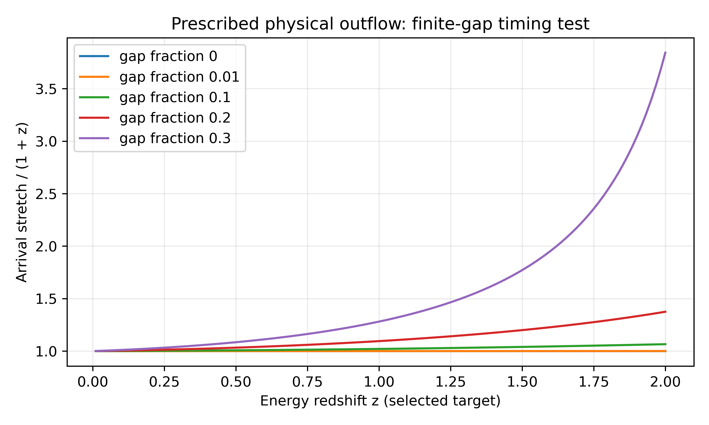

Across 24 cases the maximum absolute arrival discrepancy from quadrature was $1.35\times10^{-13}$ (normalized time, rounded upward). Maximum absolute derivative discrepancy was $5.51\times10^{-9}$. Nine regression tests check the massless limit, finite-gap stretch, target redshift, reach, flux scaling, Hamiltonian velocity and numerical arrival derivatives. The dataset and code are in the archive's outflow research folder and `tools/entrained_outflow_v1.py`.

The result connects a physical-flow ansatz to three observable channels in one calculation. It is not yet a calibrated universe: the matter force producing $H$, the regulator establishing $C$, gap and source standards, bath reciprocity, optical distortions and observed data likelihood remain open. The benchmark does not establish the smaller/closer inference sought by Foundation 12, nor solve the vector–bath problem. It defines a control a future dynamic theory should reproduce or explain why it changes.


# Part Seven — Causal Fields and Collective Interactions

## Chapter 30A. Could Other Bubble Universes Pull on Ours? A Quantitative ArcSecs Model

#### Research question and status

Imagine a greater physical cosmos in which many domains nucleate, grow, collide, and sometimes disappear. ArcSecs asks whether these domains are components of one larger causal system and whether their energy, gravity, boundary stresses or emitted fields affect the environment inside our domain. This is an important alternative to the claim that all observed cosmic behavior must be the motion of an abstract geometrical fabric. But drawing a boiling pot is not enough. We must specify the actual interacting entities, the direction of forces, the rate of propagation, and the observations created by those forces.

The proposal has two separate empirical questions. **Existence:** Is there any evidence of another bubble or an external parent medium? **Coupling:** If such a parent exists, can its properties influence our domain, rather than being permanently causally isolated? Present astronomy has not established either question. A real detection of one would be a major discovery; a non-detection restricts the mechanism's parameters without proving that all possible greater-cosmos models are impossible. Literature on eternal inflation and vacuum decay gives mathematically detailed examples, but those examples use relativistic field theory. We can learn their force accounting without adopting a literal fabric ontology. [S10] [S11] [S21] [S22]

#### 30A.1 What do we mean by a universe and a boundary?

There are at least four distinct objects called a universe in popular discussions. **The observable universe** is the region whose signals can reach an observer within the relevant history. **A physical domain** is a region with a particular field state or matter configuration. **A vacuum bubble** is a region whose local field vacuum differs from the exterior state, with a wall having measurable energy or tension if the model provides one. **The total or greater cosmos** is all physical reality, including any parent fields and additional domains. These objects are not interchangeable. The observed horizon need not be a membrane that could be pulled by a neighboring bubble.

Any claim that gravity pulls *our universe* outward must therefore identify the object being accelerated. Is it a domain wall $R(T)$, the distance between two galaxies $D_{ij}(T)$, a change in an internal matter distribution, or an apparent distance inferred from a photon? Each has a different equation and a different instrument test. We cannot infer the first from the fourth without additional derivation.

#### 30A.2 The simplest physical model: exterior pressure and wall tension

Consider a spherical interface of physical radius $R$, positive surface energy $\sigma$ per unit area, and a pressure difference $\Delta P=P_{\mathrm{in}}-P_{\mathrm{out}}$. The energy for a static, idealized, non-self-gravitating thin wall is

$$
U(R)=4\pi\sigma R^2-\frac{4\pi}{3}\Delta P\,R^3.
$$

The first term is the energetic cost of constructing a larger surface. The second expresses the work associated with changing the volume at fixed pressure difference. Differentiation gives the net generalized radial force

$$
F_R=-\frac{dU}{dR}=4\pi R^2\Delta P-8\pi\sigma R.
$$

Therefore an interface experiences an outward pressure contribution when $P_{\mathrm{in}}>P_{\mathrm{out}}$, while surface tension pulls it inward. The nonzero balance radius is

$$
R_{\mathrm{crit}}=\frac{2\sigma}{\Delta P}\quad(\Delta P>0).
$$

For this idealized energy function, $R_{\mathrm{crit}}$ is an **unstable threshold**, not a stable equilibrium: larger bubbles tend to grow and smaller ones tend to shrink. The model cannot automatically be applied to an actual cosmic boundary. At relativistic velocities or with strongly self-gravitating walls it must be replaced by a field-theoretic treatment. Coleman and De Luccia explicitly studied gravitational changes to vacuum decay. [S10]

The colloquial expression “negative outside pressure pulls the bubble bigger” has a precise mechanical meaning in this model. The effect is a **pressure difference across the interface**. It need not be gravitational attraction by another bubble. A constant negative pressure on the outside can make $\Delta P$ positive even if the inside pressure is zero. This is the most direct interpretation of Gott's boiling-bubbles illustration. [S21]

For a reproducible example use arbitrary, **dimensionless** parameters $\sigma=0.8$ and $\Delta P=1$. The critical radius is $1.6$. At $R=1$, the calculated generalized force is $-7.54$; at $R=1.6$ it is $0$; and at $R=2$ it is $+10.05$. The signs are derived from the toy energy, not measured cosmic forces. Changing $\sigma$ or $\Delta P$ changes the threshold immediately. The result helps separate a mechanism from a verbal picture; it does not claim a measured cosmic wall or its radius.

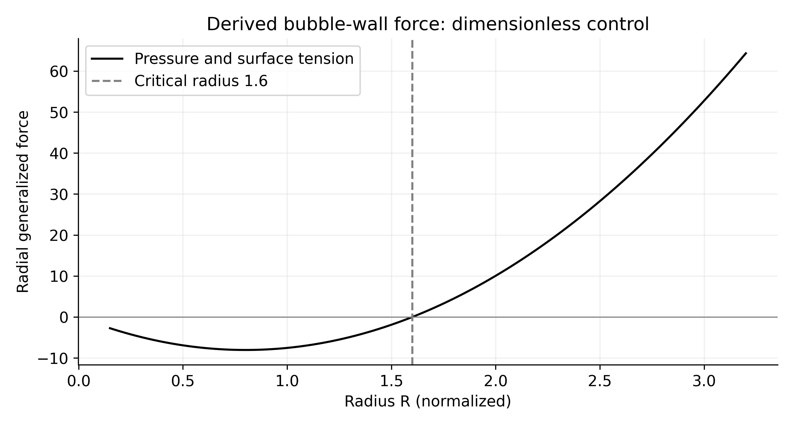{width=4.45in}

#### 30A.3 Does ordinary gravitational attraction outside a bubble pull it larger?

Not generally. This is where the physical model must become more precise, not less ambitious. In ordinary inverse-square gravitational mechanics, a perfectly spherical outer mass shell produces **zero net gravitational acceleration anywhere inside it**. Its gravitational potential is constant in the empty cavity. A symmetric distribution of other bubbles outside a domain therefore does not automatically stretch the interior apart or pull every wall element outward. [S23]

Now place one dense neighboring domain to the right. Its gravity attracts the near side and far side in nearly the same overall direction, but the near side more strongly. Relative to a freely falling interior reference point, this difference is a **tidal field**. Tides can elongate a body along one direction and compress it in others. In a vacuum inverse-square potential, the linear tidal tensor has zero trace:

$$
\mathsf T_{ij}=\partial_j g_i=-\partial_i\partial_j\Phi_{\mathrm{ext}},\qquad
\operatorname{tr}(\mathsf T)=-\nabla^2\Phi_{\mathrm{ext}}=0\quad\text{(source-free Newtonian region)}.
$$

Thus a distant neighbor cannot, merely through an ordinary vacuum tidal field, provide a first-order isotropic expansion that increases every internal separation at the same rate. Its simplest signature would instead be **direction-dependent distortions or streaming flows**. The local statement assumes a weak, nearly homogeneous tidal field; more complicated environments may have nonzero matter density or nonlinear effects. The same distinction matters in a physical-first ArcSecs interpretation: an exterior pull and an expanding boundary are separate mechanisms until the equations connect them.

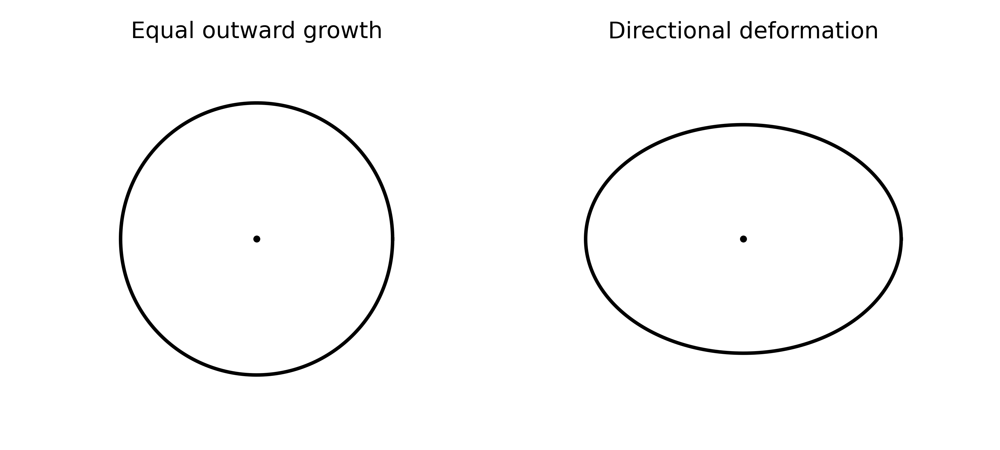{width=4.45in}

#### 30A.4 A distinct ArcSecs proposal: a finite-range physical coupling

To explore a genuine outward influence from exterior matter, we can posit a *new finite-range interaction* rather than simply re-label the inverse-square law. For example, let a physical source density $\rho_{\mathrm{ext}}(\mathbf x')$ create a scalar potential with strength $G_X$ and range $\lambda$:

$$
\Phi_X(\mathbf x)=-G_X\!\int\!d^3x'\,\rho_{\mathrm{ext}}(\mathbf x')
\frac{e^{-|\mathbf x-\mathbf x'|/\lambda}}{|\mathbf x-\mathbf x'|},
\qquad \mathbf a_X=-\nabla\Phi_X.
$$

The exponential factor represents **screening**. This is a candidate mathematical interaction, not a measured field and not proof that another universe exerts one. Its microscopic carrier, coupling to ordinary matter, conservation laws and experimental constraints all have to be specified.

For a uniform thin spherical shell of exterior source mass $M$ at radius $a$, the potential within the shell, at $0<r<a$, is

$$
\Phi_X(r)=-\frac{G_X M e^{-a/\lambda}}{a}
\frac{\sinh(r/\lambda)}{r/\lambda}.
$$

The shell's ordinary inverse-square field vanishes inside; this *screened* candidate does not generally vanish away from the center. Differentiating this formula gives a nonzero radial acceleration when $r>0$. Near the center,

$$
a_{X,r}\simeq\frac{G_X M e^{-a/\lambda}}{3a\lambda^2}\,r.
$$

The direction in this toy configuration is outward, toward the surrounding shell. This shows that an explicit mathematical coupling **could** alter the shell-theorem conclusion. It does not show such a force exists or that it could operate between causally separate universes. Its strength is restricted by laboratory gravity tests, orbital dynamics, lensing and cosmological observations. It also requires a common physical environment linking the shells and the test domain; without a causal carrier, the interaction cannot be asserted.

This is a useful ArcSecs research route: define $G_X$, $\lambda$, the carrier's energy and propagation speed, the boundary's source charge, and the predicted anisotropies. Derive a law. Do not build in the desired expansion by fiat. Test the same parameters in ordinary solar-system and laboratory environments before invoking them at interbubble distances.

#### 30A.5 Coupling a neighbor's field to the boundary's motion

A combined toy wall energy can include an externally sourced interaction energy $U_X(R,\mathcal E)$, where $\mathcal E$ denotes the full parent-environment state:

$$
U_{\mathrm{eff}}(R;\mathcal E)
=4\pi\sigma R^2-\frac{4\pi}{3}\Delta P R^3+U_X(R;\mathcal E).
$$

The generalized equation from a mechanical Lagrangian with effective radial inertia $M_{\mathrm{eff}}(R)>0$ is

$$
M_{\mathrm{eff}}(R)\ddot R+\tfrac12M'_{\mathrm{eff}}(R)\dot R^2
=-\frac{\partial U_{\mathrm{eff}}}{\partial R}.
$$

All derivatives are with respect to the project's universal progression parameter $T$. The interaction force is $-\partial_R U_X$. **This term is not zero merely because it was omitted from an earlier model, and it is not nonzero merely because we wish it to be.** It must be derived from the actual physical coupling and environmental distribution.

A neighboring bubble can modify $U_X$ in at least three conceptually distinct ways. Its **field energy** may change the local exterior pressure. Its **gravitational potential** may create an asymmetric tidal stress, exciting a nonspherical wall mode. An actual **collision** may transfer kinetic energy and produce field waves or matter shells. In none of these cases does the phrase “other universes pull ours” substitute for calculating $U_X$ or the stress tensor. That calculation is the explicit development target.

A convenient generalization beyond a perfect sphere is a radius $R(\theta,\phi,T)=R_0(T)+\sum_{\ell\ge1,m}u_{\ell m}(T)Y_{\ell m}(\theta,\phi)$. The mean radius $R_0$ carries the monopole; the perturbation sum starts at $\ell=1$ to avoid double counting. A quadrupole ($\ell=2$) represents directional distortion. Exterior tidal forces can excite quadrupole modes without automatically generating the monopole. The relative amplitudes become a sharp prediction of the proposed interaction, rather than an adjustable description after the data arrive.

#### 30A.6 Why 'external bubble pull' must remain causal

If two domains are *causally disconnected by definition*, no physical signal from one can be detected in the other without revising the causal structure of the theory. An interacting greater-cosmos hypothesis must therefore say where and how the interaction propagates. Is there a shared field in the parent domain? Does a collision generate radiation entering ours? Can the boundary transmit stress? What is the propagation speed and which conserved quantities cross the interface? These details make the hypothesis scientific.

ArcSecs need not start by presuming the light speed is the final limit for every possible mechanism. But an alleged faster interaction must be defined independently of ordinary galaxy separation rates, and a new local propagation result would have to survive timing constraints and conservation tests. At present, interbubble superluminal signals are not an established observation. Likewise, a “boiling pot” visual model does not by itself establish that a material container exists outside our observable sky.

#### 30A.7 From a growing wall to observations made inside our universe

The largest remaining missing derivation is the map from wall dynamics $R(T)$ to what our instruments actually record. If a wall grows, it does not follow automatically that two interior galaxies separate with $D_{ij}(T)\propto R(T)$, or that emitted light experiences a redshift. Those are different claims requiring an internal dynamics and radiative-transfer rule.

For the proposed ArcSecs engine, define an observable map

$$
\mathcal O =\mathcal M\big[X_{\mathrm{interior}}(T),R(T),\Phi_X(T),\mathcal C(T),
\text{emission},\text{propagation},\text{detector}\big].
$$

The map must calculate, without separate retuning, measured spectral shifts, galaxy angular separations, proper motions, CMB temperature and polarization structure, and any directional anisotropy. A change in photon energy cannot be relabeled as a change in photon speed; neither alone establishes a physical wall. This is the bridge between the ArcSecs principles about unknown cosmic size and allegedly closer/smaller distant objects, and an actual quantitative prediction.

Define the internal relational separation of two physical objects as $D_{ij}=|\mathbf x_i-\mathbf x_j|$ in a temporary coordinate representation, without treating coordinates as a material. Then specify the interaction-driven acceleration $d^2D_{ij}/dT^2$ from the common physical fields. A wall growth factor $A_R(T)=R(T)/R(T_0)$ is **not** identical to an astronomically measured scale factor until the relation to $D_{ij}$ and the photon transfer law have been derived. Avoid assigning every observed redshift to $\dot R$ simply because the bubble is growing.

#### 30A.8 What should we look for on the sky?

A coherent outside influence should produce **correlated, predictable signatures**, not isolated anecdotes. Five possible test families arise:

1. **Direction-dependent structure:** If an exterior neighbor produces a tidal field, predict a preferred axis in proper motion, peculiar velocity, or shear. Fit against foregrounds, survey geometry and local mass sources before attributing it to another bubble.
2. **CMB collision templates:** A causal bubble collision may produce approximately circular or azimuthally structured temperature/polarization patterns. The detection pipeline must be preregistered and penalize searches over many sky positions and angular sizes. The Feeney et al. WMAP analysis did not find evidence favoring a collision model. [S11] [S22]
3. **Correlated messenger effects:** A physical disturbance entering the domain might affect radiation, gravitational signals or particle distributions in a common directional or temporal way. Specify the relative delays and energy exchange from the actual interaction law.
4. **Boundary-mode predictions:** Calculate monopole and quadrupole amplitudes of $R(\theta,\phi,T)$ and map them to an internal observable rather than assuming we can photograph a cosmic wall.
5. **Geometric distance consistency:** Recalculate the sizes and distances inferred for selected galaxies using a single coupled transport/geometry model. Include spectroscopically confirmed galaxies and foreground brown-dwarf interlopers as separately classified source types.

No existing observational search has confirmed another interacting bubble universe. That is the challenge we are developing, not a reason to remove external environments from our equations.

#### 30A.9 Reproducible computational experiment

A first software experiment requires no fictional astronomical measurements. Implement the wall energy $U(R)$ and $F_R$ exactly as written. Numerically compare $F_R$ against $-dU/dR$, check $R_{\mathrm{crit}}$ and dimensional consistency, and integrate an explicitly stated effective radial inertia law. Next introduce $U_X(R)$ as a separate swappable module. One run uses $U_X=0$; a second uses an outward hypothetical term with fixed coefficient; a third calculates a tidal perturbation. Lock the parameters before comparing the trajectories.

The included `tools/bubble_force_toy.py` and `tests/test_bubble_force_toy.py` implement the mechanical force and the thin-shell screened-potential sanity check. Their purpose is to test **the equations**, not to announce a new physical discovery. Scientific numerical simulation still requires realistic energy scales, causal microphysics, local constraints, astronomical likelihoods and observational holdouts. A future version should implement $R_{\ell m}(T)$, variable pressure, a conserved parent energy budget, the coupling to interior galaxy dynamics, and map-level CMB predictions.

#### 30A.10 Falsification and decision record

**Pressure-only candidate:** Fails if the wall model requires an outward pressure difference not supplied by any identified physical source, or violates energy conservation. **Ordinary external gravity as uniform expansion:** Fails at the level of the shell theorem and first-order vacuum tidal trace unless a different stress, matter distribution or coupling is specified. **Screened exterior pull:** Fails if no allowed parameters remain after short-range gravity, orbital and cosmological constraints, or if it predicts directional effects not seen. **Collision imprint:** Fails in a specified amplitude/rate parameter range if preregistered CMB and other surveys exclude the predicted pattern. **Single causal mechanism:** Fails if an apparent improvement in one dataset requires incompatible propagation or coupling rules elsewhere.

The correct ArcSecs argument is **not** that other bubbles have already been measured pulling ours larger. It is that this physical possibility can be represented as a serious alternative with explicit state variables, force terms, numerical predictions and disconfirmation tests. It is also necessary to distinguish a model that merely repackages the same existing equations from a new interaction that makes a unique prediction. What earns the new mechanism attention is not its opposition to a literal fabric image, but its ability to predict a measurable result that alternatives miss.

#### 30A.11 Development priorities and open questions

**Priority one:** Derive $U_X$ from a parent-field action or another explicit physical interaction; specify the source of the surrounding negative pressure. **Priority two:** Find a causally allowed boundary-to-interior coupling that maps exterior stresses to galaxy motions or photon paths. **Priority three:** Calculate whether an expected exterior signal is monopolar, tidal, directional, transient or collision-like. **Priority four:** Test a single parameter set against laboratory gravity, planetary dynamics, CMB maps, galaxy surveys and gravitational-wave observations. **Priority five:** Report the residuals and the strongest excluded parameter ranges alongside any successful fit. This gives a receiving machine intelligence an executable research agenda and a genuine path toward evaluating the Greater Cosmos claim.

**Source anchors:** Gott [S21]; Coleman–De Luccia [S10]; Newton shell theorem [S23]; Feeney et al. [S11], [S22]; thin-wall collision dynamics [S24].

## Chapter 30B. Deriving a Causal External-Field Coupling: Beyond the Bubble Analogy

#### 30B.1 The problem this chapter solves

Chapter 30A distinguished a pressure-driven wall, ordinary exterior gravity, screened external fields and collision disturbances. The next step is not to repeat those possibilities. It is to specify **one candidate parent-field equation**, solve it under transparent assumptions, and calculate what an observer inside a domain would measure. This is the research direction that follows naturally from ArcSecs's physical-first worldview: hypothesize interacting physical entities, specify their coupling and then derive consequences rather than using the word *spacetime* as a causal explanation.

The following candidate is an original illustrative construction, not a discovered interuniverse force. Its field equation resembles a finite-range Klein–Gordon/Yukawa model, and its static shell solution matches the screened interaction in Chapter 30A. The model operates in a shared three-dimensional physical domain with a progression parameter $T$. It does **not** demonstrate that separate causally disconnected universes share this domain, that a cosmic horizon is a physical wall, or that one bubble has been seen pulling another. It does give us numbers, limiting behavior, a source-energy requirement and precise ways the proposal could fail.

#### 30B.2 Choose the interacting physical variables

Let $\Phi_X(\mathbf{x},T)$ have the units of gravitational potential (joules per kilogram), $G_X$ represent the strength of an additional coupling (SI units of Newton's $G$), $\lambda$ its characteristic interaction range, $v_X$ the propagation-front speed, and $\rho_X$ the source mass-density equivalent. Using a simple quadratic field description, choose the candidate field-plus-source Lagrangian density

$$
\mathcal L_X=\frac{1}{8\pi G_X}\left[
\frac{(\partial_T\Phi_X)^2}{v_X^2}-|\nabla\Phi_X|^2
-\frac{\Phi_X^2}{\lambda^2}\right]-\rho_X\Phi_X.
$$

This is a *trial interaction law*. It defines a real physical field hypothesis, with source-coupling energy and a dynamical degree of freedom rather than a free radial acceleration inserted after observations. Varying $\Phi_X$ gives

$$
\frac{1}{v_X^2}\partial_T^2\Phi_X-\nabla^2\Phi_X
+\frac{\Phi_X}{\lambda^2}=-4\pi G_X\rho_X.
$$

In a static configuration, the time derivative vanishes and the field obeys the screened Poisson equation

$$
(\nabla^2-\lambda^{-2})\Phi_X=4\pi G_X\rho_X.
$$

The time-dependent equation has finite signal-front speed $v_X$ within the classical model. Its static Yukawa solution describes a source that has persisted long enough for the field to form; it cannot be used to transmit sudden changes instantly across enormous distances. The massive-field retarded response also has a tail within the causal cone, so replacing the instantaneous source with a single naïvely delayed source term is not a complete derivation. Nothing in this model establishes $v_X>c$: any such choice would be an additional experimentally constrained hypothesis. [S26]

**Conservation requirement.** A Lagrangian without explicit dependence on $T$ permits a conserved total energy for the **closed field-plus-matter system** under suitable boundary conditions. Field energy contains positive quadratic gradient, range and time-derivative terms; source interaction energy must also be included. A force that accelerates a wall or galaxies draws energy from the external field or source. In a time-changing configuration the matter-only mechanical energy is generally **not** conserved. To assert a truly closed greater-cosmos model, we must specify the moving parent sources and their backreaction rather than keeping them fixed forever. Our present code only verifies particle energy conservation in a static external field, not the full backreacting cosmic problem.

#### 30B.3 An exterior shell produces an exact testable field

Take a spherical thin shell of ordinary-source equivalent mass $M_X$ at radius $a$. Here $a$ is the shell radius inside a shared hypothetical physical domain, **not** the observational radius of our universe. Treat the shell as stationary and its source distribution as known. For $0\le r<a$ the screened potential is

$$
\Phi_X(r)=-\frac{G_XM_X e^{-a/\lambda}}{a}
\frac{\sinh(r/\lambda)}{r/\lambda}.
$$

Writing $x=r/\lambda$, the radial acceleration on an interior test particle is the gradient of that field:

$$
 a_X(r)=-\frac{d\Phi_X}{dr}=
\frac{G_XM_Xe^{-a/\lambda}}{a\lambda}
\frac{x\cosh x-\sinh x}{x^2}.
$$

The field pulls outward, toward the surrounding shell, for $r>0$. At the center the acceleration vanishes by symmetry. The small-$r$ series is

$$
 a_X(r)=A_Xr+O(r^3),\qquad
 A_X=\frac{G_XM_Xe^{-a/\lambda}}{3a\lambda^2}.
$$

Here $A_X$ has units $\mathrm{s}^{-2}$. This is a concrete hypothesis for an *isotropic, outward relative acceleration* caused by an external source—not a verbal claim that an unspecified gravity stretches a nonphysical fabric. In the limit $\lambda\rightarrow\infty$, $a_X\rightarrow0$ inside the shell and the Newtonian shell theorem is recovered exactly. In the limit $M_X\rightarrow0$ or $G_X\rightarrow0$ the effect disappears. A supposed detection would require those differences, not simply a successful curve fit.

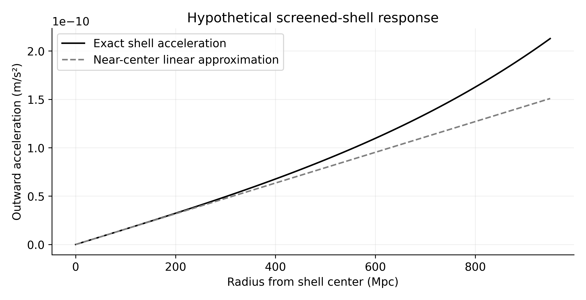{width=4.45in}

There is a further subtlety: the field gives this outward response **only if interior matter couples to it**. A hypothetical wall could respond while galaxies do not, or galaxies could couple while photons do not. The four possibilities must not be conflated. In a complete theory one must list each source charge, coupling constant and boundary condition, then identify a shared experimental observable.

#### 30B.4 How much exterior material would the effect require?

Let us calculate rather than assume. Define a reference slope $H_*=70\,\mathrm{km\,s^{-1}\,Mpc^{-1}}$ as a *numerical comparison scale*, **not** as proof that cosmic redshift is caused by expansion. Its SI value is approximately $2.269\times10^{-18}\,\mathrm{s^{-1}}$, giving $H_*^2=5.146\times10^{-36}\,\mathrm{s^{-2}}$. Set $A_X=H_*^2$. Solving the previous equation for shell mass yields

$$
M_X=\frac{3H_*^2a\lambda^2 e^{a/\lambda}}{G_X}.
$$

For an **illustrative**, hypothetical shell radius $a=1{,}000\,\mathrm{Mpc}$, interaction range $\lambda=500\,\mathrm{Mpc}$ and an assumed coupling strength $G_X=G_N$, the required shell mass is about $1.26\times10^{52}\,\mathrm{kg}$, or **$6.31\times10^{21}$ solar masses**. This is a demanding scale, not a measurement of mass outside our universe. The model predicts a relative acceleration near the shell center of approximately $1.59\times10^{-13}\,\mathrm{m\,s^{-2}}$ at 1 Mpc and $1.59\times10^{-11}\,\mathrm{m\,s^{-2}}$ at 100 Mpc. These numbers are generated by the assumed parameters; their agreement with a chosen reference slope is built into the normalization. The accompanying parameter-sweep file shows how dramatically the required source mass changes with $\lambda$. [S27]

The source might be much smaller if $G_X$ were stronger, but an interaction that couples to ordinary matter would face independent local and astrophysical constraints. Short-range inverse-square-law searches directly constrain certain Yukawa couplings; extrapolating those constraints to gigaparsec screening lengths requires a specified coupling sector and cosmological model, not an unqualified numerical bound. The Eöt-Wash group's published methodology provides one relevant laboratory benchmark. [S28]

#### 30B.5 Could this create an apparent distance–velocity relationship?

Near the center, the model yields $\ddot{\mathbf r}=A_X\mathbf r$ if the external field is the only acceleration included. For constant $A_X>0$ the one-dimensional solution is

$$
r(T)=r_0\cosh(\sqrt{A_X}\,T)+
\frac{v_0}{\sqrt{A_X}}\sinh(\sqrt{A_X}\,T).
$$

For objects starting at rest, $v(T)/r(T)=\sqrt{A_X}\tanh(\sqrt{A_X}T)$: separations and recession rates are proportional at a common elapsed time. This is a mathematical example of how a physical relative-acceleration law can yield a Hubble-like pattern **without postulating a literal stretching material**. It does not yet calculate electromagnetic redshift, galactic ages, supernova durations, the cosmic microwave background, or the full cosmic distance ladder. Thus it cannot be described as an observational replacement for standard cosmology. An ArcSecs photon transport model must be coupled independently and fitted using **one common parameter set**.

Moreover, a centered shell singles out a particular center. An observer away from that center may see a preferred direction and anisotropy; it is a possible way to disprove the setup. Treating this potential as just an adjustable universal acceleration term would remove its distinctive spatial prediction and fail the purpose of developing an independent mechanism.

#### 30B.6 Contrast ordinary neighboring-domain gravity with a screened shell

An isolated distant mass at distance $D$ creates an approximately uniform pull over a small observed region; the uniform acceleration can be removed by considering differential motion. Its leading Newtonian tidal tensor is

$$
\mathsf T_{ij}=\frac{GM}{D^3}(3n_i n_j-\delta_{ij}),
\qquad \operatorname{tr}\mathsf T=0.
$$

Along the direction to the neighbor, a separation is accelerated with coefficient $+2GM/D^3$; transversely, with $-GM/D^3$. This predicts **elongation along one axis and compression across two**—not first-order uniform growth in every direction. A real neighboring bubble could also affect the external pressure or generate a collision; those mechanisms need different source terms. [S23]

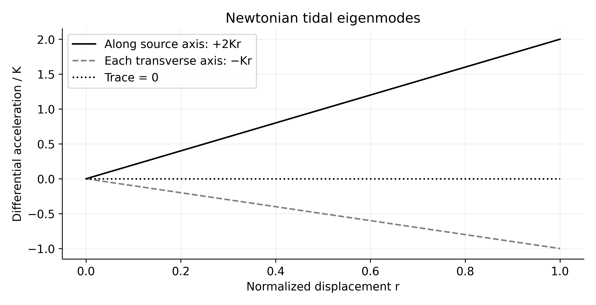{width=4.45in}

A screened shell, by contrast, has $\nabla^2\Phi_X=\lambda^{-2}\Phi_X$ in its otherwise empty interior, so its acceleration field has positive tidal trace $-\Phi_X/\lambda^2$ for $\Phi_X<0$. Relative acceleration is $\delta g_i=\mathsf T_{ij}\delta x_j$. This provides the mathematical reason screening permits a local isotropic trace, while the inverse-square vacuum tidal trace vanishes. The proposal is testable because it predicts a radius-dependent acceleration, a preferred center and a coupling-specific response.

#### 30B.7 Causality: a wall outside reach cannot announce a change instantly

The model must state a propagation speed $v_X$. If a new field disturbance is created a distance $d$ away, the earliest possible arrival in this classical model is $d/v_X$; it may be later. At $d=1\,\mathrm{Gpc}$ and $v_X=c$, that minimum is approximately **3.26 billion years**. A disturbance originating outside the relevant causal domain cannot produce a suddenly measured internal effect without changing the theory's propagation rules. A pre-existing, stationary field is a different claim from receiving a new message. Neither claim proves another universe exists.

The method deliberately avoids using an unspecified faster-than-light influence to solve every discrepancy: assigning a speed greater than $c$ requires a new dynamical hypothesis, a definition of signal fronts, and confrontation with timing data. ArcSecs is entitled to investigate alternative kinematics, but the experiment has to distinguish the proposed interaction from an arbitrary choice of coordinates.

#### 30B.8 Exact tests, negative controls, and the observable next step

The included `tools/external_coupling.py` implements the exact screened-shell potential, gradient, center expansion, inverse normalization, ordinary tidal tensor, signal-travel lower bound and static-field test-particle energy accounting. The companion `tests/test_external_coupling.py` checks ten independent properties. The physical parameters are **demonstration values**; no CMB or galaxy-survey fit has been performed.

| Candidate | Positive prediction to derive | Negative control | Meaningful rejection condition |
|---|---|---|---|
| Uniform exterior wall pressure | Predicted spherical wall acceleration and energy transfer | Reverse the pressure sign and remove wall tension | Predicted growth incompatible with measured boundary or conservation; if no boundary observable exists, mark untested |
| Ordinary neighbor gravity | Directional shear and tidal alignment | Isotropic-shell Newtonian interior produces no force | Measured signal has incompatible angular form after known local foregrounds are modeled |
| Screened surrounding source | Outward radial acceleration with center and range dependence | $G_X=0$, $M_X=0$, or $\lambda\to\infty$ removes cavity force | No parameter choice survives local gravity, galaxy flow, CMB isotropy and full cosmological constraints |
| Causal source disturbance | Delayed and correlated field response after a source event | Randomized directions and uncorrelated epochs | Observed effect precedes permitted field-front arrival or fails blind holdouts |
| Bubble collision | Joint temperature/polarization or matter signature with common location | Null sky simulations and foreground templates | Trials-corrected search excludes the claimed amplitude and frequency parameter range |

The reference astronomical inputs for a future likelihood are Planck's publicly released sky maps, the DESI DR2 baryon acoustic oscillation measurements, independent geometric distances and peculiar velocities, and appropriately masked lensing and large-scale-structure data. These sources do **not** directly measure a bubble wall or an outer-universe field. Their role is to limit or potentially uncover effects produced by the proposed mechanism. The WMAP bubble-collision analysis by Feeney and colleagues found no evidence requiring an added collision population, so any new detection algorithm needs realistic trials corrections and independent replication. [S11] [S22] [S29]

#### 30B.9 What would make this an ArcSecs scientific result?

**First, a unique source:** Identify the parent medium or neighboring bubble's physical source charge and boundary conditions, rather than selecting $M_X$ solely to imitate a desired acceleration scale. **Second, a coupled theory:** Include wall motion, field dynamics, matter acceleration, photon transport and total source+field energy under one initial-value specification. **Third, an observational discriminator:** Predeclare a radius, axis, frequency or time-dependence pattern before analyzing survey data. **Fourth, blind validation:** Fit the model against a defined calibration subset and require the same parameters to predict an independent set of observations. **Fifth, a publication-quality result:** Archive code, data hashes, SI units, covariance treatment, alternate models, unsuccessful trials, source citations and peer-review objections. A positive result would be a reproducible observation incompatible with competing forecasts—not the existence of an attractive explanatory diagram.

**Current finding:** We derived and numerically checked one internally specified, causal, finite-range candidate whose **static** shell can generate an outward force inside its cavity. No evidence yet identifies its cosmic source, carrier, coupling to photons, or effects on real galaxies. The wider ArcSecs thesis can use this as a worked mechanism and an experimentally falsifiable research program without treating it as a verified external-bubble detection. [S26] [S28]

## Chapter 30C. One State, Five Mechanisms: The Executable ArcSecs Reference Model

### 30C.1 From twelve commitments to one research object

A worldview becomes predictive only when independent observers can compute the same outputs from the same inputs. ArcSecs therefore needs a single **state vector** that contains the interacting physical entities, their motion, their clock-process counts, their photons and energy receivers, and the possible external environment. No physical substance called *space* or *time* is inserted as an object. The symbols for position and succession are coordinates used to record events. The proposed universal parameter $T$ serves as a consistent ordering variable in this research representation; a preferred global clock has not been detected.

The central model-development question is not whether one can display each of our twelve commitments on a page. It is whether **the same source interactions** can predict matter motion, photon propagation, clock readings, bubble-boundary dynamics, and measurable astronomy without arbitrary per-experiment fixes. This chapter introduces a testable common state and an executable but deliberately incomplete implementation, called **UPM-0** (Unified Physical Model, version zero). UPM-0 is a technical foundation, not an established alternative cosmology.

The state at a given research parameter $T$ is

$$
\mathcal S(T)=\{r_i,v_i,m_i,N_a,E_\gamma,p_\gamma,U_{\mathrm{sink}},P_{\mathrm{sink}},R,\dot R,\Phi_X,\rho_X,\ldots\}.
$$

The labels $r_i$ describe where test objects are relative to a specified source, $N_a$ counts a physical clock's cycles, $E_\gamma$ and $p_\gamma$ describe a selected light packet, $U_{\mathrm{sink}}$ and $P_{\mathrm{sink}}$ are bookkeeping for the energy and momentum it transfers, and $R$ describes a hypothetical bubble wall rather than the horizon of the observable sky. Physical mass, momentum and energy are separate state properties. No observation has established that our universe possesses such a wall or a neighboring bubble source.

A **single source field** is used to test whether one assumed interaction can reach more than one sector. For now it is a finite-range field $\Phi_X$ generated by an idealized static surrounding shell, not a discovered force. The coefficient values controlling its effects on clocks and photons remain independent adjustable hypotheses. Shared input is therefore *not yet* a first-principles unified interaction.

### 30C.2 The shared exterior source and matter motion

Chapter 30B introduced a spherical shell of radius $a$ and source mass $M_X$, with range $\lambda$ and coupling $G_X$. For a point a distance $r<a$ from its center, the assumed source potential is

$$
\Phi_X(r)=-\frac{G_X M_X}{a}e^{-a/\lambda}\frac{\sinh(r/\lambda)}{r/\lambda},
$$

with the regular limit $\sinh(x)/x\to1$ at the center. Its force per unit test mass is $a_X(r)=-\partial_r\Phi_X(r)$. Under this screened interaction the symmetric shell can produce an outward radial response. In the unscreened inverse-square limit, the interior gradient vanishes. A directional neighboring domain instead produces a tidal tensor with positive and negative eigenvalues rather than a universal outward pull.

A minimal radial test-body model is

$$
\frac{dr}{dT}=v,\qquad m\frac{dv}{dT}=-m\partial_r\Phi_X(r).
$$

For a *fixed* source, the mechanical quantity $\tfrac12mv^2+m\Phi_X(r)$ is constant in the absence of other interactions. For a moving source, this energy expression is not complete: the model would also need the source, propagating field, and backreaction energies. That extension is still open. The external field is not presumed to cause the observed redshift–distance relationship or to accelerate every galaxy merely because it acts on a test particle.

### 30C.3 Constant $T$ and physical process counts

Our declared foundation is *time is the when*. In UPM-0 an idealized count-generating process $a$ has a physical frequency $f_a$, and its reading is the number of accumulated events:

$$
N_a(T_2)-N_a(T_1)=\int_{T_1}^{T_2}f_a(T)\,dT.
$$

To create a measurable candidate rather than merely a slogan, choose a process-rate hypothesis relative to a designated reference configuration:

$$
f_a=f_{a,0}\left[1+\alpha_a\frac{\Phi_X(r)-\Phi_X(0)}{c^2}
-\beta_a\frac{v^2}{2c^2}\right].
$$

The coefficients $\alpha_a$ and $\beta_a$ must be specified, not tuned separately for each clock after seeing the data. They express possible couplings of a physical process to the field and motion. This formula is only a first-order weak-effect test function; it is **not** a proven causal explanation of the gravitational and kinematic clock measurements. If all kinds of process respond through the same universal factor, the resulting measurements may be observationally indistinguishable from conventional proper-time predictions. A genuinely new physical mechanism requires an independent distinction, for example a preregistered difference between nuclear and optical clock sectors that survives calibration controls. The reader should not interpret a change in $N_a$ as a detected material stretching of time.

### 30C.4 The photon as a physical messenger with a measurable ledger

Photons carry energy and momentum. ArcSecs investigates their intrinsic mass and any physical change to their propagation. Those questions require two **separate** equations. Under a hypothetical free Proca rest mass $m_\gamma$, group velocity obeys the dispersion relation

$$
E_\gamma^2=p_\gamma^2c^2+m_\gamma^2c^4,\qquad
v_g=c\sqrt{1-\left(\frac{m_\gamma c^2}{E_\gamma}\right)^2}.
$$

No positive $m_\gamma$ has been detected. Nonzero $E_\gamma/c^2$ is an energy-equivalent mass contribution regardless of that rest-mass question. The formula implies $v_g<c$ **only under its assumed massive-photon dispersion law**, not as a consequence of gravitational bending alone. [S01]

For a separately hypothesized continuous energy-transfer mechanism, begin with the transport law

$$
\frac{dE_\gamma}{d\ell}=-\kappa(\Phi_X,E_\gamma,\rho_X)E_\gamma,
\qquad
\frac{dU_{\mathrm{sink}}}{dT}=\kappa E_\gamma v_g.
$$

This fixes how the *bookkeeping* variable $U_{\mathrm{sink}}$ responds: energy lost by the photon is added to the receiver. For collinear transport, a corresponding sink momentum can be defined by $dP_{\mathrm{sink}}=-dp_\gamma$; for a free massive-particle dispersion the derivative $dE/dp=v_g$ determines the conversion. The receiving material, microscopic cross section, polarization effects and its eventual radiation are **not yet identified**. Bookkeeping is necessary, but cannot itself prove the physical sink exists. A complete tired-light account must additionally predict source-independent timing, supernova durations, image sharpness, spectral-line integrity, background radiation and redshift-independent distances. [S02] [S14]

One possible shared-field parameterization is

$$\kappa(\Phi_X)=\kappa_0\exp[\eta_\gamma(\Phi_X-\Phi_X(0))/c^2]$$

Here $\kappa_0$ has units of inverse length; $\eta_\gamma$ is dimensionless. Both are hypotheses. This does not derive the source interaction, and its positive coefficient does not demonstrate that cosmological photons actually lose energy. In a genuinely static free Proca theory, a mass term alone provides no such energy-loss channel. This is a key model boundary to preserve.

### 30C.5 A bubble boundary can grow without carrying galaxies with it

For a hypothetical interface with radius $R$, tension $\sigma$, pressure difference $\Delta P=P_{\mathrm{in}}-P_{\mathrm{out}}$, and fixed effective wall mass $M_w$, define the toy potential

$$
U_w(R)=4\pi\sigma R^2-\frac{4\pi}{3}\Delta P R^3+M_w\Phi_X(R).
$$

Then

$$
M_w\frac{d^2R}{dT^2}=4\pi R^2\Delta P-8\pi\sigma R+M_w a_X(R).
$$

When $G_X=0$, this is the ordinary pressure–tension bubble force, not external gravitational pull. When $\Delta P=\sigma=0$, the chosen extra field drives the interface. These are **different mechanisms** with different signs and independent energy budgets. The current model assumes fixed shell source, wall mass and pressure, and does not yet solve the full stress-energy transport of a moving cosmological field.

Most importantly, this wall equation does **not** determine how the separation of two galaxies changes inside it. A separate interior force and boundary-coupling law must be derived. The same warning applies to photon redshift: a growing wall does not automatically shift a distant spectrum. This is the mathematical connection that the next ArcSecs model must complete rather than insert by analogy.

### 30C.6 A conservation-and-limits checklist for every proposed model

UPM-0 combines source-driven particle motion, physical clock-process counts, imposed photon transport with a loss receiver, and a shell boundary. Its narrow static-source conservation ledger is

$$
E_{\mathrm{ledger}}=\tfrac12mv^2+m\Phi_X(r)
+\tfrac12M_w\dot R^2+U_w(R)
+E_\gamma+U_{\mathrm{sink}}.
$$

In the present fixed-source idealization the particle/wall mechanical terms are approximately conserved under numerical integration, and photon-plus-sink energy is exactly transferred by construction. This does **not** establish conservation for a dynamic parent cosmos, and it does not show that the sink and wall are real. No independent cosmological observation was fitted. The receiving source, optical transport and walls remain hypothetical.

The implementation must survive five independent controls: (i) $G_X\to0$ removes extra shell acceleration; (ii) $\lambda\to\infty$ removes a symmetric shell's interior force; (iii) $\kappa_0=0$ eliminates imposed photon energy loss; (iv) $m_\gamma=0$ recovers free massless electromagnetic dispersion; (v) $\Delta P=\sigma=0$ isolates the wall's assumed external-field contribution. Failing a control means the model or code is inconsistent **before** astronomy is involved.

### 30C.7 An executable prototype, not a claim that nature selected its parameters

The accompanying portable source is `tools/unified_reference.py`, checked by `tests/test_unified_reference.py`. Its reference state is advanced through a constant-step $T$ loop using a leapfrog integrator for matter and the wall and an exact exponential update for the photon-and-receiver **energy bookkeeping**. It records clock cycles, position, velocity, wall radius, photon energy, sink energy and momentum, and the time parameter separately. The code is standard-library Python; it requires no private service or network access.

**Reproduction:** From the package root, execute `python tools/unified_reference.py`, followed by `python -m unittest discover -s tests -v`. The output labels itself *synthetic demonstration*. External-source parameters are illustrative, not measured bubble-universe quantities. The photon update is a one-cell local approximation, not a full spatial radiation solver. It omits ray bending, optical polarization, scattered photons, field backreaction, receiver microphysics, and complete dynamical cosmic history. These omissions are documented so a new AI does not mistake the program for a validated universe simulator.

One can reproduce the test with this minimal algorithm even when the full code is not available:

```text
Load the same external-source configuration for all subsystems.
At each universal ordering step dT:
  evaluate the exterior source potential and radial gradient
  advance matter and wall momenta with their respective forces
  advance their positions and finish the second force update
  count physical oscillator cycles from the clock-rate hypothesis
  determine photon group speed from the selected dispersion law
  calculate local path increment and imposed photon energy transfer
  credit lost energy and momentum to explicit receiver ledgers
  record total static-source bookkeeping energy and zero-coupling tests
Never interpret this result as an observed cosmos without data fitting.
```

For genuine science, the next version needs a causal moving-source field solver, a physical absorption/emission operator, a collision term, and covariance-aware fits to **independent** observations. A nonzero photon mass should be inferred only from a positive discriminating measurement; a clock model should be judged on process counts; and an exterior bubble hypothesis needs a signal not reproducible through ordinary instrumental or astrophysical backgrounds. These are the shared gates through which our twelve foundations must pass to become a predictive scientific system.

### 30C.8 Publication and data requirements for a unified alternative

Every proposed equation needs a dated source or an explicit tag *ArcSecs hypothesis*. An article-format submission needs an abstract, novelty statement, full governing law or action, calibrated units, numerical algorithms, data sources, a declared selection function, testable quantitative differences from existing models, a likelihood/covariance procedure, robustness checks, independent holdouts, limitations, and code availability. **None of these can be supplied by changing an argument's tone.** The book's physical-first advocacy is strongest when the reader can execute the derivation and recover a result without appealing to the authority of its author.

The 24-report library remains a detailed companion: R01–R09 are the independent full-depth investigations; R10–R24 are recovered annotated studies with full technical sources but unfinished scientific line edits. This chapter is an integrating specification and research plan, **not** a substitute for that corpus or evidence that its proposals have been confirmed.

## Chapter 30D. The R41 Attractive-Field Test: Can an Exterior Physical Source Pull on Us?

### 30D.1 The missing sign of the force

R39 explored reciprocal momentum transfer between a photon and a massive source. R40 provided a finite-speed messenger with launch recoil and delayed receiver impact. It also exposed a crucial sign problem: a messenger arriving **from the outside** delivers momentum **away from its emitter**, not an attractive pull toward that emitter. Neither the passage of a message nor the presence of an outside bubble automatically implies gravitational attraction. R41 investigates a different physical model: a **source-coupled field with a defined attractive sign, a finite propagation parameter, and a complete energy and momentum ledger**.

This is an ArcSecs research hypothesis, not a claim that an outside universe or scalar mediator has been observed. It retains constant universal progression $T$ as **when** physical events occur; position $x$ tells us **where** bodies and interactions are located. Neither time, space nor spacetime is assigned mass, pressure, elasticity, stored energy, or an independent force. The proposed *physical field state* is distinct from its coordinate description.

### 30D.2 A single closed energy description

Take source and receiver particles of inertial mass $m_i$, momentum $p_i$, location $x_i$, and proposed physical scalar charge $q_i$. Let the intermediary field be $\phi(x,T)$ with evolution momentum $\pi=\partial_T\phi$. Its propagation parameter is $u$ and its screening coefficient is $\mu$. We start with a one-dimensional closed periodic test domain **only for numerical tractability**, not because our universe is a ring.

The shared total energy is

$$
H=\sum_i\frac{p_i^2}{2m_i}+\frac12\int dx\,[\pi^2+u^2(\partial_x\phi)^2+\mu^2\phi^2]-\int dx\,\rho(x,T)\phi(x,T).
$$

The source density $\rho$ is the sum of localized particle charges smoothed by a narrow physical-profile kernel. The field has positive free-field kinetic, gradient, and screening energy; the particle-field *interaction* term may be negative. Neglecting that term would misreport the conservation result. A stationary source generates a field whose amplitude is greatest near that source. With the coupling convention written above, equal-sign charges attract; opposite signs repel. This sign follows from the **chosen interaction**, not from a direct detection of a gravitational scalar.

The field and particle equations obtained from the same energy functional are

$$
\partial_T\phi=\pi,\qquad \partial_T\pi=u^2\partial_x^2\phi-\mu^2\phi+\rho,
$$

$$
\frac{dx_i}{dT}=\frac{p_i}{m_i},\qquad
\frac{dp_i}{dT}=q_i\int dx\,G_\sigma(x-x_i)\,\partial_x\phi(x,T).
$$

Here $G_\sigma$ is the smoothing kernel. A small field change can travel through the candidate mediator; a receiver's acceleration changes only after the source-dependent field has influenced its location. In contrast to R39's static instantaneous potential, the model carries field *state and evolution*. In contrast to R40's purely mechanical incoming messenger, the source–field coupling can generate a *pull*.

### 30D.3 Conservation belongs to the complete physical system

The total physical momentum is the sum of the source/receiver particle momenta and the proposed field momentum:

$$
P_{\mathrm{total}}=\sum_i p_i-\int dx\,\pi\,\partial_x\phi.
$$

For the exact continuous equations, the shared source kernel and translation symmetry imply conservation of $P_{\mathrm{total}}$. Energy conservation applies to the *entire* Hamiltonian in a closed domain. The current numerical algorithm uses a symmetric, second-order time integrator and therefore has a **small finite-step energy error**, not perfect real-number energy preservation. In the baseline model this error decreases approximately fourfold when the time step is halved. The total momentum residual stays close to numerical round-off. These are mathematical and software checks, not confirmations of a universal law of gravitation.

If an actual cosmic boundary were included, field energy flux through that boundary and wall energy would also have to enter the ledger. A fixed external source would represent an *open subsystem*, not a free energy supply. An additional neighboring cosmic domain would have to exchange energy and momentum with ours through a physical coupling—not through a magical change in the definition of $T$.

### 30D.4 The delayed exterior pull in the test

Place the receiver at a reference position of zero and a hypothetical exterior-domain emitter twelve synthetic length units to its right. Set the speed parameter to two synthetic length units per progression unit and begin with an initially quiet field. The model therefore has a nominal travel-time scale of six progression units. The receiver shows negligible interaction early on and begins to accelerate toward the outside source near the expected arrival window.

{width=4.7in}

At synthetic progression time 6 the computed force is about $+0.0626$ in arbitrary model units; at time 7 it is about $+0.1168$. The interior body's momentum increases toward the right-hand source, and the right-hand source recoils toward the left. The combined field plus particle momentum stays nearly constant. Moving the exterior source to the other side reverses the sign of the attraction; reversing the test charge reverses the force into repulsion. Two equally coupled sources placed symmetrically about an exactly central receiver cancel its net force. Every result is recorded in the standalone `attractive-field-events.csv` companion, where it is explicitly labeled **synthetic**.

The smooth Gaussian source approximation has mathematically nonzero tails. Therefore a tiny early numerical response does not establish a perfectly sharp causal front. A stronger future implementation must use local conservation fluxes and compact-support deposition to verify the exact front limit. The model also has a periodic computational boundary, so it cannot be read as a literal model of a cosmic wall.

### 30D.5 A neighboring bubble's influence is not one phenomenon

An isolated outside attractor usually gives a **directional** pull and differences in acceleration across interior bodies. A uniform component can move an entire physical domain without changing its internal separations. Its *tidal gradient* is what affects relative positions. A nearly symmetric set of sources can cancel at its center. A surrounding **finite-range** source distribution may instead generate a radial relative acceleration at off-center positions, as the static shell calculation in Chapter 30B proposes. A wall under pressure, a moving external field source, and a collision boundary are still distinct physical mechanisms with distinct conservation laws.

The current one-dimensional R41 test supports only this narrow statement: *an internally consistent source-coupled field can transmit a delayed attractive influence from a candidate source labeled outside a domain.* It does not demonstrate the three-dimensional shell law, cosmic acceleration, galaxy redshifts, black-hole capture, or any actual neighboring universe. A correct next step is to derive the exterior source's three-dimensional stress and field momentum, then compute measurable **differences between interior objects** and compare them with astronomical anisotropy controls.

This distinction matters for ArcSecs Principle 9. Physical objects can change their relative separation; nothing in this model stretches literal space or time. However, a simulated acceleration of physical bodies is not by itself a discovery of faster-than-light causal signaling. The field speed $u$ is a hypothesis input, and it must eventually be independently constrained by source and receiver timing experiments.

### 30D.6 The observations R41 has not yet explained

The Cassini radio-link experiment reported a tightly constrained signal associated with passage near the Sun; it did not directly image a field carrier. The MICROSCOPE spacecraft found no detected difference between the accelerations of its tested materials at very high precision. Laboratory inverse-square-law tests constrain some additional attractive forces at short range. GW170817 and its accompanying gamma-ray burst supply a powerful two-channel arrival-time observation, with source emission-time uncertainty in the propagation inference. Those results are operational benchmarks to reproduce, not permission to invent either a new scalar or a physical spacetime material. [R41-1] [R41-2] [R41-3] [R41-4]

The R41 candidate has **not** yet derived a coupling to light's physical wave-packet energy, so it does not derive the observed solar deflection angle. It has no atomic or nuclear oscillator model, so it cannot yet calculate observed clock-frequency differences. It does not derive an intrinsic nonzero photon rest mass, tired-light propagation law, or source-independent cosmic distance inference. Adding arbitrary coefficients solely to reproduce those observations would create a fitted numerical description, not the microscopic physical explanation being sought.

### 30D.7 Reproducible research and the next falsifiable step

The full R41 report belongs in the **uncondensed technical companion** at `docs/long-term-memory/reports/R41.md`. Its formal mathematics are separate in `docs/long-term-memory/research/attractive-field-methods.md` so the manuscript remains simple to export. The proposed measured-versus-interpreted evidence ledger is `docs/long-term-memory/research/attractive-field-ledger.md`. Reproduction requires `tools/attractive_field_v1.py`, `tests/test_attractive_field_v1.py`, Python and NumPy. The archive contains its numerical trace and a plotted figure. These paths are root-relative within the complete ArcSecs handoff; the standalone PDF does not contain executable code.

The R42 acceptance test should demand (1) a genuinely three-dimensional attractive source law with a field stress tensor or equivalent flux rule; (2) moving external matter and explicit boundary-energy exchange; (3) a photon momentum and energy coupling derived from the same source rule; (4) zero-force, force-sign, causal timing and convergence tests; (5) independent laboratory and astronomy measurements compared with parameters selected *before* viewing held-out results; and (6) an honest statement if the predicted effect is excluded. Conventional calculations may serve as numeric reference benchmarks, but a material spacetime substrate is not installed as the proposed ArcSecs physical mechanism.

**Chapter 30D source anchors:** [R41-1] Bertotti, Iess and Tortora (2003), https://doi.org/10.1038/nature01997; [R41-2] MICROSCOPE Collaboration (2022), https://doi.org/10.1103/PhysRevLett.129.121102; [R41-3] short-range inverse-square-law tests, https://doi.org/10.1103/PhysRevLett.124.051301; [R41-4] Abbott et al. (2017), https://doi.org/10.3847/2041-8213/aa920c; [R41-5] Zhang et al. (2024), https://doi.org/10.1140/epjc/s10052-024-12723-8. These support the measurement constraints and related theoretical background, **not a detection** of R41's proposed field.

---

# Part Eight — Screening, Matter and Charged Emission

## Chapter 30E. Light Slowing as a Field Interaction: The Screened Common-Field Trial and Its Limits

**Technical integration, 23 November 2026 — evidence status: ArcSecs premises (AP); derived equations conditional on an explicitly stated action (DC); measured instrumental constraints (OM); candidate screening, photon mass, and cosmological applications (PH).** This chapter consolidates the newly supplied *Integrated ArcSecs Physical-First Scientific Paper* (44 pages) and *Deriving the Screened Common-Field Model* (Part IX, Candidate A-05c). It keeps all twelve project foundations intact and treats an unsuccessful implementation as a result about *that implementation*, not a referendum on the charter.

### 30E.1. The physical question, without a rubber-sheet metaphor

If the physical speed and energy of radiation change during travel, the question is not whether an abstract coordinate fabric expanded or contracted. The question is **which physical quantity changed; what exchanged energy and momentum; how did the source's atomic line, the signal's wavevector, and the receiver's reference oscillator each respond; and what independently measured record discriminates this mechanism from standard cosmology?** The answer requires more than a redshift formula. A common field must account for laboratory frequencies, distant line ratios, signal durations, lensing, and gravitational-wave arrival times using the *same* couplings.

For concreteness let $T$ label universal event progression, and let $\psi(T,\mathbf{x})$ be a dimensionless, energy-bearing scalar state. A written coordinate is not the field; $\psi$ is proposed as a physical degree of freedom with energy, gradients and response to electromagnetic radiation. The local rest frame of the response is an **assumption** of this effective model, not a detected universal frame. The model does not claim to have measured a slowing of vacuum light.

### 30E.2. Start from a defensible electric-and-magnetic action

For the massless, gauge-invariant electromagnetic branch, the effective Lagrangian in a preferred physical frame is

$$
\mathcal L = \frac{\epsilon(\psi)}{2}|\mathbf E|^2-\frac{1}{2\mu(\psi)}|\mathbf B|^2
+\frac{\chi}{2}\big[(\partial_T\psi)^2-w_\psi^2|\nabla\psi|^2\big]-U(\psi,\rho)+\mathcal L_{\mathrm{matter}},
\tag{E1}
$$

where $\epsilon=\epsilon_*e^{a\psi}$, $\mu=\mu_*e^{b\psi}$, $\chi>0$, $w_\psi>0$, and $\epsilon_*,\mu_*>0$. The electromagnetic potentials define $\mathbf E=-\nabla\phi-\partial_T\mathbf A$ and $\mathbf B=\nabla\times\mathbf A$. This is the **electric/magnetic split** used in the integrated scientific paper, not the distinct, internally inconsistent $\epsilon\mu F_{\mu\nu}F^{\mu\nu}$ ansatz in the newer screened report. The latter multiplies the electric and magnetic terms together and does *not*, on its own, produce two independently specified $\epsilon$ and $\mu$ responses or the claimed $1/\sqrt{\epsilon\mu}$ signal speed. That limitation matters: an apparent no-go theorem cannot be considered a theorem of the written action if its purported dispersion relation is not derived from it.

For a locally homogeneous, slowly changing field, Maxwell's equations derived from (E1) give

$$
\omega^2=\frac{k^2}{\epsilon(\psi)\mu(\psi)},\qquad
v_\gamma(\psi)=\frac{1}{\sqrt{\epsilon\mu}}=v_*e^{-g\psi},\quad g=\frac{a+b}{2}.
\tag{E2}
$$

A positive change $g\,\Delta\psi>0$ slows the high-frequency, nondispersive wave **in this candidate**. The impedance is $Z=\sqrt{\mu/\epsilon}=Z_*e^{(b-a)\psi/2}$. Thus $a=b$ is impedance matching, but **does not imply a constant speed**; instead $v_\gamma=v_*e^{-a\psi}$. A zero speed drift requires $a+b=0$ (or constant $\psi$). The two conditions answer different physical questions.

The scalar field equation is

$$
\chi(\partial_T^2\psi-w_\psi^2\nabla^2\psi)+\frac{\partial U}{\partial\psi}
=\frac{\epsilon'(\psi)}2|\mathbf E|^2+\frac{\mu'(\psi)}{2\mu(\psi)^2}|\mathbf B|^2
+J_{\psi,\mathrm{matter}}.
\tag{E3}
$$

Here $J_{\psi,\mathrm{matter}}$ represents matter-sourced terms when these are not already included in $U$. Crucially, $\mathbf E^2-\mathbf B^2$ is **not** the same as positive electromagnetic energy density $\tfrac12(\epsilon E^2+B^2/\mu)$. A term proportional to $F_{\mu\nu}F^{\mu\nu}$ cannot simply be renamed an energy-density source; this algebraic error appears in the A-05c report and must not be carried into the book's derived results.

### 30E.3. Where the radiation's energy goes

For source-free electromagnetic propagation, define $u_{\mathrm{EM}}=\frac12\epsilon E^2+\frac{B^2}{2\mu}$ and $\mathbf S=\mathbf E\times\mathbf B/\mu$. The field equations give the exact local accounting identity

$$
\partial_Tu_{\mathrm{EM}}+\nabla\!\cdot\mathbf S=-Q,\qquad
Q=\frac12\dot\epsilon E^2+\frac12\dot\mu\left(\frac{B}{\mu}\right)^2.
\tag{E4}
$$

For $U=U(\psi)$ with no external time-dependent matter parameters, the scalar field gains the opposite amount: $\partial_Tu_\psi+\nabla\cdot\mathbf J_\psi=+Q$. Hence $\partial_T(u_{\mathrm{EM}}+u_\psi)+\nabla\cdot(\mathbf S+\mathbf J_\psi)=0$. This demonstrates an **internally conserved mechanism in the specified toy effective action**, not an observed intergalactic reservoir. It improves substantially on an assigned photon-energy-decay law with no recipient.

A density-screened extension can use $U(\psi,\rho)=\frac12(m^2+g_\rho\rho)\psi^2-f\psi$, with a *different symbol* $g_\rho$ for the density coupling than the propagation coefficient $g=(a+b)/2$. For prescribed constant $\rho$, its stationary minimum is $\psi_*(\rho)=f/(m^2+g_\rho\rho)$, provided the denominator is positive. When $\rho$ changes with $T$, **the field-only energy is not closed**: $\partial_TU|_\psi=(g_\rho/2)\psi^2\dot\rho$ transfers energy to or from the matter dynamics and must be included in a total matter-plus-field ledger. A static-screening calculation is not a self-consistent cosmology of moving matter. Likewise, adding photon invariant rest mass through a simple Proca term changes the theory's gauge structure and dispersion; a gauge-invariant completion would require an additional construction, such as a Stueckelberg field. We keep the massless action (E1) and massive-photon investigations as **distinct branches**.

### 30E.4. The received spectrum depends on the emitter as well as transport

In a spatially homogeneous adiabatic background, the wavevector $k$ is constant while $\omega=v_\gamma k$ changes. An emitted atomic line need not have the same frequency in the past as an identical atom today. Under the **explicit restricted assumptions** of fixed electron mass, charge and $\hbar$, and leading Coulomb-bound electronic transitions,

$$
\nu_{\mathrm{atom}}(\psi)\propto\epsilon(\psi)^{-2}=e^{-2a\psi},\quad
1+z_{\mathrm{spec}}=\frac{\nu_{{\mathrm{atom}},a}}{\nu_{{\mathrm{received}},a}}
=\exp\!\left[\frac{b-3a}{2}(\psi_a-\psi_e)\right],
\tag{E5}
$$

for stationary comoving source and observer with no additional gravitational, kinematic, plasma, or instrument effects. This equation is derived directly by combining $\omega_a/\omega_e=v_a/v_e=e^{-g\Delta\psi}$ with $\nu_{{\mathrm{atom}},a}/\nu_{{\mathrm{atom}},e}=e^{-2a\Delta\psi}$. The measured fine-structure response is separately $\alpha(\psi)\propto e^{(b-a)\psi/2}$ under the same assumptions.

These relations expose three **different** conditions that the A-05c draft sometimes confuses: speed drift vanishes when $a+b=0$; impedance and this model's $\alpha$ drift vanish when $a=b$; the field's extra *spectroscopic* shift vanishes when $b=3a$. None is interchangeable with the others.

| Illustrative branch | Couplings | With $\Delta\psi>0$ and $g>0$ | What remains to be tested |
|---|---|---|---|
| Magnetic-response dominated | $a=0,\ b=2g$ | $1+z_{\mathrm{spec}}=e^{g\Delta\psi}>1$; leading Coulomb transition stable | Magnetic response, impedance, hyperfine lines, polarization and clock species |
| Impedance matched | $a=b=g>0$ | $1+z_{\mathrm{spec}}=e^{-g\Delta\psi}<1$ (blue shift) | Cannot alone reproduce the sign of cosmological spectra under the stated source model |
| Spectral cancellation | $b=3a$, $a>0$ | $1+z_{\mathrm{spec}}=1$ from homogeneous $\psi$ | Propagation and atomic evolution cancel in this observable; other drift signatures remain |

Thus one can construct mathematical positive-redshift and negative-redshift branches with the same slowing prescription, as the integrated paper demonstrates. This is **not evidence that the positive branch fits the sky**: the model must meet independent constraints on $\alpha$, magnetic observables, atomic species, and screening at emitting and absorbing locations. The newer report's blanket claim of a proven no-go should be treated as **a provisional, strongly motivated failure diagnosis for its tested assumptions**, not a rigorous exclusion of every physical-field approach. Its stated $a=b$ and $b=3a$ limiting cases contain sign and identification errors; Appendix K records the corrections.

### 30E.5. A checked distance-and-duration identity

An elementary benchmark keeps a source and receiver fixed at physical separation $D$ and assigns $v_\gamma(T)=v_a\exp[-\Gamma(T-T_a)]$, where $\Gamma>0$ and $T_e<T_a$. Write $\Delta T=T_a-T_e$. Direct integration gives

$$
D=\int_{T_e}^{T_a}v_\gamma(T)\,dT
=\frac{v_a}{\Gamma}(e^{\Gamma\Delta T}-1),\qquad
z_{\mathrm{prop}}=e^{\Gamma\Delta T}-1,
\quad D=\frac{v_a}{\Gamma}z_{\mathrm{prop}}.
\tag{E6}
$$

The alternate expression $(v_a/\Gamma)(1-e^{-\Gamma\Delta T})$ printed in the newer report is not the integral of the particular $v_\gamma(T)$ written there. For successive pulses from a fixed source, differentiation of fixed $D$ yields $v_a\,dT_a=v_e\,dT_e$, so $dT_a/dT_e=v_e/v_a=e^{\Gamma\Delta T}$. This provides arrival-interval stretching in the narrow benchmark without claiming that the “when” itself is a stretchable material.

The quantity $z_{\mathrm{prop}}$ is *not necessarily* the spectroscopic $z_{\mathrm{spec}}$ when emitting atoms change. Neither a luminosity-distance law nor a cosmic age follows from (E6) alone; flux depends on photon number, wave energy, arrival rate, beam geometry and detector calibration. A simple static-Euclidean model with fixed rulers has $D_A=D$, and the **additional assumptions** of photon-number conservation and one redshift factor each in photon energy and arrival rate give $D_L=D(1+z)$. They imply $D_L/[(1+z)^2D_A]=1/(1+z)$, not the standard duality ratio. This is a discriminator to test, not a license to assign an adjustable correction factor per source.

### 30E.6. Four simultaneous tests, not four individually fitted explanations

**Spectra and clocks.** Measure line ratios from different transitions and absorption environments. The fine-structure response $\Delta\ln\alpha=(b-a)\Delta\psi/2$ is a model relation; deriving actual stellar/quasar lines requires a source, atmosphere, screening profile and atomic theory. Today's laboratory clock measurements do not alone set an identical numerical bound on an entirely screened intergalactic field.

**Gravitational lensing.** In geometrical optics $n\propto e^{g\psi}$. For the hypothetical exterior profile $\psi(r)=\psi_\infty-C/r$ with $C>0$, $g>0$, index decreases near the source and its **extra index-gradient bending defocuses** relative to attractive gravitational bending. The sign is a warning against naively using one scalar to explain both redshift and gravity. A total bending prediction must also include the separate physical gravitational interaction, boundary screening and observed lens geometry; merely appending the standard lensing answer by hand is not a derivation.

**Gravitational waves.** If the tensor action is separately specified as $\mathcal L_{\mathrm{GW}}=Q(\psi)\dot h^2/2-P(\psi)|\nabla h|^2/2$, then $v_{\mathrm{GW}}^2=P/Q$. Matching $P/Q=1/(\epsilon\mu)$ **chooses** shared speeds; it does not emerge automatically from the scalar's existence. GW170817 and its gamma-ray counterpart arrived about 1.74 seconds apart, providing a powerful source-model-dependent propagation constraint over astronomical distance [S05]. A common-speed ansatz also has to predict tensor amplitude damping and standard-siren distances; one matched speed alone is not a pass.

**Transient durations and surface brightness.** The DES analysis of 1,504 type Ia supernovae found a duration-stretch exponent $1.003\pm0.005$ (statistical) $\pm0.010$ (systematic), close to $(1+z)$ [S02]. A candidate can reproduce an interval ratio by transport but must *also* reproduce the same object's observed spectroscopic redshift, spectral energy distribution, calibrated luminosity and independent distance measurements. CMB spectral preservation, multi-band delays and frequency-dependent propagation remain decisive holdouts.

### 30E.7. A clear research decision for the next edition

The corrected action has a coherent massless-photon, energy-exchanging *toy branch* and a possible density-screening extension. The supplied A-05c no-go argument raises serious, not optional, observational conflicts; it does **not** yet establish a fully consistent closed-action global exclusion because some key equations contradict the written action and each other. We therefore **do not promote** A-05c to an established cosmology, **do not assert** a measured universal light slowdown, and **do not erase** the theory's constrained or negative parameter regimes.

The next bounded model is **A-05d (proposed, not executed here):** derive density-dependent $U(\psi,\rho)$ from a dynamical matter sector; run a one-dimensional finite-boundary field simulation with explicit energy and momentum flux; implement emitted atomic lines and receiver standards; freeze one parameter set; calculate redshift, lensing and multimessenger arrival differences without retuning; then confront independent measured datasets. A failed run closes A-05d, not the twelve ArcSecs charter premises. The existing R41 exterior attractive-field experiment remains a separate source-and-field branch until a common action genuinely couples them.

**Source and integrity notice:** The uploaded 44-page paper is a *historical 11-principle research draft*, not the latest charter. The newer Part IX analysis explicitly lists 12 premises. Neither uploaded document is presented as peer-reviewed observational evidence for a new field. Full originals, an equation-level errata ledger and reproducible algebra checks accompany this edition in `docs/long-term-memory/research/screened-field-intake/`.

---

## Chapter 30F. The Three-Way Photon-Field Test: Slowing, Spectra, and Atomic Structure

**Technical continuation and independent reproduction, 23 November 2026.** **Status:** AP = ArcSecs charter; DC = consequence of a specified model; SIM = synthetic computation; PH = unverified mechanism; OM = published measured quantity, only when a primary measurement is identified. This chapter follows Chapter 30E and the separately uploaded 17-page *ArcSecs Physical-First Photon Transport: A Coupled Electromagnetic-Field and Atomic-Source Model*. The latter is preserved unedited as an historical source. Its list of **eleven** premises predates the authoritative **twelve** in the opening of this book; principle #11 is the unknown total age of the universe and #12 is the smaller/closer-object position.

### 30F.1. A model must predict more than a redshift curve

The photon-field technical continuation advances a specific question: can an actual energy-bearing field change electromagnetic response without treating the mathematical location or clock parameter as a physical substance? It specifies a classical electric/magnetic action, a scalar energy reservoir, an evolving wave speed, and a leading model of emitting atoms. The outcome is a useful *candidate* with a closed energy ledger in a restricted homogeneous setting—not a detection of an intergalactic field and not a finished cosmology.

The last chapter corrected the action and the source–transport–receiver redshift formula. We now make a stricter advance: the same simplified field must predict **three** coupled measurements, not three separately chosen functions. One is signal-interval stretching caused by propagation. One is the redshift reported relative to a present-day atomic spectral reference. The third is the change in the dimensionless electromagnetic coupling sensed by the proposed atomic model. A violation of their common algebra excludes that *implementation* or one of its approximations; it does not alter the ArcSecs author's twelve research commitments.

### 30F.2. Define one coupling and three distinct observables

Use the effective electromagnetic action of Chapter 30E, with a physical scalar $\psi$ and independently variable response coefficients

$$
\epsilon(\psi)=\epsilon_*e^{a\psi},\qquad
\mu(\psi)=\mu_*e^{b\psi},\qquad
 g=\frac{a+b}{2}.
\tag{F1}
$$

Here $a$, $b$ and $\psi$ are dimensionless, with $\epsilon_*,\mu_*>0$. In the preferred-response-frame, high-frequency nondispersive limit, the model's propagation speed is $v_\gamma=v_*e^{-g\psi}$. Let $\Delta\psi=\psi_a-\psi_e$ between an emitting event and the receiving laboratory's present field state. Assume a spatially homogeneous, adiabatic field along transit, a fixed source–receiver separation, no intervening scattering, and source/receiver reference atoms governed by the **same unscreened** $\psi$. Then the pure propagation interval factor is

$$
S_{\mathrm{prop}}=\frac{v_e}{v_a}=e^{g\Delta\psi}.
\tag{F2}
$$

For an isolated leading nonrelativistic Coulomb transition with fixed electron mass, electric charge and $\hbar$, the emitted atomic frequency scales as $\nu_{\mathrm{atom}}\propto\epsilon^{-2}\propto e^{-2a\psi}$. Hence the received spectrum, defined relative to the *same line measured in today's laboratory*, has the shift

$$
1+z_{\mathrm{spec}}=\frac{\nu_{\mathrm{atom},a}}{\nu_{\mathrm{observed}}}
=S_{\mathrm{prop}}\frac{\nu_{\mathrm{atom},a}}{\nu_{\mathrm{atom},e}}
=e^{(g-2a)\Delta\psi}
=e^{(b-3a)\Delta\psi/2}.
\tag{F3}
$$

The model also defines its effective local fine-structure coupling, in that chosen electromagnetic/matter prescription, by $\alpha_{\mathrm{eff}}=e^2/(4\pi\epsilon\hbar v_\gamma)$. **This is a model-specific atomic coupling assumption**, not a statement that the physical fine-structure constant of our actual universe has been measured to change. Substituting the response coefficients gives

$$
R_\alpha\equiv\frac{\alpha_{\mathrm{eff},a}}{\alpha_{\mathrm{eff},e}}
=\exp\!\left[\frac{b-a}{2}\Delta\psi\right].
\tag{F4}
$$

The variables have different observational jobs: $S_{\mathrm{prop}}$ tracks calibrated transport intervals, $z_{\mathrm{spec}}$ tracks emitter–receiver spectral comparison, and $R_\alpha$ tracks atomic and magnetic structure. **They are not interchangeable definitions of redshift.** Real supernova duration includes source hydrodynamic timescales; real quasar fine-structure inferences require multiplet and source-environment modeling. These requirements cannot be dismissed by merely changing notation.

### 30F.3. New closure identity: one field, three outputs

Combining the exponents in (F2)–(F4) yields a simple exact identity within the specified model:

$$
\boxed{\ (1+z_{\mathrm{spec}})\,S_{\mathrm{prop}}=R_\alpha^{\,2}\ }
\qquad\Longleftrightarrow\qquad
\ln(1+z_{\mathrm{spec}})=2\ln R_\alpha-\ln S_{\mathrm{prop}}.
\tag{F5}
$$

**Independent algebra check:** $\ln(1+z_{\mathrm{spec}})+\ln S_{\mathrm{prop}}=(g-2a+g)\Delta\psi=(b-a)\Delta\psi=2\ln R_\alpha$. No cosmological distance fit, choice of potential $U$, or assumed numerical $H_0$ enters this equality. It follows only from the shared exponential response, leading Coulomb calibration, and homogeneous adiabatic source-to-receiver prescription.

An immediate *conditional* sign test follows. If light physically slows, $S_{\mathrm{prop}}>1$. If the same source is **spectroscopically redshifted**, $1+z_{\mathrm{spec}}>1$. Then equation (F5) requires

$$
R_\alpha>\sqrt{S_{\mathrm{prop}}}>1.
\tag{F6}
$$

Conversely, if precise independent atomic evidence requires $R_\alpha\simeq1$ for the modeled source and receiving environment, then the same unscreened model predicts $1+z_{\mathrm{spec}}\simeq S_{\mathrm{prop}}^{-1}<1$: a blueshift, not a positive spectroscopic redshift. This is a much clearer conditional *restricted-model tension* than declaring every physically possible screened field excluded. It specifies the assumptions an improved candidate must actually change, rather than pretending the contradiction disappears through a fitted distance curve.

For $g\ne0$ and $\Delta\psi\ne0$ one can also calculate a branch ratio, $r\equiv\ln(1+z_{\mathrm{spec}})/\ln S_{\mathrm{prop}}=1-2a/g$. Thus $a/g=(1-r)/2$ and $b/g=(3+r)/2$. These are **inverse algebraic relations**, not an inference of field couplings from data unless the separate transport factor has been independently determined. In particular, using an assumed supernova-template duration as if it were a pure $S_{\mathrm{prop}}$ measurement would introduce the source-clock ambiguity back into the analysis.

### 30F.4. Independent simulation: the historical numbers reproduce

The continuation paper illustrates its action with the strictly hypothetical homogeneous radiation–scalar system

$$
\begin{aligned}
E_\gamma(\psi)&=E_{\gamma,0}\exp[-g(\psi-\psi_0)],\\
U(\psi)&=U_0e^{-\lambda\psi},\\
\chi\ddot\psi&=\lambda U_0e^{-\lambda\psi}+gE_\gamma(\psi),\\
E_{\mathrm{total}}&=\tfrac12\chi\dot\psi^2+U(\psi)+E_\gamma(\psi).
\end{aligned}
\tag{F7}
$$

Here is an independent reproduction of the source's two branches. All entries are **synthetic**, not measured galaxies. The propagation factor $S$ and transport distance are the same for both branches; the spectral shift and effective coupling are different.

| $T_e$ | Model | $S_{\mathrm{prop}}$ | $z_{\mathrm{spec}}$ | $R_\alpha$ |
|---:|:---:|---:|---:|---:|
| −1.8 | M | 2.3306 | +1.3306 | 2.3306 |
| −1.8 | I | 2.3306 | −0.5709 | 1.0000 |
| −1.5 | M | 2.0503 | +1.0503 | 2.0503 |
| −1.5 | I | 2.0503 | −0.5123 | 1.0000 |
| −0.9 | M | 1.5592 | +0.5592 | 1.5592 |
| −0.9 | I | 1.5592 | −0.3586 | 1.0000 |

The source-to-receiver toy distances $D/(v_aT_{\mathrm{unit}})$ at the three emission times are 2.8709, 2.2143, and 1.1363 respectively. Branch M uses $(a,b)=(0,2)$; impedance-matched Branch I uses $(a,b)=(1,1)$. Each has $g=(a+b)/2=1$. The model choices are not measurements of how the actual universe behaves.

The source's freely chosen dimensionless inputs are $T_0=-2$, $T_a=0$, $\psi_0=-1$, $\dot\psi_0=0.4$, $\chi=1$, $U_0=0.03$, $\lambda=1$, $E_{\gamma,0}=0.002$, $g=1$. We **independently** integrated the equations using a standard-library-only fourth-order Runge–Kutta solver with 4,000 steps, rather than relying on the source's stated SciPy run. The result is $\psi(T_a)=-0.072253678864$; the maximum relative drift of the stipulated total energy over the integration history is approximately $5.3\times10^{-15}$ in this particular calculation. This checks the numerical solution to floating-point precision; it does **not** establish cosmic energy conservation or detect $\psi$ in nature. It reproduces the source paper's reported three emission cases to four decimal places. The $R_\alpha$ column is newly calculated from (F4), not copied from observational data.

The redshifting magnetic Branch M predicts a large effective coupling ratio if the same unscreened $\psi$ reaches its atoms: in the first case $R_\alpha=2.3306$, equivalent to a **133% source-to-receiver ratio increase**. The impedance-matched Branch I keeps $R_\alpha=1$ but predicts blueshift for $\Delta\psi>0$. Screening, transition-specific matter couplings, or different source conditions could change the predictions only by adding actual dynamical elements to the full action and then holding them fixed for tests—not by adjusting each object's spectrum independently.

### 30F.5. What the three-way identity does *not* establish

**It does not measure $\alpha$ at a distant source.** An inferred distant fine-structure value depends on fitted multiplets, astrophysical absorbers, isotope assumptions, and the source/receiver theory used for calibration. A valid comparison must forward-model each instrument, not divide values extracted under mutually incompatible theories.

**It does not prove radiation has nonzero invariant rest mass.** The massless gauge-invariant field action transports energy and momentum; photon energy-equivalent mass and an additional Proca or Stückelberg rest-mass hypothesis are separate investigations. A nonzero rest mass also introduces dispersion and potentially alters the nondispersive closure.

**It does not establish a universal or constant cosmic light-slowing rate.** The toy source potential has no stationary minimum for the selected positive parameters, and its field equation produces one freely chosen trajectory. The source paper describes this as synthetic and non-peer-reviewed; the book maintains that status.

**It does not include realistic gravitational rays or lensing.** The coupled electromagnetic and scalar system has no fully derived, common, photon–gravitational-wave propagation law that meets all known constraints, nor a three-dimensional matter boundary model that preserves the complete stress and momentum ledger. Those are concrete missing mechanisms, not proof for or against an ontology by themselves.

**It does not survive simply because mathematical energy closes.** The stipulated homogeneous energy ledger is internally consistent, but astronomical flux, Tolman surface brightness, line ratios, local clocks, polarization and gravitational-wave coincident arrivals remain independent tests. The simple stationary-Euclidean, homogeneous Branch M prediction for bolometric surface brightness is proportional to $S_{\mathrm{prop}}^{-2}$ under its strict assumptions; a successful broader model must derive, not insert, every additional source-evolution, absorption and geometric factor.

### 30F.6. The next bounded acceptance test

Before any fit to cosmological redshift catalogs, preregister one action, complete matter coupling, laboratory/atomic calibration model and boundary conditions. **First**, calibrate $a$, $b$, potential parameters and any screening law with one dataset that does not reuse the desired cosmological redshift as its target. **Second**, calculate $S_{\mathrm{prop}}$, $z_{\mathrm{spec}}$, atomic multiplet ratios and $R_\alpha$ simultaneously, including physical source-process durations rather than assumed clock equality. **Third**, evaluate a held-out joint set including independent geometric distances, optical/radio source associations, surface brightness, and gravitational-wave counterpart delays. **Fourth**, publish residuals, source uncertainties and rejected parameter regimes without moving the calibration after viewing the holdout.

**Research decision.** Keep the 17-page continuation as an unchanged technical source; accept its restricted homogeneous energy-ledger computation as a reproducible toy calculation; add the new closure identity (F5) and condition (F6) as **independently derived, falsifiable consequences of that toy family**. Do not promote either simple branch to successful cosmology. The next candidate **A-05d remains prospective**: full dynamical matter and screening, a spatially bounded wave/field evolution, physical optical interfaces, momentum and energy flux, and joint laboratory plus astronomical tests. The existing R41 attractive exterior-field branch remains separate until the same action genuinely connects them.

**Reproducibility and provenance.** The unaltered source is `docs/long-term-memory/research/screened-field-intake/photon-field-sequel.pdf`. The new independent calculation is `tools/photon_field_closure_v1.py`; its tests are `tests/test_photon_field_closure_v1.py`; its CSV and numerical ledger are stored alongside the source. These are computational checks of declared assumptions, not peer review or empirical confirmation.

---

## Chapter 30G. Screening at the Boundary: Matter, Light, and a Physical Field

**New bounded technical result — 23 November 2026.** **Status:** AP = unchanged ArcSecs premise; DC = mathematical consequence conditional on a stated action; SIM = a dimensionless numerical experiment; OM = recorded published measurement; PH = an unverified physical mechanism. This chapter follows 30E–30F. It neither replaces the **twelve** ArcSecs foundations nor claims to have detected a cosmic scalar field, nonzero invariant photon rest mass, or an alternative explanation of astronomical redshift. Its purpose is narrower and more exact: make the word **screening** into a physical boundary calculation before invoking it to reconcile astronomical observations.

### 30G.1. Why an interface matters

Chapters 30E and 30F found a tension in a simple homogeneous photon-field model. With one scalar response and fixed leading Coulomb atomic physics, simultaneous propagation slowing and positive spectroscopic redshift require a change in a model-defined electromagnetic coupling. It is tempting to answer by saying that source and observer atoms are *screened*. But that claim is not an independent explanation until the model predicts (i) where the scalar goes, (ii) how it passes from dense matter into dilute surroundings, (iii) what happens to the electromagnetic field at that transition, and (iv) how measured spectra and transit times respond.

A physical interface is not an interface in the substance of space. It is a region in which **physical material density and physical interaction fields** have different values. In the ArcSecs vocabulary, coordinates describe *where* the interface is and the parameter $T$ describes *when* events occur. The proposed scalar and electromagnetic fields—not those labels—would have energy and interaction degrees of freedom.

The 2026 technical continuation used a uniform $\psi$ field to demonstrate energy transfer, while Part IX of the screened-field research introduced the equilibrium profile $\psi_*(\rho)=f/(m^2+g_\rho\rho)$. That profile by itself is not a spatial field solution. Below we provide one solvable boundary problem, an analytic benchmark and an independently executable computation. We reserve the notation $g_\rho$ for density coupling and $g_\gamma=(a+b)/2$ for photon propagation; using one symbol $g$ for both obscures distinct interactions.

### 30G.2. A common action with static matter and a charged boundary

Take the Chapter 30E electric-and-magnetic response functions and a local scalar with positive gradient stiffness $\kappa$:

$$
\begin{aligned}
\mathcal L={}&\frac{\epsilon(\psi)}{2}|\mathbf E|^2
-\frac{1}{2\mu(\psi)}|\mathbf B|^2
+\frac{\chi}{2}\dot\psi^2
-\frac{\kappa}{2}|\nabla\psi|^2
-U(\psi,\rho)+\mathcal L_{\mathrm{matter}},\\
\epsilon(\psi)={}&\epsilon_*e^{a\psi},\qquad
\mu(\psi)=\mu_*e^{b\psi},\\
U(\psi,\rho)={}&\tfrac12\left(m^2+g_\rho\rho\right)\psi^2-f\psi .
\end{aligned}
\tag{G1}
$$

Here $\rho$ is a **prescribed stationary matter-density profile** for this calculation, not a self-consistently evolved fluid. The coefficients are positive where stability requires it: $\chi,\kappa,m^2,\epsilon_*,\mu_*>0$ and $g_\rho\rho\ge 0$. At $\mathbf E=\mathbf B=0$, stationarity gives the elliptic equation

$$
-\kappa\nabla^2\psi + (m^2+g_\rho\rho)\psi=f,
\qquad \psi_*(\rho)=\frac{f}{m^2+g_\rho\rho}.
\tag{G2}
$$

An increase in density lowers the equilibrium scalar and raises the local inverse response length $q(\rho)=\sqrt{(m^2+g_\rho\rho)/\kappa}$. The model has **screening by density-dependent mass and equilibrium suppression**, but that label does not imply that its parameters are consistent with laboratory constraints. In particular, the screening profile must be recalculated if real matter contains additional $\psi$-dependent binding or if the scalar changes the microscopic density distribution.

The same action also contains one controlled electromagnetic interaction. In a one-dimensional electrostatic configuration with no free charge *inside the slab*, Gauss's law requires a constant displacement $D=\epsilon(\psi)E$; external electrodes maintain the boundary charge. For **fixed $D$ rather than fixed voltage**, the proper stationary scalar functional is

$$
\mathcal F_D[\psi]=\int_{-L}^{L}
\left[\frac{\kappa}{2}(\partial_x\psi)^2
+\frac{m^2+g_\rho\rho(x)}2\psi^2-f\psi
+\frac{D^2}{2\epsilon_* e^{a\psi}}\right]dx.
\tag{G3}
$$

Varying (G3), with fixed endpoint field values, gives

$$
-\kappa\psi''+(m^2+g_\rho\rho)\psi-f
-\frac{aD^2}{2\epsilon_*}e^{-a\psi}=0.
\tag{G4}
$$

This is a genuine **static matter–scalar–electromagnetic coupling**, not a hand-assigned refractive-index boundary. It specifies the energy associated with the electrostatic charges. It is **not yet a complete moving-matter or photon-packet dynamics**: because $\rho$ is held fixed, matter recoil and the energy cost of moving the slab are excluded. Changing $\rho(T)$ by hand would not conserve the total energy of the omitted material sector. Likewise, a charged electrode's work during voltage changes must be included if the electrical ensemble changes.

### 30G.3. Solve the dense slab and the outer medium

Define a symmetric planar slab occupying $|x|\le R$ with density $\rho_{\mathrm{in}}$ and a dilute exterior $R<|x|\le L$ with $\rho_{\mathrm{out}}$. Hold the scalar at $x=\pm L$ at its exterior equilibrium. Since no scalar sheet source has been introduced, the conditions at $x=\pm R$ are continuity of $\psi$ and of the flux $\kappa\psi'$. Continuity is a **prediction of the specified gradient action**, not a discretionary fitting condition.

For zero electrostatic displacement, set $K_j=m^2+g_\rho\rho_j$, $q_j=\sqrt{K_j/\kappa}$ and $\psi_j=f/K_j$ for $j\in\{\mathrm{in,out}\}$. The exact finite-domain solution can be written

$$
\psi(x)=\begin{cases}
\psi_{\mathrm{in}}+A\cosh(q_{\mathrm{in}}x), & |x|\le R,\\
\psi_{\mathrm{out}}+B\displaystyle\frac{\sinh[q_{\mathrm{out}}(L-|x|)]}
{\sinh[q_{\mathrm{out}}(L-R)]}, & R<|x|\le L,
\end{cases}
\tag{G5}
$$

where $r=(q_{\mathrm{in}}/q_{\mathrm{out}})\tanh[q_{\mathrm{out}}(L-R)]$, $A=(\psi_{\mathrm{out}}-\psi_{\mathrm{in}})/[\cosh(q_{\mathrm{in}}R)+r\sinh(q_{\mathrm{in}}R)]$ and $B=-Ar\sinh(q_{\mathrm{in}}R)$. Equation (G5) is continuous in the scalar and its flux at $R$ and reaches $\psi_{\mathrm{out}}$ exactly at $L$. Its limiting profile for $L\to\infty$ has an exponentially recovering exterior. Appendix M includes the derivation and the numerical comparison.

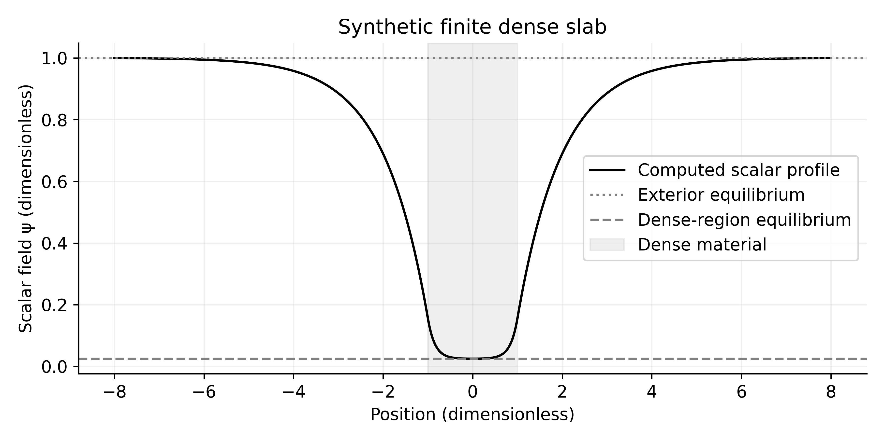{width=4.65in}

### 30G.4. Numerical calculation: no fitted astronomical numbers

We solved (G4) by a second-order symmetric finite-difference discretization, using half-cell density weighting at the two sharp interfaces and a tridiagonal Newton solve. The default demonstration has $L=8$, $R=1$, $\kappa=m^2=f=\epsilon_*=\mu_*=1$, $g_\rho=2$, $\rho_{\mathrm{in}}=20$, $\rho_{\mathrm{out}}=0$, $a=0.35$, $b=1.65$ and $801$ nodes. These are **arbitrary dimensionless example choices**; no observed $H_0$, optical spectrum or fifth-force limit was used to select them.

| Quantity in the hypothetical slab | Computed value |
|:--|--:|
| Exterior equilibrium field, $D=0$ | $1.000000$ |
| Field at the dense center, $D=0$ | $0.024828$ |
| Center as a fraction of exterior | $2.483\%$ |
| Local propagation speed, center/exterior | $2.652$ |
| Maximum finite-difference residual, $D=0$ | $8.2\times10^{-13}$ |
| Maximum error against the exact finite-boundary solution | $2.28\times10^{-4}$ |
| Exterior equilibrium field, $D=0.35$ | $1.015028$ |
| Center field, $D=0.35$ | $0.025354$ |

The electrostatic test demonstrates a real *within-model* response: at fixed boundary displacement, turning on $D=0.35$ raises $\psi$ slightly while keeping the same matter-density rule. The specified energy functional has a local minimum; the code checks that small interior perturbations increase its discretized energy. In a grid-refinement check, halving the spatial step changes the maximum error by roughly a factor of four, as expected for the centered approximation away from unresolved physics. Tests also verify reflection symmetry, the correct zero-density-contrast limit, stronger suppression with increasing density, scalar-flux matching and the absence of the electric source when $a=0$.

This is more than simply claiming that screening *might* occur: it gives a reproducible prediction for a particular action. But the size of the speed contrast is not a discovery or a plausible measured vacuum profile. The chosen example deliberately amplifies the effect to make the interface numerically legible.

### 30G.5. The optical distinction: delay is not transport redshift

The local wave speed in the geometric-optics, zero-photon-rest-mass sector is $v_\gamma(x,T)=[\epsilon(\psi)\mu(\psi)]^{-1/2}=v_*e^{-g_\gamma\psi}$ with $g_\gamma=(a+b)/2$. A **static spatial profile** changes $v_\gamma(x)$ and hence the travel delay $\int dx/v_\gamma(x)$, but it does not itself change a wave's frequency along a stationary ray. For a wave with Hamiltonian $\omega=v_\gamma(x,T)|k|$, the transport equation is

$$
\frac{d\ln\omega}{dT}
=\left.\partial_T\ln v_\gamma\right|_x
=-g_\gamma\left.\partial_T\psi\right|_x,
\quad
I_\gamma\equiv\int_{\mathrm{ray}}\partial_T\psi\,dT,
\quad S_{\mathrm{tr}}=\frac{\omega_e}{\omega_a}=e^{g_\gamma I_\gamma}.
\tag{G6}
$$

For the stationary slab, $I_\gamma=0$ and $S_{\mathrm{tr}}=1$ even though $v_\gamma$ differs by a factor of more than two between the center and exterior in the chosen synthetic example. Launching two pulses one time unit apart through the unchanged slab delivers them one time unit apart. This rules out **static screening alone** as a substitute for the evolving-field photon-slowing mechanism hypothesized by ArcSecs.

Now include source and receiver atoms in the same simplified Coulomb approximation used in Chapter 30F. Their local frequencies scale as $\nu_{\mathrm{atom}}\propto\epsilon(\psi)^{-2}$. Let $\Delta\psi_{\mathrm{at}}=\psi_o-\psi_s$ be the **actual local atomic-field difference**, which need not equal the field's temporal variation integrated along the ray. With no source motion, other gravitational shifts, dispersion or scattering, the two measured ratios become

$$
1+z_{\mathrm{spec}}=S_{\mathrm{tr}}\,e^{-2a\Delta\psi_{\mathrm{at}}},
\qquad
R_\alpha=\frac{\alpha_{\mathrm{eff},o}}{\alpha_{\mathrm{eff},s}}
=e^{(b-a)\Delta\psi_{\mathrm{at}}/2}.
\tag{G7}
$$

Therefore the homogeneous three-way identity (F5) has the following **exact generalization within this WKB-plus-atomic model**:

$$
\boxed{\frac{(1+z_{\mathrm{spec}})S_{\mathrm{tr}}}{R_\alpha^2}
=\exp[2g_\gamma(I_\gamma-\Delta\psi_{\mathrm{at}})].}
\tag{G8}
$$

When the scalar is homogeneous and time-varying, $I_\gamma=\Delta\psi_{\mathrm{at}}$ and equation (F5) is recovered. In a static inhomogeneous slab, $I_\gamma=0$ while the source and observer can occupy different local $\psi$: the transport factor is unity, **but unequal atomic references alone can produce an apparent spectral shift**. For the present toy source at the slab center and observer in the exterior, (G7) yields $z_{\mathrm{spec}}\approx-0.495$ and $R_\alpha\approx1.885$; these values are not observed spectra. If both source and receiver experience the same local field, there is no such static calibration shift.

Equation (G8) is the new bridge between Chapters 30F and 30G: it quantifies exactly which physical screening assumption breaks the earlier homogeneous closure. The change is not an unexplained fudge factor. It is the mismatch between a time derivative **integrated through the physical field along the actual ray** and the **local field values controlling the atomic measurements**. A successful alternative model must predict both from one set of equations, not tune them after seeing a distant-source spectrum.

### 30G.6. What the completed boundary experiment can and cannot say

The working screening field is static and one-dimensional. It has neither a dynamical atomic fluid nor a demonstrated interaction with all electromagnetic wave modes and gravitational radiation. It does not include radiation pressure, bound-electron feedback, freely moving charged interfaces, a derived force on a detector, measured cavity response, wave-packet scattering, reflected light or a complete stress–energy transport experiment. A nonzero invariant photon rest mass, if added as a separate candidate, would change dispersion and require independent experimental constraints. The four-term conservation ledger of the earlier homogeneous trial cannot simply be transplanted onto a time-changing material slab without the energy and momentum accounts of the actual matter and electrodes.

Independent experimental comparisons remain mandatory. Screened-scalar searches already constrain broad classes of such models through laboratory interferometry and gravitational tests; that existing work is a **measurement challenge** for any new candidate, not evidence that the particular ArcSecs scalar exists. The published GW170817/GRB170817A association constrains relative propagation over astronomical distances, subject to emission physics. The present one-dimensional static slab has no predictive gravitational-wave action or source-emission model and cannot claim to satisfy that observation simply by defining matching speeds. See the primary references at the end of Appendix M.

**Research decision.** Retain A-05d as an explicitly *partial* advance: a derivable static $\rho$–$\psi$–electrostatic boundary, analytically benchmarked and independently coded; and a screened emitter/transport/receiver identity (G8). Do not call this a solved light-slowing cosmology. The next candidate A-05e must move the density and charges dynamically, evolve both the electromagnetic and scalar waves, preserve the full matter–field energy/momentum ledger under moving interfaces, and make a parameter-frozen prediction on an independent measurement. In particular, the model must show whether the physical scalar's changing state actually causes the required frequency history without violating measured local clocks, atomic multiplets, lensing, dispersion or multimessenger timing.

---

## Chapter 30H. Matter in Motion: A Closed Photon–Scalar Exchange Experiment

**Research extension A-05e — 23 November 2026.** **Status:** AP = fixed ArcSecs project premise; DC = conditional derivation; SIM = specified numerical result; OM = external measurement; PH = proposed but undetected mechanism. The **twelve ArcSecs principles remain unchanged**. This chapter extends the stationary screening calculation in 30G to a *moving physical body* that interacts with a scalar field and an electromagnetic wave. It supplies a dynamical and mutually coupled energy–momentum account, not a detection of the proposed field or a solved cosmological redshift theory.

### 30H.1. The problem the static boundary could not answer

Chapter 30G allowed matter density to alter a physical scalar's equilibrium and the scalar to alter optical response. But the material boundary was fixed externally. With a moving boundary, a changing scalar field can push back on matter, and a wave can exert a force on the material system. If the boundary is assigned a trajectory by fiat, apparent losses of photon energy can simply be hidden in the external apparatus that moves it. That would be an inadequate physical explanation for ArcSecs.

The immediate task is therefore modest but demanding: give a *material body* a momentum and kinetic energy of its own; evolve the electromagnetic and scalar configurations at the same time; and check that the total energy and momentum remain constant when there is no external driver. In the model below, location $x$ and progression $T$ remain measurement labels (AP); the physical variables are matter's collective center $X$, the transverse electromagnetic field amplitude $A$, and a proposed scalar interaction field $\psi$ (PH).

This is a **one-dimensional collective-coordinate approximation**: a neutral, rigid slab's density is a smooth profile $\rho(x-X(T))$ translated by one dynamical coordinate. It is *not* a charged many-particle plasma, not a relativistic field theory, and not yet a complete atomic emitter or detector. These omissions define what the result can and cannot establish.

### 30H.2. One action, with no time-dependent driver

For a transverse electromagnetic polarization, write $E_y=-\partial_T A$ and $B_z=\partial_x A$. Let $\epsilon(\psi)=e^{a\psi}$ and $\mu(\psi)=e^{b\psi}$ in dimensionless units. With the positive scalar stiffness $\kappa$ and inertia $\chi$, the action is $S=\int \mathcal{L}\,dT$ with

$$
\mathcal L=\int dx\,(\mathcal L_{\mathrm{EM}}+\mathcal L_\psi)
+\frac{M}{2}\dot X^2.
\tag{H1}
$$

$$
\mathcal L_{\mathrm{EM}}=\frac{\epsilon(\psi)}{2}A_T^2
-\frac{A_x^2}{2\mu(\psi)}.
\tag{H1a}
$$

$$
\begin{aligned}
\mathcal L_\psi={}&\frac{\chi}{2}\psi_T^2
-\frac{\kappa}{2}\psi_x^2\\
&-\frac{m^2}{2}(\psi-\psi_{\mathrm{out}})^2
-\frac{g_\rho}{2}\rho(x-X)\psi^2.
\end{aligned}
\tag{H1b}
$$

**Definition, not observation.** Here $M$ is the slab's inertial mass parameter; $g_\rho$ couples matter density to the scalar; $m^2$ is the positive coefficient of the unscreened scalar potential; $a,b$ govern electrical and magnetic response. The profile is smooth and periodic for mathematical clarity, and there are no external sources or prescribed time-varying constants. The positive field coefficients avoid an immediate wrong-sign kinetic-energy instability. More demanding quantum and relativistic stability checks are not included.

Variation with respect to $A$, $\psi$, and $X$ yields the jointly evolving equations

$$
\begin{aligned}
\partial_T\big(\epsilon\,\partial_T A\big)
  -\partial_x\big(\mu^{-1}\partial_x A\big)&=0,\\
\chi\,\partial_T^2\psi-\kappa\partial_x^2\psi
  +m^2(\psi-\psi_{\mathrm{out}})+g_\rho\rho\psi
 &=\frac{a\epsilon}{2}(\partial_T A)^2
   +\frac{b}{2\mu}(\partial_x A)^2,\\
M\,\partial_T^2 X&=\frac{g_\rho}{2}\int_{-L/2}^{L/2}\rho_x(x-X)\psi^2\,dx .
\end{aligned}
\tag{H2}
$$

The third equation is the material recoil law: the field's nonuniform configuration exerts a real force on the moving slab. Unlike the static model, the matter does not have a prescribed trajectory after initialization. A light pulse can alter $\psi$; the altered $\psi$ affects wave propagation and the slab's motion; and material motion changes the scalar source. **The coupling is reciprocal** within the stipulated collective-coordinate action.

### 30H.3. Where both energy *and momentum* go

The fields have canonical momenta $\pi_A=\epsilon\,\partial_T A$ and $\pi_\psi=\chi\,\partial_T\psi$, while the slab's momentum is $P_X=M\partial_T X$. Their combined conserved energy is

$$
H=\int dx\,(\mathcal H_{\mathrm{EM}}+\mathcal H_\psi)
+\frac{P_X^2}{2M}.
\tag{H3}
$$

$$
\mathcal H_{\mathrm{EM}}=\frac{\pi_A^2}{2\epsilon}
+\frac{A_x^2}{2\mu}.
\tag{H3a}
$$

$$
\begin{aligned}
\mathcal H_\psi={}&\frac{\pi_\psi^2}{2\chi}
+\frac{\kappa}{2}\psi_x^2\\
&+\frac{m^2}{2}(\psi-\psi_{\mathrm{out}})^2
+\frac{g_\rho\rho(x-X)}{2}\psi^2.
\end{aligned}
\tag{H3b}
$$

On the periodic domain, the model's canonical total momentum is

$$
P_{\mathrm{all}}=P_X-\int dx\big(\pi_A\partial_x A+\pi_\psi\partial_x\psi\big).
\tag{H4}
$$

These expressions are more than chosen accounting labels: they follow from the autonomous, translation-invariant action. If a numerical run changes either total while the stipulated boundary conditions are respected, that is numerical error or an implementation defect, not the discovery of an extra physical source.

The *local* energy flux is $J_E=-\mu^{-1}(\partial_T A)(\partial_x A)-\kappa(\partial_T\psi)(\partial_x\psi)$. Denoting the integrand of (H3) by $u_f$, the interface exchanges power with the body through

$$
\partial_T u_f+\partial_xJ_E
=-\frac{g_\rho}{2}\,\dot X\,\rho_x\psi^2,
\qquad
\frac{d}{dT}\!\left(\frac{M\dot X^2}{2}\right)
=+\frac{g_\rho}{2}\,\dot X\!\int\rho_x\psi^2\,dx.
\tag{H5}
$$

The corresponding field momentum density is $p_f=-\epsilon A_TA_x-\chi\psi_T\psi_x$. Its flux or stress is $\sigma_f=\tfrac12[\epsilon A_T^2+\mu^{-1}A_x^2+\chi\psi_T^2+\kappa\psi_x^2-m^2(\psi-\psi_{\mathrm{out}})^2-g_\rho\rho\psi^2]$. The local balance $\partial_Tp_f+\partial_x\sigma_f=-g_\rho\rho_x\psi^2/2$ has precisely the opposite force to the slab equation in (H2). **There is no appeal to the physical stretching of time, space, or spacetime** to close these balances.

### 30H.4. A concrete synthetic experiment

All coefficients are fixed *before* selecting the comparison runs: $L=32$, $N=128$ periodic grid samples, $\chi=1$, $\kappa=0.8$, $m^2=1$, $\psi_{\mathrm{out}}=1$, $g_\rho=3$, peak matter density $4$, slab width $1$, $M=70$, $a=0.12$, $b=0.18$. The initial right-going electromagnetic packet has carrier wavenumber $k=2.5$, width $1.8$, amplitude $0.12$, and center $x=-10$. The scalar begins at the screened static equilibrium of the initial density, with initial momentum chosen to approximately follow the moving profile. We evolve to $T=18$ in dimensionless units.

The five runs use the same action, spatial discretization, and couplings. Only the *specified initial conditions* change. The initially stationary slab is allowed to recoil; only the **zero-wave, zero-velocity** control remains strictly stationary. Results below have no fitted distance or astronomical parameter.

| Initial condition | Maximum relative $H$ drift | Maximum absolute $P_{\mathrm{all}}$ drift | Slab center $X(18)$ | WKB $\ln(\omega_a/\omega_e)$ |
|---|---:|---:|---:|---:|
| Slab $+0.035$, EM pulse on | $3.75\times10^{-11}$ | $1.76\times10^{-9}$ | $+0.63152$ | $-0.005795$ |
| Slab initially at rest, pulse on | $6.05\times10^{-11}$ | $1.81\times10^{-9}$ | $+0.00143$ | $-0.005887$ |
| Slab $-0.035$, EM pulse on | $7.99\times10^{-11}$ | $1.86\times10^{-9}$ | $-0.62866$ | $-0.005939$ |
| Slab $+0.035$, pulse off | $5.34\times10^{-14}$ | $1.81\times10^{-12}$ | $+0.63000$ | $+0.000026$ |
| Slab at rest, pulse off | $1.92\times10^{-16}$ | $9.95\times10^{-16}$ | $0$ | $\approx0$ |

**SIM interpretation.** These small conservation residuals test the *specified discrete equations*, not the existence of the field in nature. In the $+0.035$ run, electromagnetic field energy decreases by approximately $5.50\times10^{-4}$, while scalar/interfacial energy and material motion gain the corresponding amounts. The slab recoils slightly, and the full physical-state momentum is conserved within the reported numerical error. The initially resting slab moves about $0.00143$ under the wave–field interaction, a nonzero mechanical response within the synthetic model.

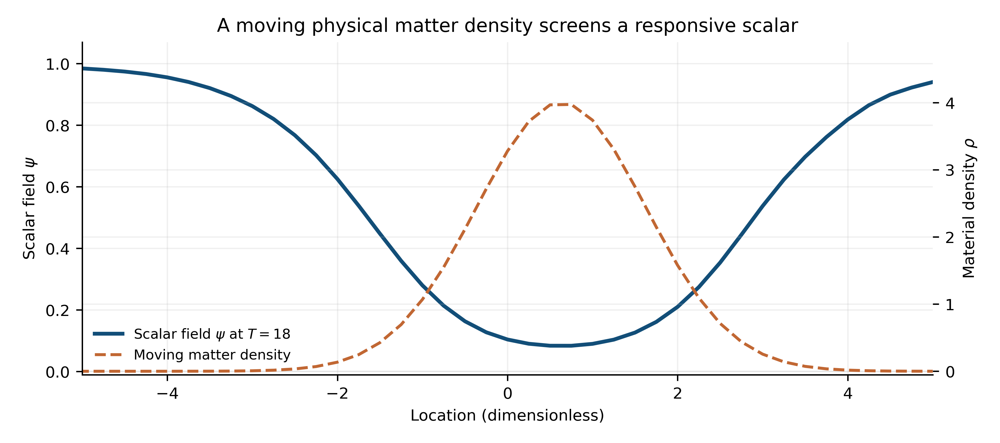{width=4.65in}

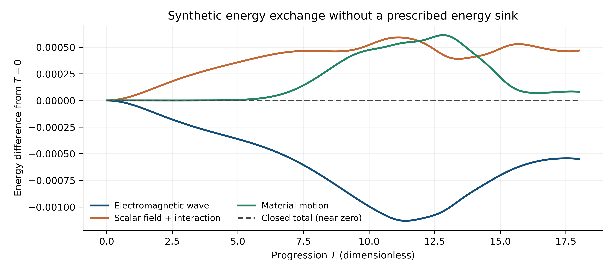{width=4.65in}

### 30H.5. A photon may change frequency without an external energy sink

For the local nondispersive WKB branch of (H2), $v_\gamma(\psi)=[\epsilon(\psi)\mu(\psi)]^{-1/2}=e^{-g_\gamma\psi}$, with $g_\gamma=(a+b)/2$. The right-going ray obeys $dx/dT=v_\gamma$ and, crucially, the **partial** time derivative gives its frequency change:

$$
\frac{d}{dT}\ln\omega
=\left.\frac{\partial}{\partial T}\ln v_\gamma\right|_x
=-g_\gamma\,\partial_T\psi(x_\gamma(T),T).
\tag{H6}
$$

This is a direct extension of (G6), not a frequency shift inferred from a position-dependent speed alone. The ray computation uses the *same evolved scalar field* as (H2), without prescribing a separate slowing function. In the pulse-on runs a right-traveling ray beginning at $x=-7.5$ has a computed $\ln(\omega_a/\omega_e)$ near $-0.0058$ after $T=18$. In the zero-wave, initially stationary control, its frequency change is effectively zero. A moving slab *without* the light pulse produces a much smaller nonzero shift in this example.

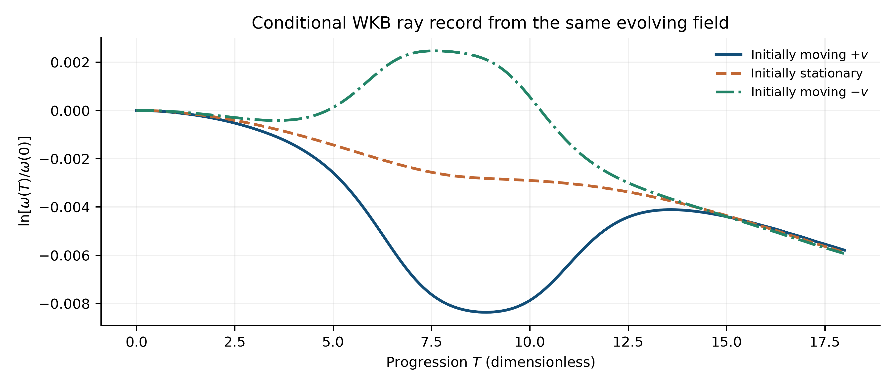{width=4.65in}

**The genuinely new conclusion is structural, not cosmological:** the sign and magnitude of a spectral transport shift can depend on the *dynamical state of matter and the backreacting field*. A measured spectroscopic redshift would also require the source and receiver's atomic transition physics as in Chapters 30F–30G. The WKB number in the table is **not** by itself $z_{\mathrm{spec}}$, and these parameters are not claimed to match astrophysical observations. The wavelength and field interpolation are finite-resolution numerical approximations; Appendix N gives their convergence checks.

### 30H.6. What a complete physical-first model still owes the observations

This is a meaningful upgrade over A-05d: moving material, scalar waves, electromagnetic waves, recoil and both conservation laws arise from **one action**. It also shows where the model remains incomplete. The slab's mass and density have been supplied, not derived from charged particles. There are no mobile charges, atomic spectral multiplets, genuine Proca photon rest-mass degree of freedom, gravitational-lensing action, three-dimensional scattering geometry, gravitational-wave propagation, or realistic cosmological source histories. The present model therefore cannot claim to have passed any of those tests or the broader requirements identified in Chapter 30E.

The next *independent test* must be specified before data fitting: calibrate $a,b,g_\rho,m^2,\chi,\kappa$ and the source/detector response using one experiment, then **freeze them**. Predict a second, unseen moving-interface condition—at a different velocity or probe frequency—including full uncertainty and instrument transfer functions. Such a comparison could refute this candidate even if its numerical conservation is excellent. The current five synthetic runs are controlled checks, **not a blinded laboratory holdout**.

**Research decision:** retain Candidate A-05e as a closed, dimensionless *matter–scalar–electromagnetic* toy with a reproducible energy and momentum ledger. Do not call its calculated transport frequency drift a measured slowing of cosmic photons. The next extension must replace rigid neutral matter with charged dynamical matter, solve emission and reception within the same system, and confront laboratory and astronomical measurements with parameters held fixed.

---

## Chapter 30I. Charged Emitters and Receivers: Spectral Calibration Must Be Physical

**Research extension A-05f — 23 November 2026.** **Status:** AP = fixed ArcSecs authorial premise; DC = conditional consequence of specified equations; SIM = numerical result; OM = observed measurement; PH = proposed, unverified law. All **twelve ArcSecs principles remain unchanged**. This chapter extends 30H with dynamical electric dipoles that both emit and detect radiation. It is a *classical bound-charge analog*, not a quantum atomic transition calculation, a detected cosmic field or a finished cosmology.

### 30I.1. A spectrum requires an emitter and a receiver

Chapter 30H calculated scalar-field evolution and a conditional WKB shift for a hypothetical electromagnetic wave. A crucial step remained: the same physical scalar may alter the frequency of the **source** and the calibration of the **receiver**. A telescope does not observe redshift from a travel-time equation. It compares a received spectrum with a reference for what the source was expected to emit.

Our model now evolves two mobile negative charges $q_s(T)$ and $q_r(T)$, moving *transversely* to a one-dimensional wave direction $x$. Fixed positive centers provide their binding wells. The coupled fields are transverse electromagnetic potential $A(x,T)$ and a proposed physical scalar $\psi(x,T)$. We keep separate (1) intrinsic source oscillation, (2) wave propagation, and (3) local receiver calibration. Stationary support positions mean that longitudinal momentum can be transferred to unmodeled anchors. No complete three-dimensional momentum claim is made for this new candidate.

### 30I.2. Autonomous action with a genuine charge current

Write $E=-A_T$, $B=A_x$, $\varepsilon(\psi)=e^{a\psi}$ and $\mu(\psi)=e^{b\psi}$. Each normalized spatial kernel $w_i(x)$ obeys $\int w_i\,dx=1$; define local scalar $\Psi_i(T)=\int w_i\psi\,dx$. The two mobile charged displacements create an explicit transverse polarization current,

$$
P(x,T)=\sum_{i=s,r}e_iq_i(T)w_i(x),\qquad J_y=\partial_TP.
\tag{I1}
$$

$J_y$ is the bound polarization current in this 1+1-dimensional transverse reduction. It is not a separate derivation of full three-dimensional charge continuity. The finite-width kernels are smooth approximations whose numerical tails must not be confused with superluminal signal fronts.

To avoid assigning an arbitrary spring frequency, let a mobile negative charge be attracted toward an oppositely charged center separated by a fixed support length $r_{0i}$. Define a positive, soft-core classical Coulomb-like well with its minimum subtracted:

$$
V_i(q_i,\Psi_i)=k_{0i}r_{0i}^{2}e^{-a\Psi_i}
\left[1-\frac{r_{0i}}{\sqrt{r_{0i}^{2}+q_i^{2}}}\right].
\tag{I2}
$$

The factor $e^{-a\Psi_i}$ follows the **assumed** local electrostatic response. The overall strength is consistent with a suitable product of mobile and fixed countercharges; a future microscopic theory must tie those charges to $k_{0i}$ rather than varying them independently. This is not a self-adjusting Bohr orbit or a quantum atom.

With a prescribed *stationary* screening-support density $\rho(x)$, a single autonomous Lagrangian is

$$
\begin{aligned}
\mathcal L={}&\int dx\,\bigg[
 \frac{\varepsilon}2 A_T^2-\frac{A_x^2}{2\mu}
 +\frac\chi2\psi_T^2-\frac\kappa2\psi_x^2\\
&\qquad-\frac{m_\psi^2}2(\psi-\psi_\infty)^2
 -\frac{g_\rho\rho(x)}2\psi^2-P A_T\bigg]\\
&+\sum_{i=s,r}\left[\frac{m_i}2\dot q_i^2-V_i\right].
\end{aligned}
\tag{I3}
$$

The interaction $-P A_T=P E$ uses physical electric field, not a chosen radiation power injection. It is gauge-invariant within the retained transverse field sector; a full three-dimensional gauge-complete particle model is not claimed. The scalar and charged coordinates are solved dynamically and no time-dependent drive is imposed.

### 30I.3. Reciprocity and a closed energy ledger

Variation with respect to $A$, $q_i$ and $\psi$ yields the coupled laws

$$
\partial_T(\varepsilon A_T-P)-\partial_x(\mu^{-1}A_x)=0,
\tag{I4}
$$

$$
m_i\ddot q_i+\partial_{q_i}V_i=e_i\langle E\rangle_i,
\qquad\langle E\rangle_i=\int w_iE\,dx,
\tag{I5}
$$

$$
\begin{aligned}
\chi\psi_{TT}-\kappa\psi_{xx}+m_\psi^2(\psi-\psi_\infty)
+g_\rho\rho\psi={}&\frac{a\varepsilon}2A_T^2
+\frac{b}{2\mu}A_x^2\\
&+a\sum_{i=s,r}V_iw_i.
\end{aligned}
\tag{I6}
$$

The charges produce current; the wave drives the charges; the wave and binding energy react back on the scalar; and the scalar changes electrical response and the wells. No one-way "tired-light friction" is inserted.

The canonical momenta are $\pi_A=\varepsilon A_T-P$, $\pi_\psi=\chi\psi_T$ and $p_i=m_i\dot q_i$. The conserved Hamiltonian is

$$
\begin{aligned}
H={}&\int dx\,\bigg[
\frac{(\pi_A+P)^2}{2\varepsilon}
+\frac{A_x^2}{2\mu}
+\frac{\pi_\psi^2}{2\chi}
+\frac\kappa2\psi_x^2\\
&\quad+\frac{m_\psi^2}2(\psi-\psi_\infty)^2
+\frac{g_\rho\rho}2\psi^2\bigg]
+\sum_{i=s,r}\left[\frac{p_i^2}{2m_i}+V_i\right].
\end{aligned}
\tag{I7}
$$

Because the action contains no explicit $T$, $dH/dT=0$ for exact solutions of this reduced model. This identity holds even as energy moves between source, wave, receiver and scalar. It is **not** a claim of full longitudinal momentum conservation: unlike 30H's moving neutral slab, this calculation has fixed support centers. All response and gradient coefficients are positive in the selected numerical experiment; quantum, relativistic and high-frequency stability remain open.

### 30I.4. Receiver calibration is a physical calculation

The soft-core potential has small-amplitude curvature $\partial_q^2V_i(0,\Psi_i)=k_{0i}e^{-a\Psi_i}$. Thus a *decoupled small-amplitude local reference* is derived from the actual chosen binding energy:

$$
\omega_{i,0}=\sqrt{\frac{k_{0i}}{m_i}}\,e^{-a\Psi_i/2}.
\tag{I8}
$$

Identical source and receiver models obey

$$
\frac{\omega_{r,0}}{\omega_{s,0}}=
\exp\left[-\frac a2(\Psi_r-\Psi_s)\right].
\tag{I9}
$$

This $-a/2$ exponent is specific to the fixed-radius *classical* soft-core well. It must **not** be substituted for the $\nu\propto\varepsilon^{-2}$ exponent of the separate leading hydrogenic quantum approximation considered in Chapters 30E–30F; that would mix physically different source models.

Define the operational spectral comparison using an actually received carrier frequency $\omega_{\mathrm{arr}}$:

$$
1+z_{\mathrm{op}}\equiv\frac{\omega_{r,0}}{\omega_{\mathrm{arr}}}.
\tag{I10}
$$

Only in an **additional idealized limit** of stationary background, weak radiation reaction, weak nonlinearity and $\omega_{\mathrm{arr}}=\omega_{s,0}$ does (I10) reduce to (I9). Our self-excited oscillators can shift their carrier through nonlinearity, re-radiation and time-dependent field backreaction. Therefore a *calibration-frequency ratio* cannot be relabeled a measured astronomical redshift. A stationary **spatial** response variation may change wavelength and local atomic calibration but does not automatically change a freely propagated electromagnetic frequency; a time-varying field may modify the spectrum.

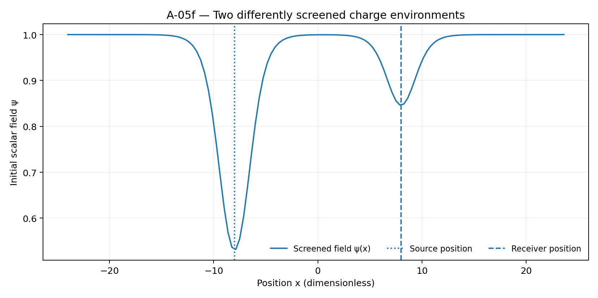

### 30I.5. Six controlled synthetic runs

In dimensionless units we take a periodic interval $L=48$, 128 Fourier sites, positive scalar coefficients $\chi=1$, $\kappa=0.8$, $m_\psi^2=1$, $\psi_\infty=1$, screening strength $g_\rho=1$, optical coefficients $a=0.27$ and $b=0.18$. Two identical charged soft-core wells have $m_i=1$, $k_{0i}=5.76$, $r_{0i}=0.65$, with transverse electric couplings $e_i=0.37$. Their support positions are $x_s=-8$, $x_r=8$ and Gaussian kernel width is $0.68$. Screening strengths at source and receiver are 3 and 0.65. Initially $q_s=0.14$, $q_r=0$ and both momenta are zero, with **zero electromagnetic field energy**. All coefficients are fixed before the control runs. See Appendix O for the exact input ledger and reproducibility instructions.

\Needspace{12\baselineskip}

| Model control | Maximum relative total-energy drift | $\omega_{r,0}/\omega_{s,0}$ | Peak $\lvert q_r\rvert$ |
|:--|--:|--:|--:|
| Different screening, excited source | $4.36\times 10^{-9}$ | 0.961640 | 0.002787 |
| Unexcited source, otherwise identical | $1.85\times 10^{-16}$ | 0.961640 | 0 |
| Receiver radiation coupling removed | $4.36\times 10^{-9}$ | 0.961640 | 0 |
| Equal source/receiver screening | $2.87\times 10^{-9}$ | 1.000000 | 0.002887 |
| No scalar optical coupling ($a=b=0$) | $1.10\times 10^{-8}$ | 1.000000 | 0.004597 |
| Both radiation couplings removed | $4.32\times 10^{-9}$ | 0.961640 | 0 |

The initially screened environment gives an isolated emitter reference $\omega_{s,0}=2.221631$ and receiver reference $\omega_{r,0}=2.136410$; their ratio $0.961640$ follows from the *field profile and the well*, not a fit to a detected frequency. The full run generates electromagnetic energy and eventually a delayed receiver displacement of about $0.002787$. With an unexcited source there is no radiation or receiver motion; with the receiver coupling removed it does not respond to the arriving wave. Equal screening gives equal reference frequencies, and $a=b=0$ disables their scalar dependence. These controls test the calculation's internal mechanism rather than the sky.

**Control limitation.** Zeroing optical charge couplings while retaining the well is a mathematical *ablation*, not a physical claim about a neutral atom still possessing the same Coulomb binding. A complete microscopic species ties countercharge, oscillator coupling and binding strength together.

\clearpage

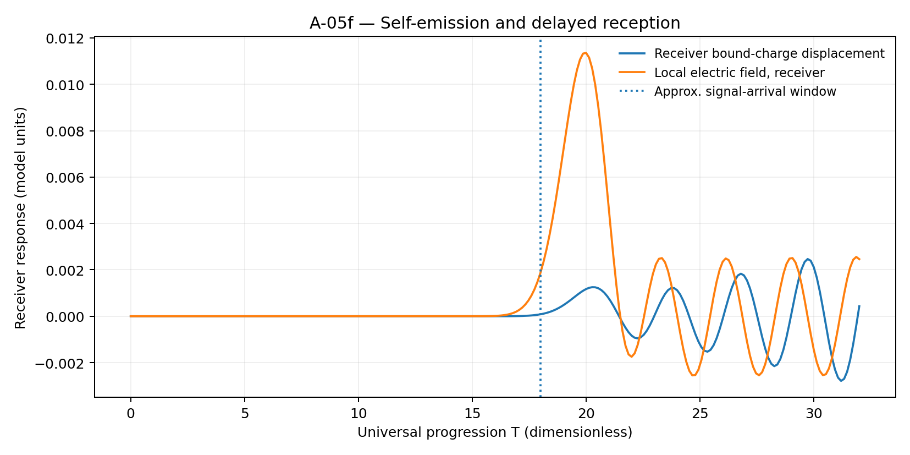

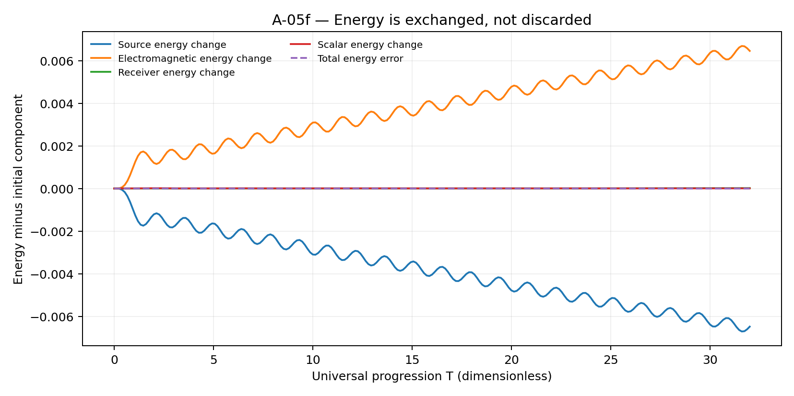{width=82%}

\FloatBarrier

The maximum numerical drift $4.36\times10^{-9}$ is a relative error in the **total energy sum**, not an amount of energy physically lost. A separate finite-difference directional derivative of the Hamiltonian along its differential equations is consistent with zero. The radiation and receiver terms increase while the source and scalar terms exchange energy as required by (I7).

Grid refinement from 64 through 96, 128, 192 and 256 points gives peak receiver displacements $0.00278077$, $0.00278716$, $0.00278716$, $0.00278716$ and $0.00278716$ (rounded); the reference ratio is stable to six decimals. Grid convergence does not establish that its arbitrary couplings describe the universe. Fourier derivatives and Gaussian kernels have small nonzero early tails. The early numerical response is much smaller than the later physical wave response, but these tails are **not** evidence of superluminal causal information.

### 30I.6. Status and next scientific obligation

**Established within this stipulated model (DC/SIM):** A moving bound charge generates a real polarization current, launches electromagnetic radiation, and makes a separate bound charge move after propagation. The source, wave, receiver, and dynamic scalar have a common autonomous energy account. The scalar also changes the classical well's calibrated frequency through an explicitly derived coefficient. Six control experiments and grid checks support this finite numerical conclusion.

**Not established:** actual quantum atomic spectral lines, photon invariant rest mass, full 3D charge continuity, moving positive nuclei, 3D momentum conservation, an absolute observed spectral redshift, relativistic dispersion, laboratory field detection, or a cosmological fit. The postulated scalar is an unverified candidate; the numbers are synthetic. The Lorentz oscillator and temporal refraction are established mathematical tools of classical optics, not discoveries unique to ArcSecs. For standard context see K. K. Likharev, [*Classical Electrodynamics*, Sec. 7.2](https://phys.libretexts.org/Bookshelves/Electricity_and_Magnetism/Essential_Graduate_Physics_-_Classical_Electrodynamics_(Likharev)/07:_Electromagnetic_Wave_Propagation/7.02:_Attenuation_and_Dispersion), and [*Electrodynamics of photonic temporal interfaces*](https://pmc.ncbi.nlm.nih.gov/articles/PMC12454649/). These are methodological references, **not empirical support for a cosmic ArcSecs field**.

**Research decision:** retain A-05f as the first reciprocal *charged emitter–wave–receiver* extension. The next candidate A-05g must move both signs of charge and their supports, derive full charge continuity and **a complete 3D energy–momentum ledger**, and add a physically grounded quantum transition Hamiltonian. Only then should a pre-registered, parameter-frozen atomic spectrum and propagation-time prediction be confronted with independent measurements. A numerical calibration mismatch is not interchangeable with an observed cosmic redshift.

---

## Chapter 30J. Moving Charges and Momentum: A Closed One-Dimensional Field Experiment

**Research extension A-05g — 23 November 2026.** **Evidence status:** AP = ArcSecs authorial premise; DC = consequence of a specified action; SIM = numerical test of that action; OM = measurement; PH = unverified physical hypothesis. **The twelve ArcSecs foundations are preserved verbatim and are not revised here.** The result is a controlled *classical one-dimensional precursor* to a complete mobile-charge theory. Its scalar field is hypothetical; no new field, massive photon, superluminal signal, or cosmic redshift has been detected.

### 30J.1. Unifying the two previous experiments

Chapter 30H introduced a moving neutral material boundary and accounted for longitudinal field momentum. Chapter 30I introduced bound charged emitters and receivers, but tied their positively charged supports to fixed positions. Consequently, Chapter 30I could conserve energy without carrying the entire longitudinal recoil of the emitter and receiver. These experiments cannot be declared a unified microscopic theory just because both include electromagnetic waves and a scalar field.

The next bounded objective is to give **both emitter and receiver material centers a longitudinal coordinate and momentum**, preserve dynamical internal electric polarization, let matter screen the scalar wherever it moves, and derive all reaction forces from **one autonomous Hamiltonian**. The modeled charged object is a neutral electron–positive-center composite in a reduced description: its center $X_i$ moves along the optical direction, while $q_i$ measures transverse relative charge displacement. The positive center is not an immobile external anchor. Neither the full three-dimensional trajectory of each charge nor the longitudinal Coulomb field is resolved. Those limits must be kept visible.

The position $x$ and progression label $T$ remain *Where* and *When* (AP). Dynamical variables are the material centers and internal charged displacements, the transverse electromagnetic field $A$, and the proposed scalar state $\psi$ (PH). The computation tests their specified mathematical exchanges, not the status of any wider ArcSecs premise.

### 30J.2. One finite-mode, translation-invariant Hamiltonian

On a periodic interval of length $L$, retain Fourier modes with $|k|\le K$. Write $\Pi_A$ and $\Pi_\psi$ for the canonical field momenta, $p_{X_i}$ for longitudinal center momenta, and $p_{q_i}$ for internal-charge momenta. Let $\overline{f}(X_i)=\int_0^L W_\sigma(x-X_i) f(x)\,dx$ be a *periodic, normalized, finite-width* field sample centered on the actual moving material object. All couplings use the **same** kernel and its derivative; otherwise the discrete action can create a spurious recoil force.

For $i=s,r$, define the autonomous Hamiltonian

$$
\begin{aligned}
H={}&\int_0^L\!dx\left[\frac{(1-a\psi)\Pi_A^2}{2}
+\frac{(1-b\psi)A_x^2}{2}
+\frac{\Pi_\psi^2}{2}
+\frac{w^2\psi_x^2}{2}
+\frac{m_\psi^2}{2}(\psi-\psi_\infty)^2\right]\\
&+\sum_{i=s,r}\left[\frac{p_{X_i}^2}{2M}
+\frac{(p_{q_i}-g\overline A_i)^2}{2m_q}
+\frac{k_0}{2}(1+s\overline\psi_i)q_i^2
+\frac{h}{2}\overline\psi_i^2\right].
\end{aligned}
\tag{J1}
$$

Here $h\overline\psi_i^2/2$ describes **moving material screening**, rather than a density profile nailed to the coordinate grid. The $g\overline A_i$ term is the retained transverse electric polarization coupling. The spring coefficient $k_0(1+s\overline\psi_i)$ makes the local charged oscillator respond to its physical scalar environment. Unlike the exponential electromagnetic response in Chapters 30H–30I, the locally linear coefficients $(1-a\psi)$ and $(1-b\psi)$ are chosen to make the finite Fourier Hamiltonian exactly translation-invariant at the retained mode level. This is a **new candidate parameterization**, not an unnoticed algebraic identity with those earlier actions.

Positivity requires $1-a\psi>0$, $1-b\psi>0$, and $1+s\overline\psi_i>0$ over the modeled trajectory. For locally uniform $\psi$ and negligible matter loading, the linearized electromagnetic characteristic speed is the **conditional** result

$$
v_\gamma(\psi)=\sqrt{(1-a\psi)(1-b\psi)}.
\tag{J2}
$$

The assumed evolution of $\psi$ could slow or accelerate this candidate wave depending on its trajectory. Neither $v_\gamma$ nor $\dot\psi$ is prescribed from an observed cosmological redshift.

### 30J.3. Matter pushes back: the generated evolution laws

Hamilton's equations give the internal charge motion and the material recoil:

$$
\dot q_i=\frac{p_{q_i}-g\overline A_i}{m_q},\qquad
\dot p_{q_i}=-k_0(1+s\overline\psi_i)q_i,
\tag{J3}
$$

$$
\begin{aligned}
\dot X_i&=p_{X_i}/M,\\
\dot p_{X_i}&=g\dot q_i\overline{A_x}_i
-\left(\frac{k_0s q_i^2}{2}+h\overline\psi_i\right)\overline{\psi_x}_i.
\end{aligned}
\tag{J4}
$$

The first recoil term is the reaction associated with transverse polarization in the varying electromagnetic field; the other terms are material screening and binding-gradient forces. These are **not independently assigned pushes**. They follow by differentiating (J1) with respect to each moving center. The self-consistent field equations are

$$
\begin{aligned}
\dot A&=(1-a\psi)\Pi_A,\\
\dot\Pi_A&=\partial_x[(1-b\psi)A_x]
+g\sum_i\dot q_i W_\sigma(x-X_i),\\
\dot\psi&=\Pi_\psi,\\
\dot\Pi_\psi&=w^2\psi_{xx}-m_\psi^2(\psi-\psi_\infty)
+\tfrac12a\Pi_A^2+\tfrac12bA_x^2\\
&\quad-\sum_i\left(\tfrac12k_0s q_i^2+h\overline\psi_i\right)
W_\sigma(x-X_i).
\end{aligned}
\tag{J5}
$$

In the finite-mode code every right-hand side is projected onto the retained Fourier modes. Spatially translating **all fields and material centers together** leaves the resulting finite-dimensional Hamiltonian unchanged. Its conserved longitudinal canonical momentum is

$$
P_{\mathrm{all}}=\sum_i p_{X_i}
-\int_0^L\big(\Pi_A A_x+\Pi_\psi\psi_x\big)\,dx,
\qquad \dot P_{\mathrm{all}}=0.
\tag{J6}
$$

Because (J1) is autonomous, $\dot H=0$ as well (DC). The resulting claim is deliberately narrow: **total energy and longitudinal canonical momentum close for this exact reduced Hamiltonian**. It is not a calculation of the full three-dimensional electromagnetic stress tensor, nor does it establish a relativistic charge-current conservation law for arbitrary motion.

### 30J.4. Controlled numerical experiment and convergence

The explicit inputs are dimensionless. We use $L=2\pi$, 10 positive Fourier harmonics (also zero and negative modes), 96 quadrature sites, Gaussian coupling width $\sigma=0.32$, $m_\psi^2=1.4$, $w^2=0.8$, $\psi_\infty=0.10$, $a=0.28$, $b=0.17$, $k_0=4.8$, $s=0.7$, $h=2.4$, $g=0.45$, $m_q=1$ and $M=13$. Initially the centers are at $X_s=1.48$, $X_r=4.53$, with longitudinal speeds $+0.028$ and $-0.012$. The source displacement is $q_s=0.17$, while $q_r=0$. The electromagnetic field is initially empty. The initial scalar is obtained by solving the **static screened equilibrium equation for those same charged sources**, not guessed from an unrelated profile. The system evolves to $T=12$ under a single fixed Hamiltonian. All reported outcomes are numerical examples (SIM), not fitted sky data.

| Simulation control | Relative $H$ drift | Absolute $P_{\mathrm{all}}$ drift | Peak $|q_r|$ | Initial $\omega_{r,0}/\omega_{s,0}$ |
|:--|--:|--:|--:|--:|
| Mobile centers, source excited | $4.56\times10^{-11}$ | $6.59\times10^{-13}$ | 0.052080 | 1.002825 |
| No initial source excitation | $8.54\times10^{-13}$ | $4.19\times10^{-15}$ | 0 | 1.000000 |
| No dipole–radiation coupling | $1.41\times10^{-10}$ | $2.02\times10^{-12}$ | 0 | 1.002825 |
| Scalar material screening removed | $6.60\times10^{-11}$ | $6.20\times10^{-13}$ | 0.048691 | 1.004688 |
| Both center speeds initially zero | $5.77\times10^{-11}$ | $1.20\times10^{-13}$ | 0.066188 | 1.002825 |
| Fourier modes increased from 10 to 14 | $6.11\times10^{-11}$ | $9.17\times10^{-13}$ | 0.052080 | 1.002825 |

The quoted energy drift is $\max_T|H(T)-H(0)|/|H(0)|$; momentum drift is the **absolute** change in total canonical longitudinal momentum. They quantify numerical accuracy rather than an experimentally measured conservation violation. Fourteen-mode and ten-mode runs differ in peak receiver displacement by only about $1.0\times10^{-9}$, though that alone does not establish convergence for all sharp initial pulses. The initially resting material centers acquire small recoil without any imposed mechanical trajectory. When the source is not excited, no receiver oscillation is generated; disabling dipole–wave coupling also suppresses the receiver response.

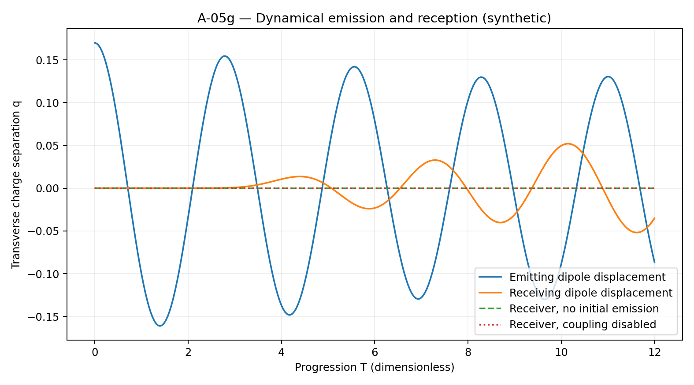{width=86%}

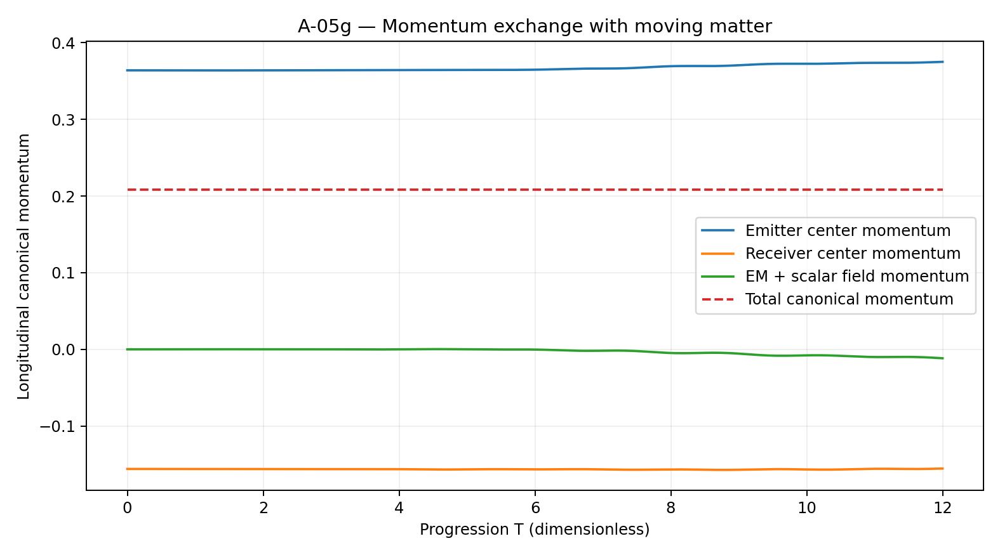{width=86%}

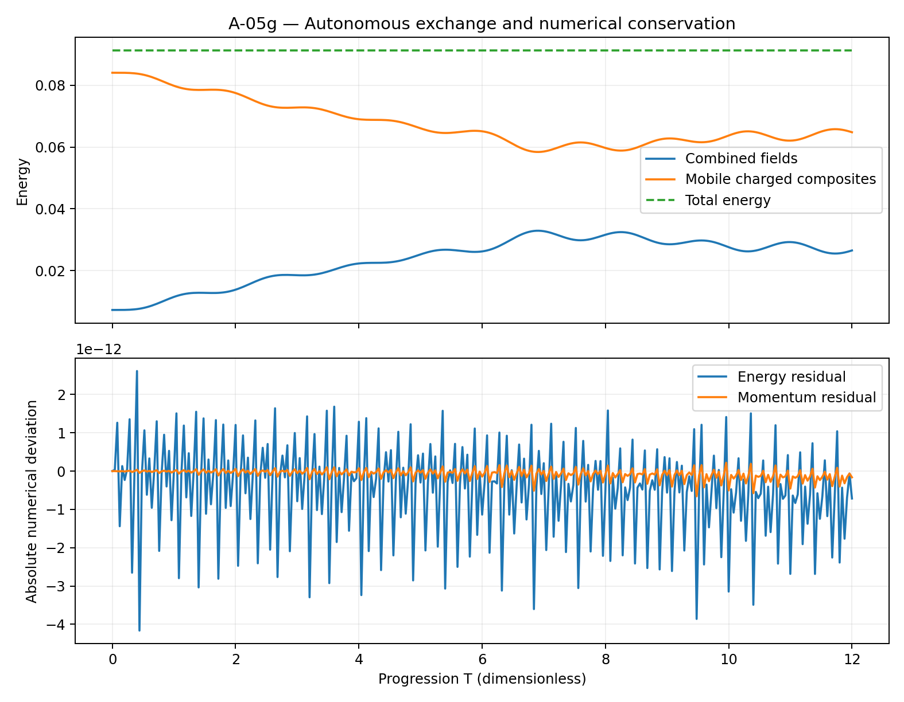{width=86%}

### 30J.5. An emitted carrier is not yet a redshift measurement

The small-amplitude *local* internal frequency obtained from (J1) is

$$
\omega_{i,0}(T)=\sqrt{\frac{k_0}{m_q}(1+s\overline\psi_i(T))}.
\tag{J7}
$$

The baseline initially gives $\omega_{r,0}/\omega_{s,0}=1.002825$ and the end-state gives $0.999808$. Those two values arise from actual evolving scalar and material states, not from an inserted redshift parameter. But they **do not** give a ratio of arriving-wave frequency to source frequency. The moving emitter can have a Doppler effect; the scalar can change along the signal trajectory; the receiving dipole can oscillate nonlinearly; and the periodic domain can recirculate signals. A valid observational redshift must additionally extract a propagation carrier and compare it with the receiver's **calibrated** spectral line using a well-defined detection protocol.

The finite Fourier approximation and the Gaussian coupling kernel also have noncompact spatial tails. Thus a tiny early numerical response is **not** evidence of a faster-than-light communication front. The simulation does not encode a massive Proca photon or its extra longitudinal polarization; the ArcSecs photon-mass premise remains independent of this computational test.

### 30J.6. Scientific status and next bounded problem

A-05g advances beyond A-05f: it lets material supports move, derives their recoil from the same charged-field Hamiltonian, provides moving scalar screening, and verifies **both** reduced total energy and longitudinal momentum numerically. It also exposes an important price of finite-width coupling and a finite spectral basis: spatial support, wave-front causality and three-dimensional current conservation cannot be claimed without a different model.

The next bounded candidate A-05h should resolve **independent positive and negative charge trajectories in three dimensions** (including the longitudinal electric field and a current satisfying charge continuity), derive the corresponding gauge-consistent stress–energy or canonical energy–momentum balance, and only then add a quantum source Hamiltonian capable of predicting real spectral transitions. Parameter selection and optical calibration must be frozen *before* comparison with an independent observational holdout. A numerical frequency-calibration ratio is not evidence that the universe's measured redshift–distance relation has been reproduced.

---

## Chapter 30K. Three-Dimensional Charged-Field Dynamics

*From dipoles to three-dimensional charge flow: conservation is not yet a spectrum.*

*Candidate A-05h · 23 November 2026 · theoretical and computational research, not a detected new interaction*

### 30K.1. What the preceding experiment could not calculate

Chapter 30J put a material center in motion and conserved longitudinal momentum, but its two charges remained represented by a single transverse internal coordinate. Chapter 30I resolved charged emission and reception but fixed the supporting positive charge. A physical-source model of spectroscopy ultimately needs both positive and negative particles to move, charge density to follow their trajectories, longitudinal electric response to be included, and material and field momenta to balance without silently attaching a charge to a motionless background.

We now take that next restricted step. Four classical particles—two positive, two negative—move independently with three coordinates and three canonical momenta each. They interact through a projected longitudinal Coulomb field, two transverse electromagnetic polarizations for each retained wavevector, a dynamical scalar field, and an explicitly declared binding potential. A single autonomous Hamiltonian determines every response. The model works in a fixed numerical coordinate system but does not assume that this coordinate system is itself a physical substance.

This new construction is a **finite-mode, periodic Coulomb-gauge classical model**, not a completed quantum electrodynamics or cosmological model. In particular, its electric response and vacuum propagation coefficients are fixed: it **does not yet derive the ArcSecs premise of a secular slowing of light**. Its significance is narrower and testable: it closes a three-component canonical-momentum ledger while satisfying the charge-continuity identity and longitudinal Gauss constraint **within the retained spectral subspace**. This distinction matters because a model can conserve energy almost perfectly and still have an insufficient description of radiation or an unphysical atom.

### 30K.2. A Hamiltonian with independently mobile charges

Let the position, canonical momentum, mass and signed charge of particle $i$ be $(\mathbf r_i,\mathbf p_i,m_i,q_i)$. The four-particle cell is globally neutral, $\sum_iq_i=0$. There are two positive–negative pairs, but **each constituent follows its own three-dimensional trajectory**. For an initial control experiment, each pair has a harmonic binding energy $\kappa|\mathbf r_+-\mathbf r_-|^2/2$. This artificial binding is chosen to make emission and reception calculations reproducible; it is **not** the hydrogen Coulomb potential and should not be called an atomic spectrum.

On a periodic cube of volume $V=L^3$, retain a finite set $\mathcal K_+$ of independent nonzero reciprocal vectors, one member of each $\pm\mathbf k$ pair. For every mode define the same finite-width source kernel

$$
B_{\mathbf k}(\mathbf r)=\sqrt{\frac{2}{V}}\exp\!\left(-\frac{\sigma^2k^2}{2}\right),\qquad
C_{i\mathbf k}=B_{\mathbf k}\cos(\mathbf k\cdot\mathbf r_i),\quad
S_{i\mathbf k}=B_{\mathbf k}\sin(\mathbf k\cdot\mathbf r_i).
\tag{K1}
$$

For each $\mathbf k$ choose two orthonormal vectors $\mathbf e_{\mathbf k\lambda}$ perpendicular to $\mathbf k$. The transverse vector potential is

$$
\mathbf A_\sigma(\mathbf r_i)=\sum_{\mathbf k\in\mathcal K_+}\sum_{\lambda=1}^2
\mathbf e_{\mathbf k\lambda}\left(C_{i\mathbf k}a^c_{\mathbf k\lambda}+S_{i\mathbf k}a^s_{\mathbf k\lambda}\right).
\tag{K2}
$$

The longitudinal field is not introduced as an independent photon oscillator. The retained charge density determines a constrained Coulomb potential,

$$
\rho^c_{\mathbf k}=\sum_iq_iC_{i\mathbf k},\quad
\rho^s_{\mathbf k}=\sum_iq_iS_{i\mathbf k},\quad
\phi^{c,s}_{\mathbf k}=\frac{\rho^{c,s}_{\mathbf k}}{\epsilon k^2}.
\tag{K3}
$$

The independent real scalar coordinates $(u^c_\mathbf k,u^s_\mathbf k)$ define $\psi_\sigma(\mathbf r_i)=\sum_\mathbf k(C_{i\mathbf k}u^c_\mathbf k+S_{i\mathbf k}u^s_\mathbf k)$. We choose a linear coupling $g_i\psi_\sigma$ and a positive quadratic material coupling $s_i\psi_\sigma^2/2$. The latter supplies a density-dependent local resistance to scalar displacement; it is **not** a demonstrated cosmological chameleon mechanism.

With canonical field momenta $\boldsymbol\Pi_A,\boldsymbol\Pi_\psi$, a single dimensionless Hamiltonian is

$$
\begin{aligned}
H={}&\sum_i\frac{|\mathbf p_i-q_i\mathbf A_\sigma(\mathbf r_i)|^2}{2m_i}
 +\frac\kappa2\sum_{\mathrm{pairs}}|\mathbf r_+-\mathbf r_-|^2
 +\sum_{\mathbf k}\frac{(\rho^c_\mathbf k)^2+(\rho^s_\mathbf k)^2}{2\epsilon k^2}\\
&+\frac12\sum_{\mathbf k,\lambda,h=c,s}
\left[(\Pi^{h}_{A,\mathbf k\lambda})^2+c_*^2k^2(a^{h}_{\mathbf k\lambda})^2\right]
 +\frac12\sum_{\mathbf k,h=c,s}
\left[(\Pi^{h}_{\psi,\mathbf k})^2+(w_\psi^2k^2+m_\psi^2)(u^{h}_{\mathbf k})^2\right]\\
&+\sum_i\left[g_i\psi_\sigma(\mathbf r_i)+\frac{s_i}{2}\psi_\sigma(\mathbf r_i)^2\right].
\end{aligned}
\tag{K4}
$$

Here $c_*$ is a **fixed trial electromagnetic speed**, not a claim that the observed speed of light is constant through cosmic history. The field's mode structure is transverse by construction, $\mathbf k\cdot\mathbf e_{\mathbf k\lambda}=0$. Particle mechanical velocities are **derived from** $\dot{\mathbf r}_i=(\mathbf p_i-q_i\mathbf A_\sigma)/m_i$, rather than equating canonical momentum with mechanical momentum. The complete equations are Hamilton's equations applied to (K4), using **identical source kernels** in deposition, backreaction and force differentiation.

### 30K.3. Continuity and Gauss's law are simultaneous constraints

The smooth projected current modes are $\mathbf J_{\mathbf k}^{c,s}=\sum_iq_i\dot{\mathbf r}_i\,C_{i\mathbf k},\sum_iq_i\dot{\mathbf r}_i\,S_{i\mathbf k}$, respectively. Differentiating (K3) gives the two real-mode continuity identities

$$
\dot\rho^c_{\mathbf k}+\mathbf k\cdot\mathbf J^s_{\mathbf k}=0,
\qquad
\dot\rho^s_{\mathbf k}-\mathbf k\cdot\mathbf J^c_{\mathbf k}=0.
\tag{K5}
$$

These identities hold for **arbitrary three-component particle velocities** because charge is attached to particles and the density and current use the same spatial smoothing kernel. The smoothed longitudinal field has coefficients

$$
\mathbf E^c_{L,\mathbf k}=-\mathbf k\,\phi^s_{\mathbf k},\qquad
\mathbf E^s_{L,\mathbf k}=+\mathbf k\,\phi^c_{\mathbf k},
\quad\Longrightarrow\quad
(\nabla\cdot\mathbf E_L)^{c,s}_{\mathbf k}=\rho^{c,s}_{\mathbf k}/\epsilon.
\tag{K6}
$$

This is a genuine charge-and-field constraint in the **finite represented space**, rather than merely a numerical penalty function. It does **not** imply that arbitrary unrepresented, high-frequency charge distributions satisfy a full continuum Maxwell system. The longitudinal field follows from a Coulomb constraint in this gauge; its instantaneous appearance in a snapshot is **not** a demonstration of an instantaneous information channel. Such a claim would require the full causal coupling of the constraint, transverse radiation, and detectors.

### 30K.4. The three-component momentum ledger

Translation of **all particles and both field configurations together** leaves the finite-mode Hamiltonian invariant. The corresponding Noether generator is

$$
\boxed{\;\mathbf{P}_{\mathrm{total}}=\sum_i\mathbf p_i
+\sum_{\mathbf k}\mathbf k\left[
\sum_\lambda\big(a^c_{\mathbf k\lambda}\Pi^s_{A,\mathbf k\lambda}-a^s_{\mathbf k\lambda}\Pi^c_{A,\mathbf k\lambda}\big)
+u^c_{\mathbf k}\Pi^s_{\psi,\mathbf k}-u^s_{\mathbf k}\Pi^c_{\psi,\mathbf k}
\right].\;}
\tag{K7}
$$

This is **total canonical momentum in three components**. It is not identical to $\sum_i m_i\dot{\mathbf r}_i$, and a discretized expression should not be mislabeled a fully verified continuum electromagnetic stress tensor. Hamilton's equations imply $dH/dT=0$ and $d\mathbf{P}_{\mathrm{total}}/dT=\mathbf{0}$ for the exact finite-dimensional system. Those identities are then independently checked on the numerical integrator, including two finite-difference directional-derivative checks at the initial state and translation-covariance tests.

### 30K.5. Six controlled computations and a decisive warning

The cell is a cube of side $L=10$, with Gaussian smoothing $\sigma=0.48$, two positive particles of mass $3$, two negative particles of mass $1$, signed charges $\pm2$, harmonic stiffness $\kappa=2.8$, $\epsilon=c_*=1$, scalar disturbance speed $0.85$, scalar mass $1.15$, scalar linear coupling $g_i=0.24m_i$ and quadratic coupling $s_i=0.55m_i$. The source negative charge starts displaced by $0.32$ in the $y$-direction and is given an equal-and-opposite internal three-component momentum kick of $(0.035,0,0.045)$. The initially neutral receiver is at rest. The scalar field begins in the exactly solved stationary configuration for the initial charges. No external energy or momentum is injected after time zero.

The 13-mode baseline is evaluated for $0\leq T\leq10$ with 161 saved times. Two comparisons use a matched four-unit interval, including a 62-mode shell. Integration is DOP853 with relative tolerance $5\times10^{-10}$ and absolute tolerance $5\times10^{-12}$. The full parameter ledger, six CSV histories and Python source are archived with the book. The figures are simulations, not observational data.

| Synthetic case | Maximum receiver separation | Relative total-energy drift | Maximum $|\Delta\mathbf P|$ |
|:--|--:|--:|--:|
| Excited 13-mode baseline, $T\leq10$ | 0.037093 | $5.04\times10^{-9}$ | $3.50\times10^{-12}$ |
| Unexcited source | $<10^{-12}$ | $1.16\times10^{-13}$ | $1.66\times10^{-18}$ |
| Electric charges set to zero | $<10^{-12}$ | $1.15\times10^{-8}$ | $1.23\times10^{-15}$ |
| Scalar coupling removed | 0.037088 | $4.33\times10^{-9}$ | $3.71\times10^{-12}$ |
| Matched 13-mode short run, $T\leq4$ | 0.021156 | $5.34\times10^{-9}$ | $3.76\times10^{-12}$ |
| Matched 62-mode run, $T\leq4$ | 0.015909 | $3.24\times10^{-9}$ | $1.92\times10^{-11}$ |

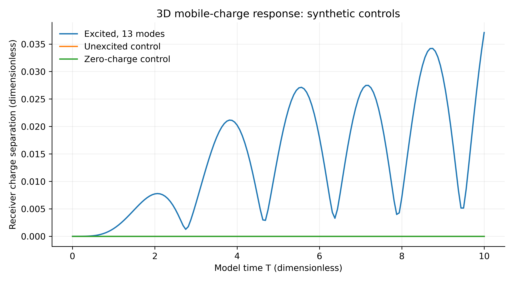

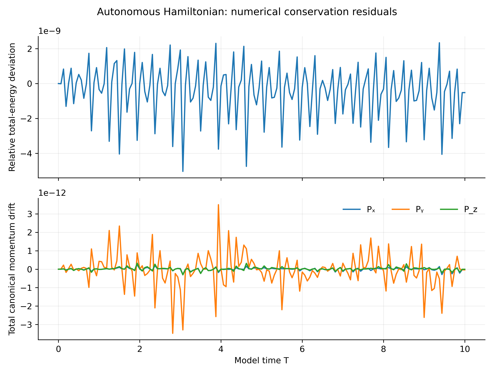

Charge-continuity residuals remain at or below approximately $2.1\times10^{-17}$ and the longitudinal Gauss-law residuals at or below approximately $1.1\times10^{-17}$ in the six saved runs. These are finite-mode **algebraic residuals**, not measurements of missing continuum modes. The new 24-test module and all 196 earlier project tests pass, for **220 passing tests** at this edition.

**The critical negative result is resolution sensitivity.** Over the *same* four-unit interval, the modeled maximum receiver displacement changes from $0.021156$ with 13 retained modes to $0.015909$ with 62, a decrease of about **24.8%**. Therefore the response amplitude is **not numerically converged**. Furthermore, removing the scalar coupling changes the ten-unit maximum receiver displacement from $0.037093$ to $0.037088$, a very small difference for this parameter choice; this particular run has not demonstrated a large, independently identifiable scalar effect. Strong conservation and constraint closure do **not** compensate for either limitation.

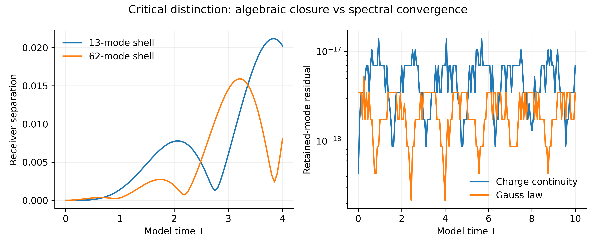

### 30K.6. Why this still cannot be called an atomic spectrum

An isolated reduced-mass harmonic pair has a calculable classical frequency,

$$
\omega_{\mathrm{relative}}=\sqrt{\kappa\left(\frac1{m_+}+\frac1{m_-}\right)}
=\sqrt{2.8\left(\frac13+1\right)}\approx1.93218
\quad\text{(dimensionless)}.
\tag{K8}
$$

An elementary quantization of that isolated harmonic coordinate would give equally spaced ideal oscillator levels. It would **not** reproduce hydrogen's Coulomb levels, electronic spin, fine structure, recoil corrections, selection rules, linewidths, scattering, or a calibrated laboratory transition. The finite-mode coupled calculation is entirely classical. Its time-dependent charge separation or radiative mode amplitude is not a detected line frequency. Nor can the receiver's motion alone be reported as a cosmological spectroscopic redshift.

Before a further model can support that interpretation, it must derive bound-state transitions and the receiver's quantum measurement standard within a consistent charge–field theory; demonstrate spectral convergence; distinguish propagation shifts from emitter/receiver shifts; and freeze parameters before comparing independent observed data. Only then could a slowing-field claim be tested with realistic spectral lines and time-of-flight observations using the **same** fitted parameters.

### 30K.7. Decision and next experiment

A-05h has succeeded at a narrow but important computational task: independently moving signed charges in three dimensions, nonzero longitudinal electric response, transverse radiation modes, a dynamical material-coupled scalar, exact retained-mode continuity and Gauss constraints, and a conserved autonomous three-component canonical momentum ledger. It does **not** yet establish the quantum, continuum, electromagnetic-response, gravitational or astronomical claims of the broader research program.

The next bounded experiment is therefore **A-05i: continuum-resolution and quantum-source calibration**. Its first acceptance gate is not an observational fit: demonstrate convergence of at least one receiver displacement, phase and field-energy transfer as the mode cutoff increases while the source width and physical parameters stay fixed. Then replace artificial harmonic binding with a controlled soft-Coulomb two-body problem and compare a separately derived quantum transition to its classical response. Add the $\epsilon(\psi),\mu(\psi)$ electromagnetic response only through a new action whose energy and momentum conservation can be verified again. Keep failed parameter cases and the exact 12-principle project charter in place. **No new historical R42 report or physical field detection is claimed.**


# Part Nine — Massive Vectors and Quantum Receivers

## Chapter 30L. Massive-Vector Photons, Charge Screening, and the Three-Observable Test

*Candidate A-05i-S — a Stueckelberg-field companion to the unconverged three-dimensional charged-particle model. Research basis: the separately supplied ArcSecs Part XIX (23 November 2026).*

### 30L.1. The question raised by the last experiment

Chapter 30K brought independently moving positive and negative charges into a finite-mode, three-dimensional field calculation. It also exposed a defect that cannot be solved by writing down more equations: the receiver amplitude changed by approximately one quarter when the retained Fourier modes increased from 13 to 62. Charge conservation and numerical energy conservation did not make that amplitude predictive. The field model also had no explicit nonzero *invariant photon mass* or a longitudinal propagating massive-vector polarization. This chapter addresses the **second** shortcoming. It does **not** claim that the first has been fixed.

The ArcSecs charter contains twelve authorial premises, including the position that photons have mass and light slows over time. The research task is to give those premises a physical mathematical realization with independent, falsifiable consequences. A mass-energy equivalent of a photon is not the same measured quantity as its invariant rest mass. The following construction tests a positive **vector mass gap** and an environmental light-response mechanism under precisely defined assumptions. It neither reports a photon-rest-mass detection nor supplies a cosmological fit.

### 30L.2. A physical massive field with gauge redundancy

Consider electromagnetic vector and scalar potentials $\mathbf A$ and $\varphi$, a Stueckelberg field $\chi$, and a separate physical environmental field $\psi$. The electromagnetic fields and invariant combinations are

$$
\mathbf E=-\partial_T\mathbf A-\nabla\varphi,\qquad
\mathbf B=\nabla\times\mathbf A,\qquad
W_0=\varphi+\dot\chi,\qquad \mathbf W=\mathbf A-\nabla\chi.
\tag{L1}
$$

A preferred-time, normalized-units vector Lagrangian is

$$
\mathcal L_V=\frac{\epsilon(\psi)}2|\mathbf E|^2
-\frac{b(\psi)}2|\mathbf B|^2
+\frac{\zeta(\psi)}2W_0^2
-\frac{\eta(\psi)}2|\mathbf W|^2,
\qquad \epsilon,b,\zeta,\eta>0.
\tag{L2}
$$

The transformations $\mathbf A\mapsto\mathbf A+\nabla\Lambda$, $\varphi\mapsto\varphi-\dot\Lambda$, and $\chi\mapsto\chi+\Lambda$ leave all the quantities in (L1) invariant. Gauge invariance therefore survives the presence of the mass terms in this particular formulation. Stueckelberg gauge redundancy is an established field-theory device, not a new discovery of ArcSecs. The scalars $\chi$ and $\psi$ serve fundamentally different jobs: the former restores the redundancy, while the latter is proposed to carry physical energy and change electromagnetic response.

One classical matter completion couples moving charges $q_j$ by $q_j(\dot{\mathbf r}_j\cdot\mathbf A-\varphi)$ and includes mechanical and scalar energy. It must also include matter equations and a properly closed momentum account. In particular, writing this schematic action does **not** yet combine Part XIX's massive-vector modes with all of Chapter 30K's moving charges, constraints, and resolution requirements.

For constant homogeneous $\psi$, the two transverse polarizations have

$$
\omega_T^2(k)=\frac b\epsilon k^2+\frac\eta\epsilon.
\tag{L3}
$$

Solving the scalar-potential constraint before evolving the longitudinal mode produces a positive reduced kinetic coefficient $K_L=\epsilon\zeta/(\epsilon k^2+\zeta)$ and

$$
\omega_L^2(k)=\frac\eta\zeta k^2+\frac\eta\epsilon.
\tag{L4}
$$

Thus a *common instantaneous dispersion law for all three polarizations* is obtained when

$$
\frac\eta\zeta=\frac b\epsilon,\qquad
\omega^2=c_\gamma^2k^2+\Omega_\gamma^2,\qquad
c_\gamma^2=\frac b\epsilon,\quad
\Omega_\gamma^2=\frac\eta\epsilon.
\tag{L5}
$$

The positivity of these quadratic modes follows from the stated coefficient inequalities, in the homogeneous linearized regime. It does not establish a nonlinear quantum completion, a universal constant vacuum rest mass, or consistency with all local measurements. In particular, a positive frequency gap in a field-dependent effective theory may describe an **environmental effective mass**, which must not silently be conflated with a fixed invariant mass in every environment.

### 30L.3. A single model links signal propagation to electrostatic force range

For a stationary point charge in a homogeneous environment, the same action gives the modified electrostatic equation and its solution:

$$
-\epsilon\nabla^2\varphi+\zeta\varphi=Q\,\delta^3(\mathbf r),\qquad
\varphi(r)=\frac{Q}{4\pi\epsilon r}\,e^{-r/\ell_Y},\qquad
\ell_Y=\sqrt{\frac\epsilon\zeta}.
\tag{L6}
$$

Using (L5), the model must satisfy

$$
\boxed{\ell_Y=\frac{c_\gamma}{\Omega_\gamma}.}
\tag{L7}
$$

This is a more restrictive demand than merely arranging photon slowing. If the vector has a fixed, nonzero gap and all polarizations are matched, the local electrostatic force range is **not** a free independent parameter. It can be measured or bounded by laboratory, astronomical, and charged-matter tests. The measured range in a specific environment must not be compared naively against a mass parameter defined with a different environmental calibration. A separate Higgs-like mechanism may produce a different environmental response but requires an explicit replacement action.

A sample Yukawa radial-equation check converges approximately quadratically with radial-grid refinement. Our independent reconstruction is documented in Appendix R; it validates the solver and the identity (L7), not the existence of a new physical field.

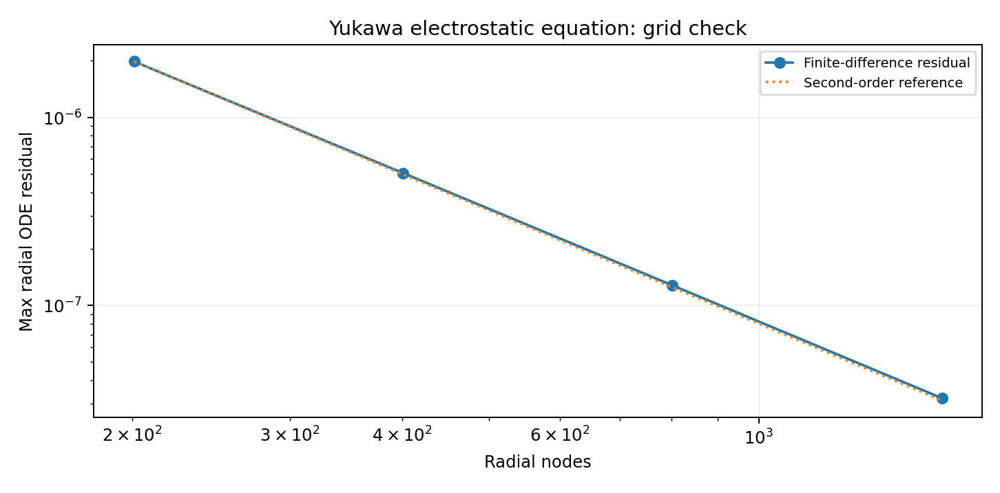{width=4.6in}

### 30L.4. Characteristic speed is not the same as packet speed

For a strictly positive $\Omega_\gamma$, a wave packet has group and phase speeds

$$
 v_{\mathrm{g}}=\frac{c_\gamma^2 k}{\sqrt{c_\gamma^2k^2+\Omega_\gamma^2}},\qquad
 v_{\mathrm{ph}}=\frac{\sqrt{c_\gamma^2k^2+\Omega_\gamma^2}}{k},\qquad
 v_{\mathrm{g}}v_{\mathrm{ph}}=c_\gamma^2.
\tag{L8}
$$

The symbol $c_\gamma$ here is a **characteristic high-wavenumber speed**, not the speed of every finite-frequency pulse. The packet is dispersive even if $\epsilon$ and $\mu=1/b$ have no explicit frequency dependence. Low-frequency packet transport is reduced more strongly than high-frequency transport, giving an additional experimental discriminator. This distinction is especially important whenever ArcSecs refers to light slowing or compares electromagnetic arrival with gravitational-wave arrival.

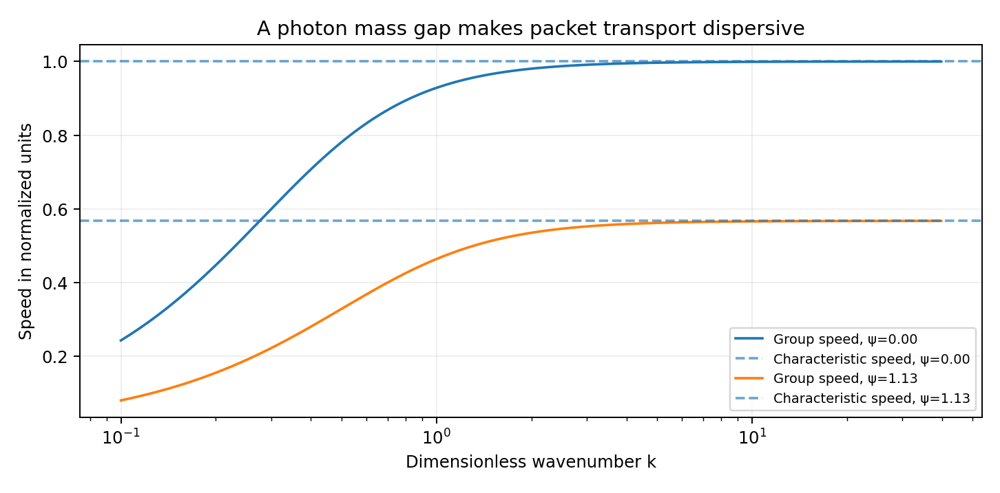{width=4.6in}

Part XIX provides one convenient **exactly matched** coefficient family,

$$
\epsilon=e^{\lambda\psi},\quad b=e^{-\lambda\psi},\quad
\eta=\Omega_0^2e^{\lambda\psi},\quad
\zeta=\Omega_0^2e^{3\lambda\psi},
\quad \omega^2=e^{-2\lambda\psi}k^2+\Omega_0^2.
\tag{L9}
$$

Here $c_\gamma=e^{-\lambda\psi}$ in normalized units while $\Omega_0$ is constant. In the homogeneous adiabatic limit, spatial translation invariance preserves $k$; therefore the rate of frequency response to an evolving field obeys

$$
\frac{d\ln\omega}{dT}=\underbrace{\frac{c_\gamma^2k^2}{c_\gamma^2k^2+\Omega_0^2}}_{\displaystyle 0<f_{\mathrm{transport}}<1}
\frac{d\ln c_\gamma}{dT}.
\tag{L10}
$$

This is a **new quantitative extension of the Part XIX audit**: a positive mass gap suppresses the fractional propagation-frequency shift at sufficiently small $k$. At large $k$ the massless transport law is recovered. At a stationary interface, time-translation symmetry instead conserves frequency across the interface even when $k$ and local group speed change. A spatial screening profile and a temporal slowing history must therefore be tested separately, as in Chapters 30G–30K.

### 30L.5. The source–transport–receiver calculation with a mass gap

The local atom supplies an independent frequency standard. If elementary charge and $\hbar$ are fixed and the simplified Coulombic source obeys $\nu_{\mathrm{atom}}\propto m_e\epsilon^{-2}$, take $\theta=\lambda\psi$ and, **only for a toy matter branch**, $m_e\propto e^{q\theta}$. For homogeneous emitter and receiver environments, let $\Delta\theta=\theta_a-\theta_e$, with $\Omega_0$ constant. Assuming the emitted photon lies on the locally calibrated same-$k$ adiabatic branch, the measured spectroscopic ratio is

$$
\boxed{1+z_{\mathrm{spec}}(k)=e^{(q-2)\Delta\theta}
\sqrt{\frac{c_e^2k^2+\Omega_0^2}{c_a^2k^2+\Omega_0^2}}},\qquad
c_a=c_e e^{-\Delta\theta}.
\tag{L11}
$$

In the high-wavenumber limit this reduces to Part XIX's $1+z_{\mathrm{spec}}=e^{(q-1)\Delta\theta}$. With a non-negligible mass gap the same source and scalar history instead yield a **frequency-dependent** apparent spectral shift. Thus an asserted positive cosmic redshift cannot be inferred from a characteristic speed decrease alone. Source calibration, emitted frequency, packet transport and detector reference all matter.

For the illustrative $\Delta\theta=\ln 2$, the high-wavenumber toy branch with $q=0$ has $z_{\mathrm{spec}}=-0.5$ (a blueshift); $q=1$ gives zero; and $q=2$ gives $z_{\mathrm{spec}}=1$. The last case requires a factor-four change of electron inertial mass between the two environments/epochs. Such a large proposed mass change is **not** an established property of matter; the resulting atomic-clock and dimensionless-ratio constraints must be calculated before it can be considered a credible cosmological branch.

### 30L.6. Independent reproduction and the unresolved observational program

We independently integrated the homogeneous reduced transverse/longitudinal/scalar Hamiltonian for Part XIX's published initial conditions ($\lambda=0.5$, $k=3$, $\Omega_0=0.4$, and evolution to $T=8$). It reproduces the endpoint $\psi=1.133880$ and characteristic speed $0.567259$. The initial total energy is $0.02323152$ normalized units, and numerical energy drift was below $10^{-15}$ in the independent run. The two vector modes and scalar trade energy; the conserved sum is a **property of this small autonomous model**, not a detected cosmological energy reservoir.

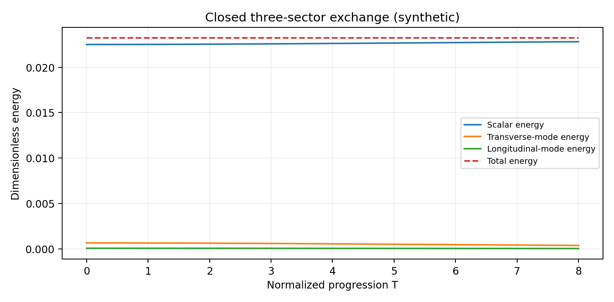{width=4.6in}

The external research context supplies demanding tests: photon-rest-mass bounds inferred from fast-radio-burst dispersion; precision constraints on atomic frequency ratios; strong constraints on the relative arrival of photons and gravitational waves; and geometric/photometric distance-duality measurements. The 2026 Zhang–Liu–Yu–Wu photon-mass paper reports upper limits, **not a detection**. A 2026 Gruzinov–Hook–Huang study investigates an environmental Abelian-Higgs alternative, not empirical confirmation of the ArcSecs scalar. A November 2026 DESI DR2 reanalysis of distance duality underscores the role of calibration. All are independent reference checks, not inputs secretly used to tune this toy Hamiltonian.

**What is now demonstrated:** a gauge-redundant classical massive-vector construction, a positive homogeneous quadratic mode spectrum, a constrained electrostatic Yukawa scale, an explicitly dispersive group velocity, an adiabatic frequency-shift suppression factor, and reproducible finite-mode energy transfer.

**What remains unresolved:** physical 3D charge/scalar current coupling; continuum convergence of Chapter 30K's receiver amplitude; quantized atomic states and transition line shapes; environmental interface transport; a shared electromagnetic/gravitational-wave propagation law; reproducible luminosity and angular-diameter distance predictions; and an independent observational fit. No model in this chapter establishes the full ArcSecs cosmology by itself.

**Decision:** retain Candidate A-05i-S as a *bounded companion* to Candidate A-05h, not as a replacement for Chapter 30K or a new numbered historical report. The next combined experiment must converge a localized charge–field observable at fixed physical parameters, then couple the screened massive vector to a microscopic quantum source and detector with no free post-hoc calibration factors. That is a testable research program consistent with the original twelve principles.

## Chapter 30M. A Massive Photon Meets a Quantum Atom: Charge Continuity and a Spectral Benchmark

*Candidate A-05j, Stage 1 — an explicit, bounded companion calculation, not the completed unified charged-field theory.*

**Research outcome.** Chapter 30L connected the matched massive-vector frequency gap to a Yukawa electrostatic interaction length. Chapter 30K showed that its separate three-dimensional charged-particle code conserves its retained mode constraints, but that the calculated receiver response remained cutoff-dependent. This chapter makes a different, strictly limited advance: it brings a conserved electric source and a hydrogen-like quantum bound-state calculation to the *same static mass–range coefficients*. The result is a falsifiable relationship among propagation, static forces and atomic line structure, without pretending that a nonconverged radiating receiver has become converged.

The twelve ArcSecs foundations remain the authorial research charter. Here a photon invariant-mass parameter, the Stueckelberg gauge redundancy, and a density-sensitive scalar are **candidate mechanisms** within that charter. Neither a positive invariant photon mass nor secular light slowing has been independently observed in this calculation. The program's distinction between physical processes and the coordinate labels “Where” and “When” remains intact.

### 30M.1. What the field model actually predicts

Adopt the positive-coefficient massive-vector action from Part XIX and Chapter 30L. In a locally homogeneous scalar environment, let the electric response be $\epsilon(\psi)>0$, the magnetic response coefficient $b(\psi)>0$, and the two vector-mass coefficients $\zeta(\psi),\eta(\psi)>0$. The field equations yield transverse and longitudinal dispersions

$$
\omega_T^2=\frac{b}{\epsilon}k^2+\frac{\eta}{\epsilon},\qquad
\omega_L^2=\frac{\eta}{\zeta}k^2+\frac{\eta}{\epsilon}.
\tag{M1}
$$

Under the *specified* matching condition $\eta/\zeta=b/\epsilon$, define $c_\gamma^2=b/\epsilon$ and $\Omega_\gamma^2=\eta/\epsilon$. Eliminating the nondynamical electrostatic potential in a homogeneous static environment gives

$$
(-\epsilon\nabla^2+\zeta)\varphi=\rho,\qquad
\ell_Y=\sqrt{\frac{\epsilon}{\zeta}}=\frac{c_\gamma}{\Omega_\gamma}.
\tag{M2}
$$

The static point-charge potential is $\varphi_Q(r)=Q\exp(-r/\ell_Y)/(4\pi\epsilon r)$. Thus $\Omega_\gamma$ and $\ell_Y$ are not two free adjustments once a matched branch and local characteristic speed have been chosen. This is a conditional constraint on that model, not a universal law for every possible massive electromagnetic theory.

The relevant physical distinction is that a *finite mass gap* affects both transverse propagation and electrostatic forces. A proposed optical deceleration cannot simply pick a massive dispersion, then demand a completely independent unscreened Coulomb law without supplying another interaction or specifying an environmental limit. The existing Stueckelberg literature provides the gauge-invariant massive-vector construction; screened hydrogen-like bound states have also been studied in the published quantum-mechanical literature. The new ArcSecs calculation below is an application and cross-check, not a claim to have invented these mathematical tools.

### 30M.2. Charged sources must conserve charge in the same numerical representation

The matter coupling in a gauge-redundant vector action may be written $\int(\mathbf j\!\cdot\!\mathbf A-\rho\varphi)\,d^3x$. Gauge variation of the source term is a total derivative *only if* the charge and current obey the continuity equation. This matters when we later combine moving electrons, nuclei, and the propagating massive vector: using incompatible particle-to-grid charge and current maps introduces an artificial charge leak that a successful energy test would not detect.

For independently moving charges $q_i$ at $\mathbf r_i(T)$ with velocities $\mathbf v_i(T)$, use the **same normalized finite-width kernel** $G_\sigma$ for both physical-source representations:

$$
\rho(\mathbf x,T)=\sum_iq_iG_\sigma(\mathbf x-\mathbf r_i),\qquad
\mathbf j(\mathbf x,T)=\sum_iq_i\mathbf v_iG_\sigma(\mathbf x-\mathbf r_i).
\tag{M3}
$$

For fixed charges $q_i$ and a fixed kernel width, this construction satisfies $\partial_T\rho+\nabla\cdot\mathbf j=0$ identically. Its Fourier-mode version, using $\widehat G_\sigma(\mathbf k)=\exp(-\sigma^2k^2/2)$, is

$$
\rho_{\mathbf k}=\sum_iq_i\widehat G_\sigma e^{-i\mathbf k\cdot\mathbf r_i},\qquad
\mathbf j_{\mathbf k}=\sum_iq_i\mathbf v_i\widehat G_\sigma e^{-i\mathbf k\cdot\mathbf r_i},\qquad
\dot\rho_{\mathbf k}+i\mathbf k\cdot\mathbf j_{\mathbf k}=0.
\tag{M4}
$$

The same source enters the *massive* electrostatic constraint

$$
\varphi_{\mathbf k}=\frac{\rho_{\mathbf k}}{\epsilon k^2+\zeta}.
\tag{M5}
$$

For a reproducible example with three moving signed charges and a finite smearing width, the complex Fourier continuity residual is smaller than $10^{-15}$ in normalized arithmetic, and the static constraint residual is at floating-point roundoff. This tests the source-construction algebra, **not** a full time-stepped, charge-conserving, three-dimensional Maxwell–Stueckelberg solver. A smooth Gaussian kernel has nonzero tails; neither this toy smoothing nor an instantaneous longitudinal constraint proves physically superluminal signaling.

### 30M.3. Replace the artificial oscillator with a solvable quantum benchmark

The first legitimate question for source/receiver calibration is not how a prescribed oscillator responds, but what its *energy-level differences* actually are. We start with the simplest conditional matter model: one nonrelativistic spinless electron in the electrostatic field of a fixed, heavy positive charge $+Ze$. Ignore spin, electron–field radiative corrections, nuclear size, dynamic recoil and many-body coupling. Define the local reduced mass $\mu_r$, Bohr scale $a_B=4\pi\epsilon\hbar^2/(\mu_rZe^2)$, local Rydberg $E_R=\hbar^2/(2\mu_ra_B^2)$, and screening strength $s=a_B/\ell_Y$.

The radial Schrödinger equation becomes, for $x=r/a_B$ and $u(x)=rR(r)$,

$$
\left[-\frac{d^2}{dx^2}+\frac{l(l+1)}{x^2}-\frac{2e^{-sx}}{x}\right]u_{nl}(x)
=\frac{E_{nl}}{E_R}\,u_{nl}(x).
\tag{M6}
$$

At $s=0$, its hydrogenic levels are $E_n/E_R=-1/n^2$. For positive screening $s$, levels change by different amounts depending on their spatial probability distributions. The first-order analytic correction is

$$
\frac{\delta E_{nl}}{E_R}=2\left(\left\langle\frac1x\right\rangle_{nl}-\left\langle\frac{e^{-sx}}x\right\rangle_{nl}\right).
\tag{M7}
$$

For $1s$, $2s$ and $2p$, the unscreened expectation values of $1/x$ are $1$, $1/4$ and $1/4$. Their screened expectations are, respectively,

$$
\begin{aligned}
F_{1s}(s)&=\frac4{(2+s)^2},\\
F_{2s}(s)&=\frac1{2(1+s)^2}-\frac1{(1+s)^3}+\frac3{4(1+s)^4},\\
F_{2p}(s)&=\frac1{4(1+s)^4}.
\end{aligned}
\tag{M8}
$$

The leading constant potential offset at small $s$ cancels out of transitions. To first order in the potential difference, the $2p$ versus $2s$ splitting is $\delta(E_{2p}-E_{2s})/E_R=2[F_{2s}(s)-F_{2p}(s)]$, which begins at **second order** in $s$. Consequently, fitting an absolute potential shift as if it were a spectral line would produce a spurious signal.

### 30M.4. A converging numerical line calculation, with an explicit limit

An independent symmetric tridiagonal radial solver was run with Dirichlet boundaries $u(0)=u(60a_B)=0$. It solves for $1s$ and $2s$ in the $l=0$ sector and $2p$ in the $l=1$ sector. Varying the grid spacing tests this **static bound-state subproblem**; it does not test the nonconverged, radiating receiver of Chapter 30K.

| Radial grid nodes | $1s\to2p$ line ($E_R$) | $2p-2s$ splitting ($E_R$) |
|--:|--:|--:|
| 600 | 0.739630 | 0.001863 |
| 1,200 | 0.741518 | 0.002012 |
| 2,400 | 0.741993 | 0.002049 |
| 4,800 | 0.742112 | 0.002058 |
| 9,600 | 0.742142 | 0.002061 |
| 14,400 | 0.742148 | 0.002061 |

**Synthetic parameters:** $s=0.05$, equivalent to $\ell_Y=20a_B$ in this one-electron model. A simple $h^2$ Richardson extrapolation using the last two resolutions gives a $1s\to2p$ line near **0.742152 $E_R$** and a $2p-2s$ splitting near **0.002062 $E_R$**. For comparison, the unscreened reference line is $0.75E_R$. The hypothetical screened line is about **1.05% smaller** than the unscreened line. Neither $s=0.05$ nor this percentage was fitted to real hydrogen or inferred from an astronomical source.

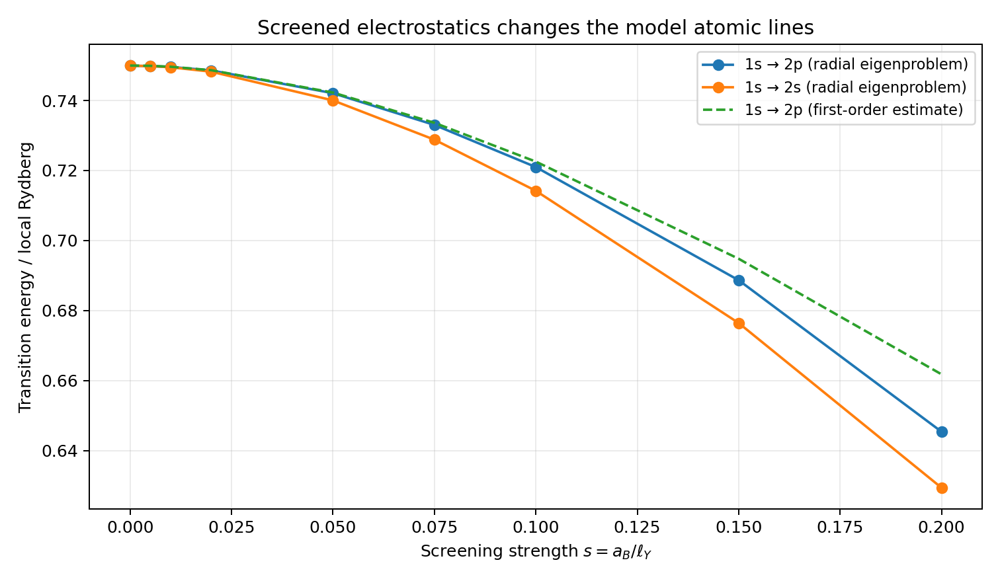

*Figure 30M.1. The plotted normalized lines are properties of the chosen screened Coulomb model. Their departure from the first-order perturbative estimate grows as screening strengthens.*

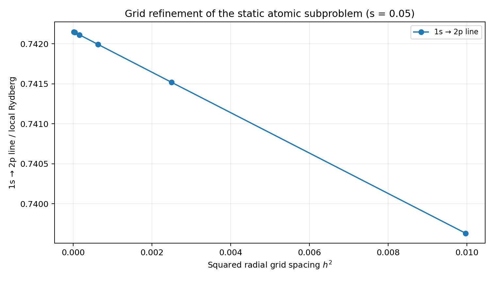

*Figure 30M.2. Refinement supports the expected second-order trend for the static radial solver. It does not establish convergence of dynamical electromagnetic reception.*

### 30M.5. Atomic standards are not fixed by electromagnetic impedance alone

For a locally homogeneous screened atom, the leading spectral scale and screened eigenvalue difference obey

$$
\nu_{1s\to2p}(\psi)=\frac{E_R(\psi)}{h}\,\mathcal D\!\left(s(\psi)\right),\quad
\mathcal D(s)=\frac{E_{2p}(s)-E_{1s}(s)}{E_R},\quad
s=\frac{a_B}{\ell_Y}.
\tag{M9}
$$

The fine-structure ratio alone therefore cannot determine the source line. For the Part XIX example $\epsilon=e^\theta$, $b=e^{-\theta}$, $\eta=\Omega_0^2e^\theta$, and $\zeta=\Omega_0^2e^{3\theta}$, we obtain $c_\gamma=e^{-\theta}$ and $\ell_Y=e^{-\theta}/\Omega_0$. If a *specified toy matter sector* gives $\mu_r\propto e^{q\theta}$ while $e$ and $\hbar$ remain constant, then

$$
E_R(\theta)\propto e^{(q-2)\theta},\qquad
s(\theta)=s_0e^{(2-q)\theta},\qquad
\nu_{1s\to2p}(\theta)\propto e^{(q-2)\theta}\mathcal D(s_0e^{(2-q)\theta}).
\tag{M10}
$$

This improves on a pure power-law atomic-frequency ansatz: it includes the **change in atomic wavefunctions and the associated Yukawa spectral correction**. For the illustrative $q=2$ branch, both $E_R$ and $s$ are constant in this leading model; for $q=0$ both change. None of these $q$ choices is empirically established or yet derived from a microscopic scalar–matter theory.

A measured source-to-observer redshift requires an additional phase transport law, source motion, the physical conditions at emission and reception, and detector calibration. Local atomic differences calculated here must not be relabeled as propagation redshift. Nor may one infer the size or age of the entire universe from this selected laboratory-scale model.

### 30M.6. What a decisive continuation must accomplish

The new calculation closes **one** previously missing bridge: a single assumed massive-vector force range can be used, consistently and quantitatively, in an explicitly solvable atomic spectrum, and moving signed charges can be constructed to obey the correct modewise continuity identity. It has not yet joined those ingredients into a self-consistent time-dependent Hamiltonian with mobile nuclei, propagating longitudinal polarization, dynamical screening, and independent source/receiver transitions. We must not silently promote a two-body electrostatic solver into the long-sought three-dimensional radiation model.

A proper Stage 2 of Candidate A-05j must implement its full charged source and longitudinal constraint, resolve packet emission and reception as the physical Fourier cutoff increases, and demonstrate conservation of total three-momentum as well as charge and energy. Only after the calculated receiver **line shape** is cutoff-stable should its parameter set be frozen and tested against independent clock and spectral observations. The finite-gap prediction must also survive static-force experiments and multi-messenger constraints, with no independently adjustable electrostatic range inserted after the fact.

**Research status:** new analytical connection and reproducible static quantum benchmark, with explicitly incomplete dynamic coupling. Failed or unconverged model branches remain in the project record. See Appendix S for the computational and source-provenance ledger.

## Chapter 30N. When a Quantum Receiver Listens: A Cutoff-Convergent Transverse-Field Benchmark

*Candidate A-05j, Stage 2A — a conservative one-dimensional quantum–classical bridge, **not** the complete three-dimensional Stueckelberg–charged-matter theory.*

**Research outcome.** Chapter 30K's three-dimensional, classical mobile-charge receiver response changed substantially with the retained Fourier cutoff. Chapter 30M established a separate, converging **static** screened atomic transition. The missing intermediate question is whether one can obtain a receiver response that is genuinely calculated—not assigned to a source spectrum—and stable under numerical refinement while conserving the energy and momentum of the interacting system. This chapter answers that narrower question **yes** for an explicitly limited model: two mobile neutral centers, each equipped with a quantum two-level degree of freedom, couple to a periodic one-dimensional set of *transverse* massive-vector modes and a homogeneous, dynamical scalar. The local transition frequency is tied to the Chapter 30M screened-atom benchmark, rather than chosen as an unrelated oscillator frequency.

The twelve ArcSecs foundational principles remain the author's research charter. A positive massive-vector frequency gap, environmental field, and quantum emitter/receiver are proposed *mechanisms*. Nothing in the numerical result detects a nonzero invariant photon rest mass, demonstrates cosmological light slowing, or establishes superluminal information transfer. Unlike the previous static calculation, the present receiver state actually changes in response to a field emitted by the source. Unlike the envisioned full model, it does **not** yet resolve the longitudinal polarization, dynamic Gauss constraint, real moving electron/nucleus charge densities, or full quantum radiation.

### 30N.1. A physically accountable question, not a fitted redshift

The model computes the probability that an initially unexcited receiver becomes excited when a coherent source polarization drives a massive transverse field. The receiver's own energy splitting changes with the scalar field according to a screened atomic reference. By scanning a small, explicitly specified intrinsic detuning at the receiver, we calculate an **excitation-versus-detuning response curve**. This is a synthetic finite-time spectral *proxy*, not an astronomical line profile or an instrumentally observed redshift. The computational acceptance condition is that this full response curve stabilizes with increasing Fourier cutoff at **fixed physical source width**.

There are three distinct observables: the source's local atomic gap, the field reaching the receiver, and the receiver's excited-state probability. Their values are related by equations of motion, not identified by definition. A changing optical propagation speed or a changing source clock cannot by itself be called an observed spectroscopic redshift.

### 30N.2. An autonomous Hamiltonian with moving neutral centers

Let $T$ be the universal ordering parameter used throughout the ArcSecs program, and $X_s,X_r$ be two material-center coordinates in a periodic one-dimensional calculation box of length $L$. Their masses $M_j$ and canonical momenta $P_j$ are genuine **model matter variables**. Each center carries a quantum two-level internal state $|g\rangle,|e\rangle$ represented by a normalized Bloch vector $(u_j,v_j,w_j)$, with $w=+1$ for the ground state. The electromagnetic polarization used here is *transverse* to the modeled direction of travel.

For positive Fourier wave numbers $k_n=2\pi n/L$, define a finite-width, normalized field sampling map

$$
\begin{aligned}
A(X_j,T)&=\sum_{n=1}^{N} W_n\,[a_n(T)\cos(k_nX_j)+b_n(T)\sin(k_nX_j)],\\
W_n&=\sqrt{\frac{2}{L}}\exp\!\left(-\frac{\sigma^2 k_n^2}{2}\right),\qquad \sigma>0.
\end{aligned}
\tag{N1}
$$

The same fixed physical width $\sigma$ is used when increasing $N$; otherwise apparently improved convergence may be no more than a change in the modeled source. The matched positive-gap family carried forward from Chapter 30L is

$$
\epsilon(\psi)=e^{\lambda\psi},\quad b_{\mathrm{em}}(\psi)=e^{-\lambda\psi},\quad
\eta(\psi)=\Omega_0^2e^{\lambda\psi},\quad
C_n(\psi)=b_{\mathrm{em}}(\psi)k_n^2+\eta(\psi).
\tag{N2}
$$

Consequently the **transverse** dispersion at a fixed field state satisfies $\omega_{T,n}^2=C_n/\epsilon=e^{-2\lambda\psi}k_n^2+\Omega_0^2$. This is not yet a solution of the longitudinal Stueckelberg constraint. The homogeneous scalar has a positive kinetic coefficient $K$ and restoring potential $V(\psi)=\kappa(\psi-\psi_*)^2/2$. In the dimensionless units of this subsection, the *complete implemented Hamiltonian* is

$$
\begin{aligned}
H={}&\frac{P_\psi^2}{2K}+\frac\kappa2(\psi-\psi_*)^2
+\sum_{j=s,r}\frac{P_j^2}{2M_j}\\
&+\sum_{n=1}^{N}\left[\frac{p_{a,n}^2+p_{b,n}^2}{2\epsilon(\psi)}+
\frac{C_n(\psi)}2(a_n^2+b_n^2)\right]\\
&+\sum_{j=s,r}\left[\frac{\Delta_j(\psi)}2(1-w_j)-g_jA(X_j,T)u_j\right].
\end{aligned}
\tag{N3}
$$

The $-g_j A u_j$ term is the expectation value of a two-level transverse dipole coupling $-g_jA\sigma_x$. A quantum two-level spin is not equivalent to a point electron with a spatially resolved charge density. The moving neutral centers provide a *longitudinal translational recoil* variable, while their internal dipole matrix elements are represented only at the two-level, transverse-projected level. **No claim of complete local charge continuity or full gauge invariance is made for this truncated Hamiltonian.** Those requirements remain separate acceptance gates for a later model.

### 30N.3. Borrow only the atomic physics that has actually been calculated

Chapter 30M defined $s=a_B/\ell_Y$ and numerically solved a hydrogen-like Yukawa radial eigenproblem, obtaining the extrapolated local $1s\rightarrow2p$ line $\mathcal D_0\simeq0.742152\,E_R$ at $s_0=0.05$. It did **not** give a dynamic quantum emitter embedded in an inhomogeneous scalar field. We therefore construct a transparent *local linear surrogate*, anchored at that independently converged reference rather than declaring the whole screened spectrum solved:

$$
\begin{aligned}
\theta&=\lambda\psi,\qquad s(\psi)=s_0e^{2\theta},\\
\Delta_s(\psi)&=e^{-2\theta}
\left[\mathcal D_0+\mathcal D'_{\mathrm{pert}}(s_0)(s(\psi)-s_0)\right],\\
\mathcal D'_{\mathrm{pert}}(s)&=2\left[(1+s)^{-5}-8(2+s)^{-3}\right],\\
\Delta_r(\psi)&=(1+\delta)\Delta_s(\psi).
\end{aligned}
\tag{N4}
$$

The dimensionless $\delta$ is a **declared receiver detuning** used in the resolution study; it is not a fitted astronomical redshift. $\mathcal D'_{\mathrm{pert}}$ is the derivative of the first-order screened-potential correction to the transition. It is *not* being passed off as a numerical derivative of the exact screened radial eigenproblem. The approximation must be replaced by actual dynamic microscopic matter calculations before interpreting a precision spectrum. In the runs below, $\psi$ remains between roughly $0.0398$ and $0.0767$; correspondingly $s$ remains near $0.051$–$0.052$, close to the anchor where the linearization is used.

### 30N.4. Evolution, recoil, scalar backreaction and invariants

Denote the Bloch vector for each center by $(u_j,v_j,w_j)$ and let $A_j=A(X_j,T)$. The local two-level Hamiltonian produces the **coupled** Bloch equations

$$
\dot u_j=\Delta_jv_j,\qquad
\dot v_j=-\Delta_ju_j+2g_jA_jw_j,\qquad
\dot w_j=-2g_jA_jv_j.
\tag{N5}
$$

With the canonical field momenta $p_{a,n},p_{b,n}$ and the spatial derivative $A'_j=\partial_XA(X_j,T)$, the field and center equations are

$$
\begin{aligned}
\dot a_n&=p_{a,n}/\epsilon, &\dot b_n&=p_{b,n}/\epsilon,\\
\dot p_{a,n}&=-C_na_n+W_n\sum_jg_ju_j\cos(k_nX_j), &
\dot p_{b,n}&=-C_nb_n+W_n\sum_jg_ju_j\sin(k_nX_j),\\
\dot X_j&=P_j/M_j,&\dot P_j&=g_ju_jA'_j.
\end{aligned}
\tag{N6}
$$

The scalar responds to electromagnetic mode energy **and** to the evolving quantum-level energies:

$$
\dot\psi=P_\psi/K,\qquad
\dot P_\psi=-V'(\psi)
+\frac{\epsilon'(\psi)}{2\epsilon(\psi)^2}\sum_n(p_{a,n}^2+p_{b,n}^2)
-\frac12\sum_n C_n'(\psi)(a_n^2+b_n^2)
-\frac12\sum_j\Delta_j'(\psi)(1-w_j).
\tag{N7}
$$

These terms are derivatives of the *same time-independent* Hamiltonian. They avoid one of the earlier candidates' pitfalls: allowing the light-field coefficient or atomic frequency to change without a specified energy recipient. Scalar energy gains and losses are included, but a homogeneous scalar cannot capture the full spatially resolved screening profile of Chapter 30G.

Two independent invariants of this particular reduced geometry follow from its symmetries: the Hamiltonian $H$ and the longitudinal Noether momentum

$$
P_{\mathrm{total}}=P_s+P_r-\sum_{n=1}^{N}k_n(p_{a,n}b_n-p_{b,n}a_n).
\tag{N8}
$$

The Bloch norm $u_j^2+v_j^2+w_j^2=1$ is a third check. Transverse canonical momentum is not represented, and conservation of equation (N8) is **not** a verification of three-dimensional electromagnetic stress or longitudinal charge dynamics. The algorithm separately checks that numerical scalar and material forces equal the finite-difference gradients of $H$.

### 30N.5. A calculated, cutoff-stable receiver detuning response

The experiment fixes $L=120$, source/receiver starting coordinates $X_s=35$, $X_r=48$, physical Gaussian width $\sigma=1.5$, center masses $M=250$, $g_s=0.045$, $g_r=0.070$, $\lambda=0.25$, $\Omega_0=0.18$, $K=50$, $\kappa=10$, and scalar equilibrium/initial value $\psi_*=\psi(0)=0.04$. All numbers are **dimensionless hypothetical parameters**. Both electromagnetic fields begin unexcited; the source begins in the *coherent* equal superposition with $u_s=1$, and the receiver begins in its ground state with $w_r=1$. The calculation integrates through $T=45$ with SciPy DOP853, relative tolerance $2\times10^{-9}$, absolute tolerance $2\times10^{-11}$ and maximum step $0.16$.

The synthetic response is defined as the maximum receiver excited-state probability $[1-w_r(T)]/2$ during a common window beginning after the approximate geometric arrival time. We repeat **seven detector detunings** $\delta=-0.12,-0.08,-0.04,0,0.04,0.08,0.12$ at **four Fourier cutoffs** $N=24,48,96,192$. A frequency-resolved source spectrum is *not* assumed as an input; the received field drives the quantum-state equations and the population is calculated. Because the emitter is prepared coherently, however, this scheme does not simulate spontaneous atomic emission from a pure excited eigenstate.

| Receiver detuning | $N=24$: peak excitation | $N=48$: peak excitation | $N=192$: peak excitation |
|--:|--:|--:|--:|
| $-12\%$ | $8.6242\times10^{-5}$ | $8.6156\times10^{-5}$ | $8.6156\times10^{-5}$ |
| $-8\%$ | $1.03322\times10^{-4}$ | $1.03207\times10^{-4}$ | $1.03207\times10^{-4}$ |
| $-4\%$ | $1.16609\times10^{-4}$ | $1.16479\times10^{-4}$ | $1.16479\times10^{-4}$ |
| $0\%$ | $1.17522\times10^{-4}$ | $1.17427\times10^{-4}$ | $1.17427\times10^{-4}$ |
| $+4\%$ | $1.04079\times10^{-4}$ | $1.04045\times10^{-4}$ | $1.04045\times10^{-4}$ |
| $+8\%$ | $7.98346\times10^{-5}$ | $7.98523\times10^{-5}$ | $7.98523\times10^{-5}$ |
| $+12\%$ | $5.16761\times10^{-5}$ | $5.17113\times10^{-5}$ | $5.17113\times10^{-5}$ |

At *fixed* $\sigma=1.5$, the maximum absolute difference over the full seven-point response curve between $N=48$ and $N=192$ is approximately $7.3\times10^{-13}$, and the maximum relative difference is $6.3\times10^{-9}$. In this run the $N=96$ and $N=192$ recorded curves are indistinguishable at the exported numerical precision. The lowest cutoff $N=24$ is slightly displaced (maximum relative difference about $0.112\%$), demonstrating that the comparison has not silently assumed identical results for all cutoffs.

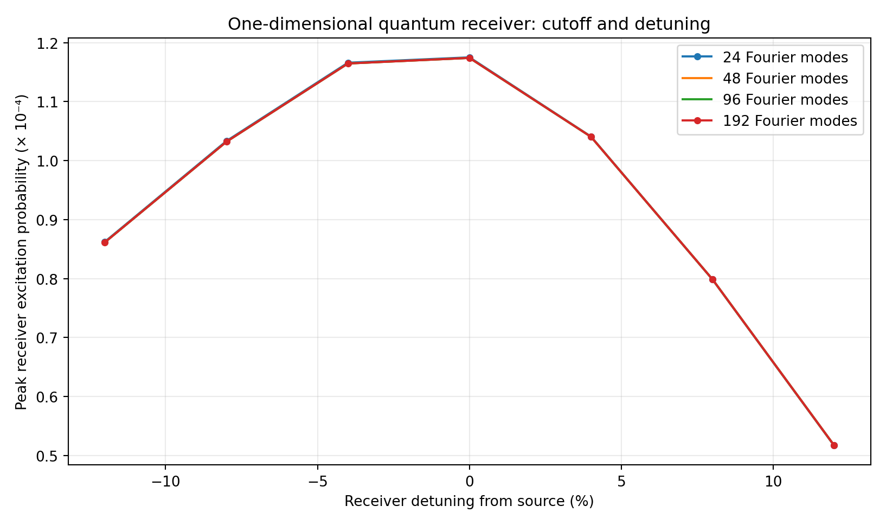

*Figure 30N.1. The seven measured quantities are simulated finite-time receiver excitation probabilities. They are neither astronomical fluxes nor a physical spectral line width in measured units.*

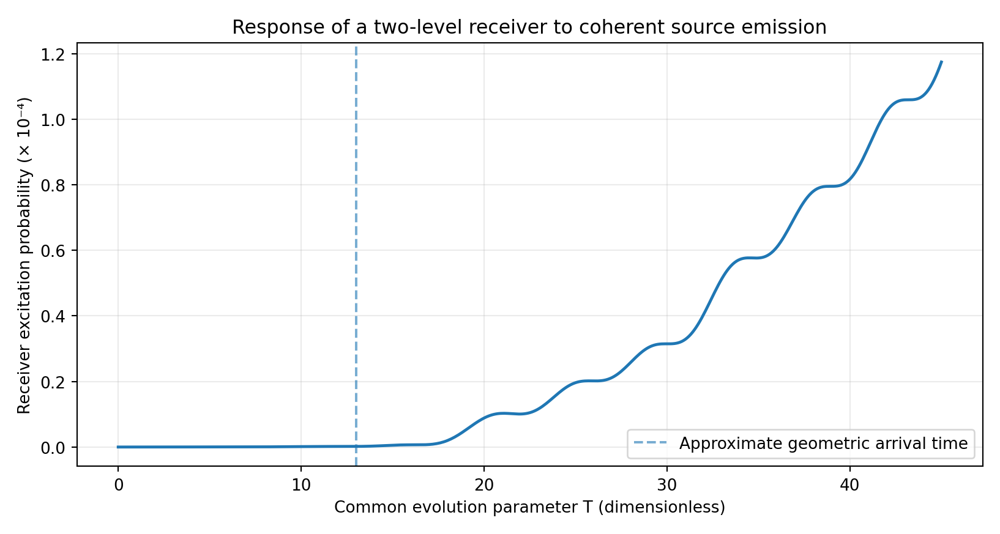

*Figure 30N.2. The source excites a receiver after field propagation in the finite box; the dashed time is an approximate propagation-time reference rather than an independently measured velocity.*

The autonomous model also conserves its energy to a maximum relative drift below $3\times10^{-15}$ and total longitudinal momentum to better than $1.2\times10^{-17}$ absolute for the reported detuning runs. The Bloch norm drift stays below $6\times10^{-14}$; the scalar evolves under the same equations and the material centers undergo small but nonzero calculated recoil. These are numerical correctness checks for the **implemented model** and should not be quoted as experimental precision or evidence of an ArcSecs cosmology.

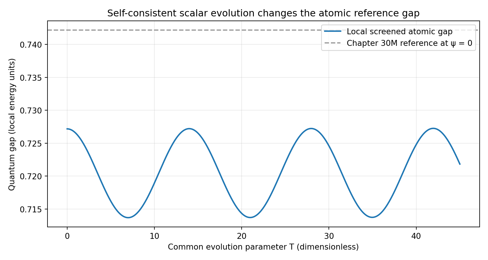

*Figure 30N.3. The changing detector gap is a local matter-calibration effect calculated from the specified surrogate. It is not identical by definition to the field propagation shift.*

### 30N.6. Controls: what produces the receiver signal?

Two independent zero-coupling experiments give exactly zero receiver excitation to solver precision: with $g_r=0$, the receiver does not interact with the field; with $g_s=0$, the initially field-free source does not excite a propagating wave. With $\lambda=0$, the scalar no longer shifts optical response or atomic gaps, and the receiver still responds through the electromagnetic coupling alone. The zero-scalar-coupling reference gives a $1.16081\times10^{-4}$ peak response at zero detuning, compared with $1.17427\times10^{-4}$ when coupled. The effect of varying $\sigma$ is larger: at $\sigma=0.9$, the zero-detuning response rises to approximately $4.92528\times10^{-4}$. **Cutoff convergence does not mean independence of the chosen source width.** This is a physical modeling parameter that would require microscopic justification and independent constraints.

An initially **pure excited** two-level source has $u_s=v_s=0$. With zero classical field, its dipole expectation stays zero and it emits no radiation in this mean-field scheme. That result is a known missing ingredient, not proof that physical excited atoms fail to radiate; spontaneous emission requires field quantization or a specified noise/initial-state prescription. This control prevents one from misrepresenting the calculation as a complete quantum-electrodynamics emission theory.

### 30N.7. Comparison to the earlier failure and acceptance gate

The approximately $25\%$ receiver discrepancy between 13 and 62 retained modes in Chapter 30K remains a real, recorded *failure of that earlier model's numerical acceptance test*. The Chapter 30N calculation does not retroactively correct it. It demonstrates that a carefully controlled, fixed-width, one-dimensional transverse quantum receiver admits a stable detuning curve and explicitly calculates a detector-state response. It adds an independent working reference for the eventual full theory.

The nonnegotiable next stage is **Candidate A-05j, Stage 2B**: put genuine mobile signed charges and their charge/current continuity, the constrained Stueckelberg longitudinal polarization, the transverse radiation field, spatially inhomogeneous scalar screening, atomic bound-state transitions and nuclear recoil into *one* three-dimensional model. Demonstrate simultaneous convergence of charge/Gauss constraints, total energy, all three momentum components, and a measured receiver spectrum under a prescribed fixed physical source regularization. Then freeze parameters and test observations not used in construction.

A failure of those specific coupled coefficients would be a result about the candidate model, not a declaration that the author's twelve foundational propositions have been independently established or disproved. The book advances most reliably when its predicted detector record can be reproduced **without** hiding a regulator choice, a clock-calibration change, or an unresolved experimental constraint.

**Research status:** synthetic numerical result, reproducing a *truncated* autonomous quantum–classical bridge; no novel astrophysical fit, observed photon mass or measured cosmological redshift claimed. Appendix T contains the equation and reproducibility audit.

## Chapter 30O. Listening in Three Dimensions: Charge Continuity, Massive-Vector Modes, and a Receiver Convergence Test

*Candidate A-05j, Stage 2B (bounded linear benchmark) — 23 November 2026*

**Research outcome.** Chapter 30K constructed an autonomous three-dimensional charged-particle model with conserved mode-projected charge and momentum, but its receiver response changed by about a quarter when the Fourier cutoff changed. Chapter 30N subsequently produced a convergent quantum two-level receiver in a different, one-dimensional, transverse-only model. Neither result established a convergent **three-dimensional receiver** with the longitudinal massive-vector mode of Chapter 30L. This chapter constructs a deliberately narrower but essential intermediate: a three-dimensional, charge-conserving, *driven linear* massive-vector response with finite-width signed charges. It gives a reproducible, complex-valued receiver spectrum stable under Fourier refinement. It does **not** merge all previous Hamiltonians or resolve Chapter 30K's original receiver failure.

This investigation accepts ArcSecs' twelve charter premises as the research program's declared starting points. It tests a proposed mathematical physical mechanism without claiming that a new field or nonzero invariant photon rest mass has been observed. Its results are conditional on the chosen action, source profile, and boundary conditions.

### 30O.1. Why the old receiver's discrepancy matters

A conservation check is necessary but not sufficient. It is possible for a finite-dimensional calculation to conserve its exact discrete Hamiltonian while the quantity supposedly representing a detector response changes every time the number of allowed field modes changes. A physical source size, a specified observable, fixed geometry, and a convergence criterion must therefore be declared **before** numerical refinement. Here a spatially resolved, neutral positive-and-negative charge pair sources a three-dimensional vector field; a second finite-width region measures the field projected along a chosen detector axis. The key output is a *complex transfer amplitude*, not an atom's excitation probability, an astronomical flux, or a spectral redshift.

The old Chapter 30K result remains a failed acceptance gate: its approximately 25% response change over the reported mode range cannot be erased by running a different model with smoother input data. This new experiment isolates the ingredients needed to turn the next fully dynamical model into a meaningful cutoff study.

### 30O.2. One three-dimensional vector action and a conserved charged source

Use coordinates as relational labels and a preferred ordering parameter $T$. Let $\mathbf A$, $\varphi$, and $\chi$ be a vector potential, electric potential and Stueckelberg field. The gauge-invariant electric and magnetic fields are $\mathbf E=-\dot{\mathbf A}-\nabla\varphi$ and $\mathbf B=\nabla\times\mathbf A$. A fixed, homogeneous scalar background selects the four positive response coefficients $\epsilon,b,\zeta,\eta$ of Part XIX:

$$
\begin{aligned}
\mathcal L={}&\frac{\epsilon}{2}|\mathbf E|^2-\frac b2|\mathbf B|^2
+\frac\zeta2(\varphi+\dot\chi)^2
-\frac\eta2|\mathbf A-\nabla\chi|^2\\
&+\mathbf J\cdot\mathbf A-\rho\varphi.
\end{aligned}\tag{O1}
$$

The source is invariant under the gauge redundancy when its charge and current satisfy $\dot\rho+\nabla\cdot\mathbf J=0$. For **matched** transverse and longitudinal speeds, choose

$$
 b=\epsilon c_\gamma^2,\qquad \eta=\epsilon\Omega_\gamma^2,\qquad
 \zeta=\epsilon\Omega_\gamma^2/c_\gamma^2 .\tag{O2}
$$

Then the three polarizations have $\omega_k^2=c_\gamma^2|\mathbf k|^2+\Omega_\gamma^2$, and the electrostatic Yukawa length is $\ell_Y=c_\gamma/\Omega_\gamma$. Equation (O2) is a *model choice*, not a measurement of vacuum constitutive properties. The local scalar is held fixed for this experiment: the density screening, scalar energy and recoil dynamics derived in Chapters 30G–30J are **not** claimed to be present here.

Put a positive Gaussian charge cloud at $\mathbf X+\mathbf d(T)/2$ and an equal negative one at $\mathbf X-\mathbf d(T)/2$. The clouds share fixed physical width $\sigma_s$ and have opposite velocities $\pm\dot{\mathbf d}/2$ about a fixed center. In a periodic cubic volume of side $L$, their exact Fourier-space source is

$$
\begin{aligned}
\rho_{\mathbf k}&=-2iq\,G_s(k)e^{-i\mathbf k\cdot\mathbf X}
\sin(\mathbf k\cdot\mathbf d/2),\\
\mathbf J_{\mathbf k}&=q\,G_s(k)e^{-i\mathbf k\cdot\mathbf X}
\cos(\mathbf k\cdot\mathbf d/2)\dot{\mathbf d},\\
G_s(k)&=\exp(-\sigma_s^2|\mathbf k|^2/2).
\end{aligned}\tag{O3}
$$

Differentiating the first line gives $\dot\rho_{\mathbf k}+i\mathbf k\cdot\mathbf J_{\mathbf k}=0$ **for each retained wavevector**, for arbitrary prescribed $\mathbf d(T)$. That is an exact continuity identity for the signed clouds, not just a claim that the total integrated charge is zero. The centers' trajectories are *supplied inputs*, however. Their power source and recoil are not tracked in this chapter.

For the linear, small-separation response, define the dipole moment $\mathbf p=q\mathbf d$ and retain terms first order in $\mathbf d$. Under one harmonic component of frequency $\omega$, the Fourier sources reduce to $\rho_{\mathbf k}=-i(\mathbf k\cdot\mathbf p)G_s$ and $\mathbf J_{\mathbf k}=-iz\mathbf pG_s$, with $z=\omega+i\gamma$. A positive $\gamma$ specifies the analytic retarded frequency window used for the plotted transfer function; it is **not** a claim of energy loss in an autonomous Hamiltonian or a new material absorption mechanism.

### 30O.3. Solving the electric constraint and all three vector polarizations

Fix $\chi=0$ for the positive-gap linear theory. Write $D_{\mathbf k}=c_\gamma^2|\mathbf k|^2+\Omega_\gamma^2-z^2$. Solving the massive-vector equations and their scalar-potential constraint yields

$$
\begin{aligned}
\mathbf A_{\mathbf k}&=\frac{-izG_s}{\epsilon D_{\mathbf k}}\mathbf p,\\
\varphi_{\mathbf k}&=\frac{-ic_\gamma^2G_s}{\epsilon D_{\mathbf k}}
(\mathbf k\cdot\mathbf p),\\
\mathbf E_{\mathbf k}&=\frac{G_s}{\epsilon D_{\mathbf k}}
\left[z^2\mathbf p-c_\gamma^2\mathbf k(\mathbf k\cdot\mathbf p)\right].
\end{aligned}\tag{O4}
$$

These expressions include transverse radiation and longitudinal electric response. At nonzero $\mathbf k$, the transverse projector is $I-\mathbf k\mathbf k^T/k^2$ and the longitudinal projector is $\mathbf k\mathbf k^T/k^2$. The $\mathbf k=0$ mode is handled separately without dividing by $k^2$. A second calculation independently solves the original *four-by-four* linear system for $A_x,A_y,A_z,\varphi$, rather than substituting (O4) into itself. It reproduces the electric-field amplitudes to floating-point precision.

The two strongest algebraic constraints have the form

$$
-iz\rho_{\mathbf k}+i\mathbf k\cdot\mathbf J_{\mathbf k}=0,\qquad
 i\epsilon\mathbf k\cdot\mathbf E_{\mathbf k}+\zeta\varphi_{\mathbf k}
=\rho_{\mathbf k}.\tag{O5}
$$

They hold for every included mode because the source current and the longitudinal constraint were derived together. The numerical residuals in this benchmark are algebraic equation checks, **not** a proof that a continuum, spatially varying, nonlinear theory has converged.

### 30O.4. A receiver must measure a specified physical average

A receiving region of Gaussian width $\sigma_r$ centered at $\mathbf X_r$ samples $\mathbf d_r\cdot\mathbf E$, with unit detector axis $\mathbf d_r$. Denoting $\mathbf R=\mathbf X_r-\mathbf X_s$, the receiver transfer function for a cubic cutoff $|n_x|,|n_y|,|n_z|\leq N$ is

$$
\begin{aligned}
H_N(z)=\frac{1}{\epsilon L^3}\sum_{\mathbf k}
\frac{e^{-(\sigma_s^2+\sigma_r^2)k^2/2}\,e^{i\mathbf k\cdot\mathbf R}}
{c_\gamma^2 k^2+\Omega_\gamma^2-z^2}
\left[z^2(\mathbf d_r\cdot\mathbf p)
-c_\gamma^2(\mathbf d_r\cdot\mathbf k)(\mathbf k\cdot\mathbf p)\right].
\end{aligned}\tag{O6}
$$

The Gaussian factors are *fixed physical modeling assumptions*; they are not numerical filters allowed to shrink with the cutoff. The result is a complex electric-field susceptibility from a **prescribed** dipole oscillation to a sampled electric field. It is not a detector's quantum transition probability. Because longitudinal and transverse amplitudes are complex, $|H_T+H_L|$ need not equal $|H_T|+|H_L|$; dropping the longitudinal term would change both magnitude and phase.

For a dimensionless illustration, set $L=24$, $\epsilon=c_\gamma=1$, $\Omega_\gamma=0.30$, $\gamma=0.12$, $\sigma_s=1.5$, $\sigma_r=1.3$, $\mathbf R=(4.5,0.7,0.4)$, and parallel source/receiver axes along $y$. These are **synthetic inputs**, not calibrated charge dimensions or measured physical constants. Evaluate nine frequencies from $0.45$ to $1.65$ and five cubic cutoffs $N=4,6,8,10,12$, or 729 through 15,625 modes.

| Fourier shell $N$ | Retained 3D modes | $|H_N|$ at $\omega=1.05$ |
|--:|--:|--:|
| 4 | 729 | 0.0016660224 |
| 6 | 2,197 | 0.0015895634 |
| 8 | 4,913 | 0.0015898982 |
| 10 | 9,261 | 0.00158989965 |
| 12 | 15,625 | 0.00158989963 |

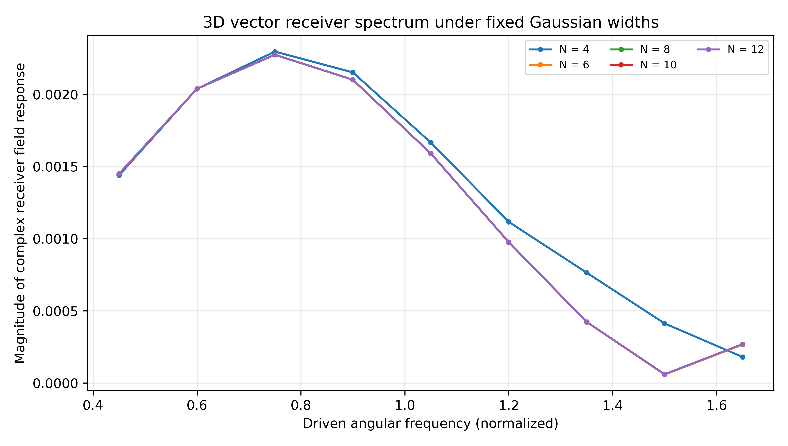

The maximum **complex** difference between $N=10$ and $N=12$ across the nine frequencies is $1.092\times10^{-10}$ in the normalized field units; the maximum corresponding relative difference is $1.40\times10^{-6}$. Evaluating the complex response, not only its absolute magnitude, prevents accidentally masking a phase error. This demonstrates convergence for this one chosen finite-width, finite-box problem; it does not establish convergence under $\sigma_s\to0$, $\sigma_r\to0$, a larger simulation box, or a different mass gap.

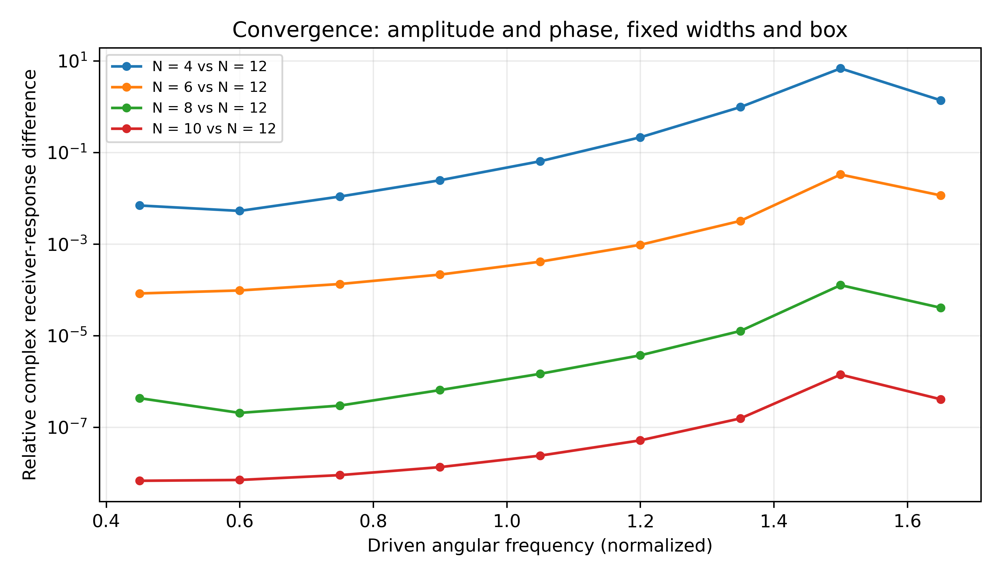

### 30O.5. Controls and what survives them

An exact signed-pair continuity check, a centered finite-difference time derivative, the independent four-variable matrix solver, source reversal, source–receiver reciprocity, a static longitudinal check, and varying frequency all pass. Across the cutoff sweep, the largest scaled algebraic equation residual is approximately $2.3\times10^{-16}$. Both polarization sectors have nonzero influence on the detector in the baseline geometry; the relative phase can create cancellation.

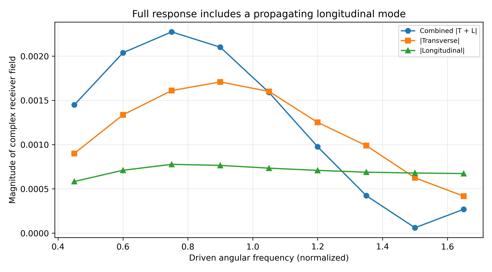

The most important *negative* control is physical-width dependence. Narrowing each cloud from the baseline widths to $0.65$ changes the response at $\omega=1.05$ from about $0.00159$ to $0.00705$ in the same normalized field units. Altering the cubic box from $L=24$ to $L=30$ also changes the response: the periodic-image and finite-volume assumptions have not vanished because the Fourier sum converged. Setting the vector mass gap to zero changes the response yet again. These controls are preserved to prevent a numerical success from becoming an unjustified observation claim.

### 30O.6. What this advances—and what remains to be built

Chapter 30O now supplies a working **three-dimensional longitudinal-plus-transverse charge-conserving receiver transfer reference**. It answers the limited question: *Can a spatially finite, neutral charged source excite a mathematically constrained three-dimensional positive-mass vector theory and yield a stable frequency-resolved receiver field as retained Fourier modes increase?* Under the specified conditions, **yes**. That result is useful because it defines a frozen, reproducible target for subsequent dynamic codes.

But it is **not** the complete Stage 2B goal. The signed pair's trajectory is prescribed, rather than obtained from forces; its mechanical and field energy exchanges are not closed; the scalar screening background is held fixed; the current is linearized in the small-dipole limit for the frequency scan; no quantum bound-state transition is dynamically computed; and the periodic box and positive frequency window influence the result. The unconverged dynamic receiver of Chapter 30K remains a distinct unresolved result. A separate, three-dimensional *autonomous* model must couple moving signed charges, a genuinely spatial scalar, all three vector modes, and quantum-transition matrix elements, and then pass charge continuity, Gauss's law, total energy–momentum conservation, and a cutoff-stable **atomic receiver spectrum at fixed physical widths** simultaneously.

**Research decision:** retain Candidate A-05j-B as a constrained, reproducible three-dimensional Green-response companion to A-05h, A-05i, and the Chapter 30N quantum receiver—not as a replacement for them, an R42 historical report, an experimental detection, or a self-contained cosmological theory. The twelve foundational principles remain unchanged; the next tests concern candidate equations, not the author's entitlement to use those premises in the book.

## Chapter 30P. The Recoiling Quantum Receiver: Three-Dimensional Charges Under One Conservation Ledger

*Candidate A-05j-C, Stage 2C — 23 November 2026; reproducible semiclassical benchmark*

**Research outcome.** Chapter 30K demonstrated an autonomous three-dimensional charged-field Hamiltonian but did not converge its detector amplitude; Chapter 30N converged an autonomous one-dimensional two-level receiver; Chapter 30O converged a driven three-dimensional massive-vector transfer, without feedback from a quantum detector. This chapter joins four independently moving signed charges, two coherent two-level systems, three-dimensional transverse electromagnetic modes, an instantaneous screened longitudinal electric constraint, and a *spatially homogeneous* evolving scalar in one finite-dimensional Hamiltonian. The field drives the receiver and the receiver back-reacts on the field and charge centers. Energy, three-component canonical momentum, spin normalization, and retained-mode charge continuity are checked independently. A fixed-width receiver excitation converges across five cubic Fourier cutoffs. **This is a new, limited model: it is not a complete dynamical Stueckelberg three-polarization theory, a spatially screened field, a quantum-electrodynamics atom, a measured spectral redshift, or a solution of Chapter 30K's original unconverged setup.**

The twelve ArcSecs foundations remain the author's unmodified research charter. Here the book's responsibility is narrower: identify which consequences follow from an explicit candidate law, what numerical diagnostics actually establish, and where that candidate still lacks a physical mechanism.

### 30P.1. What must be coupled rather than separately calibrated

A driven receiver model can be made to show almost any line response by choosing its source. Conversely, a moving-charge Hamiltonian may conserve energy while failing to produce a stable detector observable. The appropriate intermediate test is to make each part of the system exchange energy and momentum *reciprocally*: moving positive and negative charges source and respond to the electromagnetic modes; the two-level dipole both feels and sources a transverse mode; the scalar changes the electrostatic constraint, vector propagation coefficients and the local transition gap. The source's initial state and the detector's excited-state population must then be outputs of the same evolution.

The calculation uses a preferred ordering label $T$ and a periodic cubic reference volume of side $L$, but no claim that coordinate locations or this numerical grid constitute a material medium. Each atom surrogate has a positive charge and a negative charge at independently mobile positions $\mathbf r_{j+}$ and $\mathbf r_{j-}$. Its internal two-level state is represented by a unit Bloch vector $\mathbf s_j=(u_j,v_j,w_j)$, with excited-state probability $P_{e,j}=(1-w_j)/2$. This is a coherent Ehrenfest approximation rather than a quantized electromagnetic field with spontaneous emission and entanglement. The assumed harmonic positive–negative binding is retained as a placeholder, not derived from microscopic spectroscopy.

### 30P.2. The autonomous reduced Hamiltonian

Take one representative of each $\pm\mathbf k$ pair in the finite periodic three-dimensional Fourier lattice. Let $\mathbf e_{\mathbf k\ell}$, $\ell=1,2$, be orthonormal vectors transverse to $\mathbf k$. The fixed physical charge width $\sigma$ enters the real cosine and sine basis

$$
\begin{aligned}
F^c_{\mathbf k}(\mathbf x)&=\sqrt{\frac{2}{L^3}}\,e^{-\sigma^2 k^2/2}\cos(\mathbf k\cdot\mathbf x),\\
F^s_{\mathbf k}(\mathbf x)&=\sqrt{\frac{2}{L^3}}\,e^{-\sigma^2 k^2/2}\sin(\mathbf k\cdot\mathbf x),\\
\mathbf A(\mathbf x)&=\sum_{\mathbf k,\ell}\mathbf e_{\mathbf k\ell}\bigl[a^c_{\mathbf k\ell}F^c_{\mathbf k}(\mathbf x)+a^s_{\mathbf k\ell}F^s_{\mathbf k}(\mathbf x)\bigr].
\end{aligned}\tag{P1}
$$

The vector has canonical momenta $\pi^{c,s}_{\mathbf k\ell}$. With $\epsilon=e^{\lambda\psi}$, $b=e^{-\lambda\psi}$, and an illustrative positive massive-vector gap $\Omega$, define $C_k=b k^2+\Omega^2\epsilon$ and $D_k=\epsilon k^2+\Omega^2\epsilon^3$. The second denominator enforces the **static** matched-model Yukawa electrostatic constraint; the propagating longitudinal Stueckelberg polarization is not evolved here. The same positive/negative charge deposition basis defines $\rho^c_{\mathbf k}=\sum_i q_iF^c_{\mathbf k}(\mathbf r_i)$ and its sine counterpart. Then use

$$
H=H_{\mathrm m}+H_{\mathrm L}+H_{\mathrm T}+H_{\psi}+H_{\mathrm{at}}.\tag{P2}
$$

Here the independently mobile charged particles and their bound-pair interaction contribute

$$
H_{\mathrm m}=\sum_{i=1}^{4}\frac{|\mathbf p_i-q_i\mathbf A(\mathbf r_i)|^2}{2m_i}
+\frac{\kappa}{2}\sum_{j=1}^2|\mathbf r_{j+}-\mathbf r_{j-}|^2.\tag{P2a}
$$

The constrained longitudinal electric and dynamical transverse field sectors are

$$
H_{\mathrm L}=\frac12\sum_{\mathbf k}\frac{(\rho^c_{\mathbf k})^2+(\rho^s_{\mathbf k})^2}{D_k}.\tag{P2b}
$$

$$
H_{\mathrm T}=\frac12\sum_{\mathbf k,\ell}\left[\frac{(\pi^c)^2+(\pi^s)^2}{\epsilon}
+C_k\bigl((a^c)^2+(a^s)^2\bigr)\right].\tag{P2c}
$$

The scalar and local two-level dipole energy sectors are

$$
H_{\psi}=\frac{p_\psi^2}{2K_\psi}+\frac{\kappa_\psi}{2}(\psi-\psi_0)^2.\tag{P2d}
$$

$$
H_{\mathrm{at}}=\sum_{j=1}^2\left[\frac{\Delta_j(\psi)}{2}(1-w_j)
-g_j u_j\,\mathbf d_j\cdot\mathbf A(\mathbf X_j)\right],\qquad
\mathbf X_j=\frac{\mathbf r_{j+}+\mathbf r_{j-}}{2}.\tag{P2e}
$$

The scalar-dependent local transition gap $\Delta_j$ uses the *linearized local Yukawa benchmark* derived in Chapter 30N from Chapter 30M. Its scale is calibrated only within the synthetic model, not by a measured source. The reduced coupling $-g_ju_j\mathbf d_j\cdot\mathbf A$ is specified in a fixed transverse gauge; it is **not** a proof of fundamental gauge-invariant atom–vector coupling. The scalar is homogeneous and does not generate a spatial chameleon screening wall, although it changes the electrostatic screening denominator $D_k$. The longitudinal sector therefore remains an instantaneous constraint, not a third propagating polarization.

The particle equations follow from $\dot{\mathbf r}_i=\partial H/\partial\mathbf p_i$ and $\dot{\mathbf p}_i=-\partial H/\partial\mathbf r_i$, and the modes from the analogous canonical pairs. The same spin Hamiltonian gives

$$
\dot u_j=\Delta_j v_j,\quad
\dot v_j=-\Delta_j u_j+2g_j B_jw_j,\quad
\dot w_j=-2g_jB_jv_j,\qquad
B_j=\mathbf d_j\cdot\mathbf A(\mathbf X_j).
\tag{P3}
$$

It follows algebraically that $d(u_j^2+v_j^2+w_j^2)/dT=0$. The field-source term in the mode equation is proportional to $g_ju_j$, and its reciprocal mechanical force is $\tfrac12 g_ju_j\nabla B_j$ on *each* signed member of the pair. There is no independently prescribed detector trajectory or external field drive in this experiment.

### 30P.3. Charge continuity, screened Gauss law and Noether momentum

Because every charge deposits through the *same* basis used in its current, the signed-charge mode coefficients obey exactly

$$
\dot\rho^c_{\mathbf k}+\mathbf k\cdot\mathbf J^s_{\mathbf k}=0,
\qquad\dot\rho^s_{\mathbf k}-\mathbf k\cdot\mathbf J^c_{\mathbf k}=0,
\quad\mathbf J^{c,s}_{\mathbf k}=\sum_i q_i\dot{\mathbf r}_i F^{c,s}_{\mathbf k}(\mathbf r_i).
\tag{P4}
$$

The constrained electrostatic coefficients are $\varphi^{c,s}_{\mathbf k}=\rho^{c,s}_{\mathbf k}/D_k$, so $(\epsilon k^2+\Omega^2\epsilon^3)\varphi^{c,s}_{\mathbf k}=\rho^{c,s}_{\mathbf k}$ for each retained Fourier mode. The homogeneous charge mode vanishes because each pair is neutral, but this does **not** mean that the local charge density or the longitudinal electric forces vanish after the two members separate.

The Hamiltonian has no explicit $T$ or absolute position in a spatially periodic box. Its three-component translation generator is

$$
\mathbf P_{\mathrm{total}}=\sum_i\mathbf p_i+\sum_{\mathbf k}\mathbf k\sum_{\ell=1}^2\left(a^c_{\mathbf k\ell}\pi^s_{\mathbf k\ell}-a^s_{\mathbf k\ell}\pi^c_{\mathbf k\ell}\right).
\tag{P5}
$$

Thus $\dot H=0$ and $\dot{\mathbf P}_{\mathrm{total}}=\mathbf0$ follow for the reduced autonomous system. Finite-difference derivatives of the implemented Hamiltonian were also compared against the programmed force equations: these independent checks matter because conservation from the *same erroneous code* would be weaker evidence.

### 30P.4. Frozen parameters, cutoff refinement and actual detector output

In normalized units, set $L=14$, fixed Gaussian width $\sigma=1.75$, $\Omega=0.40$, four charges $q_i=(+0.24,-0.24,+0.24,-0.24)$, equal source and receiver couplings $g_s=g_r=1.5$, and initial centers at $x=\pm2.5$. The two opposite charges in each center begin coincident; the source Bloch vector begins at $(1,0,0)$, while the receiver begins in its ground state $(0,0,1)$. The scalar starts at $\psi=0.04$. The initial positive dipole is therefore a *coherent superposition*, not a spontaneously radiating pure excited atom. Integrate to $T=12$, with a common 121-sample output grid. The reported observable is the **maximum receiver excited-state population after $T=4.6$**, not a redshift, luminosity, telescope spectrum, or measurable photon flux.

| Cubic shell cutoff | Retained real wavevector pairs | Peak receiver excitation |
|---:|---:|---:|
| 1 | 13 | $0.00017064596$ |
| 2 | 62 | $0.00015581364$ |
| 3 | 171 | $0.00015404983$ |
| 4 | 364 | $0.00015405858$ |
| 5 | 665 | $0.00015405857$ |

The relative change between shell 4 and shell 5 is $6.59\times10^{-8}$ **for this particular finite-source, finite-box, finite-time output**. The maximum reported energy drift across the 14-run matrix is below $1.5\times10^{-14}$ relative to initial energy; the total three-momentum drift remains below $4\times10^{-17}$ in normalized units; Bloch norms and charge/Gauss constraints are also stable. Such small numbers indicate integration of this defined Hamiltonian, not the precision of any laboratory measurement.

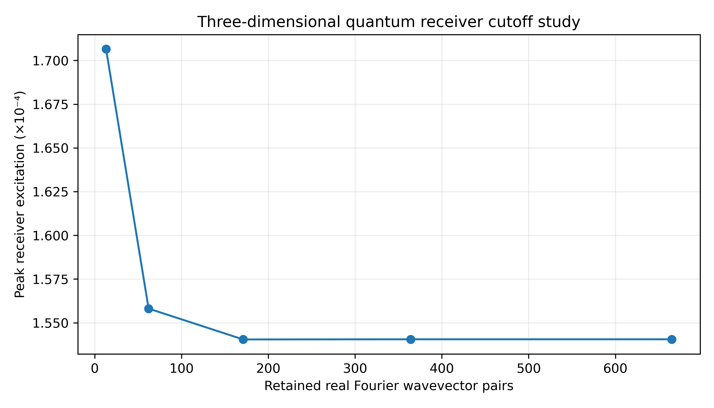

The receiver is not an arbitrary open-loop readout: switching off either source coupling or receiver coupling gives zero excited-state probability. A scalar-decoupled control changes the peak to $0.000148861$, compared with $0.000154059$ in the baseline. Setting the explicit signed charges to zero changes the output slightly but does not abolish excitation, because the two-level dipole still couples directly to the transverse field. Increasing the Gaussian width to $2.1$ reduces the peak to $0.0000314054$. **This physical-width dependence is substantial.** The regulator must ultimately be independently calibrated from microscopic charge distributions, not selected solely to achieve convergence.

### 30P.5. A receiver detuning curve is not yet a cosmological spectrum

Changing only the receiver gap by $-12\%,-6\%,0,+6\%,+12\%$ gives the following peak probabilities at the shell-4 cutoff: $0.000146087$, $0.000151963$, $0.000154059$, $0.000152391$, and $0.000146930$. Their nonconstant response is an actual **synthetic detector selectivity** calculation. It does not establish any observed source emission line or redshift. A photon frequency transported from emission to reception, a frequency ratio of two fully calibrated atoms, and the recorded detector population must remain separate until all three are predicted by the same controlled theory.

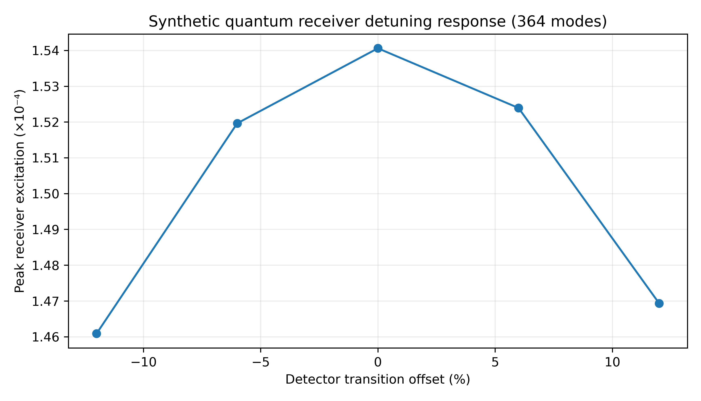

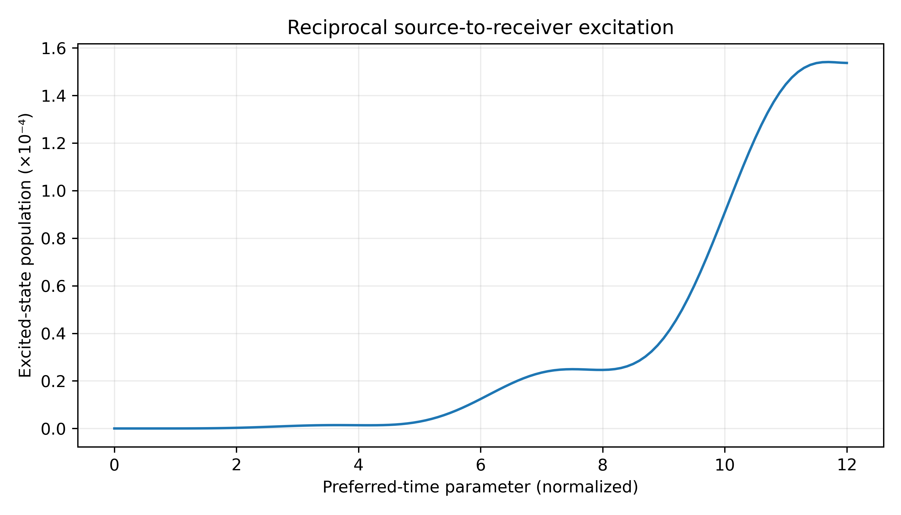

### 30P.6. What is improved, and what still fails the acceptance gate

The advance over Chapter 30O is reciprocal dynamics: the field excites a two-level detector; the detector feeds back on the field; independently mobile signed charges experience recoil; and the same autonomous evolution preserves total energy and three momentum components. The advance over Chapter 30K is a specifically declared regularization, a quantum-state output and a cutoff-stable result for a *new* finite-width model. Neither result changes the historical 30K failure, and the Gaussian width has not been derived from microscopic atomic physics.

Four major requirements remain open. **First**, the longitudinal Stueckelberg polarization is not dynamically evolved, although a Yukawa electrostatic constraint is present. **Second**, the scalar is spatially homogeneous and cannot reproduce the density-screening boundary of Chapter 30G. **Third**, the two-level gap is imported from a local Yukawa benchmark while the signed particles still obey harmonic binding: a fully self-consistent atom with quantized relative motion and genuine transition selection rules has not been derived. **Fourth**, fixed-transverse-gauge electric-dipole coupling must be completed into a gauge-consistent microscopic theory before interpreting its spectral response as a photon-mass test. Finite periodic volume, smooth source kernels, finite time, and a coherent initial dipole also remain input assumptions.

**Next bounded research acceptance gate:** derive a single microscopic charged-matter/Stueckelberg/scalar action with dynamical longitudinal polarization and spatial density screening; derive and preserve all constraints and conserved quantities; obtain regulator-independent or independently calibrated three-dimensional detector response; and **only then** freeze the theory's parameters for laboratory and astronomical holdouts. This stage must test—not simply assume—that the same mechanism accounts for atomic lines, photon propagation, lensing, clock behavior and multi-messenger timing. The authorial twelve ArcSecs principles remain intact as the program's agenda, while candidate mechanisms retain explicit failure conditions.

*Reproducibility:* see Appendix V, `tools/charged_quantum_3d_v1.py`, `tools/plot_charged_quantum_3d_v1.py`, and `docs/long-term-memory/research/charged-quantum-3d/`. All reported numbers arise from synthetic normalized runs. No observation was fitted or detector measurement acquired.

\Needspace{16\baselineskip}

## Chapter 30Q. When Matched Photon Speeds Diverge: Propagating Longitudinal Modes at a Screened Boundary

**Candidate A-05j-D · One-dimensional stratified massive-vector field · 23 November 2026**

*Claim status:* Conditional mathematical derivation and normalized numerical test. The twelve ArcSecs principles remain the charter; no new experimental observation, real photon-mass measurement, or cosmological fit is claimed.

### 30Q.1. What the earlier models did not yet connect

Chapter 30L derived an explicitly gauge-redundant Stueckelberg massive-vector candidate with two transverse and one longitudinal propagating polarizations. Chapter 30G independently produced a density-screened scalar profile across a material surface. Chapters 30O and 30P added respectively a three-dimensional driven receiver and a reciprocal mobile-charge/two-level model. Yet the 30P Hamiltonian represented the longitudinal electric interaction by an **instantaneous screened constraint**, not by its own propagating positive-energy polarization. It also kept the scalar spatially uniform. Neither convergence of its receiver population nor conservation of its reduced energy establishes the missing physics.

The present bounded step deliberately **does not** claim the complete missing three-dimensional union. Instead it asks a narrower, independently checkable question: *if a stationary physical scalar field is screened by dense matter, how do the actual propagating transverse and longitudinal modes cross that boundary when their local dispersions have been matched?* The calculation derives the longitudinal constraint and a strictly positive wave-energy ledger, solves the matter-supported scalar background, and then calculates reflection and transmission of both polarizations without inventing a separate attenuation law. This separates (i) equal local speeds, (ii) equal boundary transmission, and (iii) true dynamic matter exchange.

### 30Q.2. The gauge-consistent starting action

Use the same preferred-order parameter $T$ and relational position coordinate $x$ as the preceding candidate. Let $\psi(x)$ denote an environmental scalar, $A_y$ a transverse component, $A_x$ a longitudinal component, $\varphi$ a scalar electric potential, and $\chi$ the Stueckelberg field. In normalized units define

$$
\begin{aligned}
E_x&=-\partial_T A_x-\partial_x\varphi,\\
E_y&=-\partial_T A_y,\\
B_z&=\partial_x A_y,\\
W_0&=\varphi+\partial_T\chi,\\
W_x&=A_x-\partial_x\chi.
\end{aligned}\tag{Q1}
$$

The relevant positive-coefficient vector action is

$$
\mathcal L_{\mathrm{v}}=\frac{\epsilon(\psi)}2(E_x^2+E_y^2)
-\frac{b(\psi)}2B_z^2+\frac{\zeta(\psi)}2W_0^2
-\frac{\eta(\psi)}2(W_x^2+A_y^2).\tag{Q2}
$$

All four coefficients are positive. The transformations $\mathbf A\mapsto\mathbf A+\nabla\Lambda$, $\varphi\mapsto\varphi-\partial_T\Lambda$, $\chi\mapsto\chi+\Lambda$ leave the physical combinations invariant. Positive Stueckelberg mass coefficients allow unitary gauge $\chi=0$ for this classical calculation. This is a particular, established form of gauge redundancy, not a claim that ArcSecs discovered the Stueckelberg method.

A static environmental profile can be sourced by a fixed density $\rho(x)$ through

$$
-S\,\psi''+(m^2+g\rho(x))\psi=f,
\qquad S,m^2,g,f>0.\tag{Q3}
$$

It follows as the static Euler–Lagrange equation of a scalar action with gradient energy $S(\psi')^2/2$, potential $(m^2+g\rho)\psi^2/2-f\psi$, and a kinetic term for a future dynamic extension. **For this experiment the matter profile and $\psi$ are held fixed.** The wave is a linear probe, so its calculated energy conservation is not an independent conservation test for moving matter or a backreacting scalar.

### 30Q.3. The longitudinal mode is not a Coulomb shortcut

In unitary gauge set the free longitudinal displacement $D=\epsilon E_x$. Varying $\varphi$ and $A_x$ in (Q2), without externally injected charge or current inside the probe region, gives

$$
\partial_xD+\zeta\varphi=0,
\qquad \partial_TD=\eta A_x.\tag{Q4}
$$

Consequently $\varphi=-D_x/\zeta$ and $A_x=D_T/\eta$. Substitution back into the electric-field definition produces the *dynamical*, constraint-respecting longitudinal wave equation

$$
\boxed{\partial_T\!\left(\frac{\partial_TD}{\eta}\right)
-\partial_x\!\left(\frac{\partial_xD}{\zeta}\right)
+\frac{D}{\epsilon}=0.}\tag{Q5}
$$

The transverse equation is

$$
\boxed{\partial_T(\epsilon\,\partial_T A_y)
-\partial_x(b\,\partial_x A_y)+\eta A_y=0.}\tag{Q6}
$$

Equation (Q5) contains a genuine longitudinal propagation term; it is not merely the static Yukawa equation used in Chapter 30P. In any homogeneous region the two local dispersions are

$$
\omega_T^2=\frac{b}{\epsilon}k^2+\frac{\eta}{\epsilon},
\qquad \omega_L^2=\frac{\eta}{\zeta}k^2+\frac{\eta}{\epsilon}.\tag{Q7}
$$

A shared characteristic speed therefore requires $\eta/\zeta=b/\epsilon$. The common positive gap is $\Omega^2=\eta/\epsilon$; above the gap, a packet's *group* speed remains $v_g=c_{\mathrm{char}}^2k/\omega$ and is generally less than its characteristic speed. Matching local formulas alone says nothing about the interface conditions or reflection.

The exact positive wave-energy densities for **time-independent coefficients** are

$$
\begin{aligned}
\mathcal E_T&=\tfrac12\epsilon(\partial_T A_y)^2+
\tfrac12 b(\partial_x A_y)^2+\tfrac12\eta A_y^2,\\
\mathcal E_L&=\frac{(\partial_TD)^2}{2\eta}+
\frac{(\partial_xD)^2}{2\zeta}+\frac{D^2}{2\epsilon}.
\end{aligned}\tag{Q8}
$$

Their fluxes are $J_T=-b A_{y,x}A_{y,T}$ and $J_L=-D_xD_T/\zeta$, giving $\partial_T\mathcal E_s+\partial_xJ_s=0$ for either $s\in\{T,L\}$. This is a *linear, fixed-background* energy ledger. Its positivity and conservation do not imply that the interacting three-dimensional emitter–field–matter system has already been solved.

### 30Q.4. A deliberately matched family and a screened material slab

To isolate interface effects without tuning each frequency separately, take one fixed coefficient family:

$$
\epsilon=e^\theta,\qquad b=e^{-\theta},\qquad
\eta=\Omega_0^2 e^\theta,\qquad
\zeta=\Omega_0^2e^{3\theta},\qquad
\theta(x)=\lambda\psi(x).\tag{Q9}
$$

Then both modes have $\omega^2=e^{-2\theta}k^2+\Omega_0^2$, and the static electric-force range satisfies $\ell_Y=\sqrt{\epsilon/\zeta}=e^{-\theta}/\Omega_0$. The common gap is positive and constant in this chosen family. A decrease in local characteristic speed with increasing $\psi$ is possible *if* the scalar evolves in time; in this calculation the scalar does not evolve in time, so a stationary interface causes **no frequency shift** in an otherwise static system.

The matter slab is centered at $x=0$, has half-width $a=3$, and occupies a normalized interval $[-18,18]$. Its density is $\rho_{\mathrm{in}}=12$, against $\rho_{\mathrm{out}}=0.03$. With $S=1$, $m^2=1$, $g=1.8$, $f=1$, $\lambda=0.85$ and $\Omega_0=0.38$, the scalar is strongly screened in the interior and tends toward the exterior equilibrium. We solve (Q3) by both an exact piecewise hyperbolic-function profile and a separately coded tridiagonal finite-volume-informed approximation.

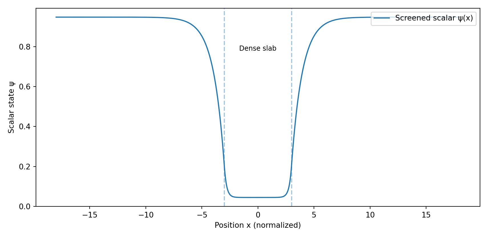

The exact profile has $\psi(0)=0.044248$ and $\psi(\pm18)=0.948767$. The boundary values, interface continuity, density contrast and scalar-gradient scale follow from the specified differential equation. No astronomical density or experimentally measured scalar coupling is being inferred from these numbers.

### 30Q.5. Equal dispersions, unequal interface scattering

For an above-gap monochromatic probe, write $A_y(x,T)=u_T(x)e^{-i\omega T}$ or $D(x,T)=u_L(x)e^{-i\omega T}$. In either sector the mode equation is a positive-coefficient Sturm–Liouville problem,

$$
\frac{d}{dx}\left(p_s\frac{du_s}{dx}\right)+q_su_s=0,\quad
\begin{cases}
p_T=b,\ q_T=\epsilon\omega^2-\eta,\\
p_L=1/\zeta,\ q_L=\omega^2/\eta-1/\epsilon.
\end{cases}\tag{Q10}
$$

Across a sharp interface without a delta-function source, both $u_s$ and its canonical flux $p_su_s'$ are continuous. For a single boundary between homogeneous regions, the reflected **field-amplitude** coefficient is

$$
r_s=\frac{p_{s,1}k_1-p_{s,2}k_2}
{p_{s,1}k_1+p_{s,2}k_2},
\qquad k_j=e^{\theta_j}\sqrt{\omega^2-\Omega_0^2}.\tag{Q11}
$$

In the specially matched family (Q9), $p_Tk=\sqrt{\omega^2-\Omega_0^2}$ on *both* sides: $r_T=0$. Yet $p_Lk=e^{-2\theta}\sqrt{\omega^2-\Omega_0^2}/\Omega_0^2$, so

$$
\boxed{r_L=\tanh(\theta_2-\theta_1),\qquad r_T=0.}\tag{Q12}
$$

This sign-aware formula applies to a **single sharp interface**, with the amplitude defined for incident $u_L=D$, not to the total reflection of the two-interface slab. It shows immediately why equal $\omega(k)$ does not imply equal coupling to material structure. Indeed, for an arbitrarily *smooth* one-dimensional static $\theta(x)$, the optical coordinate $s=\int^xe^{\theta(u)}du$ reduces the transverse equation to $d^2u_T/ds^2+(\omega^2-\Omega_0^2)u_T=0$: this particular transverse channel is exactly reflectionless at normal incidence. The longitudinal equation retains additional gradient terms and can reflect. These are constrained consequences of (Q9), **not** general theorems about all massive-vector theories.

The code integrates the first-order transfer state $(u_s,p_su_s')$ across the **two-sided smooth profile**. It calculates the flux ratio rather than interpreting a raw amplitude change as absorbed energy:

$$
R_s=|r_s|^2,\quad \mathcal T_s=\frac{(p_sk)_{\mathrm{right}}}{(p_sk)_{\mathrm{left}}}|t_s|^2,
\qquad R_s+\mathcal T_s=1.\tag{Q13}
$$

For equal exterior environments the prefactor is unity. At $\omega=1.1$, using 1601 profile nodes, the longitudinal reflected **energy fraction** is $R_L=0.115487$ (about 11.55%) while $R_T$ is below $10^{-25}$ for the same coefficient family. Across the tested twelve frequencies from $0.6$ to $2.8$, flux closure holds within $8.5\times10^{-15}$, and transverse reflection is at floating-point noise. The longitudinal reflection spectrum changes strongly with frequency because the two interfaces and finite screening-gradient width interfere. The numbers must not be interpreted as real laboratory photon-reflection measurements.

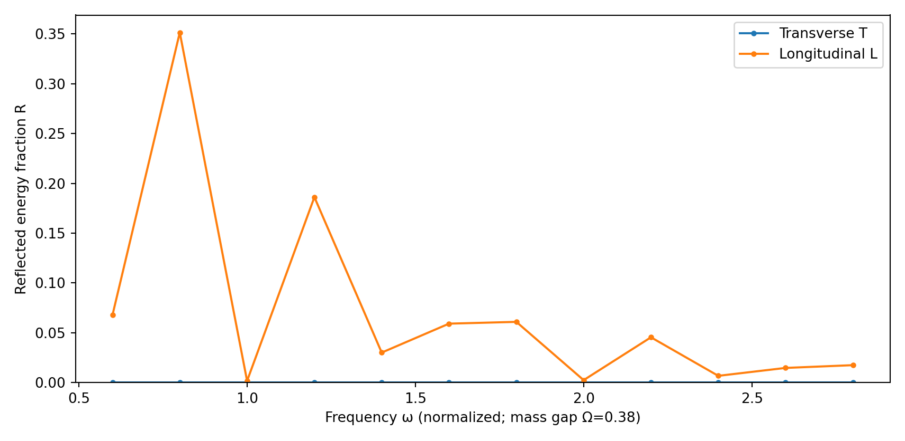

### 30Q.6. Numerical independence, energy and honest convergence

A separate time-domain code constructs symmetric positive stiffness operators for (Q5) and (Q6). An implicit midpoint step evolves the canonical field coordinates and momenta under a fixed scalar background; its conservation of the discrete positive quadratic energy is a structural check rather than an assertion that energy entered the dense slab. For the recorded trial runs, relative field-energy drift is of order $10^{-14}$ or smaller.

For the longitudinal *scattering* calculation, keeping the physical scalar profile and frequency fixed gives:

| Spatial grid nodes | Longitudinal reflected energy fraction $R_L$ |
|---:|---:|
| 101 | 0.102897 |
| 201 | 0.113515 |
| 401 | 0.114844 |
| 801 | 0.115377 |
| 1601 | 0.115487 |

The last two values differ by $0.000110$ **in absolute reflected fraction**. The sequence is stabilizing, but extrapolation beyond this calculation should retain the numerical uncertainty and must not claim exact continuum convergence at machine precision. The separately solved scalar boundary problem also improves under grid refinement; its largest absolute discrepancy against the analytic profile falls from about $0.0132$ at 101 nodes to about $0.000114$ at 1601 nodes. The fixed physical slab width and test frequency were *not* tuned as the grid was increased.

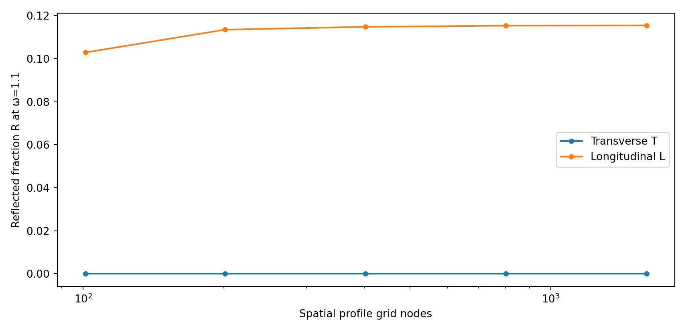

With $\lambda=0$ or $f=0$, the scalar response ceases to create an optical boundary and both modes become reflectionless in this setting. These controls identify the calculated interface signal as a consequence of the imposed field profile and coefficient family, not a numerical artifact of a moving source or a claim about true vacuum photon masses.

### 30Q.7. What this changes in the book's research decisions

This chapter closes a **specific mathematical gap**: it provides a genuinely propagating longitudinal polarization in a spatially screened but fixed environmental scalar, and a positive energy/flux ledger. It also introduces a polarization-sensitive **boundary transmission** test that previous single-dispersion arguments overlooked. Equal characteristic speeds do not imply equal propagation through a material density gradient; the full wave and constraint equations decide.

It does **not** merge Chapters 30O and 30P into a fully gauge-consistent, backreacting three-dimensional atom; $\rho(x)$ is externally held, the scalar does not respond to the vector wave, and the wave packet neither excites a quantized atom nor predicts a measured spectral line. The positive mass gap is an assumed parameter, subject to future local electrostatic and high-precision bounds. No net photon redshift is generated across this stationary profile. The earlier Chapter 30K 3D dynamic receiver convergence problem remains in the historical record.

**Next independent acceptance gate, Candidate A-05j-E:** release the scalar and material sources dynamically in a single gauge-invariant matter–Stueckelberg system; preserve charge continuity and the scalar, longitudinal, transverse and material energy-momentum exchanges; then compare frozen-parameter **three-dimensional** receiver spectra across independent spatial cutoffs, source widths and external box sizes. A new model fails the proposed gate if it achieves only conservation but not spectral convergence, or if it achieves convergence only by changing the physical source profile. None of those future tasks is presented here as already completed.

---

# Part Ten — Cross-Scale Transport and Photon Aging

## Chapter 30R. The Cosmic Regulator and the Aging Photon: Cross-Scale Tests

*Consolidated-paper intake: Parts I–XXVIII, November 23, 2026. This chapter bridges the microscopic work of Chapters 30L–30Q to C-01, distance inference and irreversible aging. It does not complete the previously proposed three-dimensional dynamical A-05j-E integration. The twelve foundations remain authorial research premises.*

### The physical origin of an emission ceiling

The supplied 22-page consolidated paper, *ArcSecs: A Physical-Process Research Program for Photon Propagation, Cosmic Distance, and Relational Inertia* (review edition 1.0), clarifies C-01. The question is what establishes the maximum initial speed of newly emitted light in our cosmic domain. The proposed collective influence of the matter distribution may differ across hypothetical domains. It is not a claim that two approaching spacecraft generate a photon that travels at four times the local reference speed. In a hypothetical additive-velocity model, two oppositely directed wavefronts emitted by approaching sources can close at twice the sum of source and emission speeds; that convention cannot also impose the same individual photon ceiling in the shared frame. Closing speed alone is not the speed of a transmitted signal. Sciama's historical inertia hypothesis is motivation, not a derivation of C-01 [CR1].

Distinguish five quantities: local emission ceiling $C_{\mathrm{em}}$, electromagnetic characteristic $C_f$, all-sector causal characteristic $C_{\mathrm{causal}}$, packet group velocity $v_g$, and coordinate separation rate $V_{\mathrm{sep}}=d|\mathbf{x}_2-\mathbf{x}_1|/dT$. A strict candidate target is $v_g(T_e+\tau)\le v_g(T_e)\le C_{\mathrm{em}}(\mathbf{x}_e,T_e)$ and $dv_g/d\tau\le0$. The characteristic need not equal the causal maximum of all sectors. In the local massive-vector dispersion of Chapter 30L, $\omega^2=C_f^2k^2+\Omega^2$, the packet speed is $C_f\sqrt{1-\Omega^2/\omega^2}$. Exact initial packet speed at the front speed is not attained for finite frequency and positive gap. Preserve the exact charter target and disclose this model's shortfall. Distinguish fixed rest mass from fixed local energy gap when $C_f$ varies. The numerical SI value of the local reference $c_0$ is not itself a derivation of the cosmic constitutive law.

### A physical environmental regulator, not a potential convention

Part XXVII proposes a finite-range matter-sourced scalar $I$, separate from earlier candidate fields unless their couplings are explicitly identified. For a prescribed static density and decaying boundary conditions,

$$(-\nabla^2+\lambda^{-2})I=g\rho,\qquad C(I)=\frac{C_*}{\sqrt{1+\alpha I^2}}.\tag{CR1}$$

Here $\lambda>0$, $\alpha\ge0$, and $C_*>0$ are candidate parameters. A causal extension can introduce $C_I^{-2}\partial_T^2 I$ on the left of the field equation and impose retarded initial/boundary conditions. Its signal speed $C_I$ must enter the all-sector causal ledger. A moving density source needs reciprocal field forces and energy accounting; it cannot be prescribed externally while claiming closure. The regulator does not derive inertia merely by depending on cosmic mass.

For a thin spherical shell of mass $M$ and radius $R$, with $q=R/\lambda$ and $x=r/R$, the decaying Green function gives

$$I(0)=\frac{gM}{4\pi R}e^{-q},\qquad
\frac{I(r)}{I(0)}=\begin{cases}\sinh(qx)/(qx),&x\le1,\\
[\sinh(q)/q]e^{-q(x-1)}/x,&x\ge1.\end{cases}\tag{CR2}$$

The limit at the center is one. The scalar can be nonzero throughout an empty cavity with zero ordinary Newtonian shell force. For finite range its gradient generally need not vanish away from the center. This is a static environmental field solution, not a discovery of a wall or a neighboring universe. In the illustrative normalization $\alpha I(0)^2=1$, $C(0)=c_0$, so $C_*=\sqrt2 c_0$. Re-normalizing the center for each $q$ is not a parameter-frozen range experiment. At $q=1$, the normalized speeds at $r/R=1,1.5,2$ are 0.916487, 1.277330, and 1.382287 respectively. The exterior asymptote is $\sqrt2 c_0$ by construction. A constant-frequency packet can slow toward the wall then reaccelerate outside it, contrary to strict monotonic aging. A spatially infinite domain with uniform finite density $\rho_0$ gives $I_{\mathrm{ref}}=g\rho_0\lambda^2$; removing a ball of radius $b$ removes the central fraction $1-(1+s)e^{-s}$ for $s=b/\lambda$. This is a benchmark, not a statement about the size or density of the real cosmos.

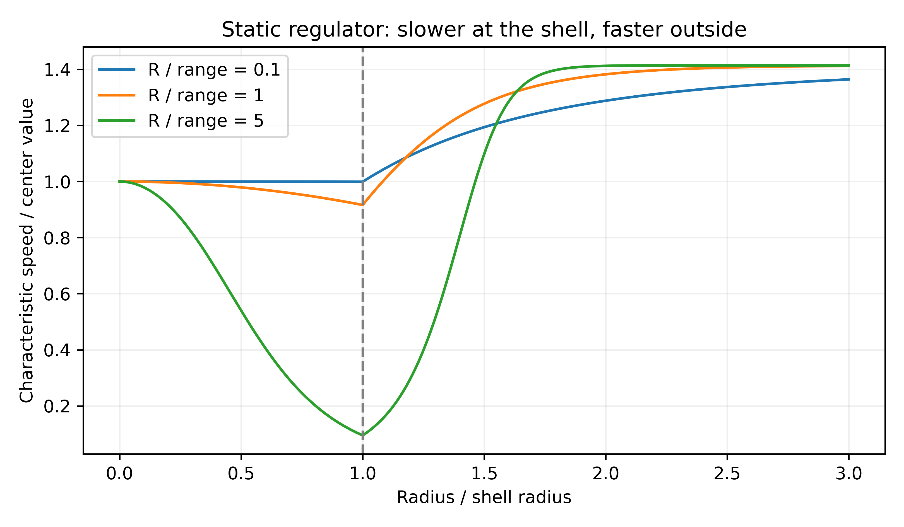

### Irreversible photon aging: a bounded obstruction

A stationary homogeneous medium with positive rest energy $E_m=\hbar\Omega$ and fixed characteristic $C$ is the domain of Part XXVIII. The effective packet law is $\dot p=-\gamma p$ with $\gamma>0$, not a microscopic interaction. Set $u=Cp/E_m$ and $\tau=T-T_e$.

$$E=E_m\sqrt{1+u^2},\quad u=u_e e^{-\gamma\tau},\quad v=\frac{Cu}{\sqrt{1+u^2}}.\tag{CR3}$$

The derivative $\dot v=-\gamma v/(1+u^2)$ is strictly negative for finite positive momentum. The exact path length is

$$D(\tau)=\frac{C}{\gamma}[\operatorname{arsinh}(u_e)-\operatorname{arsinh}(u_e e^{-\gamma\tau})].\tag{CR4}$$

The maximum packet travel distance approaches $(C/\gamma)\operatorname{arsinh}(u_e)$ under eternal drag. It is not the causal horizon of all sectors. At stationary endpoints with identical stable atomic standards, let $1+z=E_e/E_a$ and $\epsilon=E_m/E_e$. The stable arrival-speed deficit is

$$1-v_a/C=\frac{\epsilon^2(1+z)^2}{1+\sqrt{1-\epsilon^2(1+z)^2}}.\tag{CR5}$$

The finite arrival requires $\epsilon(1+z)<1$. The small-gap limit of (CR5) is $\epsilon^2(1+z)^2/2$. It measures deficit from $C$, not decrement from the initial speed. At $z=1$ and $\epsilon=10^{-8}$ the deficit is $2\times10^{-16}$ while the packet loses half its energy. At $\epsilon=10^{-16}$ it is $2\times10^{-32}$. These numbers are illustrative fractions, not measured masses. Significant frequency loss does not guarantee significant slowing. A positive gap by itself does not solve the ArcSecs aging mechanism.

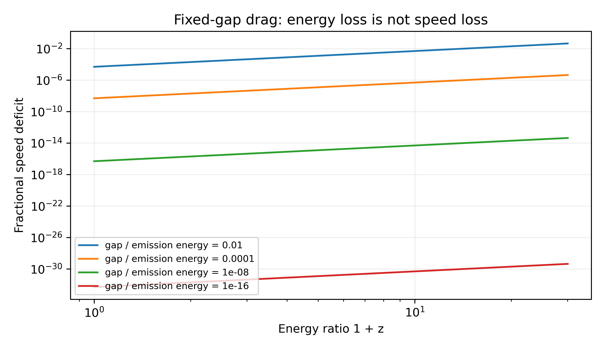

There is an additional constraint on a faster exterior. Suppose a packet with initial speed $v_i$ enters a region of characteristic $C_f>v_i$ and unchanged positive rest energy. Avoiding endpoint acceleration requires

$$\frac{E_f}{E_m}\le[1-(v_i/C_f)^2]^{-1/2}.\tag{CR6}$$

For a nearly characteristic-speed packet, with $C_f/C_i=\sqrt2$ and $E_m/E_i=10^{-8}$, at most about $1.4142\times10^{-8}$ of the initial energy survives. Almost all the energy must be transferred elsewhere; the arrival is near the mass gap. This is a necessary endpoint condition, not proof of a continuous monotone path. It applies only to the fixed-gap dispersion. A varying gap, different dispersion, moving medium or other microscopic process requires new equations, not an arbitrary clamp on the speed.

The packet loses power $\gamma pv$ and momentum at rate $\gamma p$. An additive bath ledger can balance both, but does not specify any physical bath. The energy released per net positive momentum loss is an average of the packet group speed over the lost momentum interval. If all allowed bath excitations cost at least $u_{\min}$ per unit net momentum and $u_{\min}>v_i$, then this transfer is kinematically forbidden in that restricted bath. This constraint does not rule out material recoil or slower phase modes. A candidate must derive drag from real degrees of freedom, including thermal return, noise, heat and angular scattering. A linear time-invariant wave equation preserves monochromatic frequency; a genuine frequency-changing loss mechanism requires an inelastic or time-dependent interaction or nonlinearity. The effective law alone does not predict spectral coherence, line shape, blackbody preservation or an observed dark-matter inventory.

### Timing: an independent test of aging

For identical emitted packets between stationary endpoints, stationarity gives $T_a=T_e+\tau_D$ and arrival stretch $A=dT_a/dT_e=1$, even when $z=1$. The Dark Energy Survey measured the time-axis exponent $b=1.003\pm0.005$ (statistical) $\pm0.010$ (systematic) for 1,504 Type Ia supernovae using $(1+z)^b$ [CR5]. The stationary loss-only subclass cannot supply this observed trend by assigning a longer flight time to all packets equally. Dispersion may broaden different frequency components but is not automatically an achromatic time-axis stretch.

A further bounded calculation allows moving endpoints with fixed initial momentum in the chosen frame and identical launch conditions. At the first regular arrival the integrated displacement satisfies $D(T_a-T_e)=x_r(T_a)-x_s(T_e)$. Differentiation yields

$$A=\frac{v_a-v_s(T_e)}{v_a-v_r(T_a)}.\tag{CR7}$$

The denominator must be nonzero. With $C=E_m=1$, $u_e=10$, $\gamma=0.3$, source velocity $-0.08$, receiver velocity $0.03$, reference separation 1, and $T_e=0.4$, the arrival time is 1.4840764, arrival speed 0.9905536, and stretch 1.1145173. Finite-difference timing verifies this value. This is a conditional packet-train result, not a complete moving quantum source model. A moving source changes its phase-matching conditions; the detector samples $\omega-\mathbf{k}\cdot\mathbf{v}_r$ and compares to its physical clock. There is no general equality between (CR7) and the spectroscopic ratio. The receiver calculations in Chapters 30I–30P remain relevant to this missing connection.

### Distances, brightness and the sign of the proposed correction

Do not replace all astronomical distance definitions by a single light-travel-time distance. At known travel age $\tau$, a stationary-source estimate $c_0\tau$ differs from actual distance by the ratio $c_0/\bar v$. The paper's separate exponential speed-aging example ending at half the initial speed gives $2\ln2=1.38629$ for the inferred-to-actual distance ratio. Astronomical travel ages are generally unknown. A globally varying characteristic can reverse that sign, and neither calculation alone supplies a redshift-distance law.

The consolidated paper's inherited distance table reports static tired-light and bounded-propagation angular-distance ratios of 3.74 and 2.02 at redshift 3, respectively, relative to the chosen conventional estimate. Both contradict size reduction in those selected models. They are not proof of an opposite universal correction. Stellar radii or virial black-hole masses can be sensitive to adopted luminosity distance, but independent geometric and dynamical anchors must be retained. The LMC eclipsing-binary result is 49.59 kpc with statistical 0.09 and systematic 0.54 kpc uncertainties [CR4]. Extreme-object examples are sensitivity exercises, not revised catalog measurements.

Part XXVI distinguishes forward area distance $D_G$ from reverse angular distance $D_A$. With isotropic emission, consistent endpoint energy and time units, energy ratio $Z_E=E_e/E_a$, physical emission-to-arrival stretch $A$, and survival fraction $\mathcal{T}$, photon counting gives

$$F=\frac{L_e\mathcal{T}}{4\pi D_G^2 Z_E A},\qquad D_L=D_G\sqrt{Z_E A/\mathcal{T}}.\tag{CR8}$$

This identity assumes a common time and energy convention. If local clock units differ, use $A_{\mathrm{clock}}=(\nu_r/\nu_s)A$ and express $Z_E$ in consistently calibrated energy units. A complete theory must predict the detector standard; a change in clock ticks cannot be silently counted as photon energy loss.

Define the conventional distance-duality comparison

$$\eta=\frac{D_G}{D_A}\frac{\sqrt{Z_E A/\mathcal{T}}}{(1+z)^2}.\tag{CR9}$$

In the particular reciprocal Euclidean example $D_G=D_A$, $Z_E=A=1+z$, the ratio is $1/[(1+z)\sqrt{\mathcal{T}}]$. For $z=1$, a target angular distance 0.8 times the reference while matching its luminosity distance requires survival 0.16, yielding $\eta=1.25$. This is an algebraic mismatch with retaining the reference duality, not a fit or proof that all modified optical theories fail. The general metric reciprocity relation must not be silently imported into a nonmetric transport model. The paper's Figure 2 supports the restricted static reciprocal lens calculation; Figure 1 illustrates planar clump-field dynamics, not a 3D luminosity distance. A physical model must calculate both directional maps, energy transfer, arrival stretching, bandpass and survival with the same independently calibrated field.

### From the paper to the next tests

The consolidated paper's 38 original source documents and the book's 41 historical R01–R41 reports are different registers. Do not sum them or manufacture missing installments. Earlier Parts XII–XXVII numerical values discussed in the supplied PDF remain attributed; its cited companion scripts were not uploaded here. Appendix X records independently executed calculations and reference checks. The submitted PDF is preserved unchanged in the archive, together with a detailed section-by-section review. No new R42 is claimed.

The near-term acceptance gates are: (i) real matter-regulator action and recoil, (ii) full 3D moving charges, longitudinal and transverse vector modes and spatial scalar dynamics (the outstanding 30Q gate), (iii) an explicit bath capable of energy and momentum exchange, with predicted linewidth, timing and heating, (iv) operational clocks and source/receiver spectra, (v) 3D optical maps with the complete flux ledger, and (vi) joint calibrated observational likelihood. The same parameter set must meet mass, charge, static-force, clock, lensing, redshift, time-dilation, and multimessenger constraints. Fit no individual source by an independent arbitrary drag coefficient. Preserve the independent LMC, DES and multimessenger benchmarks. GW170817/GRB 170817A places the published conditional differential propagation-speed bound at about $-3\times10^{-15}$ to $+7\times10^{-16}$ [CR6]. This is not a universal bound on an isolated coordinate speed. The cavity orientation constraints likewise require a matter/clock model [CR7].

The scientific consequence is a sharper research design. The environmental ceiling, post-emission irreversible aging, and observed spectra/distances are three separate mechanisms to derive and cross-check. None of these conditional results establishes a detected field, observed massive photon, physical cosmic wall, or complete alternative cosmology. The twelve foundations are retained, with each candidate subjected to independent failure tests.


## Chapter 30S. The Recipient of Lost Light: Recoil, Spectral Noise, and a Physical Bath

**Candidate B-01a — bounded kinematic and scalar-surrogate experiment.** Chapter 30R identified the missing recipient of energy and momentum in the phenomenological aging law. This chapter tests one possible recipient: propagating excitations of a second physical field in a homogeneous, stationary environment. It neither assumes that such a field exists in nature nor derives the full quantum Stueckelberg interaction. The 12 foundations remain the authorial requirements. No observed photon mass, redshift fit, or new historical report is claimed.

### From formal drag to a specified recipient

The phenomenological law in (CR3)–(CR5) removes momentum continuously. Merely writing its lost energy into a column headed “bath” does not tell us which physical states can absorb that momentum, what those states cost in energy, or whether they scatter the surviving photon. A useful completion starts from translation invariance: each interaction must conserve the total energy and all three momentum components of the participating states. This is more restrictive than imposing a friction coefficient on a trajectory.

Consider the prospective process $\gamma(\mathbf p)\to\gamma(\mathbf p')+b(\mathbf q)$ in a preferred environmental rest frame. At fixed local characteristic $C$, the positive-gap vector packet has energy $E(p)=\sqrt{C^2p^2+E_m^2}$. Let the receiving field excitation have energy $B(q)=\sqrt{s^2q^2+E_b^2}$, with $0<s\le C$ and $E_b\ge0$. Here $s$ is its high-momentum characteristic, not necessarily the speed of all causal processes. For $E_b>0$ it has positive rest energy; $E_b=0$ is a controlled acoustic-branch limit (a collective disturbance of a physical medium, not an assertion of independently existing massless material). The background is uniform, not a simulated galaxy or cosmic wall. Ordinary additive conservation in this frame is an explicit hypothesis. These kinematics are analogous to Cherenkov threshold reactions in theories with differing characteristic speeds [BS1], but the proposed vector-to-vector-plus-bath process requires its own interaction amplitude.

Write the initial energy as $E_i$, the photon rest-energy fraction as $e=E_m/E_i$, the emitted energy fraction as $y=B/E_i$, the bath gap fraction as $h=E_b/E_i$, and the characteristic ratio as $\beta=s/C$. Take $0<e<1$, $0<y<1-e$, $0\le h<y$. In units $E_i/C$ the initial, final and emitted momentum magnitudes are

$$P=\sqrt{1-e^2},\qquad P'=\sqrt{(1-y)^2-e^2},\qquad Q=\frac{\sqrt{y^2-h^2}}{\beta}.\tag{BS1}$$

The conservation equations are $E_i=E_f+B$ and $\mathbf p=\mathbf p'+\mathbf q$. A physical triangle exists if $P-P'\le Q\le P+P'$. This test does not require treating coordinate space or time as material. It does require a definite interaction and rest frame; the complete model must eventually derive how laboratory standards and moving sources transform. The surviving photon deflection $\phi$ relative to its initial direction satisfies

$$\sin^2(\phi/2)=\frac{Q^2-(P-P')^2}{4PP'}.\tag{BS2}$$

The formula is exact for an allowed event and makes angular scattering a direct consequence of energy–momentum exchange. It does not supply a scattering rate. To avoid cancellation in the small-loss case use $P-P'=y(2-y)/(P+P')$ and factor the numerator as $(Q-P+P')(Q+P-P')$.

For a specified maximum deflection $\phi_0$, the allowed bath-speed band is

$$\frac{\sqrt{y^2-h^2}}{\sqrt{(P-P')^2+4PP'\sin^2(\phi_0/2)}}\le\beta\le\frac{\sqrt{y^2-h^2}}{P-P'}.\tag{BS3}$$

Intersect this interval with the model's permitted characteristic speeds. Exact forward emission of a finite energy requires equality at its upper endpoint. A new bath gap can move that band, but is not a license to tune a different parameter for every photon. As $E_i$ varies, both gap fractions change. A successful mechanism must predict all spectral bands from the same physical parameters.

### The slow-bath threshold and the sharp-image constraint

For the linear acoustic limit $h=0$, let $p$ and $q$ be dimensional momenta. Writing the energy conservation condition and eliminating the final energy yields the angle of the bath momentum relative to the initial packet:

$$\cos\theta_b=\frac{Es}{C^2p}+\frac{(C^2-s^2)q}{2C^2p}.\tag{BS4}$$

Here $q>0$. If $v_g=C^2p/E\le s$, no such emission is possible. If $v_g>s$, there is a nonzero allowed momentum range, bounded by

$$q_{\max}=\frac{2(C^2p-Es)}{C^2-s^2},\qquad E_{\mathrm{th}}=\frac{E_m}{\sqrt{1-\beta^2}}.\tag{BS5}$$

The threshold statement assumes $0<s<C$, a constant gap, and the linear acoustic branch. A finite-gap bath is more restrictive. No emission into a branch whose excitation energy is at least $Cq$ is allowed in this constant-$C$, positive-gap dispersion: the energy lost by the photon cannot exceed $v_g q<Cq$ for a momentum reduction. A faster signal sector may exist under Foundation 8, but is not automatically a passive energy recipient under these assumptions. A bath-induced slowdown would need a sufficiently low-cost branch, recoil, or different kinematics. The threshold also means such a channel cannot be taken as an eternal exponential drag law at arbitrary energies.

For stable identical source and detector standards and no endpoint motion, $y=1/2$ corresponds to energy redshift $z=1$. In the small-gap example $e=10^{-8}$, the single-event deflection into the $h=0$ branch is:

| Bath characteristic ratio | Deflection (degrees) |
|---:|---:|
| 0.5 | 75.5225 |
| 0.9 | 19.7191 |
| 0.99 | 5.7754 |
| 0.9999 | 0.5730 |
| 0.999999 | 0.05730 |

For an illustrative tolerance of one arcsecond, (BS3) instead requires $\beta$ between approximately $0.999999999976495$ and $1-10^{-16}$ in the selected small-gap limit. High-precision evaluation is required near unity; binary64 endpoints must not be interpreted at this precision. The bandwidth is about $2.35\times10^{-11}$. This is an illustrative geometric requirement on one event, not an adopted telescope resolution, a measured angular bound, or a universal rejection of all aging. In particular, it concerns changes in propagation direction, not a complete lensing and detector-aperture calculation. A single hard event in a significantly slower medium will generally deflect the photon away from its original ray. The effect must not be hidden by retaining only the scalar energy loss.

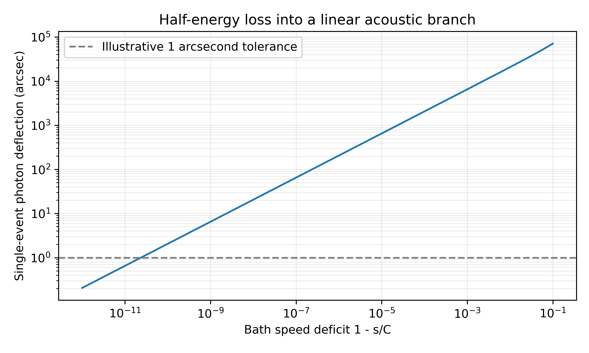

### Many weak events: conditional angle and energy statistics

Could a sequence of many softer emissions reduce this problem? Fix the overall energy ratio at one half and impose $N$ equal logarithmic energy steps, each of fraction $f=1-2^{-1/N}$. For independent uniform azimuths about the incident direction, the expected directional cosine after $N$ rotations is the product of the individual cosines. If $\Theta$ is the final angle to the original direction,

$$\langle\cos\Theta\rangle=\prod_{j=1}^{N}\cos\phi_j,\qquad \sigma_{\mathrm{dir}}=\sqrt{2(1-\langle\cos\Theta\rangle)}.\tag{BS6}$$

The second observable is the root-mean-square chord between unit directions. It is approximately an angle in radians only when the deviations are small. This is not a distribution of apparent image positions. In the gapless limiting calculation at $e=10^{-8}$ and $\beta=0.9$, the exact conditional result and a seeded 20,000-ray azimuth experiment agree:

| Number of loss events | Analytic RMS chord | Simulated RMS chord |
|---:|---:|---:|
| 1 | 0.342467 | 0.342467 |
| 16 | 0.083864 | 0.084190 |
| 64 | 0.041954 | 0.042353 |
| 256 | 0.020981 | 0.020980 |
| 1024 | 0.010491 | 0.010478 |

The large-$N$, negligible-gap estimate scales as $N^{-1/2}$. Extrapolating this restricted result to a one-arcsecond RMS chord would require about $4.8\times10^9$ equal soft events, not a simulated billions-of-events run. Correlated scattering, a coherent background or different interactions would change the statistic. The selected event schedule is imposed rather than generated by a rate.

A second, separate ensemble asks about spectral noise. Let a packet have $N$ independent interaction opportunities, each successful with probability $\pi_b$ and removing a fixed fraction $f$ of its then-current energy. The final energy ratio is $X=(1-f)^K$, where $K$ has the binomial distribution. The mean and relative RMS energy spread are

$$\langle X\rangle=(1-\pi_b f)^N,\tag{BS7}$$

$$\frac{\sigma_X}{\langle X\rangle}=\sqrt{\left[1+\frac{\pi_b(1-\pi_b)f^2}{(1-\pi_b f)^2}\right]^N-1}.\tag{BS8}$$

For $\pi_b=1/2$, choose $f=2(1-2^{-1/N})$ so the mean ratio is exactly one half. At $N=100$, $10^4$, and $10^6$, the relative RMS is respectively 0.069639, 0.006932, and 0.000693. This illustrates the spectral broadening of one prescribed stochastic process; it is not a linewidth prediction from the field action. At $\pi_b=1$ the event count is fixed and the energy spread is zero in this ideal model, even though directional scattering may remain. The deterministic and Bernoulli ensembles are different controls, not a combined forecast.

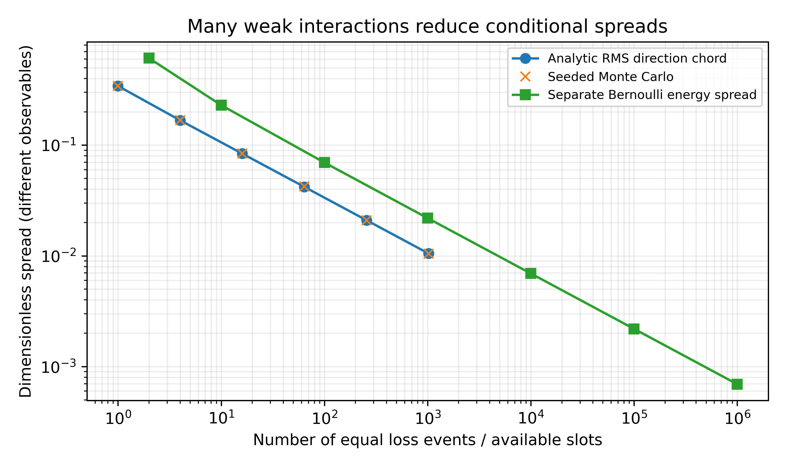

A positive bath gap cannot be ignored in this proposed soft-event limit. For the equal-log schedule with total energy ratio $1/2$, the smallest released energy is that of the final step, $E_i(2^{1/N}-1)/2$. A necessary condition for every step to emit a bath excitation of rest energy $E_b$ is therefore

$$N\le\frac{\ln 2}{\ln(1+2E_b/E_i)}.\tag{BS9}$$

For $E_b/E_i=0.01$, at most 35 events satisfy even this energy-only condition; momentum matching can be stricter. A very large event count demands a correspondingly small gap, a collective gapless response, or another energy recipient. Thus the ideal acoustic limit is not interchangeable with an arbitrarily chosen massive bath. The model must supply a real density of states and microscopic interaction law, not merely a count selected to preserve sharp spectra.

### An explicit positive-energy scalar surrogate

To take a first step beyond kinematics, introduce two real scalar fields $a$ and $\sigma$. Use units $\hbar=C=1$ in this subsection. Their kinetic densities are $\dot a^2/2-|\nabla a|^2/2$ and $\dot\sigma^2/2-s^2|\nabla\sigma|^2/2$. A nonnegative potential with positive gaps is

$$V(a,\sigma)=\frac{m_a^2}{2}a^2+\frac{m_b^2}{2}\left(\sigma+\frac{g}{2m_b^2}a^2\right)^2.\tag{BS10}$$

With $m_a,m_b>0$, the Hamiltonian has positive kinetic, gradient and potential terms. The cubic vertex $g\sigma a^2/2$ couples the two sectors, and the accompanying quartic term stabilizes the potential. Homogeneous coefficients make the action translation-invariant. The field $a$ is **a scalar proxy for the massive packet**, not a full electromagnetic vector or a quantized atom. A possible vector research direction uses a scalar-dependent positive Stueckelberg mass coefficient multiplying gauge-invariant $W_iW_i$ and a consistent $W_0$ coefficient. Its interaction amplitude, polarization dependence, and constraints are not calculated by (BS10).

The tree-level scalar process $a\to a+\sigma$ has a constant cubic amplitude of magnitude equal to the absolute value of $g$ with the chosen canonical normalization. At zero bath occupation, the two-body phase-space calculation in Appendix Y gives a uniform differential rate in emitted energy $B$ over the allowed interval from $B_1$ to $B_2$:

$$\frac{d\Gamma}{dB}=\frac{g^2}{16\pi E p s^2},\quad \Gamma=\frac{g^2(B_2-B_1)}{16\pi E p s^2}.\tag{BS11}$$

This result uses ordinary momentum-state normalization, the leading cubic vertex, and the free dispersions. The band is obtained independently from the collinear convex-energy boundary. For normalized $E=1$, $m_a=0.01$, $s=0.9$, $m_b=0.005$, $g=0.001$, the allowed emitted energy fraction is approximately 0.0114733–0.946902, with rate $2.29762\times10^{-8}$ and mean loss power $1.10099\times10^{-8}$ in the chosen energy/time units. The mean fraction lost per event is about 0.47919. A generic constant vertex in this example therefore permits hard losses rather than selecting only tiny soft events. For $m_a=0.4$, $s=0.99$, $m_b=0.005$ the channel closes. All parameters are synthetic. The full vector amplitude, actual physical normalization, coupling bounds, reverse absorption, bath heating and quantum emission/reception remain unfinished.

### Consequence for the cosmological program

The new experiment strengthens Chapter 30R's distinction between energy loss and speed loss. A viable aging model needs both a recipient and an independently justified means of preserving directional and spectral information. The constant-gap drag example still fails the stationary packet-train timing test. Random interaction delays could broaden arrivals, but a stationary ensemble of identical launches still has a translation-invariant arrival-time distribution, not a systematic $(1+z)$ multiplication of every intrinsic time interval. Recession, evolving fields and physical clocks must be modeled with the same source and detector.

The next acceptance gate is to derive the **vector** emission and absorption matrix elements from the gauge-invariant action, including the longitudinal sector, and compute the resulting joint energy, momentum, direction, line shape and travel-delay distribution without tuning an event count. Follow with a finite-occupation bath and its spatial evolution, real clock calibration, then a two-direction optical map and observational holdout. The fully coupled 3D matter–vector–scalar gate inherited from Chapter 30Q remains open. Candidate B-01a is a bounded additional branch, not a claim that C-01, A-05j-E, or Foundation 12 has been solved.

[BS1] Mattingly (2005), *Modern Tests of Lorentz Invariance*, Living Reviews in Relativity 8, 5; threshold reactions and vacuum Cherenkov radiation. https://doi.org/10.12942/lrr-2005-5. The source supplies established methodological context, not empirical support for the specific ArcSecs bath.


# Part Eleven — Synthesis and Next Experiments

## 33. Conclusion — The Map Should Never Become Sacred

The ArcSecs argument begins with a suspicion and ends with a task. The suspicion is that modern cosmology sometimes speaks as though its most successful mathematical abstraction were the material machinery of the universe. The task is to replace that habit with direct accounts of propagation, energy exchange, gravity, measurement, and motion. A model that treats spacetime as a calculation rather than a physical fabric is philosophically coherent as a research position. Whether a particular relational alternative is quantitatively superior remains a matter for future tests.

Tired light is not valuable because the phrase is provocative. It is valuable because it asks whether photons carry a history that a distant spectrum alone cannot reveal. Parallax and parsecs are not valuable because the light-year is numerically invalid; they are valuable because they teach the distinction between geometric measurement and a propagation-dependent estimate. Proca mathematics is not valuable because a tiny photon mass has been detected; it is valuable because it turns an old assumption into a bounded experiment. Gravitational-wave observations are not valuable because an arrival-time difference proves slow light; they are valuable because two messengers allow us to decompose the problem.

The user of a future ArcSecs engine should see a universe of events and interactions, not a rubber sheet. Each signal should have a pathway. Each energy loss should have a recipient. Each gravitational effect should have a candidate mechanism. Each alleged anomaly should carry uncertainty. Every impressive trajectory should be checked against conservation. The program will either construct a more explanatory physical account or discover exactly where its candidate mechanisms break. Both results are better than mistaking a mathematical shortcut for the final substance of reality.

**The book's closing challenge:** Stop asking whether an alternative sounds like the current picture. Ask what it predicts, what interaction makes it happen, where the energy goes, and which instrument can tell the difference. Only then have we moved from defending a diagram to discovering a universe.

---

# Technical Reference and Reproducibility

## Appendix A — A Compact Equation and Definitions Ledger

- Angular definition: 1 arcsecond = (π/648000) radians ≈ 4.8481368 × 10^-6 radians.
- Geometric parallax: d(pc) ≈ 1/p(arcsec), for the usual annual parallax convention.
- Proper motion: v_t(km/s) ≈ 4.74047 μ(arcsec/yr) d(pc).
- Standard length unit: 1 pc ≈ 3.08567758 × 10^16 m; 1 light-year ≈ 9.46073047 × 10^15 m. Both are length units.
- Toy photon energy degradation: dE/dr = -αE; E(r)=E_0 exp(-αr); 1+z_TL=exp(αr) if emission calibration and Planck's constant are fixed in that branch.
- Combined positive redshift factors: (1+z_total)=∏_i(1+z_i), only if the factors are independently defined for the actual photon transfer sequence.
- Massive free-photon dispersion: E² = p²c² + m_γ²c⁴; v_g = pc²/E; this equation does **not** imply intrinsic photon energy dissipation.
- Event time-budget schematic: Δt_obs = Δt_source + Δt_environment + Δt_propagation + Δt_selection; each term requires a precisely defined reference clock and common convention.
- Idealized ramjet intake: ṁ = ηρAv; net usable momentum and energy must be calculated, not inferred from ṁ alone.
- Constraint on classical flat-space photon deflection: the elementary Newtonian corpuscular estimate produces about half the observed weak-field solar deflection; a replacement law must derive the full deflection.

## Appendix B — What the ArcSecs Thesis Does and Does Not Claim

**Defends:** spacetime should not be treated as a literal material fabric; observations should be separated from their geometric interpretation; photons may have a propagation history that warrants experiments; nonmetric and relational accounts deserve clear tests; dark-sector identification remains an open physical problem; a transparent simulator is a valuable research instrument.

**Investigates but has not established:** vacuum tired-light decay, a nonzero photon rest mass, evolving constants, a static or much older universe, dark matter as degraded light, Machian void-inertia collapse, universally faster-than-light local travel, an operable dark-substrate ramjet.

**Will not falsely claim:** that a light-year is an invalid unit; that one parallax technique measures every cosmic distance directly; that old-language “relativistic mass” is required by modern physics; that galaxies' coordinate recession is a measured local superluminal drive; that a browser simulation is experimental proof; that source-delay observations by themselves establish light slowing.

## Appendix C — Key Reading and Source URLs

**ArcSecs project**

1. ArcSecs main site and overview: https://arcsecs.com/
2. Research Hub: https://arcsecs.com/arcsecs-research-hub/
3. Distance-Time Framework: https://arcsecs.com/arcsecs-distance-time-framework/
4. Research Library and source roles: https://arcsecs.com/research-library/
5. Cosmic Anomalies Tracker: https://arcsecs.com/cosmic-anomalies-tracker/
6. Physics Engine Demo: https://arcsecs.com/arcsecs-physics-engine-demo/
7. Multi-Messenger Light Delay: https://arcsecs.com/multi-messenger-light-delay/
8. Teleparallel, Proca, and Relational Kinetics: https://arcsecs.com/arcsecs-proca-teleparallel-relational-kinetics/
9. Light slowing and gravitational waves: https://arcsecs.com/modeling-light-slowing-energy-degeneration-gravitational-waves/
10. Tired Light Revisited: https://arcsecs.com/tired-light-test-driven-cosmology/
11. Against literal spacetime: https://arcsecs.com/spacetime-is-not-a-thing-2/
12. Parsecs for speed and area: https://arcsecs.com/parsecs-speed-area-geometric-cosmology/
13. Dark Matter Drive research: https://arcsecs.com/arcsecs-dark-matter-drive-relational-ftl-propulsion/
14. November 2026 editorial: https://arcsecs.com/relativity-warp-bubbles-theory-protection/

**Independent research and observational anchors**

15. Gupta, *JWST Early Universe Observations and ΛCDM Cosmology* (2023): https://academic.oup.com/mnras/article/524/3/3385/7221343
16. Gupta, *The Origin of Dark Matter and Dark Energy: Covarying Coupling Constants?* (2026): https://doi.org/10.3390/sym18020300
17. University of Ottawa, 6 Nov 2026 CCC+TL research summary: https://www.uottawa.ca/faculty-science/news-all/theory-predicting-older-universe-without-dark-matter-dark-energy-passes-key-cosmological
18. DES, 1,504 Type Ia supernova time-dilation analysis (2024): https://arxiv.org/abs/2406.05050
19. Particle Data Group, photon listings (2025): https://pdg.lbl.gov/2025/listings/rpp2025-list-photon.pdf
20. SPARC database: https://astroweb.case.edu/SPARC/
21. Standard observational discussion of tired-light challenges: https://www.astro.ucla.edu/~wright/tiredlit.htm
22. Nature Astronomy, review of JWST first-billion-years research (2025): https://www.nature.com/articles/s41550-025-02624-5
23. NIST atomic-clock experimental context (2026): https://www.nist.gov/blogs/taking-measure/putting-einstein-test-worlds-most-accurate-clocks
24. Gupta CCC+TL cosmic chronometers (2026): https://academic.oup.com/mnras/article/550/1/stag1126/8707440

**Source note:** These references support different parts of the argument and do not all endorse ArcSecs. Scientific results used as experimental anchors should be checked against primary papers before final publication. URLs are included for future verification and reproducible debate. Further site inventory is in `site_research/`.

## Appendix D — The Thirty-Eight ArcSecs Disagreements

This register collects disagreements, research objections, and proposed alternatives in one place. They are not all claims about the same theory. Some target literal-spacetime language, some target the ΛCDM cosmological model, and others concern open questions about photon physics or spacecraft engineering. The status of each item is a position to argue or a hypothesis to test, not an assertion of a completed disproof.

### Foundational ontology

1. **Spacetime as substance.** We reject the inference from useful event geometry to a literal material fabric. Test: demonstrate a fully specified relational model with equivalent measured outputs and at least one distinctive prediction.
2. **Geometry as final cause.** We reject treating a geodesic as the last possible explanation of gravity. Test: derive measurable deflection and motion from a nonmetric interaction law.
3. **Time as elastic substance.** We regard clocks as physical event counters rather than cameras of a temporal material. Test: reproduce gravitational and kinematic clock behavior across different physical processes.
4. **Global continuum as prerequisite.** We question whether a differentiable manifold must be fundamental to physical interactions. Test: reconstruct observables from discrete or relational states.
5. **Singularity as a physical object.** We reject infinite calculated density as a complete microscopic account. Test: propose finite high-density dynamics consistent with compact-object observations.

### Light and transport

6. **Redshift from expansion alone.** We ask whether photon propagation adds a measurable energy-loss term. Test: predict frequency, image, timing, and flux together.
7. **Eternal uniform propagation speed in all epochs.** We test energy- or environment-dependent transport within current bounds. Test: prospective multi-frequency timing.
8. **Exactly massless photons as an untestable axiom.** We consider a small photon-mass branch with a bounded dispersion relation. Test: precision electromagnetic constraints.
9. **History-free photons.** We reject the habit of ignoring source-to-detector transport variables. Test: independent propagation signatures across source populations.
10. **Unaccounted photon energy transfer.** We demand a receiver of energy and momentum in any tired-light model. Test: conservation closure and predicted secondary effects.
11. **Dark matter unrelated to light by necessity.** We investigate a transition to a cold photon-like state. Test: formation law, abundance, clustering, and laboratory coupling.
12. **Literal fabric required for lensing.** We ask for a direct interaction mechanism. Test: achromatic solar and extragalactic deflection from a single law.
13. **Relative speed sufficient to characterize collisions.** We insist on full energy-state and interaction-history bookkeeping. Test: controlled state-dependent energy transfer.
14. **One undifferentiated notion of active light.** We separate freely propagating radiation, stored optical information, bound excitations, and hypothetical dark states. Test: explicit state transitions.

### Cosmic metrology and chronology

15. **Light-year as the privileged explanatory ruler.** We prefer parallax-anchored parsecs and explicitly model-dependent extrapolation. Test: cross-calibration of distance channels.
16. **Redshift as directly measured distance.** We insist that redshift is a measured spectral ratio from which distance is inferred under assumptions. Test: independent distance comparisons.
17. **Clock differences as ontological proof.** We separate observed cycle counts from a theory of their ultimate cause. Test: common rules across atomic and particle clocks.
18. **Global time coordinate as fundamental substance.** We investigate relational event chronology. Test: reproduce all measurable synchronization and timing records.
19. **Electromagnetic observations as sufficient historical record.** We advocate independent messenger comparisons. Test: joint gravitational-wave and photon events with source-delay modeling.

### Cosmic architecture

20. **Expansion as the only possible source of cosmological redshift.** We test a specified propagation contribution against the full observable suite.
21. **One immutable inferred cosmic age.** We test alternative source-distance-time mappings and their consequences for all derived galaxy properties.
22. **Conventional particle halos as the only solution to rotation discrepancies.** We compare relational gravity, evolving couplings, and proposed dark states against common held-out datasets.
23. **Dark energy as a completed physical identification.** We investigate whether changing couplings or propagation can account for the inferred acceleration signals.
24. **Hubble-tension remedies restricted to expansion-history changes.** We reexamine distance ladders and calibration dependencies under a registered transport law.
25. **Early galaxy interpretations fixed by one timeline.** We test all linked number-count, luminosity, mass, size, and age predictions under alternate mappings.
26. **Clusters and large structures requiring one prescribed microscopic cause.** We demand quantitative alternative calculations for cluster lensing and dynamics.
27. **A microwave-background fit uniquely choosing a spacetime ontology.** We ask whether a nonmetric mechanism can produce the measured blackbody and angular structure.
28. **The quantum–gravity mismatch as a final acceptable architecture.** We seek a deeper common interaction or state-space description rather than treating the gap as closed.

### Dynamics and propulsion

29. **A metaphysical universal speed limit stated without an operational target.** We require a distinct local signal or matter-transport prediction before claiming a new kinematics.
30. **Superluminal recession as proof that an expanding substance exists.** We question the ontology but do not confuse coordinate recession with measured local faster-than-light propagation.
31. **Relativistic mass as a literal growing rest mass.** We reject obsolete pedagogy while acknowledging the modern invariant-mass energy accounting that a new law must address.
32. **Inertia as irreducible without relational investigation.** We test Machian or Weber-style dependence on cosmic matter distribution.
33. **Cosmic voids as kinematically ordinary by necessity.** We investigate an effective inertia response but require computation of distant-matter contributions.
34. **Warping geometry as the primary imaginable route to extreme propulsion.** We investigate mass-flow thrust and direct field interactions instead.
35. **A warp metric as an engineered machine.** We demand an energy source, force path, containment, stability, and thermal budget.
36. **Dark-sector material forever outside engineering consideration.** We propose capture experiments only if a real accessible substrate and coupling are established.

### Scientific practice

37. **Prediction as proof of ontology.** We distinguish a theory's empirical performance from metaphysical claims about its preferred variables.
38. **Theory preservation above new tests.** We require preregistered failures, independent replication, and identical standards for new and old models.

## Appendix E — Eight Reference Experiments for the Next ArcSecs Release

### E1. Geometric distance audit

**Input:** nearby-star parallax, proper motion, calibrated baselines, and uncertainty covariance. **Prediction:** distance and transverse velocity with traceable uncertainties. **Failure:** hidden conversion between redshift and distance, unit confusion, or inconsistent uncertainty propagation. **Release artifact:** open metrology module and a set of checked reference cases.

### E2. Photon-energy transfer

**Input:** spectral source model, propagation distance, candidate medium or field, and a declared interaction coefficient. **Prediction:** received spectrum, flux, polarization where applicable, time profile, angular distribution, and environmental energy/momentum gain. **Failure:** inability to balance energy or reproduce image and timing observables. **Release artifact:** public transport notebook with frozen parameters.

### E3. Supernova time stretch and surface brightness

**Input:** a reproducible Type Ia dataset including the 2024 DES sample of 1,504 light curves and independent galaxy photometry. **Prediction:** observed time-width versus redshift and surface-brightness scaling from the same transport law. **Failure:** unrelated after-the-fact multipliers for each observable. **Release artifact:** out-of-sample comparison and parameter count.

### E4. Nonmetric solar-system gravity

**Input:** Sun and planet masses, orbit constraints, ray impact parameters, and time-delay data. **Prediction:** perihelion dynamics, solar light bending, and gravitational delays from one interaction law. **Failure:** half-bending, arbitrary doubling, chromatic residuals, or conservation loss. **Release artifact:** derivation plus independent trajectory integration.

### E5. Galaxy-to-cluster generalization

**Input:** SPARC galaxy rotation data and independent gravitational-lensing maps. **Prediction:** rotation profiles and lensing distributions using a shared registered rule. **Failure:** unique correction functions per object or a new hidden field invented for every cluster. **Release artifact:** withheld validation subset and anomaly map.

### E6. Clock and lifetime comparisons

**Input:** multiple clock architectures, gravitational potential differences, controlled relative velocities, and unstable-particle lifetime data. **Prediction:** differences derived from the proposed interaction model. **Failure:** an explanation restricted to electron transitions that cannot cover particle lifetimes. **Release artifact:** published preregistration and uncertainty budget.

### E7. Multimessenger propagation

**Input:** independently confirmed gravitational-wave and electromagnetic counterparts, estimates of source emission offsets, line-of-sight conditions, and instrument latency. **Prediction:** residual propagation effect with confidence limits. **Failure:** attributing all raw arrival offset to light slowing. **Release artifact:** likelihood model and reproducible residual plots.

### E8. Substrate collection and net thrust

**Input:** measured substrate density and coupling, capture geometry, supplied power, exhaust distribution, and drag. **Prediction:** captured mass flow, net momentum, and heat. **Failure:** modeled thrust that appears without measured reaction mass or compensating external momentum. **Release artifact:** closed mass/energy/momentum audit and independent thrust-balance experiment.

## Appendix F — Editorial and Evidence Rules

This book is an advocacy text. It is designed to argue an ArcSecs position, not to reproduce a detached introductory course. The following rules preserve that position without confusing aspiration with evidence.

**Observed:** an independently documented instrument result, with the measuring system and uncertainty identified. **Inferred:** a quantity derived from observations using declared modeling assumptions. **Proposed:** an equation, mechanism, or hypothesis not yet independently demonstrated. **Illustrated:** a visualization or simulation output that follows from chosen inputs. **Tested:** a proposed mechanism compared against independently obtained data. **Established within a scope:** a result repeatedly corroborated to a stated precision and domain. A claim should never silently move from one category to another.

The word *disproving* in the title announces the challenge. Disproving a literal-rubber-sheet metaphor is not the same act as experimentally excluding every mathematical formulation of general relativity. The book's concrete objective is to make a nonfabric framework calculationally complete, constrain its unresolved interactions, and derive predictions that distinguish it from accepted models. The common-sense principle is to keep the records of this process public.

### Source provenance

The manuscript draws on fifteen uploaded source reports, fourteen physics-related and one unrelated governance essay retained only for archival completeness, as well as the corrected report set and accessible public ArcSecs.com pages recorded in the November 2026 handoff. Historical report provenance is summarized in the source citations; this single-book edition does not require external report folders. Some site pages, assets, and internal documentation were not available as a verified complete export, so this edition does not claim to reproduce the entire website.

ArcSecs project pages used as starting points include `https://arcsecs.com/test-driven-cosmology-tired-light-relational-mechanics/`, `https://arcsecs.com/cosmic-anomalies-tracker/`, and `https://arcsecs.com/stationary-light-test-tdd-thought-experiment/`. Independent quantitative checkpoints include the 2024 Dark Energy Survey supernova time-dilation paper (`https://arxiv.org/abs/2406.05050`), the Particle Data Group photon-mass listings (`https://pdg.lbl.gov/2025/listings/rpp2025-list-photon.pdf`), and the SPARC rotation-curve database (`https://astroweb.case.edu/SPARC/`). These external records are cited as tests and constraints, not as endorsements of the ArcSecs thesis.


## Appendix G — Research Continuation and Reproducibility

The authoritative charter and active startup instructions reside in the project's `.uai` files. The book provides a scientific narrative, not a separate competing instruction hierarchy. Begin with the current source owners, identify the precise physical question and required output, then derive and test a bounded mechanism. Use verified measurements as controls; preserve source provenance and distinguish candidate equations, conditional consequences and instrument results.

A scientific advancement derives independent observables from one specified mechanism, closes its energy and momentum ledger, and survives a declared numerical or observational acceptance test. An animation, renamed coordinates or a fitted curve alone does not establish a new physical mechanism. Record the actual validation results in the owning report and current handoff; place superseded assumptions in the decision register, not the active queue.

## Appendix H — Research Architecture and Model Compatibility

### Separate the modules before merging them

- **Module 1 Photon ontology:** measured photon energy and momentum, and independent tests for intrinsic vacuum rest mass.
- **Module 2 Clock processes:** constant event-progression parameter and state-dependent transition-rate functions.
- **Module 3 Photon transport:** energy transfer, possible speed changes, scattering, polarization and environmental sinks.
- **Module 4 Gravity dynamics:** a causal interaction/field model for mass and radiation, including propagation and lensing.
- **Module 5 Geometric metrology:** astrometry, proper motion, parallax, geometric anchors, uncertainty and selection effects.
- **Module 6 Galaxy/cluster dynamics:** one acceleration/mass model across galaxy disks, merging clusters and lens maps.
- **Module 7 Greater-cosmos domains:** hypothetical boundary stresses, bubble nucleation and collision signatures.
- **Module 8 Spacecraft interactions:** demonstrated substrate density, capture probability, net momentum and drag.
- **Module 9 Evidence and simulation engine:** shared datasets, unit tests, parameter registry, calibration-holdout split and falsification reporting.

The dependencies are directional, not mere word associations. Module 1 does not imply Module 3; photons can have energy-equivalent mass without tiring, and a positive Proca parameter by itself does not transfer photon energy to the intergalactic medium. Module 2 does not imply changes to observed supernova arrival intervals without a propagation or source-process calculation. Module 4 must be completed before an inertia-control propulsion system has a gravitational source law. Module 7 does not prove Module 8 or any direct interaction with a parent cosmic environment. Only combine modules when their equations and observed predictions are mutually compatible.

### Validation file structure for future research

Each experiment should have: a stable identifier; question; declared model version; source DOI; raw data link; selection cuts; calibration parameters; frozen holdout; physical units; nuisance parameters; diagnostic plots; numerical residuals; pass/fail thresholds; code commit; simulation seed; and a signed interpretation note. Negative results should remain in the ledger; they do not make an archive “poisoned.” They prevent a later AI from rediscovering a discarded mistake.

### First eight work packages

1. Derive and numerically test a clock-rate function covering atomic, nuclear and unstable-particle systems using one parameter set.
2. Re-derive a candidate photon transport law with both spectral shift and transient duration predicted, and separately derive group speed.
3. Test the transport law against the 1,504-supernova DES timing dataset and independent CMB spectral data. [S02]
4. Build a flat-description or relational gravity interaction rule and test solar deflection, Cassini signal delay, and binary wave propagation. [S03]
5. Audit high-redshift candidates using separate photometric, spectroscopic, proper-motion and physical-distance fields, starting with Capotauro. [S04]
6. Fit a shared galaxy/cluster rule across a preregistered partition of SPARC and cluster lensing data. [S09]
7. Simulate universe-sized domains with explicit stress-energy and conservation, then run trials-corrected CMB collision searches. [S10] [S11]
8. Produce a mass/energy/momentum feasibility table for any proposed propulsion substrate using verified local density and experimentally justified interaction efficiency.

## Appendix I — Scientific Sources and Research Bibliography

The following sources are included as verification anchors, not endorsements of every ArcSecs proposal. DOI and publisher pages should be reviewed again at the time of journal submission. Direct primary literature and official instrument data take priority over social summaries.

- **[S01]** Particle Data Group. *Review of Particle Physics: Photon Listings* (2025). Photon mass upper limits and experimental methods. https://pdg.lbl.gov/2025/listings/rpp2025-list-photon.pdf
- **[S02]** Dark Energy Survey Collaboration. *The Dark Energy Survey Supernova Program: Slow supernovae show cosmological time dilation out to z ~ 1* (2024). Sample of 1,504 Type Ia supernovae, stretch exponent `b = 1.003 +/- 0.005(stat) +/- 0.010(sys)`. https://academic.oup.com/mnras/article/533/3/3365/7738388
- **[S03]** Bertotti, B., Iess, L., and Tortora, P. *A test of general relativity using radio links with the Cassini spacecraft*. Nature 425, 374–376 (2003). https://doi.org/10.1038/nature01997
- **[S04]** *A clear detection of proper motion confirms that the claimed z ~ 32 galaxy candidate “Capotauro” is a Y-type brown dwarf* (2026). The measured proper motion is direct; the published 730-pc estimate is template-based. https://doi.org/10.1093/mnras/stag2055
- **[S05]** LIGO Scientific Collaboration and Virgo Collaboration. *Gravitational Waves and Gamma-Rays from a Binary Neutron Star Merger: GW170817 and GRB 170817A* (2017). https://doi.org/10.3847/2041-8213/aa920c
- **[S06]** Planck Collaboration. *Planck 2018 results. VI. Cosmological parameters* (published 2020). Model-dependent age and size inference context. https://arxiv.org/abs/1807.06209
- **[S07]** Bahamonde et al. *Teleparallel Gravity: From Theory to Cosmology* (2023). Alternative geometric formulation without needing a rubber-sheet ontology. https://arxiv.org/abs/2106.13793
- **[S08]** NIST. *Atomic clock performance beyond Earth's gravitational limit* and NIST clock research. https://www.nist.gov/publications/atomic-clock-performance-beyond-earth146s-gravitational-limit
- **[S09]** Lelli, McGaugh and Schombert. *SPARC: Mass Models for 175 Disk Galaxies with Spitzer Photometry and Accurate Rotation Curves* (2016). https://astroweb.case.edu/SPARC/
- **[S10]** Coleman and De Luccia. *Gravitational effects on and of vacuum decay* (1980). https://doi.org/10.1103/PhysRevD.21.3305
- **[S11]** Feeney et al. *First Observational Tests of Eternal Inflation* (2011). Bubble-collision CMB searches and upper limits. https://arxiv.org/abs/1012.1995
- **[S12]** American Astronomical Society, Data and Software Guide. https://journals.aas.org/data-guide/
- **[S13]** American Physical Society, Physical Review author guidelines. https://journals.aps.org/authors
- **[S14]** NASA LAMBDA, COBE/FIRAS CMB spectral observations and data. https://lambda.gsfc.nasa.gov/product/cobe/firas_overview.html
- **[S15]** McGaugh, Lelli and Schombert. *Radial Acceleration Relation in Rotationally Supported Galaxies* (2016). https://doi.org/10.1103/PhysRevLett.117.201101
- **[S16]** Borde, Guth and Vilenkin. *Inflationary spacetimes are incomplete in past directions* (2003). https://arxiv.org/abs/gr-qc/0110012
- **[S17]** Gupta. *The Origin of Dark Matter and Dark Energy: Covarying Coupling Constants?* (2026). Alternative cosmological interpretation requiring independent review and physical tests. https://doi.org/10.3390/sym18020300
- **[S18]** ESA Gaia mission scientific archive. Astrometry, parallaxes and proper motions. https://gea.esac.esa.int/archive/
- **[S19]** LUX-ZEPLIN collaboration, experiment and direct-dark-matter searches. https://lz.lbl.gov/
- **[S20]** ArcSecs Research Hub. The originating independent research program and its proposed physical mechanisms. https://arcsecs.com/arcsecs-research-hub/


- **[S21]** Gott, J. Richard III. *Did our cosmos emerge from a sea of inflating bubbles?* (2017). Expository account of outside negative pressure and bubble growth; not a measured external gravity detection. https://aeon.co/essays/did-our-cosmos-emerge-from-a-sea-of-inflating-bubbles
- **[S22]** Feeney, S. M., et al. *First observational tests of eternal inflation: Analysis methods and WMAP 7-year results*. Physical Review D **84**, 043507 (2011). DOI: https://doi.org/10.1103/PhysRevD.84.043507
- **[S23]** Bovy, J. *Dynamics and Astrophysics of Galaxies*, Section 2.2, Newtonian spherical shell theorems. https://galaxiesbook.org/chapters/I-01.-Gravitation_2-Spherical-systems%3A-Newton%27s-shell-theorems.html
- **[S24]** Aguirre, A., Johnson, M. C., and Tysanner, M. *Towards observable signatures of other bubble universes. II. Exact solutions for thin-wall bubble collisions*. Physical Review D (2009), manuscript hosted by Caltech. https://authors.library.caltech.edu/records/ems06-8jm44
- **[S25]** *Bubble universes with different gravitational constants*. Physical Review D **92**, 023514 (2015). Models thin-wall motion using gravitational junction conditions; demonstrates conditional mechanics, not a detection. https://doi.org/10.1103/PhysRevD.92.023514

- **[S26]** Candidate finite-range scalar theory: the field equation and normalized shell benchmark in Chapter 30B are original **toy assumptions and derived equations**, not a peer-reviewed empirical result. Compare established massive-field causal propagation with standard Klein–Gordon field-theory treatments; original derivations and tests: `tools/external_coupling.py` and `docs/long-term-memory/research/external-coupling-v2.md`.
- **[S27]** Hubble-scale reference for the illustrative normalization: $H_*=70$ km/s/Mpc is a declared example, not a cosmological fit or newly observed fact; compare published distance-scale analyses in [S06] and [S29].
- **[S28]** Eöt-Wash Group, *Inverse Square Law* research and short-distance fifth-force constraints. https://www.npl.washington.edu/eotwash/inverse-square-law
- **[S29]** DESI Collaboration, *DESI DR2 results. II. Measurements of baryon acoustic oscillations and cosmological constraints*. Physical Review D **112**, 083515 (2025). https://doi.org/10.1103/tr6y-kpc6

- **[S30]** Gupta, Rajendra P., and Nikolaos Samaras. *A Big Bang Nucleosynthesis Consistency Test of the CCC+TL Cosmology.* *Universe* **12**(7), 193 (26 June 2026), https://doi.org/10.3390/universe12070193 . This paper models nuclear rates under coordinated scaling; its reported lithium improvement at low baryon density accompanies a deuterium penalty. The model is a hybrid and not an independently confirmed ArcSecs universe.

- **[S31]** *ArcSecs Integrated Physical-First Scientific Paper*, 44-page working research manuscript, 23 November 2026, supplied with this edition; original archived under `docs/long-term-memory/research/screened-field-intake/integrated-paper-original.pdf`. A historical 11-principle version; not independently peer reviewed.
- **[S32]** *ArcSecs Scientific Investigation — Part IX: Deriving the Screened Common-Field Model*, Candidate A-05c, supplied Markdown research working paper, archived under `docs/long-term-memory/research/screened-field-intake/screened-field-original.md`. Appendix K documents equation-level corrections and scope.

## Appendix J — Report-to-Model Integration Map and Reproducible Starting Point

The book is the reader-facing explanation, while the 41 indexed technical records retain the extensive details. Each report has a stable short identifier and an evidence status. The **research archive has not been silently reduced** to the brief summaries printed here.

| ArcSecs model component | Full technical sources | Essential bridge still required |
|---|---|---|
| Photon mass and gravitational response | R01, R23, R24 | A positive rest-mass discriminator distinct from energy-momentum coupling |
| Constant $T$ and clock processes | R02, R15 | One physical rate law across atomic, nuclear and particle events |
| Cosmic size, distance, false red sources | R03, R13, R18 | An independently anchored redshift–distance relation with source classifications |
| Physical photon transport and tired light | R04, R14, R19, R21–R24 | A conserved transport operator reproducing spectral and event timing evidence |
| Relational or nonmetric gravity | R05, R11, R12, R17 | A complete field law reproducing lensing and precision gravity |
| Galaxy/cluster dark sector and propulsion | R06, R20 | One acceleration and lensing law; a measurable capture interaction and momentum budget |
| External bubble pressure, field and tides | R07, R08, R09 | Coupled moving source + retarded carrier + distinctive observable |
| Simulation architecture and statistical QA | R10, R14, R22 | Source-controlled, locked-prior calibration and untrained held-out validation |
| Research governance methodology (not astrophysics evidence) | R16 | Reproducibility and decision rules, not a physical force claim |

**Later report coverage (R25–R41):** R25–R38 expand compact-object physics, clock systems, cosmic-distance/age interpretations, photon-mass terminology, relational dynamics, and external-domain candidates. R39 tests reciprocal photon-source momentum exchange; R40 tests a causal carrier and source recoil; R41 tests an attractive finite-speed field. See `docs/long-term-memory/index.md` for report-level routing and dates. Chapter 30E is an **integration of newly supplied working papers, not a claim that R42 has been completed**.

**Primary executable reference:** `tools/unified_reference.py` (model UPM-0). The companion test file is `tests/test_unified_reference.py`. Together they expose the unproven couplings instead of hiding them. They should be read alongside `tools/external_coupling.py`, `tests/test_external_coupling.py`, and `docs/long-term-memory/research/unified-physical-model.md`.

A receiving AI should record for each output: measured observable; model assumption; equation and parameter definition; data provenance; inference and uncertainty; falsification criterion; and the exact source commit or package checksum. It should never use an AI-authored report as independent laboratory evidence merely because its prose is lengthy.

### R41 source–field–receiver extension (November 2026)

The continuing companion report [R41] is located in the ArcSecs research archive at `docs/long-term-memory/reports/R41.md`. R41 introduces a derived attractive **field-particle** toy with finite signal propagation, two-sided source recoil and complete energy/momentum accounting. It is a new candidate, not a verified physical force. Its equations and runnable solver are in `docs/long-term-memory/research/attractive-field-methods.md` and `tools/attractive_field_v1.py`; new synthetic results are separate. The project still needs a three-dimensional, photon-coupled theory and real-data validation, not further condensation of the 41 full-depth source reports.

## Appendix K — Screened Common-Field Equation Audit and Source Concordance

This appendix is a technical correction ledger for the two 23 November 2026 files supplied with the manuscript. It does **not** retroactively rewrite either original. References to equation numbers (225)–(278) refer to the uploaded *Deriving the Screened Common-Field Model*; (11)–(38) refer to the 44-page *Integrated Physical-First Scientific Paper*. These are **internal working documents**, not independent observational confirmations.

| Source location | Printed or implied claim | Checked disposition |
|---|---|---|
| Part IX, (246)–(247) | $-\epsilon\mu F^2/4$ yields independently variable $\epsilon E^2/2-B^2/(2\mu)$ | **Not derived.** A scalar factor of $F^2$ scales both terms and does not give two independent response coefficients. Use the split action in paper (13) and Chapter 30E (E1). |
| Part IX, after (247), and stability section | $a=b$ means $\epsilon\mu$ constant | **Incorrect.** $\epsilon\mu\propto e^{(a+b)\psi}$; $a=b$ holds impedance constant, while $a+b=0$ holds speed constant (for variable $\psi$). |
| Part IX, (248)–(250) | $F_{\mu\nu}F^{\mu\nu}=-4u_{\mathrm{EM}}$ | **Incorrect in general.** The field invariant involves electric-minus-magnetic terms; positive energy density involves their sum. |
| Part IX, (229) | The printed flight-distance integral uses the wrong exponential sign. | **Incorrect sign in the evaluated integral.** Correct expression is $(v_a/\Gamma)(e^{\Gamma\Delta T}-1)$. The resulting $D=v_a z/\Gamma$ remains correct. |
| Part IX, (261)–(265) and ensuing text | $1+z_{\mathrm{spec}}=e^{(b-3a)\Delta\psi/2}$, but $a=b$ supposedly cancels field shift | **Internal contradiction.** Substitute $a=b$: $1+z_{\mathrm{spec}}=e^{-a\Delta\psi}$, generally a blue shift for $a\Delta\psi>0$. Paper (31), branch table and Chapter 30E use this substitution. |
| Part IX, spectroscopy/screening discussion | $b=3a$ keeps fine structure $\alpha$ fixed | **Incorrect in the stated approximation.** $\alpha\propto e^{(b-a)\psi/2}$ is constant for $a=b$, not $b=3a$. $b=3a$ instead cancels the toy's *spectroscopic* $\psi$ factor. |
| Part IX, time-varying density | $\psi_*=f/(m^2+g\rho)$ gives a closed scalar/EM energy budget with time-dependent $\rho$ | **Incomplete.** If $\rho(T)$ is prescribed, $U(\psi,\rho)$ has explicit time dependence and the omitted matter reservoir must receive energy and momentum. |
| Part IX, GW speed | Choice $P/Q=1/(\epsilon\mu)$ by itself passes multimessenger constraints | **Only a conditional constructed equality.** Amplitude transport, emission delay assumptions, local conditions, frequency dependence, and future events remain independent tests. |
| Part IX, conclusion | All physically stable screened common fields ruled out | **Overstated for the written calculation.** Serious parameter tensions are retained; a general no-go needs a corrected common action, sourced boundary conditions, model-wide parameter scan and quantitative likelihood analysis. |
| Integrated paper, abstract, Section 1 | “Eleven” foundations | **Historical draft superseded.** The book's binding charter contains 12 foundations; #11 is unknown total age and #12 is smaller/closer inferred objects. No scientific result is altered by the numbering correction. |

### Compact independent checks

Take $\Delta\psi=0.1$. With $(a,b)=(0,2)$, $g=1$ and equation (E5) gives $1+z_{\mathrm{spec}}=e^{0.1}>1$; with $(a,b)=(1,1)$, the **same** $g=1$ gives $1+z_{\mathrm{spec}}=e^{-0.1}<1$. Thus one slowing law does not imply one spectroscopic sign. With $(a,b)=(1,3)$, $1+z_{\mathrm{spec}}=1$ although $g=2$ and speed changes. The model's $\alpha$ exponent for these three cases is respectively $+1$, $0$, and $+1$ times $\Delta\psi$; the cancellation rules differ.

For the temporal toy, $\Gamma=0.2$, $v_a=1$, $\Delta T=1$: numerical integration of $e^{-0.2(T-T_a)}$ gives $(e^{0.2}-1)/0.2\approx1.1070$, **not** $(1-e^{-0.2})/0.2\approx0.9063$. This directly tests the corrected distance identity without assuming a cosmic age, an observed $H_0$, or a fitted spectrum.

The integrated paper's classical electromagnetic action (13), field equation (15), energy ledger (19)–(22), and spectroscopic formula (31) are the preferred *working starting point*, subject to further scientific review. Its illustrative conserved-energy simulation is **synthetic**; it does not measure $\psi$ in the actual universe. The screened report is retained as a useful collection of constraints and failed model choices, not as a verified universal exclusion proof.

### Minimal reproducibility and provenance record

The editable text and PDF originals are stored unchanged inside the accompanying workspace's `docs/long-term-memory/research/screened-field-intake/`. The small executable test file `tests/test_screened_field_book_audit.py` verifies the exponent identities and travel-distance integral; it does not validate astrophysical observations. Chapter 30E cites primary external anchors already used by the book: DES supernova stretch [S02] and GW170817/GRB170817A [S05]. No additional unpublished observational fit or sky-map analysis is claimed.

---

## Appendix L — Photon-Field Three-Way Closure and Numerical Source Record

**Scope.** This appendix documents the specific 17-page technical continuation received on November 23, 2026, alongside two duplicate earlier sources. It supplements Appendix K, which already audits the 44-page integrated paper and the screened common-field report. Historical originals retain their 11-premise wording; the 12-principle charter remains authoritative for all new ArcSecs book text.

**Duplicate source 1 — *Deriving the Screened Common-Field Model(2).md*.** SHA-256 matches the previously ingested Part IX manuscript exactly. The existing original and errata remain authoritative for that historical version; no duplicate is added.

**Duplicate source 2 — *ArcSecs Integrated Physical-First Scientific Paper(2).pdf*.** SHA-256 matches the previously ingested 44-page PDF exactly. The original remains unchanged; no second copy is added.

**New source — *ArcSecs Photon Field Dynamics Technical Continuation.pdf*.** Seventeen-page historical technical paper preserved unchanged, reproduced independently, and incorporated into Chapter 30F.

**New derived equation.** Under the shared exponential electric/magnetic response and fixed-$e,m_e,\hbar$ unscreened Coulomb transition prescription, $(1+z_{\mathrm{spec}})S_{\mathrm{prop}}=(\alpha_{\mathrm{eff},a}/\alpha_{\mathrm{eff},e})^2$. It is an algebraic theorem of that limited model. It is **not** an observational law demonstrated for the actual universe. In particular, $\alpha_{\mathrm{eff}}$ is defined by the hypothetical electromagnetic response, not imported from a distant-quasar fit performed under standard atomic assumptions.

**Independent numerical computation.** A 4,000-step pure-Python Runge–Kutta implementation of the source's equations (24)–(28) reproduces the source's $\psi(0)$ and listed synthetic redshifts/distances to four decimal places, with a relative total-energy drift of about $5.3\times10^{-15}$ for that run. The source reports a different integrator and approximately $1.53\times10^{-15}$ drift; the discrepancy in floating-point residual is method-dependent and far smaller than the precision of the reported synthetic observables. Both are numerical diagnostics, not measured physical constants.

**Necessary next step.** A 1D electromagnetic–scalar–matter boundary simulation must account for physical source and receiver atoms, screening layers, spatial gradients, flux and conserved stress; a nonzero invariant photon mass is a separate branch requiring additional terms and constraints. Precommit the parameters before comparing with held-out spectra, clocks and propagation records.

---

## Appendix M — Screened Material Boundary: Derivation, Reproduction and Failure Tests

**Provenance and model class.** This appendix is new ArcSecs internal research (23 November 2026), extending the archived 17-page photon-field continuation and the screened-field Part IX report. Those historical PDFs/Markdown sources remain unchanged. The new calculations are **dimensionless synthetic predictions of a chosen action**. The authoritative research charter remains twelve principles; this work does not alter it or create report R42.

### M.1. Density-dependent equilibrium and matching

With $D=0$, the scalar Euler–Lagrange equation for the static energy is $-\kappa\psi''+K(x)\psi=f$, where $K(x)=m^2+g_\rho\rho(x)>0$. In any region of constant density the particular solution is $\psi_j=f/K_j$ and perturbations satisfy $\delta\psi''=q_j^2\delta\psi$, $q_j^2=K_j/\kappa$. Reflection symmetry selects the interior $\cosh(q_{\mathrm{in}}x)$ branch. The exterior Dirichlet condition $\psi(L)=\psi_{\mathrm{out}}$ selects the $\sinh[q_{\mathrm{out}}(L-x)]$ branch for $x\ge R$. An infinitesimal integral of the equation across $R$ shows $-\kappa[\psi']_{R^-}^{R^+}=0$ if there is no delta-function surface source. The action also requires $[\psi]=0$ for finite gradient energy. The matched coefficients are $r=(q_{\mathrm{in}}/q_{\mathrm{out}})\tanh[q_{\mathrm{out}}(L-R)]$, $A=(\psi_{\mathrm{out}}-\psi_{\mathrm{in}})/[\cosh(q_{\mathrm{in}}R)+r\sinh(q_{\mathrm{in}}R)]$ and $B=-Ar\sinh(q_{\mathrm{in}}R)$, leading to (G5). This provides an analytical target independent of numerical solver implementation.

### M.2. The controlled electrical ensemble

For the static one-dimensional electrostatic boundary with no interior free charge, Gauss's law gives $D=\epsilon E=$ constant. An **externally maintained fixed total charge** is represented by fixed $D$, and its electric energy is $u_E=D^2/(2\epsilon(\psi))$. Varying that expression with respect to $\psi$ gives $\partial u_E/\partial\psi=-aD^2/(2\epsilon)$, yielding the source term in (G4). Fixing electrode *voltage* instead would use a different thermodynamic potential; silently mixing the two would reverse a response sign or omit electrode work. There is no added independent $\psi F^2$ term in (G1): introducing one without checking existing $\epsilon'(\psi),\mu'(\psi)$ double-counts coupling. Positive $K$ and positive $a^2D^2/(2\epsilon)$ make the discrete Newton Jacobian positive-definite under the chosen Dirichlet conditions.

### M.3. A spatially varying medium and the corrected closure

Let $\omega(x,T,k)=v(x,T)|k|$ in the nondispersive geometrical-optics limit. Hamilton's ray equations are $\dot x=\partial_k\omega$, $\dot k=-\partial_x\omega$, whence $d\omega/dT=\partial_T\omega$ along a ray. Thus $d\ln\omega/dT=\partial_T\ln v$ even though $d\ln v(x(T),T)/dT$ also contains the spatial transport term $\dot x\cdot\nabla\ln v$. **Confusing the total derivative with the partial derivative incorrectly produces a frequency shift in a static refractive layer.** The correct WKB transport is (G6).

With the local Coulomb emitter rule $\nu_{\mathrm{atom}}\propto\epsilon^{-2}$, $1+z_{\mathrm{spec}}=S_{\mathrm{tr}}\exp[-2a\Delta\psi_{\mathrm{at}}]$. With the model-defined $\alpha_{\mathrm{eff}}\propto\sqrt{\mu/\epsilon}$ and $g_\gamma=(a+b)/2$, simple subtraction of logarithms yields

$$
\begin{aligned}
\ln(1+z_{\mathrm{spec}})+\ln S_{\mathrm{tr}}-2\ln R_\alpha
&=2g_\gamma I_\gamma-(a+b)\Delta\psi_{\mathrm{at}}\\
&=2g_\gamma(I_\gamma-\Delta\psi_{\mathrm{at}}).
\end{aligned}
\tag{App-M1}
$$

Equation (App-M1) proves (G8) *under those assumptions*. A realistic screened atom, radiative transfer, polarization, finite photon rest mass, local source velocity, anisotropic response or nonadiabatic reflection may require new terms. Such changes must come from a **specified action and calibration model**, not a phenomenological residual defined solely to force a fit.

### M.4. Numerical implementation and checked limits

The reproducible code is `tools/screened_slab_v1.py`, with unit tests at `tests/test_screened_slab_v1.py`. It requires only the Python standard library for the solver. A centered second-order difference handles $-\kappa\psi''$; the two interface nodes use half-cell density weighting because the jump passes through their centers. The nonlinear fixed-$D$ source is solved by a tridiagonal Newton iteration with a backtracking line search. The energy functional is evaluated with nearest-neighbor gradient contributions and interior-node potential terms. Two machine-readable run products are stored in `docs/long-term-memory/research/screened-boundary/`: a profile CSV and a JSON numerical summary; the plotted figure is `book/figures/screened-slab-profile.png`.

Default zero-$D$ results: $\psi(0)=0.02482796555$, $\psi_{\mathrm{out}}=1$, maximum residual $8.2\times10^{-13}$. The maximal discrepancy against the **finite-interval** analytic solution (not an artificially infinite exterior) is approximately $9.02\times10^{-4}$ with 401 grid nodes, $2.27\times10^{-4}$ with 801, and $5.69\times10^{-5}$ with 1601. This is second-order numerical convergence: a factor close to four as the grid step halves. The fixed-$D=0.35$ experiment shifts the center to about $0.0253536$ and the exterior to about $1.0150275$. The computed no-time-variation condition $I_\gamma=0$ gives $S_{\mathrm{tr}}=1$; the static source/observer field contrast gives $z_{\mathrm{spec}}\approx-0.494709$ solely from the stipulated atomic calibration, not photon propagation.

The regression tests verify the analytic limit, zero density contrast, positive density screening, electrical decoupling for $a=0$, symmetry, boundary values, local scalar energy minimization, Maxwell response identity, stationary-flight interval invariance, and both the generalized and homogeneous-limit spectral formulas. They are tests of model equations, **not** empirical validation. Any simulated effect larger than measured tolerances still requires confronting real physical observations and source uncertainties.

### M.5. Independent observations to apply next, without retuning

A true test should freeze the action, source/receiver couplings, density boundary conditions and uncertainty model using independent laboratory calibration. Then predict one or more *unseen* atomic transition ratios, timed optical traversals, polarization effects, and optical/electromagnetic response gradients at material transitions. Next, carry the same field parameters into astronomical source matter rather than resetting them object by object. The current code has not performed such a holdout. Laboratory work on screened scalar interactions provides relevant external constraints (e.g. **Testing chameleon dark energy at short range with atom interferometer**, *Phys. Rev. D* **109**, 123515 (2024), DOI `10.1103/PhysRevD.109.123515` (**proposed measurement method**, not a positive detection), and the review **Screened Scalar Fields in the Laboratory and the Solar System**, arXiv `2405.14638`). The primary **GW170817/GRB170817A** joint observation, *Astrophysical Journal Letters* **848:L13 (2017)**, arXiv `1710.05834`, found a measured gamma-ray delay of $1.74\pm0.05$ seconds, and its published velocity inference depends on relative source emission; A-05e must confront the full coupled propagation. Temporal optical refraction has also been demonstrated in actual modulated materials (e.g. *Time-refraction optics with single cycle modulation*, PMID `39634044`); observing time refraction in a laboratory does **not** prove cosmological photon slowing.

**Explicit open tasks:** (1) vary $\rho$ dynamically and include material energy, charge and recoil; (2) evolve $\mathbf E,\mathbf B,\psi$ self-consistently through the moving interface and verify a local stress/flux ledger; (3) include dispersion/reflection and atom-specific transition modeling; (4) check whether any one parameter set passes independent fifth-force, clock, lensing, surface-brightness and GW tests. Do not call the new one-dimensional static boundary a solution to those tasks.

---

## Appendix N — Moving Matter, Wave Fields and Conservation: Derivations and Reproduction

**Source record.** New ArcSecs internal research for Chapter 30H (23 November 2026), not a separately numbered R42 report. Program: `tools/moving_interface_v1.py`; tests: `tests/test_moving_interface_v1.py`; figure generator: `tools/plot_moving_interface_v1.py`; numerical archive: `docs/long-term-memory/research/moving-interface/`. The 41 historical research reports and the authorial 12-principle charter are not changed. All calculations are synthetic and dimensionless.

### N.1. Variational derivation and exchange signs

Set $A=A_y$, $\epsilon=e^{a\psi}$, $\mu=e^{b\psi}$ and $V(\psi,x-X)=\tfrac12m^2(\psi-\psi_{\mathrm{out}})^2+\tfrac12g_\rho\rho(x-X)\psi^2$. Varying $\int dT dx[\epsilon A_T^2/2-\mu^{-1}A_x^2/2+\chi\psi_T^2/2-\kappa\psi_x^2/2-V]$ gives the first two equations of (H2). There is no extra $\lambda\psi F^2$ source added to the same exponential response, avoiding double-counting. For $X$, $\partial_X\rho(x-X)=-\rho_x$ yields $\partial L/\partial X=(g_\rho/2)\int\rho_x\psi^2 dx$. Adding $M\dot X^2/2$ therefore produces (H2)'s recoil law.

The field energy density $u_f$ in (H3) satisfies, on the equations of motion, $\partial_Tu_f+\partial_xJ_E=(g_\rho/2)(\partial_T\rho)\psi^2=-(g_\rho/2)\dot X\rho_x\psi^2$, with $J_E=-\mu^{-1}A_TA_x-\kappa\psi_T\psi_x$. The material's power is $\dot X M\ddot X$, with equal opposite integral. The canonical translation momentum density $p_f=-\pi_A A_x-\pi_\psi\psi_x$ satisfies $\partial_Tp_f+\partial_x\sigma_f=-(g_\rho/2)\rho_x\psi^2$ for the stress printed in Chapter 30H. When integrated over the periodic domain this exactly cancels $\dot P_X$. Neither conservation result requires an external sink in space or spacetime.

This finite body carries one collective motion coordinate. The full local material stress, deformable density, charge continuity and carrier polarization current are **not** supplied; the momentum ledger here is a global closed-system ledger for this particular rigid-profile action, not a solution of complete charged-fluid electrodynamics.

### N.2. Numerical method and fixed-parameter initial states

The spatial coordinate is periodic on $[-16,16)$. The smooth, periodic density is $\rho(x-X)=\rho_{\max}\exp[-L^2\sin^2(\pi(x-X)/L)/(2\pi^2\sigma_\rho^2)]$. Its derivative is calculated analytically, so the mechanical force is not inferred from an arbitrary numerical finite difference. Periodic spectral derivatives act on the two physical fields. The scalar's initial stationary profile solves $-\kappa\psi_{xx}+(m^2+g_\rho\rho)\psi=m^2\psi_{\mathrm{out}}$ by a conjugate-gradient solve. The electromagnetic packet is initialized as a localized oscillatory $A$ field with canonical momentum approximately right-going, $\pi_A=-\epsilon v_\gamma A_x$. The moving scalar begins with $\pi_\psi=-\chi\dot X\psi_x$; this represents approximate comotion, not an imposed condition at later times.

The simulation evolves the canonical Hamilton equations with SciPy's DOP853 adaptive integrator (relative tolerance $2\times10^{-9}$, absolute tolerance $10^{-11}$). The numerical Hamiltonian is evaluated at 181 evenly spaced output times. The maximum energy drift is normalized by $\max(1,|H(0)|)$ and momentum drift is absolute in the dimensionless units; these two measures must not be confused. The momentum residual is sensitive to spectral aliasing because variable coefficients multiply the derivatives on a finite grid. The residuals reported in Chapter 30H are numerical **consistency checks**, not an analytic proof that the discretization is exactly translation-invariant.

Ray post-processing separately integrates $dx/dT=\exp[-(a+b)\psi/2]$ and (H6), sampling the evolving scalar and its time derivative with periodic cubic interpolation. It neither imposes a new cosmological $H_0$ nor infers a local atomic line from the transport frequency. The zero-wave, zero-velocity case is the stationary control, whereas the pulse-on, zero-initial-velocity case may recoil and cannot be called a frozen interface.

### N.3. Repeatability, resolution and controls

The standard $N=128$, five-run experiment yields maximum relative energy drift no larger than $7.99\times10^{-11}$ and maximum absolute total-momentum drift no larger than $1.87\times10^{-9}$. In the no-wave/zero-velocity control both drift at floating-point roundoff. With the same moving initial condition, changing only the electromagnetic pulse amplitude from $0.12$ to zero changes the sign and dramatically reduces the ray's log-frequency shift; the choice of pulse amplitude is a **controlled input**, not a fitted astrophysical quantity.

Grid checks of the $+0.035$ pulse-on run give the following independently rerun synthetic values:

| Grid samples | Max. relative energy drift | Max. absolute momentum drift | Slab $X(18)$ | WKB $\ln(\omega_a/\omega_e)$ |
|---:|---:|---:|---:|---:|
| 96 | $1.40\times10^{-8}$ | $2.51\times10^{-7}$ | $0.6315153$ | $-0.005775$ |
| 128 | $3.75\times10^{-11}$ | $1.76\times10^{-9}$ | $0.6315153$ | $-0.005795$ |
| 160 | $1.18\times10^{-12}$ | $4.99\times10^{-10}$ | $0.6315153$ | $-0.005803$ |
| 192 | $2.87\times10^{-13}$ | $5.97\times10^{-10}$ | $0.6315153$ | $-0.005807$ |
| 256 | $2.95\times10^{-13}$ | $5.18\times10^{-10}$ | $0.6315153$ | $-0.005809$ |

The slab displacement is stable to the printed digits. The ray's reported log-frequency shifts approach a stable value but should not be quoted to more precision than resolution permits, especially because WKB is only an approximation to a finite-carrier pulse. Conserved quantities have much smaller discretization errors than the eikonal diagnostic. The program uses a periodic finite region: reentry and long-time interference eventually matter, so extending this run to cosmological distances would require a new geometry and radiation treatment.

Regression checks exercise the equilibrium solve, density derivative, positive Hamiltonian, scalar source backreaction, matter recoil, energy/momentum time derivatives, zero-light and zero-coupling limits, WKB static control, and repeatability. These are *code-level model tests*, not astronomical evidence or laboratory verification.

### N.4. Next rigorous experiment, with parameters frozen

The cleanest laboratory extension would use a moving slab with independently measured density profile, material velocity and source frequency. The protocol would (1) independently measure optical/electric/magnetic response and scalar screening or place upper limits on them; (2) specify the dynamical emitter and detector Hamiltonians instead of assuming atomic transitions unchanged; (3) fit the couplings only on a predeclared training condition; (4) freeze the fitted couplings and apparatus response; and (5) predict a held-out velocity and frequency condition with propagated error bars before checking its measured transmission, reflection, frequency shift and mechanical impulse. A null result under a sensitive test would exclude the relevant parameter range of Candidate A-05e even if the synthetic code passes every conservation test.

**Unsolved beyond this scope:** charged-particle motion; true dynamical electric charge/current; external optical reflection and dispersion in materials; fully coupled quantum emission; photon invariant rest mass; gravity and lensing; three-dimensional field stresses; GW/EM coincidence; CMB spectral evolution; calibrated astronomical distances. A-05e takes a concrete step toward the requested physical mechanics, while leaving these observational burdens explicit.

---

## Appendix O — Charged Emitter/Receiver Derivation and Reproduction

**Provenance:** New ArcSecs internal theoretical continuation A-05f, 23 November 2026. Not a separately numbered R42 report. The original R01–R41 historical research reports and all twelve authorial principles are preserved unchanged. Source: `tools/charged_emitter_receiver_v1.py`; tests: `tests/test_charged_emitter_receiver_v1.py`; data: `docs/long-term-memory/research/charged-emitter-receiver/`; figures: `book/figures/charged-*.png`. All tests and numerical values are **dimensionless synthetic calculations**, not observational detections.

### O.1. Variation and the conservation identity

The Lagrangian (I3) has $P=\sum_i e_iq_iw_i$, local scalar $\Psi_i=\int w_i\psi\,dx$ and $V_i=k_{0i}r_{0i}^2e^{-a\Psi_i}[1-r_{0i}/\sqrt{r_{0i}^2+q_i^2}]$. Varying $A$ gives $\pi_A=\varepsilon A_T-P$ and the field equation $\partial_T\pi_A-\partial_x(\mu^{-1}A_x)=0$. Varying $q_i$ gives $m_i\ddot q_i+\partial_{q_i}V_i=e_i\langle E\rangle_i$. Since $\partial_{\Psi_i}V_i=-aV_i$, the scalar field is sourced by $a\sum_iV_iw_i$ in addition to the electromagnetic response terms; omitting this term would break reciprocity and energy accounting. The Legendre transform yields Hamiltonian (I7), with $A_T=(\pi_A+P)/\varepsilon$.

The action has no explicit $T$ dependence, so its exact solutions obey $dH/dT=0$. The numerical suite evaluates both a finite-difference directional derivative $dH/dT$ using the Hamiltonian vector field and the full integrated energy balance. The field's charge current is the transverse polarization identity $J_y=P_T=\sum_i e_i\dot q_iw_i$, not a claim of complete 3D four-current conservation. **Fixed longitudinal support centers break translation invariance in $x$**; a longitudinal momentum claim would need the support/nucleus forces. The model thus extends 30H in charge detail but does not yet combine its moving neutral-slab momentum law with a complete moving-charge treatment.

### O.2. Derived oscillator frequency, not an inserted redshift

Direct differentiation gives

$$
\frac{\partial V_i}{\partial q_i}
=k_{0i}e^{-a\Psi_i}\frac{r_{0i}^3q_i}{(r_{0i}^2+q_i^2)^{3/2}},
\qquad
\frac{\partial^2 V_i}{\partial q_i^2}\bigg|_{q_i=0}
=k_{0i}e^{-a\Psi_i}.
\tag{App-O1}
$$

Thus the local isolated small-amplitude frequency is (I8). This differs from a genuine hydrogenic quantum Bohr spectrum because the fixed scale $r_{0i}$ is not a self-consistent bound-state radius. An observed spectroscopic redshift requires *actual* source and received carrier calibration, not merely the two curvatures of a classical well.

### O.3. Reproduction conditions and comparison outputs

The periodic region has length 48 and 128 default spectral nodes. Screening field: $\chi=1$, $\kappa=0.8$, $m_\psi^2=1$, $\psi_\infty=1$, $g_\rho=1$. Gaussian densities at $x_s=-8$ and $x_r=8$ have normalized strengths 3 and 0.65 and width 1; the charge coupling kernels have width 0.68. Optical coefficients $a=0.27$, $b=0.18$. Charge masses $m_i=1$, radiation couplings $e_i=0.37$, soft-core radius $r_{0i}=0.65$, restoring scale $k_{0i}=5.76$. Initial source displacement $q_s=0.14$, receiver displacement and both canonical charge momenta zero. The electromagnetic field starts with $E=B=0$, while the scalar starts in the stationary solution of

$$
-\kappa\psi_{xx}+[m_\psi^2+g_\rho\rho(x)]\psi=m_\psi^2\psi_\infty.
\tag{App-O2}
$$

The scalar is not required to remain in equilibrium after source excitation. The solver uses Fourier spectral derivatives, a conjugate-gradient stationary solution, and SciPy `solve_ivp` with DOP853, relative tolerance $3\times10^{-9}$ and absolute tolerance $2\times10^{-11}$. The time interval $0\le T\le32$ is sampled at 241 output times. The energy drift metric is $\max_T |H(T)-H(0)|/\max(1,|H(0)|)$, not a physical dissipation ratio.

The six recorded control cases are listed in Chapter 30I and `run_summary.json`. With initial scalar screening the isolated source and receiver local frequencies are respectively $2.2216310923$ and $2.1364098525$, ratio $0.9616402381$. A real receiver responds only when both a source excitation and receiver radiation coupling are present. Equal screening gives a unit frequency ratio. Removing $a$ and $b$ removes the scalar dependence of the calibration. Coupling-switch tests retain unchanged wells artificially as an *ablation*, not a consistent atom with altered physical charge.

Grid results (64/96/128/192/256 nodes) for maximum received charge displacement are $0.00278077/0.00278716/0.00278716/0.00278716/0.00278716$ (rounded). Spectral differentiation and smooth kernels do not support an exact compact-support front test. No performance number in this appendix implies astrophysical accuracy.

To reproduce from `ArcSecs/`:

```bash
python tools/charged_emitter_receiver_v1.py --output-dir docs/long-term-memory/research/charged-emitter-receiver
python -m unittest discover -s tests -p 'test_*.py' -q
python tools/validate_package.py
```

### O.4. Explicit limitations and next holdout

We have not independently calibrated a quantum atom's energy levels, moving positive nuclei, electromagnetic scattering cross sections, real spectral multiplets, or a three-dimensional local stress-energy/momentum ledger. Photon invariant rest mass, cosmological lensing, distance duality, cosmic background spectrum and multimessenger timing are not addressed by this narrow candidate. Numerical conservation cannot establish the existence of the postulated scalar or satisfy astronomical constraints. **No empirical detection or published discovery is claimed.**

For a decisive next step, derive quantum transitions and an emitter/receiver instrument model from the same charge–field theory, keep external conditions and couplings fixed, pre-register an absolute frequency-shift prediction and a time-of-flight prediction, and compare with independent data and null controls. Report failures without replacing the historical sources or changing the 12-principle charter.

## Appendix P — Mobile-Dipole Field: Derivation, Controls, Reproduction and Handoff

### P.1. Exact reduced variables and why the momentum is conserved

The A-05g model is a **periodic, finite-Fourier-mode classical Hamiltonian**. Retained degrees of freedom are $A_k,\Pi_{A,k},\psi_k,\Pi_{\psi,k}$ and two sets of $(X_i,p_{X_i},q_i,p_{q_i})$. Finite-width kernels have modal multipliers $\exp[-(k\sigma)^2/2]$. The energy in (J1) is nonnegative when the stated response/stiffness inequalities hold. The optical and scalar response laws are modeling choices, not observational findings.

For a field $f(x)=f_0+\sum_{k=1}^K(c_k\cos kx+s_k\sin kx)$ on $L=2\pi$ (with the corresponding $2\pi/L$ factors for general $L$), the normalized kernel sample is

$$
\overline f(X)=f_0+\sum_{k=1}^K
 e^{-k^2\sigma^2/2}[c_k\cos(kX)+s_k\sin(kX)].
\tag{App-P1}
$$

The same kernel and **the same spatial derivative of the sample** are used for both the field-source terms and the material forces. Its use permits an exact continuous-translation symmetry of the *truncated* Hamiltonian; the polynomial field products are projected by a quadrature with sufficient nodes to avoid aliasing of the retained cubic terms. Under $f(x)\mapsto f(x-\delta)$, $X_i\mapsto X_i+\delta$, all terms in (J1) are invariant. Noether's canonical generator is (J6). Any change in the total momentum is numerical integration error, not a hidden fixed support.

The internal coordinate $q_i$ is *transverse* electric polarization; it is not the orbital position of a resolved three-dimensional electron. Its kinetic term has reduced mass $m_q$, and the longitudinal mechanical motion of the composite is described by $X_i$ and inertial mass $M$. Thus each **composite** is longitudinally mobile, but individual nucleons and electrons do not yet have full three-dimensional trajectories. This keeps the model honest about what is and is not closed.

### P.2. Conjugate equations, screening and numerical initial conditions

Hamiltonian derivatives give (J3)–(J5). The scalar's initial equilibrium solves, in the retained Fourier basis,

$$
\big[-w^2\partial_x^2+m_\psi^2\big]\psi_0
+\sum_i\left[h\overline\psi_0(X_i)
+\tfrac12k_0s q_i^2\right]W_\sigma(x-X_i)
=m_\psi^2\psi_\infty.
\tag{App-P2}
$$

The initial electromagnetic field and both field momenta are zero; the source is displaced and the receiver is unexcited. Every point-sample source is projected with the canonical modal normalization. Both centers' initial mechanical momenta follow from their stated masses and velocities. No field is manually given an energy loss or an arbitrary driver after initialization.

The integration uses SciPy `solve_ivp(..., method='DOP853', rtol=2e-10, atol=2e-12)` with 301 saved times. The baseline has $K=10$ positive harmonics and $N=96$ quadrature sites. The higher-resolution run uses $K=14$ and $N=112$; the spatial smoothing width is unchanged. Both are within the alias-free quadrature condition $N>6K$. Periodic boundaries are a numerical simplification and do not represent unbounded intergalactic propagation.

### P.3. Recorded tests and internal limits

The project suite now passes **196 tests**, including **16 new tests** dedicated to A-05g. These cover autonomous equations, positive energy and response coefficients, the initial static screening residual, no-source/no-coupling null controls, nonzero recoil for an initially resting center, energy and momentum invariance, exact translation invariance of $H$ and $P$, covariance of the evolution laws under common spatial translation, field–charge coupling consistency, and directional derivatives of the two conservation generators.

The baseline maximum *relative* energy drift is $4.5598\times10^{-11}$, the maximum *absolute* momentum drift is $6.5861\times10^{-13}$, and the peak receiver displacement is $0.05207970$ (dimensionless). The initial and final ratios of locally calibrated small-amplitude charge frequencies are $1.00282534$ and $0.99980784$, respectively. The higher-resolution receiver peak is $0.05207970$ as well, differing by about $1.0\times10^{-9}$. These simulation outputs do not measure an atomic line, a physical photon rest mass, or a cosmic distance.

The finite-mode model has no strict finite-support wavefront, and the Gaussian source kernel has instantaneous mathematical tails. The one-dimensional transverse current is a gauge-fixed approximation; longitudinal electric fields, full three-dimensional charge continuity, individually mobile negative and positive particles, radiative damping in open space, quantum transitions, gravity, and external astronomical observations are absent. The claimed conservation is of **reduced canonical longitudinal momentum**, not a verified tensor law for all electromagnetic matter in three dimensions. A static or local oscillator ratio is not by itself observed redshift.

### P.4. File-by-file reproduction

From the extracted project root, with `numpy`, `scipy` and `matplotlib` installed:

```bash
python tools/mobile_dipole_field_v1.py \
  --output-dir docs/long-term-memory/research/mobile-dipole-field
python tools/plot_mobile_dipole_field_v1.py
python -m unittest discover -s tests -p 'test_*.py' -q
python tools/validate_package.py
```

The model writes six CSV histories, `parameters.json` and `results.json`. The three figures are `book/figures/mobile-dipole-emission.png`, `mobile-dipole-momentum.png` and `mobile-dipole-conservation.png`. The regression source is `tests/test_mobile_dipole_field_v1.py`. Exact original R01–R41 research records and the `.uai/totem.uai` 12-principle charter are retained without editing. This work is a **book research extension**, not a new numbered historical R42 report.

### P.5. Next held-out experimental objective

To proceed beyond this internally controlled experiment, supply an autonomous three-dimensional gauge-complete charge–matter–field action with individual electron and positive-charge currents; prove the appropriate charge, energy and momentum identities; identify operational spectral lines and instrumental calibration; and then freeze physical parameters before confronting an independent observed dataset. No observational likelihood or empirical detection has been computed in A-05g.

---

## Appendix Q — Three-Dimensional Charge–Field Methods

*Hamiltonian definitions, numerical controls, and research handoff.*

### Q.1. Derivation and normalization

The authoritative implementation is `tools/charged_3d_spectral_v1.py`, with 24 dedicated regression tests at `tests/test_charged_3d_spectral_v1.py`. The model has $N_p=4$ particles and $M=13$ independent nonzero real Fourier wavevector pairs in the baseline. A wavevector shell of magnitude at most two in each reciprocal coordinate contains $M=62$ pairs. Each pair supports **two transverse electromagnetic polarizations** with cosine and sine amplitudes, as well as cosine and sine dynamical scalar coordinates. There are $24+12M$ real canonical degrees of freedom: $180$ baseline and $768$ for the resolution comparison. Real sinusoidal functions are normalized by $\sqrt{2/V}$. The same Gaussian factor $\exp(-\sigma^2k^2/2)$ appears in all source deposits and sampled field couplings; changing only one of these would destroy the exact energy/momentum derivation.

The full Hamiltonian and Coulomb-gauge decomposition are (K1)–(K4). Write the transverse field basis as $\mathbf e_{\mathbf k\lambda}f_{\mathbf k}^{c,s}(\mathbf r)$, where $\mathbf e\cdot\mathbf k=0$. The particle canonical velocity is $\mathbf v_i=(\mathbf p_i-q_i\mathbf A_\sigma)/m_i$. Differentiation of the Hamiltonian with respect to the vector-potential coefficients gives, for example,

$$
\dot a^{c}_{\mathbf k\lambda}=\Pi^{c}_{A,\mathbf k\lambda},\qquad
\dot\Pi^{c}_{A,\mathbf k\lambda}=-c_*^2k^2a^{c}_{\mathbf k\lambda}
 +\sum_iq_i(\mathbf v_i\cdot\mathbf e_{\mathbf k\lambda})C_{i\mathbf k}.
\tag{App-Q1}
$$

The $s$ equation replaces the cosine basis with its sine counterpart. The scalar equations read

$$
\dot u^{h}_{\mathbf k}=\Pi^{h}_{\psi,\mathbf k},\qquad
\dot\Pi^{h}_{\psi,\mathbf k}=-(w_\psi^2k^2+m_\psi^2)u^h_{\mathbf k}
 -\sum_i(g_i+s_i\psi_\sigma(\mathbf r_i))f^h_{i\mathbf k},\qquad h\in\{c,s\}.
\tag{App-Q2}
$$

For the particle equation, differentiate **all three** terms involving $\mathbf r_i$: the mechanical minimal-coupling term, the Coulomb energy, and the scalar potential. Then add the equal and opposite pair spring forces. With $\mathbf E_{L,\sigma}(\mathbf r_i)$ computed from (K3),

$$
\dot{\mathbf p}_i=q_i\mathbf E_{L,\sigma}(\mathbf r_i)
+q_i\sum_{a=1}^3v_{ia}\,\nabla A_{\sigma,a}(\mathbf r_i)
-(g_i+s_i\psi_\sigma(\mathbf r_i))\nabla\psi_\sigma(\mathbf r_i)
-\nabla_iU_{\mathrm{bind}}.
\tag{App-Q3}
$$

This is the **canonical** momentum equation; the usual mechanical Lorentz-force description can be recovered by differentiating $m_i\mathbf v_i=\mathbf p_i-q_i\mathbf A_\sigma$. The longitudinal charge field is not a separately propagating oscillator. Its Coulomb energy is quadratic in the deposited charge modes, and its forces sum to zero over all particles. No fixed material support supplies hidden recoil.

### Q.2. Reproduction ledger and automated tests

From the extracted `ArcSecs/` project root, with NumPy, SciPy and Matplotlib installed:

```bash
python tools/charged_3d_spectral_v1.py \
  --output-dir docs/long-term-memory/research/charged-3d-field
python tools/plot_charged_3d_spectral_v1.py
python -m unittest discover -s tests -p 'test_*.py' -q
python tools/validate_package.py
```

The simulation writes `parameters.json`, `results.json`, and six CSV time histories. The three diagnostic figures in the book are generated from those CSVs, not redrawn by hand. The 24 new tests cover wavevector selection, two polarization directions, signed charges, global neutrality, Gauss's law, the discrete continuity equation, exact initial scalar equilibrium, simultaneous translation of fields and particles, energy and three-momentum invariance, covariance of the equations, directional derivatives of both invariants, genuine off-axis three-dimensional charge motion, closed numerical evolution, unexcited/zero-charge/zero-scalar controls, static scalar-screening suppression, larger spectral shell coverage, cancellation of the Coulomb self-force, and zero initial total momentum. The entire project now passes **220** automated tests.

The initial scalar modes are not set to zero arbitrarily. At the actual initial particle locations the stationary profile minimizes the scalar part of the Hamiltonian: if $\mathbf b_i$ denotes the vector of all real Gaussian-smoothed basis components and $\Omega^2$ is diagonal in the modes,

$$
\left[\Omega^2+\sum_is_i\mathbf b_i\mathbf b_i^T\right]\mathbf u_0
=-\sum_ig_i\mathbf b_i,
\qquad\boldsymbol\Pi_{\psi,0}=\mathbf{0}.
\tag{App-Q4}
$$

This linear system is solved directly. Both electromagnetic mode coordinates and their conjugate momenta start at zero. A source charge displacement and optional three-direction internal momentum kick are initial conditions, not a continuous driver. Numerical integration uses DOP853 with tolerances $5\times10^{-10}$ and $5\times10^{-12}$.

### Q.3. Three kinds of accuracy must not be confused

1. **Identity and constraint closure:** (K5) and (K6) hold to floating-point precision on the retained modes, because both use identical deposition, and (K7) follows from translation symmetry. This is an analytical property of the truncated equations. The saved numerical residuals are roughly $10^{-17}$.
2. **Time integration accuracy:** energy and momentum have numerical drifts ranging approximately from $10^{-13}$ to $10^{-8}$ relative energy and up to about $2\times10^{-11}$ absolute canonical momentum over the recorded controls. These demonstrate high precision for the specified ODEs, not physical fidelity of an untested coupling.
3. **Spectral convergence:** despite the first two successes, the matched-four-unit receiver response changes about **24.8%** between 13 and 62 modes. Thus no stable quantitative receiver-response prediction or inferred astronomical parameter is warranted. Better mode/width/boundary convergence is an **explicit acceptance condition** for A-05i.

A periodic Coulomb-gauge truncation is not a numerical demonstration of exact free-space causal support. Gaussian kernels have tails. The instantaneous longitudinal solution implements a constraint, not superluminal physical signaling. The model does not independently derive $\epsilon(\psi)$ or $\mu(\psi)$, and does not test slowing light over cosmic progression. Neither its oscillator radiation nor a harmonic oscillator quantum analogy is a measured atomic line. There is no photon invariant rest mass term, experimentally detected scalar, astrophysical inference or peer-reviewed validation in this experiment.

### Q.4. Archive preservation and next pickup

The portable research archive preserves the 41 R01–R41 reports **byte-for-byte** and leaves `.uai/totem.uai` and its 12 authoritative principles unchanged. This technical continuation is Chapter 30K/Appendix Q, **not** a new historical R42 report. The latest code and numerical records are in `tools/charged_3d_spectral_v1.py`, `tests/test_charged_3d_spectral_v1.py`, and `docs/long-term-memory/research/charged-3d-field/`; the figures are `book/figures/charged-3d-*.png`. Next A-05i: demonstrate spectral convergence and a legitimate quantum-source/detector calibration before making frozen-parameter predictions against an independent observational holdout. Preserve synthetic negative controls and failed models as part of the research record.


## Appendix R — Massive-Vector Derivation, Reproduction, and Source Concordance

**Source of the proposed model:** *ArcSecs Scientific Investigation, Part XIX: Gauge-Invariant Massive Photons, Environmental Scalar Coupling, and the Electrostatic Screening Constraint*, uploaded 23 November 2026. Preserved in `docs/long-term-memory/research/massive-photon-field/part-xix-source.md` without altering reports R01–R41. Part XIX originally labels its equations (600)–(619). Chapter 30L adopts its relevant field expressions under labels (L1)–(L9) and adds (L10)–(L11) as explicit consistency consequences.

### R.1. The longitudinal constraint must be eliminated correctly

For homogeneous coefficients, choose the gauge $\chi=0$ and a Fourier mode with $\mathbf A_L=A_L\hat{\mathbf k}$. Its quadratic Lagrangian is

$$
L_L=\frac\epsilon2(\dot A_L+k\varphi)^2+\frac\zeta2\varphi^2-\frac\eta2 A_L^2.
\tag{R1}
$$

Variation with respect to the nondynamical $\varphi$ gives $\varphi=-\epsilon k\dot A_L/(\epsilon k^2+\zeta)$. Substitution produces

$$
L_L=\frac12\frac{\epsilon\zeta}{\epsilon k^2+\zeta}\dot A_L^2-\frac\eta2 A_L^2,
\quad \omega_L^2=\frac\eta\zeta k^2+\frac\eta\epsilon.
\tag{R2}
$$

The transverse modes instead obey $\omega_T^2=(bk^2+\eta)/\epsilon$. The equality $\omega_T^2=\omega_L^2$ for **all** $k$ demands $\eta/\zeta=b/\epsilon$ (not merely equality of the gap at $k=0$). The sign conditions guarantee positive reduced quadratic kinetic/potential coefficients, but no claim about global nonlinear stability follows. At vanishing vector mass the constraint structure changes; do not infer the longitudinal degree of freedom survives continuously as a propagating physical vacuum photon in that limit.

### R.2. Static potential and frequency transport probe different mechanisms

The static sourced mode satisfies $(\nabla^2-\ell_Y^{-2})\varphi=-Q\delta^3(\mathbf r)/\epsilon$. Its decaying solution is $\varphi=Qe^{-r/\ell_Y}/(4\pi\epsilon r)$, with $\ell_Y=\sqrt{\epsilon/\zeta}$. For the matched mode model, $\ell_Y=c_\gamma/\Omega_\gamma$. The relationship follows algebraically from the **same** coefficients that govern propagation; it is not an independently adjustable phenomenological correction.

For a homogeneous scalar history with constant gap $\Omega_0$, $\omega^2(T,k)=c_\gamma(T)^2k^2+\Omega_0^2$. At fixed conserved wavevector $k$,

$$
\partial_T\ln\omega=\frac{c_\gamma^2k^2}{c_\gamma^2k^2+\Omega_0^2}\,\partial_T\ln c_\gamma.
\tag{R3}
$$

At fixed $\omega$ in a **stationary**, spatially inhomogeneous background, the local wavenumber instead adapts to the profile. Stationary refraction and temporal energy exchange therefore predict distinct observations. For $\omega$ below the local mass gap, the simple homogeneous propagating mode has no real wavenumber; a fully coupled boundary model must treat evanescence, polarization mixing, charge response and reflections rather than applying geometric optics mechanically.

### R.3. Numerical reproduction and audits

The independent code `tools/stueckelberg_scalar_v1.py` evolves Hamiltonian canonical variables $(\psi,p_\psi,A_T,p_T,A_L,p_L)$ with the autonomous Hamiltonian

$$
H=\frac{p_\psi^2}{2K}+V(\psi)
+\frac{p_T^2}{2\epsilon}+\frac{b k^2+\eta}{2}A_T^2
+\frac{p_L^2}{2K_L}+\frac\eta2 A_L^2.
\tag{R4}
$$

It does **not** impose scalar evolution as an arbitrary external schedule. The companion `tools/plot_stueckelberg_scalar_v1.py` generates the new plots. Test file: `tests/test_stueckelberg_scalar_v1.py` (22 analytical and numerical checks). Reproduce from the package root:

```bash
python tools/stueckelberg_scalar_v1.py --output-dir docs/long-term-memory/research/massive-photon-field
python tools/plot_stueckelberg_scalar_v1.py
python -m unittest discover -s tests -q
python tools/validate_package.py
```

| Independent diagnostic | Calculated value | Meaning |
|:--|--:|:--|
| $\psi$ at $T=8$ | 1.13388016 | Reproduces Part XIX's rounded endpoint |
| $c_\gamma$ at $T=8$ | 0.56725855 | Characteristic speed, not universal packet speed |
| Initial and final total normalized energy | 0.02323152 | Closed-system invariant |
| Maximum relative energy drift | $8.96\times10^{-16}$ | ODE numerical accuracy only |
| Radial grid residual at 201 nodes | $1.98\times10^{-6}$ | Independent source-free Yukawa check |
| Radial grid residual at 1601 nodes | $3.21\times10^{-8}$ | Roughly second-order refinement |

Part XIX itself reports slightly different radial residuals because its radial sample/normalization differs. This appendix does not claim those two numerical arrays are identical. The calculations test mathematical consistency, not observations. The mode match is imposed through the coefficients: a vanishing mismatch is not independent evidence for that match in nature.

### R.4. Where the new candidate cannot yet be merged into the existing 3D code

Chapter 30K employs finitely many Coulomb-gauge modes plus a retained longitudinal **constraint**, with conserved mode-projected charge and momentum. Part XIX introduces a **propagating** longitudinal polarization of a positive-mass vector. Converting one into the other is not a matter of replacing a dispersion formula in a plotting routine: both the longitudinal kinetic variable and the correct $\varphi$ constraint must enter the Hamiltonian, and spatially varying $\epsilon,b,\zeta,\eta$ must carry their own momentum and scalar backreaction.

The six-run Chapter 30K convergence failure remains in force. A defensible merger must (1) provide an explicit charged-matter/current action; (2) solve the Gauss constraint with finite-mass terms; (3) demonstrate charge continuity and three-momentum conservation again; (4) reproduce localized source/receiver observables under increasing Fourier cutoff; (5) compute quantum bound-state differences without interpreting a uniform potential offset as a spectral line shift; and (6) freeze parameter values before astronomical comparisons. A failure of these coefficients is a model failure, not a logical disproof of the twelve authorial ArcSecs premises.

### R.5. Source-status and citation routing

The Part XIX source is a theoretical derivation, not a peer-reviewed result. Its references include an established Stueckelberg review (Ruegg and Ruiz-Altaba, arXiv:hep-th/0304245), a 2026 published radio-burst mass-bound study (Zhang et al., *Physical Review D* 113, 043513, DOI `10.1103/sh7h-94jy`), a November 2026 published environmental-Higgs investigation (Gruzinov, Hook and Huang, *Journal of High Energy Physics*, DOI `10.1007/JHEP11(2026)186`), and a distance-duality article accepted 13 November 2026 (Melchiorri, DOI `10.1103/2glj-ljfh`). These external sources concern bounds and competing mechanism proposals; none measures an ArcSecs scalar, establishes cosmic photon deceleration, or supplies a quantitative fit of the chapter's model. Keep existing observational constraints visible rather than fitting them away.

## Appendix S — Bounded A-05j Source/Atom Derivation, Numerical Validation, and Reproduction

This appendix reports independently checked consequences of the **Part XIX massive-vector action** as incorporated in Chapter 30L, not a new measurement. The authoritative ArcSecs 12-principle charter remains `.uai/totem.uai`. The source research corpus R01–R41 is not rewritten. Equation labels (M1)–(M10) belong to Chapter 30M and do not renumber Part XIX's archival equations. The unrelated Appendix M equation is labeled (App-M1).

### S.1. Modewise continuity and its limits

For a smearing kernel $G_\sigma$ independent of time and a signed set of *constant* charges, $\dot\rho=\sum_i q_i[-\mathbf v_i\cdot\nabla G_\sigma(\mathbf x-\mathbf r_i)]$. With $\mathbf j=\sum_iq_i\mathbf v_iG_\sigma$, $\nabla\cdot\mathbf j=\sum_iq_i\mathbf v_i\cdot\nabla G_\sigma$. Hence $\dot\rho+\nabla\cdot\mathbf j=0$ identically, including at every retained Fourier $\mathbf k$ when identical convolution weights are used. A different smoothing kernel or inconsistent charge interpolation for current and density would break this exact identity. If charges can change with time, additional source/sink currents must be modeled.

For the homogeneous Stueckelberg coefficients, the static potential mode satisfies $(\epsilon k^2+\zeta)\varphi_{\mathbf k}=\rho_{\mathbf k}$. The numerical gauge-constraint test reproduces the source to floating-point precision and checks positivity of both coefficients. It is **not** evidence of stability of the full nonlinear time-dependent scalar/vector/matter field theory. The dynamic Hamiltonian and the longitudinal sector still require explicit implementation with those source terms.

The static force between two charges $q_1,q_2$ at separation $r$ is, in the positive radial direction,

$$
F_r=\frac{q_1q_2}{4\pi\epsilon}e^{-r/\ell_Y}
\left(\frac1{r^2}+\frac1{\ell_Yr}\right).
\tag{S1}
$$

It recovers Coulomb's radial force as $\ell_Y\to\infty$ and agrees with a finite-difference derivative of the screened interaction potential. Agreement is internal to the model.

### S.2. Quantum reference problem and perturbative integrals

The relative electron–nucleus Schrödinger equation in Chapter 30M uses $x=r/a_B$ and $E_R=\hbar^2/(2\mu_ra_B^2)$. Its dimensionless radial operator is $-d^2/dx^2+l(l+1)/x^2-2e^{-sx}/x$. It is a **one-particle central-potential model**. The heavy nucleus approximation, absence of spin and self-energy, and homogeneity of the field over atomic distances must be included in any experimental comparison.

For normalized unscreened hydrogenic wavefunctions, $\langle e^{-sx}/x\rangle_{1s}=4/(2+s)^2$, $\langle e^{-sx}/x\rangle_{2s}=1/[2(1+s)^2]-1/(1+s)^3+3/[4(1+s)^4]$, and $\langle e^{-sx}/x\rangle_{2p}=1/[4(1+s)^4]$. The first-order shift $2[\langle 1/x\rangle-\langle e^{-sx}/x\rangle]$ must be applied to **each level** before forming a transition. Its common order-$s$ term cancels in the difference; the splitting of the originally degenerate $2s$ and $2p$ levels begins at order $s^2$.

At $s=0$ the exact reference has $E_{1s}=-1E_R$ and $E_{2s}=E_{2p}=-0.25E_R$. The radial finite-difference operator is the symmetric three-diagonal matrix with diagonal $2/h^2+l(l+1)/x_j^2-2e^{-sx_j}/x_j$ and nearest off-diagonal $-1/h^2$. Dirichlet conditions at $x=0$ and $x=60$ implement a finite-box approximation; any residual box truncation has to be tested separately for extremely weak binding.

### S.3. Executed diagnostics, not inferred observations

The reproducible experiment uses screening strengths $s=0$ through $0.20$ and multiple radial spacings. The $s=0.05$ static $1s\to2p$ line is about $0.742148E_R$ at 14,400 interior nodes and roughly $0.742152E_R$ after a basic second-order two-grid extrapolation. The associated $2p-2s$ splitting extrapolates to approximately $0.002062E_R$. Comparison with first-order perturbation theory at $s=0.02$ agrees to better than $1.1\times10^{-4}E_R$ for the $1s\to2p$ line; at $s=0.10$ the difference exceeds $10^{-3}E_R$, so the first-order expression must not be treated as an exact finite-screening spectrum.

| Verified numerical check | Outcome | What it does not establish |
|:--|:--|:--|
| Fourier moving-source continuity | Residual $\lesssim10^{-15}$ for test modes | A complete 3D dynamic numerical evolution |
| Massive-vector electrostatic mode constraint | Floating-point residual | Full Lorentz/quantum consistency |
| Screened static force derivative | Agreement with numerical derivative | A measured photon mass |
| Unscreened $1s,2s,2p$ limits | Recovered as mesh refined | Real precision hydrogen spectroscopy |
| Radial level grid refinement | Convergent second-order trend | Chapter 30K receiver convergence |
| First-order/Yukawa comparison | Agrees at weak screening; diverges gradually | Fit to atomic clock data |
| Synthetic local-field scaling | $E_R\propto e^{(q-2)\theta}$, $s\propto e^{(2-q)\theta}$ | A derived microphysical matter coupling $q$ |

The separate preceding Chapter 30K finding—about 25% variation in receiver amplitude between 13 and 62 retained Fourier modes—**remains unresolved**. No new observed value of a fundamental constant, photon mass, galaxy distance, or redshift is presented.

### S.4. How to reproduce

From the archive root:

```bash
OPENBLAS_NUM_THREADS=1 python tools/massive_charge_atom_v1.py
OPENBLAS_NUM_THREADS=1 python tools/plot_massive_charge_atom_v1.py
OPENBLAS_NUM_THREADS=1 python -m unittest discover -s tests -q
python tools/validate_package.py
```

Input and output records: `tools/massive_charge_atom_v1.py`, `tests/test_massive_charge_atom_v1.py`, `docs/long-term-memory/research/massive-charge-atom/atomic_grid_convergence.csv`, `yukawa_atomic_line_benchmark.csv`, `mode_charge_continuity.csv`, and figures `book/figures/massive-atom-lines.png` and `massive-atom-grid-convergence.png`.

### S.5. Scientific provenance

The original user-supplied *ArcSecs Part XIX — Gauge-Invariant Massive Photons, Environmental Scalar Coupling, and the Electrostatic Screening Constraint* (23 November 2026) is preserved verbatim in `docs/long-term-memory/research/massive-photon-field/part-xix-source.md`. It supplies the mass–range matching problem. External background includes Henri Ruegg and Martí Ruiz-Altaba, *The Stueckelberg Field*, arXiv:hep-th/0304245 (https://arxiv.org/abs/hep-th/0304245), and the Yukawa hydrogen perturbation literature, *Physical Review A* 33, 1433 (1986; https://doi.org/10.1103/PhysRevA.33.1433). Such work establishes the technical provenance of the gauge mechanism and screened central-potential calculations; it does not independently validate the ArcSecs cosmological interpretation.

**Next acceptance gate:** a single fully gauge-consistent dynamical Hamiltonian with both longitudinal and transverse massive-vector modes, local signed charge continuity, scalar backreaction and mobile nuclei; a demonstrated cutoff-stable and detector-calibrated emission/absorption line shape; then a preregistered independent observational comparison. If that model fails, retain the failure as a result about the candidate coefficients—not a revision of the author's twelve declared foundations.

## Appendix T — Quantum Receiver Hamiltonian, Cutoff Protocol, and Reproducibility Ledger

This appendix is the executable specification of Chapter 30N, **Candidate A-05j Stage 2A**. The word *convergence* refers here only to a declared observable in a declared one-dimensional, **transverse**, finite-width and two-level model. The authoritative twelve-principle ArcSecs charter is `.uai/totem.uai`. Archived R01–R41 reports, the original Part XIX manuscript, and the prior Chapter 30K unresolved cutoff finding remain untouched.

### T.1. Positivity and dispersion

The field sector uses $\epsilon=e^{\lambda\psi}>0$, $b_{\mathrm{em}}=e^{-\lambda\psi}>0$, $\eta=\Omega_0^2e^{\lambda\psi}>0$, with Fourier $C_n=b_{\mathrm{em}}k_n^2+\eta$. Its transverse characteristic speed is $c_T=e^{-\lambda\psi}$ and its positive mode frequency gap is $\Omega_0$. For $k_n>0$ the phase and group speeds differ:

$$
\omega_n=\sqrt{c_T^2k_n^2+\Omega_0^2},\qquad
v_{\mathrm{group}}=\frac{c_T^2k_n}{\omega_n},\qquad
v_{\mathrm{phase}}=\frac{\omega_n}{k_n}.
\tag{T1}
$$

No longitudinal electromagnetic mode is evolved in this appendix. Stating the matched dispersion of an *unimplemented* longitudinal sector would not establish that sector's dynamical constraint stability or its coupling to the moving quantum sources.

### T.2. A single energy and momentum accounting convention

The implemented code specifies the quantum–classical energy as $H$ in (N3) and evolves both matter and fields from its Hamiltonian derivatives. For the atom's internal two-level degree of freedom, $H_j=\Delta_j(I-\sigma_z)/2-g_jA(X_j)\sigma_x$. Its expectation generates (N5). Translating both centers and the field by the same increment leaves $H$ unchanged; with the cosine–sine Fourier convention of (N1), this yields the Noether momentum (N8). The code checks $H$, $P_{\mathrm{total}}$, and the two Bloch norms separately at every recorded time.

The scalar equation includes a gap derivative $\Delta'(\psi)$; omitting it would create spurious energy when atomic calibration changed. The mode kinetic term includes $\epsilon'(\psi)$ and the restoring term includes $C_n'(\psi)$. A finite-difference test independently checks derivatives of $H$ with respect to the scalar coordinate, a material center coordinate and a field-mode coordinate. The atom's simulated two-level amplitudes satisfy $u^2+v^2+w^2=1$ by construction up to numerical error.

### T.3. Source and detector states

The source is prepared in a **coherent** superposition with $(u_s,v_s,w_s)=(1,0,0)$, the receiver in its ground state $(u_r,v_r,w_r)=(0,0,1)$, and all transverse Fourier field amplitudes zero. This initial source state has a nonzero dipole expectation. A pure excited state $(0,0,-1)$ with exactly zero classical field gives no emission in the semiclassical model; tests explicitly preserve this limitation. Physical spontaneous emission requires a different quantum field state, vacuum fluctuations, or a more complete model.

The receiver observable is $\mathcal P_r(T)=(1-w_r(T))/2$. The quoted spectrum-proxy value at detuning $\delta$ is $\max_{T\ge T_{\mathrm{arrival}}+2}\mathcal P_r(T)$, with $T_{\mathrm{arrival}}=(X_r-X_s)/\exp(-\lambda\psi(0))$ used only to establish a **common post-arrival window**. The evolving group velocity is frequency dependent because $\Omega_0>0$, so this fixed geometric reference is **not** a computed wave-packet arrival time. A finite-time excitation-vs-detuning scan is not interchangeable with a spectrometer's photon-energy distribution.

### T.4. The screened-atom input is a local surrogate

The Chapter 30M reference $\mathcal D_0\simeq0.742152$ at $s_0=0.05$ is imported as a *computed* scalar reference. The derivative $\mathcal D'_{\mathrm{pert}}(s_0)\simeq-0.29014649$ comes from the first-order unscreened-hydrogenic perturbation formula, **not** the derivative of the converged finite-screening eigenproblem. In (N4), the Yukawa parameter $s=s_0e^{2\lambda\psi}$ stays approximately $0.051$–$0.052$ in the main runs. The resulting change in gap is a defined, local extrapolation; it does not derive a dynamical quantum atomic wavefunction under time-varying scalar gradients.

The scalar starts at $\psi=0.04$ and responds to the *shared* Hamiltonian (N3), rather than being prescribed by hand. Under the baseline parameters its recorded value lies approximately in $[0.0398,0.0767]$ and the receiver gap lies approximately in $[0.71369,0.72725]$ in dimensionless units. Those are simulation outputs, **not** new measurements of fundamental-constant drift.

### T.5. Numerical protocol and recorded verification

Use the physically fixed $L=120$, $\sigma=1.5$, $X_s(0)=35$, $X_r(0)=48$, $g_s=0.045$, $g_r=0.070$, $M=250$, $\lambda=0.25$, $\Omega_0=0.18$, $K=50$, $\kappa=10$, $\psi_*=\psi(0)=0.04$. Integrate to $T=45$ with SciPy DOP853 (`rtol=2e-9`, `atol=2e-11`, `max_step=0.16`). Recompute each of seven detunings at $N=24,48,96,192$ using the same finite-width kernel and physical parameters; do **not** change source width with cutoff. The record contains 28 main runs and four controls (receiver decoupled, source decoupled, scalar dependence removed, narrower source kernel).

| Acceptance check | Executed result | Scientific scope |
|:--|:--|:--|
| Seven-point response curve, $N=48$ vs $N=192$ | Maximum absolute change about $7.3\times10^{-13}$; relative change below $6.3\times10^{-9}$ | Cutoff convergence of this fixed-width **1D transverse** response |
| $N=24$ vs $N=192$ | Largest relative difference about $1.12\times10^{-3}$ | Detectable low-cutoff bias |
| Peak receiver excitation at $\delta=0$, $N=192$ | $1.17426699\times10^{-4}$ | Synthetic two-level excitation probability |
| Relative total-energy drift, all 28 runs | Below $3.0\times10^{-15}$ | High-accuracy ODE consistency, not an experimental energy test |
| Total longitudinal momentum drift, all 28 runs | Below $1.2\times10^{-17}$ absolute | Only one translational component represented |
| Bloch length deviation, all 28 runs | Below $6\times10^{-14}$ | Two-level state normalization |
| Set $g_r=0$ or $g_s=0$ | No receiver excitation | Signal requires source and detector coupling |
| Set $\lambda=0$ | Gap fixed at $\mathcal D_0$; response remains nonzero | Isolates scalar calibration from field transmission |
| Narrow kernel $\sigma=0.9$ | $4.92528\times10^{-4}$ response | Physical kernel dependence remains important |
| Pure excited eigenstate with no seed field | No semiclassical emission | Missing quantum spontaneous emission is explicit |

These tolerances must not be replaced by the more favorable conservation tolerances alone: a code can conserve total energy and momentum while producing an unconverged local receiver. Numerical convergence in this single setup also does not guarantee grid convergence for arbitrarily small $\sigma$, many receivers, ultrahigh frequencies or realistic atomic ensembles.

### T.6. Reproduction and source preservation

From the archive root:

```bash
OPENBLAS_NUM_THREADS=1 python tools/quantum_receiver_v1.py --output-dir docs/long-term-memory/research/quantum-receiver
OPENBLAS_NUM_THREADS=1 python tools/plot_quantum_receiver_v1.py
OPENBLAS_NUM_THREADS=1 python -m unittest discover -s tests -q
python tools/validate_package.py
```

The source `tools/quantum_receiver_v1.py` stores `receiver_spectral_convergence.csv`, `receiver_controls.csv` and `receiver_time_trace.csv` in `docs/long-term-memory/research/quantum-receiver/`. A separate plotting script generates `book/figures/quantum-receiver-spectral-convergence.png`, `quantum-receiver-time-response.png`, and `quantum-receiver-local-gap.png`. `tests/test_quantum_receiver_v1.py` contains 25 new independent checks (including derivatives of the Hamiltonian, conserved quantities, norm, cutoff, source coupling and detector coupling). In total the research project passes **294 tests**, including the previously existing 269.

All records R01–R41 and the authoritative 12-principle `.uai/totem.uai` remain byte-identical to the previous edition. The original Part XIX research is unchanged. No new historic R42 or positive cosmological observation has been manufactured.

### T.7. Why the next model remains difficult

The full acceptance gate continues to require a consistent three-dimensional action for signed mobile charges, atom/nucleus center-of-mass motion, a gauge-complete Stueckelberg longitudinal mode with its scalar-potential constraint, all transverse radiative modes, spatial scalar screening and dynamic microscopic transition matrix elements. It must demonstrate **simultaneously**: charge continuity, Gauss-law residual convergence, all energy/momentum ledgers, a cutoff-stable and physically regularized receiver line shape, and a frozen-parameter observational comparison. Chapter 30N supplies a transparent working receiver benchmark for that future effort; it does not substitute for it.

## Appendix U — Three-Dimensional Charge-Conserving Green Response: Derivation and Reproduction Ledger

This appendix contains the complete executable specification for Chapter 30O, Candidate **A-05j-B**. All quantities in the numerical examples are dimensionless. It follows the Chapter 30L and Part XIX massive-vector action; neither a gravitational-wave action nor a time-varying scalar is included. The results are mathematically derived or simulated, never presented as an astronomical observation.

### U.1. Fourier and gauge conventions

Use a cubic periodic box of side $L$ with $\mathbf k=(2\pi/L)(n_x,n_y,n_z)$ and the convention $f(\mathbf x)=L^{-3}\sum_{\mathbf k}f_{\mathbf k}e^{i\mathbf k\cdot\mathbf x}$. Time-harmonic factors are written $e^{-izT}$, with $z=\omega+i\gamma$ used only to evaluate the retarded complex-frequency response. For physical real driving, the actual field is obtained from a suitable inverse frequency transform. Here $\gamma>0$ is a fixed broadening/window parameter, not the dissipation coefficient of a coupled energy-conserving system.

The vector action is (O1) with its massive $\chi$ gauge redundancy; the sources obey charge conservation. In unitary gauge $\chi=0$, the Fourier field equations can be checked independently as

$$
\begin{aligned}
\big[(-\epsilon z^2+\eta+b k^2)I-b\mathbf k\mathbf k^T\big]\mathbf A
+\epsilon z\mathbf k\varphi&=\mathbf J,\\
-\epsilon z\mathbf k\cdot\mathbf A+(\epsilon k^2+\zeta)\varphi&=\rho.
\end{aligned}\tag{U1}
$$

The second line is the modified Gauss constraint, not an optional extra propagation mode. With $b/\epsilon=\eta/\zeta=c_\gamma^2$ and $\eta/\epsilon=\Omega_\gamma^2$, the $4\times4$ system produces (O4). This provides two implementations of the same theory: (i) the derived compact Green expression and (ii) a direct matrix solution with no projector substitutions. Their agreement is an algebraic cross-check rather than an independent physical observation.

### U.2. Positive and negative cloud source

Let $g_\sigma(\mathbf x-\mathbf X)$ be a normalized periodic Gaussian (specified via Fourier coefficients $e^{-\sigma^2k^2/2}e^{-i\mathbf k\cdot\mathbf X}$). With charges $+q$ and $-q$ and positions $\mathbf X\pm\mathbf d/2$, the exact expressions for $\rho_{\mathbf k}$ and $\mathbf J_{\mathbf k}$ are given in (O3). Direct differentiation yields

$$
\dot\rho_{\mathbf k}=-iq\,G_s e^{-i\mathbf k\cdot\mathbf X}
\cos(\mathbf k\cdot\mathbf d/2)(\mathbf k\cdot\dot{\mathbf d}),
\qquad i\mathbf k\cdot\mathbf J_{\mathbf k}=-\dot\rho_{\mathbf k}.\tag{U2}
$$

The exact formula assumes the center $\mathbf X$ is fixed. A moving center would require its own current term; a future fully dynamical implementation must include it. In the small-separation limit, $\mathbf p=q\mathbf d$, $\rho_{\mathbf k}=-i\mathbf k\cdot\mathbf p\,G_s$ and $\mathbf J_{\mathbf k}=\dot{\mathbf p}\,G_s$. The harmonic transfer formula uses this linear limit, not the full nonlinear two-cloud source. The exact pair formula is tested separately to guard charge continuity outside the linear approximation.

### U.3. Receiver quantity and convergence metric

The computed receiver is **not** a quantum sensor population. It is the signed, complex field average in (O6). The $y$-polarized emitter has unit dipole axis and the receiver projects along $y$. At each frequency $\omega_j$ and cutoff $N$, compute both the real and imaginary parts of $H_N$. The acceptance metric is

$$
\mathcal C_{N,N'}=\max_j\frac{|H_N(\omega_j+i\gamma)-H_{N'}(\omega_j+i\gamma)|}
{\max(|H_{N'}(\omega_j+i\gamma)|,10^{-14})}.\tag{U3}
$$

The denominator floor is declared and not tuned from the results. This measure captures phase *and* amplitude. In the baseline example, $\mathcal C_{10,12}\leq1.40\times10^{-6}$ across nine frequencies, and the largest absolute complex difference is $1.092\times10^{-10}$. Both source and receiver Gaussian widths are held fixed throughout. The full three-dimensional Fourier counts are $(2N+1)^3$, including the homogeneous mode. The $k=0$ mode is included without defining a meaningless longitudinal direction at zero wavevector.

### U.4. Control matrix

| Control | What it tests | Bounded inference |
|:--|:--|:--|
| Exact finite-separation signed pair | Modewise $\dot\rho+i\mathbf k\cdot\mathbf J=0$ | Source continuity follows from actual prescribed velocities |
| Centered difference of $\rho(T)$ | Independent derivative of signed-pair density | Eliminates a purely symbolic continuity check |
| Independent $4\times4$ solve | Potential constraint and full vector equations | Compact Green calculation agrees with unreduced equations |
| $\Omega_\gamma=0$ | Vector mass-gap sensitivity | Different physical coefficient family yields a different transfer |
| Narrow Gaussian widths | Physical source and receiver regularization | A cutoff-stable curve does not establish parameter independence |
| Larger periodic box | Finite-volume effects | No infinite-domain prediction has yet been established |
| Rotate receiver or reverse source dipole | Polarization and parity response | The complex transfer changes consistently with the source geometry |
| Reciprocal source/detector axes | Symmetry of linear Green tensor | The transfer is symmetric under source/detector interchange and $\mathbf R\to-\mathbf R$ |
| Static $z=0$ | Yukawa electrostatic limit | The static response is longitudinal; radiative transverse contribution vanishes |
| Compare five 3D cutoffs | Complex receiver convergence | Convergence passes **only** for the specified frozen widths and box |

At representative $\omega=1.05$ the corresponding algebraic continuity, Gauss and full Ampere residuals are below $2.5\times10^{-16}$ in the normalized implementation. Such values describe numerical roundoff of a **linear algebraic model**, not physical precision.

### U.5. Reproduction paths, protocol and result provenance

Run from the portable project root:

```bash
python tools/charged_3d_green_v1.py --out-dir docs/long-term-memory/research/charged-3d-green
python tools/plot_charged_3d_green_v1.py --data docs/long-term-memory/research/charged-3d-green --figures book/figures
python -m unittest tests.test_charged_3d_green_v1 -v
python -m unittest discover -s tests -q
python tools/validate_package.py
```

The result directory contains `spectral_cutoff_scan.csv` (45 frequency–cutoff records), `model_controls.csv` (five physical controls), `constraint_residuals.csv`, and `summary.json`. The three book figures are `charged-3d-green-spectrum.png`, `charged-3d-green-convergence.png`, and `charged-3d-green-polarizations.png`. The code uses NumPy and the figures use Matplotlib; there is no imported observational database or statistical fitting. The 27 new regression tests include the exact signed-pair continuity law, the independent matrix solver and the fixed-width convergence acceptance. Project tests total **321** in this edition.

### U.6. Boundaries of the result and next acceptance gate

The positive-gap matched massive-vector formalism is classical. A *fixed* scalar environment determines its coefficients; it does not solve a density-dependent screening boundary. A prescribed moving charge pair satisfies continuity but is not dynamically force-balanced by the field and is not assigned a closed mechanical/field energy ledger. The harmonic linearization cannot predict a true atomic source line, an excitation probability, spontaneous emission, photon counting, or astronomically measured redshift. Finite periodic boundary conditions and the selected complex-frequency window remain modeling choices. The previous Chapter 30K dynamical receiver's approximately 25% cutoff discrepancy remains unresolved.

**Required next test:** replace prescribed dipole motion with self-consistent three-dimensional signed particle and bound-state motion; evolve the spatial scalar and longitudinal Stueckelberg constraint together with transverse radiation; independently check three-component momentum, charge continuity, Gauss law, energy exchange and a *quantum receiver spectrum*. Only after that spectrum converges at **physically fixed**, externally justified charge widths should model coefficients be frozen for observational testing. The twelve authorial foundations are held intact while candidate mathematical mechanisms are tested and, when necessary, rejected.

## Appendix V — Charged Quantum Receiver: Hamiltonian Audit, Convergence and Reproduction

### V.1. Scope and source concordance

This appendix documents the bounded Candidate A-05j-C calculation used in Chapter 30P. It combines mathematical elements from Chapter 30K (independent signed charge motion and canonical momentum), Chapter 30M (static Yukawa atomic gap), Chapter 30N (coherent two-level dynamics) and Chapter 30O (three-dimensional positive-gap massive-vector response and finite-width convergence). Each predecessor remains a separate source and its limitations remain in the book. The present *reduced gauge-fixed Hamiltonian* is not the complete four-potential Stueckelberg action of Chapter 30L/Part XIX.

### V.2. Canonical construction

Particles are numbered $i=1,\ldots,4$, with signed charges $(+q,-q,+q,-q)$. The positive and negative members of source and receiver each have independent three-dimensional position and canonical momentum. Choose the real half-lattice Fourier basis and the same Gaussian kernel for charge density, current and transverse vector potential. The canonical pairs are $(\mathbf r_i,\mathbf p_i)$, $(a^{c,s}_{\mathbf k\ell},\pi^{c,s}_{\mathbf k\ell})$, and $(\psi,p_\psi)$. The two internal Bloch vectors obey the standard coherent-state spin Poisson bracket that gives (P3). The total Hamiltonian is (P2). There is no external forcing or time-dependent prescribed coefficient.

For $\epsilon=e^{\lambda\psi}$, $b=\epsilon^{-1}$, $\eta=\Omega^2\epsilon$ and $\zeta=\Omega^2\epsilon^3$, the constrained screened electrostatic energy is

$$
H_L=\frac12\sum_{\mathbf k}\frac{\rho_{\mathbf k,c}^2+\rho_{\mathbf k,s}^2}{\epsilon k^2+\zeta},\qquad
\frac{\partial H_L}{\partial\psi}=-\frac\lambda2\sum_{\mathbf k}\frac{(\rho_c^2+\rho_s^2)(\epsilon k^2+3\zeta)}{(\epsilon k^2+\zeta)^2}.
\tag{V1}
$$

The same $\psi$ derivatives of the transverse vector Hamiltonian and transition gaps are included in $\dot p_\psi=-\partial H/\partial\psi$. Omitting any of those reciprocal terms would break the energy ledger. For massive-vector electrostatic screening, $\ell_Y=\sqrt{\epsilon/\zeta}=1/(\Omega\epsilon)$ in the normalized units of the chosen coefficient family. That is **not** a measured vacuum photon range.

### V.3. Mode-projected conservation and reference tests

The charge deposition and current identity are (P4), and the reduced screened Gauss constraint is $(\epsilon k^2+\zeta)\varphi_{\mathbf k}=\rho_{\mathbf k}$. Differentiate the energy and three momentum components along the full coupled ordinary differential equations: the result vanishes analytically within the finite basis. The Bloch unit norms satisfy $\mathbf s_j\cdot\dot{\mathbf s}_j=0$. An independent centered-difference calculation tests particle, scalar and vector canonical derivatives of $H$ without reusing each programmed force expression as its own validation. A simultaneous physical translation of charges and Fourier modes leaves $H$ and $\mathbf P$ unchanged.

Note the distinction between a *Gauss constraint* and a *propagating longitudinal massive-vector mode*. The first is present; the second is deliberately absent. The fixed-gauge dipole–vector term is not by itself a fundamental gauge-redundant matter coupling.

### V.4. Frozen numerical protocol and outputs

The baseline uses $L=14$, $\sigma=1.75$, $\Omega=0.40$, $\lambda=0.16$, $g_s=g_r=1.5$, signed charges $\pm0.24$, scalar inertia $K_\psi=10$, scalar potential stiffness $12$, initial $\psi=0.04$, and center separation $5$. Run the DOP853 adaptive integrator with $\mathrm{rtol}=10^{-8}$, $\mathrm{atol}=3\times10^{-10}$, maximum step $0.14$, and 121 equally spaced output times over $0\leq T\leq12$. These are numerical controls, not inferred universal constants. The initial source is a *coherent* Bloch superposition $(1,0,0)$, not a pure excited eigenstate; an unforced pure excited source has no coherent dipole expectation in this approximation.

The generated `comparison.csv` contains 14 simulations: shell cutoffs 1–5, source and receiver decoupling, constant electromagnetic/scalar coefficients, a wider physical charge kernel, zero explicit signed charge, and four independent receiver detunings. `baseline_trace.csv` stores the shell-4 receiver population, conserved quantities and scalar trajectory; `summary.json` mirrors the comparisons in machine-readable form. The figures are `charged-quantum-3d-convergence.png`, `charged-quantum-3d-detuning.png`, and `charged-quantum-3d-trace.png`.

| Validation | Measured in this toy numerical system | Meaning |
|---|---:|---|
| Shell 4 $\to$ 5 peak relative difference | $6.59\times10^{-8}$ | Fixed-width convergence of *one defined* receiver observable |
| Largest reported energy drift (14 runs) | $<1.5\times10^{-14}$ relative | Closed reduced Hamiltonian integration |
| Largest reported three-momentum drift | $<4\times10^{-17}$ absolute | Translation symmetry in the finite periodic model |
| Charge continuity and screened Gauss residual | Typically $<10^{-19}$ normalized | Algebraic retained-mode constraints, not continuum convergence |
| Source/receiver decoupled controls | Zero receiver excitation | Both coherent couplings are required |
| Width $1.75\to2.1$ response | $\sim0.204$ of baseline | Physical source-width dependence remains substantial |

The reported precision must not be rounded into an experimental error bar. It reflects the chosen finite system and integration tolerance. Extending to a different box, independently calibrated atomic charge profile, stronger excitation, quantized electromagnetic modes or a spatial scalar can change the outcome.

### V.5. Reproduction commands

From the unzipped `ArcSecs/` directory with Python, NumPy, SciPy and Matplotlib installed:

```bash
PYTHONPATH=tools python tools/charged_quantum_3d_v1.py --output-dir docs/long-term-memory/research/charged-quantum-3d
python tools/plot_charged_quantum_3d_v1.py --data docs/long-term-memory/research/charged-quantum-3d --figures book/figures
PYTHONPATH=tools python -m unittest tests.test_charged_quantum_3d_v1 -v
PYTHONPATH=tools python -m unittest discover -s tests -q
python tools/validate_package.py
```

The 25 new verification tests check directional Hamiltonian energy/momentum derivatives, multiple independent centered finite-difference gradients, positive mode coefficients, three-dimensional transverse polarizations, gauge-fixed electrostatic constraints, exact signed-charge continuity, Bloch norm tangency, translation invariance, source/receiver controls, scalar dependence and a short shell-refinement test. The full test suite has **346 passing tests** at this edition. No new R42 historical report is asserted.

### V.6. Exact limitation and the next scientific decision

The calculation is a coherent **mean-field two-level detector**, not a realistic atomic Hamiltonian or a probability distribution from measured photon counts. Its signed particles use placeholder harmonic binding, and their screened Coulomb energy is mode-regularized. The scalar is homogeneous, whereas the historical chameleon-like research asks for true spatial screening. The longitudinal Stueckelberg physical mode, quantized radiation vacuum, spontaneous emission, fine-structure multiplets and gravitational interaction are absent. Convergence with respect to Fourier cutoff at one $\sigma$ does not justify extrapolating $\sigma\to0$, changing the box, or identifying the calculated transition with observed hydrogen spectra. All astronomical and laboratory data are untouched in this appendix.

**Next acceptance task:** construct and validate a self-consistent spatial-scalar and propagating-longitudinal massive-vector matter action with a gauge-consistent dipole operator, then demonstrate independent three-dimensional detector convergence at a physically calibrated charge distribution. Preserve the failures of earlier candidate formulations and predeclare failure tolerances before observational fitting.

\Needspace{14\baselineskip}

## Appendix W — Screened Stueckelberg Boundary: Gauge, Energy, Scattering and Reproduction

**Research record:** 23 November 2026. This appendix documents the source-derived action, independent algebra, numerical normalization, controls, and open limitations of Chapter 30Q. All numbers are from a synthetic normalized model; no physical observation was fitted.

### W.1. Physical degrees of freedom and the correct longitudinal elimination

The gauge-invariant construction is the positive-coefficient Stueckelberg action of original Part XIX, reproduced and distinguished in Chapter 30L. In a stratified, charge-free probe region, $E_x=-\dot A_x-\varphi'$, $D=\epsilon E_x$ and unitary gauge $\chi=0$. Treat $\varphi$ as a constraint rather than a propagating independent field. Variation yields $D'+\zeta\varphi=0$; variation of $A_x$ gives $\dot D=\eta A_x$. Therefore $\varphi=-D'/\zeta$ and $A_x=\dot D/\eta$, which imply

$$
\partial_T(\dot D/\eta)-\partial_x(D'/\zeta)+D/\epsilon=0.\tag{W1}
$$

By contrast, varying $A_y$ yields $\partial_T(\epsilon\dot A_y)-\partial_x(bA_y')+\eta A_y=0$. For the fixed coefficient profiles all terms in

$$
H_L=\int dx\left[\frac{\dot D^2}{2\eta}+\frac{(D')^2}{2\zeta}+\frac{D^2}{2\epsilon}\right],
\quad H_T=\int dx\left[\frac{\epsilon\dot A_y^2}{2}+\frac{b(A_y')^2}{2}+\frac{\eta A_y^2}{2}\right]\tag{W2}
$$

are nonnegative, and positive for nonzero finite-energy excitations. The associated fluxes are $-\dot D D'/\zeta$ and $-b\dot A_y A_y'$ respectively. A fixed material background can exchange *momentum* with waves, and the complete moving-matter momentum ledger is **not** included. The work done to establish a scalar profile is also outside this frozen-background wave experiment.

### W.2. Exact scalar boundary solution and independent discrete solve

For $|x|<a$, let $\rho=\rho_i$; outside let $\rho=\rho_o$. Define $k_j=\sqrt{(m^2+g\rho_j)/S}$ and $\psi_j^*=f/(m^2+g\rho_j)$. Impose $\psi(\pm L)=\psi_o^*$, continuity of $\psi$, and continuity of scalar gradient $S\psi'$ at $x=\pm a$. A parity-even exact solution is

$$
\psi(x)=\begin{cases}
\psi_i^*+A\cosh(k_i x),&|x|\le a,\\
\psi_o^*+B\sinh(k_o(L-|x|)),&a<|x|\le L,
\end{cases}\tag{W3}
$$

with

$$
A=\frac{\psi_o^*-\psi_i^*}{\cosh(k_i a)+(k_i/k_o)\sinh(k_i a)\tanh[k_o(L-a)]},
\quad B=-\frac{Ak_i\sinh(k_i a)}{k_o\cosh[k_o(L-a)]}.\tag{W4}
$$

An independent banded finite-difference solve approximates $-S\psi''+(m^2+g\rho)\psi=f$ with the density averaged across each grid control cell at the sharp transition, rather than assigning an arbitrary node value to the discontinuity. Both solutions are saved and compared. This tests the field profile before it is used for scattering. The scattering code itself uses the exact profile so its grid refinement does **not** accidentally retune the density edge.

### W.3. Matched modes can scatter differently

The coefficients $\epsilon=e^\theta$, $b=e^{-\theta}$, $\eta=\Omega_0^2e^\theta$, $\zeta=\Omega_0^2e^{3\theta}$ yield $c^2=b/\epsilon=\eta/\zeta=e^{-2\theta}$ and $\Omega^2=\eta/\epsilon=\Omega_0^2$. For a stationary Fourier frequency $\omega>\Omega_0$, the canonical flux factor $\kappa_s=p_s k$ is

$$
\kappa_T=\sqrt{\omega^2-\Omega_0^2},\quad
\kappa_L=\frac{e^{-2\theta}}{\Omega_0^2}\sqrt{\omega^2-\Omega_0^2}.\tag{W5}
$$

Continuity of $u_s$ and $p_su_s'$ across a sharp step yields $r_s=(\kappa_{s1}-\kappa_{s2})/(\kappa_{s1}+\kappa_{s2})$, hence $r_T=0$ but $r_L=\tanh(\theta_2-\theta_1)$. In a smooth slab, the transfer-matrix calculation multiplies exact constant-coefficient propagation matrices on each spatial cell:

$$
\begin{pmatrix}u\\p_su'\end{pmatrix}_{x+\Delta x}
=\begin{pmatrix}
\cos(k\Delta x)&\sin(k\Delta x)/(p_sk)\\
-p_sk\sin(k\Delta x)&\cos(k\Delta x)
\end{pmatrix}
\begin{pmatrix}u\\p_su'\end{pmatrix}_{x}.\tag{W6}
$$

Its determinant is exactly one in algebra. Incident/reflected/outgoing boundary vectors give $r,t$ by a 2-by-2 complex solve. Flux conservation is independently checked as $|r|^2+(\kappa_R/\kappa_L)|t|^2=1$; this test does not assume that amplitudes are energy fractions. For the chosen symmetric slab, both exterior media are identical, making the flux prefactor one. This is a gauge-consistent **one-dimensional normal-incidence** solution, not a general 3D boundary condition for all gauge and material sectors.

### W.4. A separate positive-energy time-domain solver

For fixed coefficients, both polarizations have equations $\ddot q=-BCq$ with positive diagonal $B$ and symmetric positive stiffness matrix $C$ after flux-conserving central differencing. Choose canonical momentum $p=B^{-1}\dot q$; the discrete Hamiltonian is $H=(\Delta x/2)(p^TBp+q^TCq)$. Implicit midpoint updates $q,p$ in a time-symmetric, quadratic-invariant-preserving system. The separate field-energy test reports relative drift about $10^{-14}$ or better in the recorded demonstration. The solver does not evolve the matter source or the scalar background and thus cannot be cited as a complete matter–field exchange simulation.

### W.5. Executed protocol, fixed parameters and controls

- Scalar: $L=18$, slab half-width $a=3$, $\rho_i=12$, $\rho_o=0.03$, $S=1$, $m^2=1$, $g=1.8$, $f=1$, $\lambda=0.85$.
- Vector gap $\Omega_0=0.38$; scattering benchmark $\omega=1.1$; frequency scan 12 fixed above-gap frequencies from 0.6 to 2.8.
- Spatial transfer grids: 101, 201, 401, 801 and 1601 nodes; spatial screening check uses those same grid sizes but an independent finite-difference method.
- Controls: transverse reflectionlessness at multiple frequencies; scalar-source-off and scalar-coupling-off; distinct longitudinal/transverse response; above-gap restriction; time-domain longitudinal/transverse field-energy conservation; positive quadratic forms; matching dispersion; interface amplitude formula; correct flux normalization.
- Representative results: $\psi(0)=0.0442479932$, $\psi(18)=0.9487666034$, $R_L(\omega=1.1,N=1601)=0.1154869315$, transverse $R_T$ at floating-point noise, maximum scanned flux error $8.44\times10^{-15}$.
- 29 new independent unittest checks. Prior 346 project tests are preserved, for **375 total** when all checks run successfully.

**Reproduction:** from the extracted `ArcSecs/` root, with NumPy, SciPy and Matplotlib installed:

```bash
PYTHONPATH=tools python tools/stueckelberg_screened_interface_v1.py --output-dir docs/long-term-memory/research/stueckelberg-screened-interface
python tools/plot_stueckelberg_screened_interface_v1.py --data docs/long-term-memory/research/stueckelberg-screened-interface --figures book/figures
PYTHONPATH=tools python -m unittest tests.test_stueckelberg_screened_interface_v1 -v
PYTHONPATH=tools python -m unittest discover -s tests -q
python tools/validate_package.py
```

Deliverables: `scalar_profile.csv`, `screening_convergence.csv`, `mode_spectrum.csv`, `scattering_convergence.csv`, `summary.json`, three `book/figures/stueckelberg-*.png` plots and the two executable Python tools. Historical R01–R41 and the authoritative `.uai/totem.uai` are preserved without rewriting; this book extension does **not** claim to be numbered research Report R42.

### W.6. Limits and the next falsifiable decision

This is a fixed, one-dimensional density-screened *background*, not a time-evolving chameleon backreacting to emitted radiation. Gauge invariance of the classical vector action does not itself supply a quantized atom or renormalizable microscopic matter sector. Transverse reflectionlessness relies on the special exponentially matched coefficients and normal incidence; the longitudinal reflected fraction depends on slab thickness, scalar gradient, frequency and reference parameters. The model does not predict the universe's age, size, recession speed, astronomical redshift, standard-candle brightness, or real spectroscopic photon mass. Those remain separate physical and observational tasks.

The next planned test must dynamically evolve spatial $\psi$, signed charges and all three vector polarizations with one conserved energy–momentum inventory, then achieve resolution-stable **three-dimensional** receiver spectra without recalibrating the physical charge distribution between cutoffs. Failure to meet any of those conditions must be reported explicitly; it cannot be hidden by the present successful linear boundary test.


## Appendix X — Consolidated Paper Review, Independent Calculations and Source Ledger

### Derivation and reproduction

The new PDF source is *ArcSecs: A Physical-Process Research Program for Photon Propagation, Cosmic Distance, and Relational Inertia*, review edition 1.0, 22 pages, archived unchanged as `docs/long-term-memory/research/cosmic-aging/source-paper.pdf`. The companion detailed review is `docs/long-term-memory/research/cosmic-aging/review.md`. The paper's original companion code was not supplied. This appendix documents a separate implementation, not a rerun of that original code. No earlier numerical result is reclassified as measured data.

For (CR2), the shell field relative to its center is the angular integral

$$\frac{I(r)}{I(0)}=\frac{e^q}{2}\int_{-1}^{1}\frac{e^{-q\sqrt{1+x^2-2x\mu}}}{\sqrt{1+x^2-2x\mu}}\,d\mu.\tag{CX1}$$

Substituting the separation $s=\sqrt{1+x^2-2x\mu}$ reduces the integral to a finite interval in $s$ and gives (CR2). A 30-case independent quadrature over six ranges and five radii agrees to maximum relative error $1.90\times10^{-13}$. The derivative of the distance integral (CR4) is the stated packet velocity. Invert the energy ratio to obtain the dimensionless age

$$\gamma\tau=\ln(1+z)+\tfrac12\ln\frac{1-\epsilon^2}{1-\epsilon^2(1+z)^2}.\tag{CX2}$$

A direct adaptive quadrature over 20 cases agrees with (CR4) to maximum absolute error $4.34\times10^{-15}$ in $C/\gamma$ units. Very small speed deficits are evaluated with (CR5), not by subtracting nearly equal machine-precision numbers. The exterior bound (CR6) follows by substituting the final dispersion in $v_f\le v_i$. It is necessary only. For collinear momentum loss $p_i>p_f\ge0$, the released energy per net momentum is

$$\frac{E(p_i)-E(p_f)}{p_i-p_f}=\frac{C^2(p_i+p_f)}{E(p_i)+E(p_f)}\le v_i.\tag{CX3}$$

Therefore a bath whose possible excitations obey $\Delta E_{\mathrm{bath}}\ge u_{\min}|\Delta p|$ cannot receive the transferred momentum if $u_{\min}>v_i$. This is a conditional kinematic restriction, not a general no-drag theorem. A real bath can include recoil, other modes and additional degrees of freedom. Derive (CR7) by differentiating the arrival condition at fixed launch momentum, assuming a smooth first-arrival branch. A twelve-case finite-difference derivative check gives maximum discrepancy $7.78\times10^{-11}$. No source-frame emission transformation, atomic state or bath is simulated in this benchmark.

The paper's 1S–2S Yukawa coefficient can also be checked independently: expand $-K e^{-r/\ell}/r=-K/r+K/\ell-Kr/(2\ell^2)+\cdots$. The constant cancels; the hydrogenic radial means are $1.5a_B$ and $6a_B$, while the Coulomb transition is $3K/(8a_B)$. The fractional leading shift is $-6(a_B/\ell)^2$ in this restricted nonrelativistic, fixed-coupling limit. This is not a full QED prediction.

Run `python tools/cosmic_aging_review.py` and `python -m unittest discover -s tests -q` from the project root. The new directory contains `drag.csv`, `shell.csv`, `arrival.csv`, `exit-bound.csv`, and `verification.txt`. The script regenerates the two Chapter 30R figures. All 18 new tests and the previous 375 project tests passed (393 total). The tests cover independent quadrature, tiny-gap cancellation, domain errors, monotonicity, stationary timing, moving timing, shell/void behavior, optical duality, energy transfer and the leading atomic correction. No new 3D coupled solver or observational likelihood was executed.

### Paper concordance and verified external references

Page references below refer to the original 22-page PDF. Its pp. 2–5 provide the charter, evidence policy, and C-01 clarification; pp. 5–8 provide earlier field, clock and recession results; pp. 8–11 provide distance, size and two-direction optical geometry; pp. 12–14 develop the shell/void regulator; pp. 14–17 contain the drag and timing obstruction; pp. 17–22 describe relational gravity, empirical gates, evidence ledger and source register. Earlier reported values remain inherited rather than newly validated. The independent calculations reproduce selected equations only. All seven literature records cited by the source were checked against publication or abstract records; the new review does not claim to have independently fitted their data.

- [CR1] Sciama (1953), *On the Origin of Inertia*. https://doi.org/10.1093/mnras/113.1.34
- [CR2] Tu, Luo and Gillies (2005), *The mass of the photon*. https://doi.org/10.1088/0034-4885/68/1/R02
- [CR3] Adelberger, Dvali and Gruzinov (2007), *Photon-Mass Bound Destroyed by Vortices*. https://doi.org/10.1103/PhysRevLett.98.010402
- [CR4] Pietrzynski et al. (2019), *A distance to the Large Magellanic Cloud that is precise to one per cent*. https://doi.org/10.1038/s41586-019-0999-4
- [CR5] Dark Energy Survey Collaboration (2024), *Slow supernovae show cosmological time dilation out to z ~ 1*. https://arxiv.org/abs/2406.05050
- [CR6] Abbott et al. (2017), *Gravitational Waves and Gamma-Rays from a Binary Neutron Star Merger: GW170817 and GRB 170817A*. https://arxiv.org/abs/1710.05834
- [CR7] Nagel et al. (2015), *Direct terrestrial test of Lorentz symmetry in electrodynamics to 10^-18*. https://doi.org/10.1038/ncomms9174

### Handoff

Retain the clean publication workflow, exactly 12 authoritative principles, 41 historical reports and the original Part XIX. The consolidated paper is a new source document, not a new report number. The next experiment must combine causal spatial scalar dynamics, independent moving charges, and all propagating vector modes in a single energy/momentum/charge ledger. Add an irreversible-loss bath only through a specified microscopic or controlled effective theory; verify (CR6)–(CR9) and realistic spectral timing/line shapes before cosmological inference. The user-requested review integration has redirected attention to cross-scale constraints without declaring the 30Q dynamic gate resolved.


## Appendix Y — Bath Recoil, Scalar Phase Space, and Reproduction

### Conservation and threshold derivation

Chapter 30S's $\mathbf q=\mathbf p-\mathbf p'$ fixes momentum in all three components by construction. For a selected allowed energy fraction, the computed vector norm is checked against the independently specified bath dispersion. The law of cosines gives (BS2) and the momentum triangle bounds; imposing an angular tolerance instead of the full triangle gives (BS3). To obtain (BS4), use the positive-energy relation $E'=E-sq$ in the acoustic limit, square it and subtract the initial dispersion. The surviving energy must remain positive. For $0<s<C$ and $q>0$, the right side of (BS4) increases with $q$, so the largest allowed momentum lies at $\cos\theta_b=1$. The result (BS5) is below the energy-only bound and respects the positive-energy branch. This establishes a threshold in the linear acoustic limit, not a rate in a realistic medium. More generally the strict slope bound $|dE/dp|<C$ for positive mass and finite momentum implies $|E(p)-E(p')|< C|\mathbf p-\mathbf p'|$ whenever the momenta differ. Thus a bath costing at least $Cq$ cannot receive the emitted energy from this isolated two-body channel.

### Scalar surrogate rate

The canonical scalar potential (BS10) expands to quadratic gaps, the cubic interaction $g\sigma a^2/2$, and a positive quartic $g^2a^4/(8m_b^2)$. This is a nonnegative classical Hamiltonian; no renormalized quantum stability result is claimed. With $\hbar=C=1$, the leading-order transition uses the mode normalization $1/\sqrt{2E}$ and $1/\sqrt{2B}$ from canonical kinetic terms. Before integrating the final-state momentum, the rate is

$$\Gamma=\frac{1}{2E}\int\frac{d^3p'}{(2\pi)^3 2E'}\frac{d^3q}{(2\pi)^3 2B}\,(2\pi)^4g^2\delta^{(3)}(\mathbf p-\mathbf p'-\mathbf q)\delta(E-E'-B).\tag{App-Y1}$$

Integrate the three-momentum delta function, then the azimuth and the cosine of the emission angle. The Jacobian magnitude for the energy delta function is $pq/E'$. It cancels the final packet factor $1/E'$ and gives

$$\frac{d\Gamma}{dq}=\frac{g^2}{16\pi Ep}\frac{q}{B(q)}.\tag{App-Y2}$$

The limits require that the cosine root be real. At fixed $q$ the least possible total final energy is $\sqrt{(p-q)^2+m_a^2}+B(q)$. The largest, reached with opposite momenta, is always greater than $E$ for $q>0$. Hence the allowed $q$ interval is the sublevel set of a convex function. With $m_a,m_b>0$, locate its minimum and then its two intersections with $E$ if the minimum is below $E$. Use $q\le \sqrt{(E-m_a)^2-m_b^2}/s$ as the energy-only upper endpoint. The solver is exercised away from degenerate thresholds, not a certified near-threshold root finder. Changing variables with $dB/dq=s^2q/B$ yields (BS11). The mean emitted energy is $(B_1+B_2)/2$, and the leading loss power is this mean times $\Gamma$. Direct adaptive quadrature of (App-Y2) and its energy-weighted form checks both analytic integrations. The scalar proxy is not the rate for the full vector action, and no radiation or absorption amplitude for atoms has been derived.

### Conditional statistical models

The uniform azimuth average removes the transverse term in the update of the directional cosine, so conditional expectation iterates as $\langle\cos\Theta_j\rangle=\cos\phi_j\langle\cos\Theta_{j-1}\rangle$. The Monte Carlo calculation independently rotates the direction cosine at each step using random azimuths. The small-angle, small-gap acoustic asymptote is $\phi_j\simeq f\sqrt{\beta^{-2}-1}$ at $f\ll1$, so $\sigma_{\mathrm{dir}}\simeq(\ln2)\sqrt{\beta^{-2}-1}/\sqrt{N}$. This is the basis of the order-$4.8\times10^9$ event-count extrapolation, not an experimental restriction. The line-noise result follows from the binomial generating function $\langle t^K\rangle=(1-\pi_b+\pi_b t)^N$. Applying it to $t=1-f$ and $t=(1-f)^2$ supplies (BS7) and (BS8). Neither chosen schedule is the actual scalar-proxy emission process. For the positive-gap case, the last equal-log step is the most restrictive energy-only bound; setting its loss no lower than $E_b$ gives (BS9).

### Reproduction and acceptance record

Run `python tools/bath_recoil_v1.py` and `python -m unittest discover -s tests -q` from the project root. The output folder `docs/long-term-memory/research/bath-recoil/` contains five CSV datasets (`events.csv`, `bands.csv`, `cascades.csv`, `linewidth.csv`, `scalar-rates.csv`), and `verification.txt`. The program regenerates both figures. The event scan has 24 parameter cases (forbidden triangles are recorded explicitly); allowed-speed bands cover 48 cases, the directional cascade has six event counts, the line-noise study seven slot counts, and the positive-gap scalar rate scan 27 cases. All are synthetic. The largest tested allowed-event energy or momentum-magnitude residual is $3.33\times10^{-16}$ in the normalized units. The three-vector conservation is built into event reconstruction, not a long-time integration of interacting fields. The azimuth ensemble uses 20,000 independent draws per case and seed 3026. The 29 new tests cover allowed/forbidden energy and momentum triangles, thresholds, exact angular bounds, scalar phase-space endpoints and independent quadrature, binomial moments, Monte Carlo agreement and control cases. They bring the scientific/project suite from 393 to 422 tests.

The archived paper *ArcSecs: A Physical-Process Research Program for Photon Propagation, Cosmic Distance, and Relational Inertia* (Parts I–XXVIII), pp. 14–17, supplies the drag problem and the timing obstruction; Chapter 30R independently checked them. Chapter 30S is a newly derived bounded follow-on, not an inherited Part XXIX paper or a newly numbered historical report. For methodological context, [BS1] is a published review of threshold reactions. Neither the review nor these tests is evidence of the proposed bath in nature.

The next physical step is a positive-coefficient, gauge-invariant vector–bath interaction, with all polarization amplitudes, stimulated and inverse processes, and a joint kinetic transport equation for energy, momentum and angular distributions. Test the finite-gap and soft limits against the scalar benchmark before proceeding to an independently calibrated source and receiver, then a matter/regulator transport model and observational likelihood. Preserve the original 12-principle charter and all 41 source reports.


## Synthesis Ledger — Curated Research and Reproduction

This ledger routes the six bridges to their owning reports. The claim IDs, exact input line ranges and source hashes remain in the curated library. The 41 numbered reports remain provenance.

| Claim | Scientific role | Research bridge |
|---|---|---|
| C01-01 | Constitutive origin of a local emission characteristic | Chapter 13 |
| C01-02 | Finite-range causal collective inertia | Chapter 13 |
| C01-03 | Shell and void response | Chapter 13 |
| C01-04 | Separate characteristic, group and causal speeds | Chapter 13 |
| C01-05 | Operational calibration and void experiment | Chapter 13 |
| P-01 | Gauge-consistent positive-gap photon architecture | Chapter 7 |
| P-02 | Environmental gap and phase-dependent limits | Chapter 7 |
| P-03 | Atomic recoil and independent force-range test | Chapter 7 |
| P-04 | Reciprocal aging and causal memory | Chapter 7 |
| P-05 | Transport diagnostics and closed ledger | Chapter 7 |
| T-01 | Universal ordering and physical clock response | Chapter 5 |
| T-02 | Inherited motion and relational inertia | Chapter 5 |
| T-03 | Moving sources plus weak transport aging | Chapter 5 |
| T-04 | Different causal reaches | Chapter 5 |
| D-01 | Distance modulus, dust and signed distance ratio | Chapter 2 |
| D-02 | Independent geometry and local calibration | Chapter 2 |
| D-03 | One Mpc sign reversal with consistent endpoint velocities | Chapter 2 |
| D-04 | Entrained 3D physical outflow | Chapter 2 |
| D-05 | Lensing and flux must be paired | Chapter 2 |
| D-06 | Extreme objects and classification controls | Chapter 2 |
| D-07 | Covariance-aware distance inference | Chapter 2 |
| B-01 | Physical domains and wall geometry | Chapter 32 |
| B-02 | Blinded multi-channel domain search | Chapter 32 |
| B-03 | Domain dynamics and causal exchange | Chapter 32 |
| G-01 | Retarded spin-2 physical interaction (M1) | Chapter 6 |
| G-02 | Gravity and dark-sector discrimination | Chapter 6 |
| G-03 | Capture, escape and local versus coordinate velocities | Chapter 6 |
| G-04 | Energy recipient and momentum exchange | Chapter 6 |

The new outflow calculation has its own research note, CSV and executable tests. It is an independent bounded extension of D-04 and T-03, not a new source claim. Reproduce it with `python tools/entrained_outflow_v1.py`. The next scientific priority remains vector–bath reciprocity with polarization and noise: derive spatial reservoir structure factors, physical escape spectral density and bound-state receiver response before completing Chapter 30T. The outflow control is a parallel benchmark.

## Closing Message to the Next Researcher

The charter fixes the questions; experiments constrain the answers. Work from the active curated source owners, reproduce the smallest relevant benchmark, then extend only the assumption that needs changing. Connect source and receiver standards, the local emission characteristic, matter motion and reciprocal interactions into a common prediction of the instrument record.

## Revision note — scientific compatibility and evidence gates

The November 24 editorial audit is stored in the companion archive. The main manuscript now uses the acceleration-gradient tidal convention, nonredundant boundary harmonics, finite-density kernel terminology, a high-precision bath endpoint, explicit frame limits for OF7 and operational clock calibration. These changes preserve the research charter.

Separate research branches must not be conflated: B-01a is the scalar-emission surrogate in Chapter 30S; the separately maintained Review 6.0 contains a different reduced history/dressing candidate in Part XXXI and a reversible local two-vector conversion candidate in Part XXXII. A future authorized integration would need a microscopic vector–bath self-energy, recoil and reverse-reaction derivation. No shared solution or observational calibration follows from either reduced model.

Numerical energy conservation is not observable convergence. Require independent variation of time step, mode cutoff, finite source width, domain size and boundaries, with receiver uncertainty and parameter provenance. The old receiver failure remains a regression gate. Retain exact literature source identifiers and compare distances estimator by estimator; the original report-count inventories refer to different source collections.

The final 129-page scientific review retains its own numbering. Internal page $n$ corresponds to the first page of the appended review plus $n-1$. An intentional blank follows the review for even print pagination. This preserves the separate research record, rather than implying that it has been reconciled with the main book.

## Independent verification — linked research controls

An independent audit of the earlier 430-page hardcover reproduced selected calculations and supplied an executable reduced-model solver. It examined selected scientific text on 111 pages, automatically screened another 317 and identified two blank pages. Sixteen pages were visually sampled. This is a targeted numerical and editorial audit, not a complete scientific review or new observational validation. Source: *ArcSecs Independent Audit*, 24 November 2026, archived with its original PDF, correction ledger, reference register, coverage ledger and script in the companion project.

### Keep the six physical aging candidates distinct

| Candidate ID | What is actually modeled |
|---|---|
| AGE-S (Chapter 30S) | Secondary scalar emission and angular/energy transfer; illustrative rate only. |
| AGE-H (Review Part XXXI) | Reduced history coordinate, changing effective gap, heat, recoil and capacity. |
| AGE-V (Review Parts XXXII–XXXIII) | Local reversible vector contact conversion; tested contact vertex is an exclusion control. |
| AGE-X (Part XXXIV) | Finite-range scalar exchange; inelastic forward-transfer floor. |
| AGE-C (Part XXXIV) | Phase-matched selected-mode collective conversion. |
| AGE-E (Part XXXIV) | Escape-assisted total population model. |

These names are a cross-reference convention, not replacement equations. Independent reproduction confirms selected AGE-H fixed-wall and finite-wall recoil examples, not an actual photon-aging mechanism. AGE-V is not a derivation of AGE-H's one-way mobility; neither is identified with AGE-S without a mathematical limit or additional vertex. Read the protected review at its own Sections 11–12 and 14–15; its scientific content is maintained separately.

For the reference dimensionless AGE-H trajectory, the independent calculation gives arrival at 1.445830121453, final group speed 0.822103826, retained energy fraction 0.695302670, effective gap 0.506501369, heat 0.303414617 and receiver recoil energy 0.001282713. The energy and momentum residuals are about $2.53\times10^{-11}$ and $5.55\times10^{-16}$, respectively. Twenty of the 21 audit cases arrive; one short-horizon control remains incomplete. Arrival is not a certificate of monotonic slowing, and a negative sampled derivative is not an interval proof. Finite-wall cases at masses 100, 10 and 1 are separate reduced controls. The substantial dressed gap and its detector response remain unresolved.

Part XXXIV (Section 15, equations K1–K14) investigates two physically distinct ways to preserve direction while radiation changes branch. A finite-range scalar mediator has a nonzero forward momentum-transfer floor when both final masses increase. In the illustrative large-gap reference, the formal long-range kernel accepts only about $9.33\times10^{-11}$ of converted packets within one arcsecond. This is not a successful beam-preserving aging law. A different phase-matched collective reservoir admits an exactly collinear, energy- and momentum-conserving conversion in a normalized example: incident energy 1, outgoing energy 0.895003493, reservoir energy 0.104996507 and outgoing group speed 0.829398767. The result presupposes selection of the appropriate physical reservoir mode; a finite isolated cell exhibits back-conversion. An open-cell escape model analytically gives monotone total converted population for $\kappa\geq4G$, but does not prove continuous slowing of an individual photon. The static-wall interval certificate applies only to the original AGE-H trajectory, not to a moving wall or microscopic interaction. The actual medium, coherence and spectral density, reverse reactions, conserved-current detection, clock calibration, C-01 emission ceiling and astronomical fit remain research objectives. These are contributor-reported conditional results, not new measurements or independently reproduced calculations.

### Shared acceptance contract

C-01 requires an actual emission mechanism and a specified local reference. The bounded ballistic control in the review is causal by its assumed boost law, yet a packet may slow relative to matter while accelerating in common coordinates. It does not repair the older Chapter 32A advection model into a universal law. The regulator, matter, radiation and reservoir must have reciprocal dynamics, bounded energy, causal characteristics, an explicit boundary and a common calibrated detector. Impedance matching alone cannot establish unchanged atomic or nuclear rates.

For radiation transport, distinguish arrival-coordinate stretch, physical clock stretch and spectral shift. The optical flux ledger uses common time and energy standards, or explicitly calibrated local units. Require a derived spectrum, angular scattering, receiver response and energy recipient before fitting distances. Compare geometric anchors, angular maps, brightness and timing jointly; do not impose a size or distance reduction. Source values checked by the audit include the LMC eclipsing-binary distance and NGC 4258 maser distance, DES supernova timing and GW170817/GRB timing. These are independent constraints with their original assumptions. The named extreme-object dossiers still require primary-source verification and uncertainty budgets; conflicting classifications are not new distance measurements.

### Editorial cross-reference and reproduction

The independent audit flagged two items in Review 4.0. Review 5.0 corrected both issues (internal page 69 and pages 71–72 in that edition); Review 6.0 retains the corrections in Sections 12.4 and 13.1. Both editorial corrections are present; the new paper is preserved unchanged. For a level-energy difference, include the degeneracy ratio once; when it is already included in free energy, omit the extra degeneracy factor. Use the main book's acceleration-gradient tidal convention. The original review's own page numbers remain authoritative for references to it.

The complete correction ledger, selected reference checks and code provenance are in `docs/long-term-memory/research/independent-audit/`. The active reproduction copy separates integration end time from actual arrival and writes valid JSON. Original files are preserved in the audit ZIP. No experimental data were fitted. This release does not claim completion of the unified theory, exhaustive bibliography verification, or authorization of the final contributor's revisions.

# Final Section — Integrated Scientific Review 6.0 {#final-scientific-review}

The following independent review, *ArcSecs: A Physical-Process Research Program for Photon Propagation, Cosmic Distance, and Relational Inertia*, Review Edition 6.0 (24 November 2026), is reproduced in full, with its original equations, figures, tables, references, wording, and internal page numbering. Its original pages are already formatted at the hardcover trim size and are reproduced without scaling. This section is a separate research manuscript maintained by its originating research contributor; its scientific content has not been edited or reconciled with the preceding book.

<!-- EDITORIAL LOCK: review6-original.pdf is the authoritative source. Another agent is actively maintaining this section. Do not rewrite, correct, summarize, splice, renumber equations, change conclusions, or merge its research into the active memory without explicit authorization. Print-layout adjustments only. See book/FINAL_SECTION_LOCK.md. -->
