# Report 14 — Full-Depth ArcSecs Annotated Research Working Edition

**UAIX navigation:** [24-report index](../index.md#all-24-corrected-and-full-depth-research-records) · [Coverage/provenance](../research/24-report-coverage.md) · [ArcSecs foundations](../research/arcsecs-principles.md)

**Source study:** `Designing Tired Light Simulation Software(1).md` · 119,743 original bytes · SHA-256 `3fc37ad4346c78fd4d55d0129f000de9f08aaa98474482876b0cd8a259be121a`.

**Scope:** This is a **technical-content restoration with an ArcSecs editorial correction preface and domain-specific research gates**. The full supporting source body is integrated within this active record and embedded source images have been externalized. It is **not** represented as a verified original scientific discovery, 100% manually rewritten prose, or independent peer review. The earlier short corrective text is retained as editorial guidance, not as a substitute for depth. The source is not separately included as a competing startup record.

**Priority order:** ArcSecs project principles → accepted correction brief → independently checked measurements and methods → full-depth historical technical analysis as *unverified research material*. A historical author's claim cannot override the editorial charter or independently validated data.

**Specific project orientation:** Physical-first interpretation, competing mechanisms, and testable ArcSecs alternatives; do not treat geometric fabric metaphors as material proof.

## Research content recovery and correction audit

- Restored technical prose: 5,953 words (after externalizing embedded figures).
- Source figures/equation images recovered: 73.
- Prior selective correction summary: 688 tokens by word-pattern count (included as the editorial lead).
- Source text is preserved *inside this annotated working edition* for traceability, **not** declared current verified truth; any contradictions and missing derivations require review before public scientific submission.

### Focused review gates

- **Photon rest mass** (6 research mentions): Distinguish measured energy and momentum, any effective in-medium mass, and a proposed nonzero invariant rest mass. Gravitational bending alone does not measure rest mass; check laboratory/astrophysical upper limits.
- **Clock processes** (10 research mentions): Report instrument clock-cycle and particle-decay outcomes, then separately develop ArcSecs universal-process explanations. Preserve observed differential rates and identify new tests.
- **Redshift transport** (28 research mentions): Define a specific energy and momentum exchange, propagation delay, image blur, surface brightness, CMB and supernova-duration predictions. Do not infer an energy sink from fitted redshift alone.
- **FTL and causality** (1 research mentions): Differentiate cosmological recession coordinates, local transport of matter, and information transfer. A local FTL result must be independently measured.
- **Cosmic distances** (4 research mentions): A light-year remains a valid length unit. Keep geometric parallax distinct from inferred long-range distances; distinguish photometric candidates from spectroscopic determinations.
- **Simulations** (48 research mentions): Simulation is a consequence of programmed equations, not direct proof of physical ontology; version parameters and benchmark against held-out observations.
- **Dark substrate** (9 research mentions): Retain galaxy/cluster/lensing observations; a revised gravitational law or harvestable substrate must satisfy density, interaction, energy, and momentum constraints.

## Earlier Corrected Report

# Designing a Test-Driven Tired-Light and Variable-Propagation Simulator

**ArcSecs revised advocacy report 05 | 22 November 2026**
**Source file:** `Designing Tired Light Simulation Software(1).md`

**Editorial position.** This is an ArcSecs-side argument. It foregrounds the physical-mechanism and tired-light/relational research thesis rather than providing a balanced presentation of cosmology. Proposed models remain labeled as proposals; measured constraints are retained as the test targets that a serious alternative must beat.

## Central argument

A public simulator can make speculative cosmology useful by turning each physical assumption into executable, unit-aware equations and an explicit failure state.

## A solver is not a theory

The simulation may implement an exponential tired-light energy law, a separately defined photon group-velocity law, and a third branch for evolving couplings. These branches are separate until a specific interaction connects them. The code cannot silently move energy, create dark matter, or adjust event duration to match a preferred curve.

## State and integration

Represent photon packets by energy, frequency, direction, coherence, location in a chosen coordinate chart, local environment, and provenance. Use a finite-step integrator with convergence checks and independent reference solutions. A global tick is a numerical synchronization mechanism, not experimental confirmation of absolute time. Store physical units for every state variable.

## Transport ledger

For a simple path step Δr, integrate E_new = E_old exp(-αΔr). Calculate the amount removed from the photon account and place the same amount into an explicitly labeled recipient account. Record numerical closure error, not just a red curve. Implement optional scattering as a separate angular-diffusion operator whose image blur can be measured.

## Quality gate and visualization

A valid run exports configuration, equations, parameter provenance, test results, empirical datasets, and a machine-readable pass/fail summary. Clearly mark whether a slider is a physical value, a normalized demonstration parameter, or a theatrical exaggeration. The interface should never turn an artistic illustration into a measurement.

## Prospective prediction workflow

Calibrate on one set of redshift and brightness observations, freeze constants, and predict supernova duration, image size, or multi-messenger delay in separate data. Version the data and test the sign and magnitude of residuals. This is how the proposed explanation can become an empirically relevant physical model.

## Proposed decisive tests

1. Energy and momentum ledger closure.
2. Solver convergence with decreasing step size.
3. Achromaticity and angular-blurring diagnostics.
4. Reproduction of known calibrations before speculative modes.
5. Reproducible JSON exports and held-out prediction validation.

## Corrections made to the source report

- Eliminated implicit equation that slowing automatically produces redshift.
- Added explicit conservation and falsification ledgers.
- Separated illustrative software from empirical physics.

## Source trace and further reading

- Original authoring input: `Designing Tired Light Simulation Software(1).md` (historical original available only in earlier source archive; not bundled here).
- https://arcsecs.com/arcsecs-physics-engine-demo/
- https://arcsecs.com/building-no-spacetime-physics-engine-tired-light-entropic-gravity-arcsecs/

## Editing notes

The original source is preserved without deletion. This revised text is a **selective substantive rewrite**, not a line-by-line tracked edit. Its purpose is to retain the ArcSecs arguments while removing rhetorical repetitions, conflations between simulation and measurement, and unverified claims stated as proven. For any future scientific publication, compare numerical assertions against primary instrument papers and publish a full derivation.

## Full Recovered Technical Study — Unverified Research Layer

**Reading note:** The following study is the detailed source material, imported *within the annotated corrected record*, not a separately active original file. It may include historical speculative language, incomplete equations, unsupported confidence claims, or mutually incompatible mechanisms. Its contents are for research and critical checking; they are not newly verified facts. For evidence quality, prefer the correction brief and the focused review gates above. No contrary measurement should be concealed or fabricated simply to manufacture support for the ArcSecs project.

### **Conceptual Architecture and Test-Driven Development Framework for Simulating Variable Speed of Light and Tired Light Cosmologies over a 15-Billion-Year Epoch**

## **Introduction to the Cosmological Impasse and Alternative Frameworks**

The standard cosmological model, known formally as the 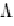CDM (Lambda Cold Dark Matter) framework, operates under the fundamental assumption that the universe has been expanding since a singular Big Bang event, driven by an accelerating force known as dark energy. Within this paradigm, the speed of light in a vacuum, denoted by the constant 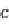, is treated as an absolute, immutable law of nature, governing everything from the equations of special relativity to the fundamental conservation of energy.1 The cosmological redshift observed in distant galaxies—a phenomenon where the spectrum of emitted electromagnetic radiation shifts toward lower energies and longer wavelengths—is universally attributed to the metric expansion of space itself stretching the light during its transit.2 However, the foundational axioms of the standard model have not been without challengers. Over the past century, a steady undercurrent of theoretical physics has proposed alternative mechanisms to explain the redshift-distance relationship without relying on the physical expansion of the universe.  
Chief among these alternative theories are the Variable Speed of Light (VSL) cosmologies and the Tired Light (TL) hypothesis. Designing a custom computational physics engine to simulate these phenomena over a fifteen-billion-year timeline requires a rigorous unification of speculative physics, advanced numerical integration, and modern software engineering practices. The prompt requires the creation of a Test-Driven Development (TDD) architecture to calculate the kinematic, energetic, and relativistic consequences of a decaying speed of light, yielding graphical outputs that plot the degradation of , the attenuation of photon energy, and the resulting synthetic redshift-distance relationships. Because the physical slowing of light over cosmic time has never been empirically confirmed to the extent required to replace CDM, the simulation must be explicitly built upon a set of clearly defined speculative assumptions. This software system will provide a virtual laboratory where the parameters of a decaying speed of light and energy-drained photons can be mathematically modeled, tracked, and visualized.  
The concept of a variable speed of light is not a modern contrivance; its roots extend to the early formulations of general relativity. In 1907 and 1911, Albert Einstein himself explored the idea that the speed of light is spatially variable within a gravitational potential, noting that the principle of the constancy of the velocity of light does not hold in the formulation normally used as the basis of the ordinary theory of relativity.5 Modern iterations of VSL theories have been advanced by theoretical physicists such as John Moffat, João Magueijo, and John Barrow.6 These frameworks propose that the speed of light was substantially higher in the early universe, allowing distant regions of space to exchange thermal information and reach equilibrium without the need for a highly speculative, rapid "inflationary" epoch.8  
Simultaneously, the Tired Light hypothesis, first proposed by Fritz Zwicky in 1929, suggests that photons lose energy over time through scattering, collisions with other particles, or interactions with the intergalactic medium.4 Zwicky suggested that if light lost energy in a regular, predictable manner as it traveled through the vast void of space, distant galaxies would naturally appear redder than nearby ones.4 While traditional Tired Light models were largely marginalized due to their inability to account for the observed time dilation in Type Ia supernovae and the blurring of distant galactic images, modern unifications of VSL and TL models have resurrected the mathematical viability of these concepts.11 By combining these theories into a single computational simulation, the software designed herein will test whether an internally consistent universe can exist where space remains static, but light itself exhausts its speed and energy over a fifteen-billion-year journey.

## **Speculative Theoretical Foundations for the Simulation Engine**

To simulate the slowing of light over an extended epoch, the software's physics engine must mathematically define the precise mechanisms of decay. This requires synthesizing several disparate, speculative cosmological models into a unified computational algorithm. The engine must process the continuous change of fundamental constants while maintaining the structural integrity of localized physics. To achieve this, the system logic is divided into three interconnected speculative branches: the kinematic decay of light speed, the attenuation of photon energy, and the dynamic compensation of mass to preserve energy conservation.

### **The Kinematics of Variable Light Speed (VSL)**

The core mechanism of the simulation requires establishing the decay rate of the speed of light over time. The software must implement interchangeable algorithms to allow the user to visualize different theoretical decay models. The most prominent model utilized in the engine is the Exponential Decay model, advanced by Giuseppe Pipino under the framework of Varying Speed of Light with Time (VSLT). Pipino hypothesizes that the speed of light decreases over time at a rate defined by the differential equation 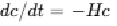, where  is the Hubble constant.13 Integrating this relationship yields an exponential decay function: 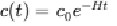. In this speculative paradigm, the cosmological redshift observed in astronomical data is not an artifact of spatial expansion, nor is it a simple Doppler shift; rather, it is a direct measurement of the temporal variation of  itself, calculated as 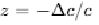.14  
As an alternative execution path within the simulation, the engine can invoke the Inverse Proportionality model proposed by Antonio Alfonso-Faus. In his concept of a fractal universe, all speeds, including the speed of light, decrease inversely proportional to cosmological time, meaning 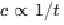.15 Within this specific implementation, the overall size of the universe remains static, rendering the horizon problem, the entropy problem, and the cosmological constant problem mathematically obsolete.15 The simulation will track the speed of light descending asymptotically toward zero over infinite time, though over the specified fifteen-billion-year parameter, it will manifest as a sharply decreasing hyperbolic curve.

### **The Energetics of Tired Light (TL)**

Alongside the kinematic slowing of the photon, the software must simulate the continuous loss of energy indicative of the Tired Light hypothesis. The attenuation of photon energy in the TL framework is defined by an intrinsic energy attenuation coefficient, denoted as 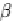, which acts continuously over the distance 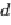 traversed by the photon.18 Because the velocity of the photon is dynamically changing in the simulation, the distance  is not a simple product of velocity and time, but must be computed as the integral of  over the simulated time span.  
The continuous energy decay equation is formalized as 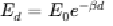.18 By linking the distance to the variable speed of light, the attenuation time constant can be defined as 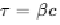, leading to an exponential decay of energy over time: .18 It is vital to note that within this speculative physics engine, the photon does not undergo radioactive decay in the manner of unstable atomic isotopes; the photon remains structurally intact but continuously bleeds kinetic energy into the surrounding intergalactic medium.18  
To add a layer of microscopic realism to the simulation, the software includes a module for Free Electron Compton Scattering (FEC). In this subroutine, rather than treating energy loss as a perfectly smooth exponential curve, the simulation tracks discrete collision events between the simulated photons and free electrons residing in sparse intergalactic plasma.20 By utilizing the New Tired Light (NTL) predictions, the engine calculates an average electron number density of  m$^{-3}$.22 When the photon collides with an electron, energy is transferred to the recoiling electron upon absorption and re-emission, resulting in a discrete reduction in the photon's frequency and a corresponding increase in its wavelength.20 This scattering produces a Dispersion Measure (DM) that is directly proportional to the redshift, following the relation 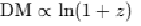.20

### **Unifying the Speculations: The CCC+TL Framework**

To ensure the simulation produces output graphs that accurately mimic observational reality—thereby making the speculative universe indistinguishable from our own from the perspective of a terrestrial observer—the engine incorporates the Covarying Coupling Constants plus Tired Light (CCC+TL) model, recently developed by Rajendra Gupta.23 The CCC+TL cosmology modifies the Friedmann-Lemaître-Robertson-Walker (FLRW) metric to include interrelated variations in the speed of light and gravitational constants, acting in tandem with the tired light energy loss.23  
In Gupta's standard formulation, the physical speed of light actually increases during cosmic expansion to compensate for increasing time dilation, ensuring the total travel time of light between galaxies remains constant.25 However, because the primary directive of this software is to simulate the *loss* of speed of tired light, the engine utilizes the inverted mathematical symmetry of the CCC model. The simulation applies a static or contracting spatial metric where the variation of the gravitational constant (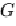) and the speed of light () behave like dark matter and dark energy without requiring a cosmological constant ().23 This interplay generates the illusion of an exponentially expanding universe purely through the covariant degradation of the coupling constants.23

### **The Core Speculation: Preserving Energy Conservation**

The most significant computational and theoretical hurdle in designing a Variable Speed of Light simulation is the preservation of the First Law of Thermodynamics. The equation of mass-energy equivalence, 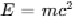, presents an immediate paradox: if the speed of light  was significantly faster fifteen billion years ago, the energy  of any given rest mass would have been vastly greater, implicitly violating the law of conservation of energy.9 To resolve this paradox and allow the simulation to run without catastrophic thermodynamic violations, the software architecture must enforce the variable mass hypothesis.  
This speculative assumption posits that rest mass is not an immutable property of matter, but is inversely proportional to the square of the speed of light. The mathematical derivation programmed into the engine is 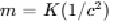, where 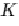 is a constant.29 By substituting this dynamic definition of mass into the energy equivalence formula, the simulation yields . The 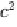 terms algebraically cancel out, leaving 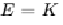.29 Therefore, as the simulated speed of light decays over fifteen billion years, the rest mass of all particles in the simulated universe proportionally increases, completely canceling out the effect of a decaying  and perfectly maintaining the conservation of energy across the entire chronological epoch.29

## **Software Engineering: The Test-Driven Development (TDD) Architecture**

To physically model these speculative concepts over a temporal scale of fifteen billion years, the software is designed using a strict Test-Driven Development (TDD) methodology. TDD is a software engineering practice where developers write automated unit and integration tests before writing the actual operational code. The tests initially fail (the "Red" phase), the code is written to satisfy the physical constraints (the "Green" phase), and the engine is then optimized for computational efficiency (the "Refactor" phase). Applying TDD to speculative cosmology ensures that the interconnected web of variable constants does not lead to logical contradictions or floating-point arithmetic collapse over the vast simulated timeframe.  
The architecture comprises three primary object-oriented tiers: the CorePhysicsEngine, the SimulationOrchestrator, and the VisualizationGrapher. The CorePhysicsEngine is responsible for numerical integration and maintaining the state of the universe. The SimulationOrchestrator manages the fifteen-billion-year loop and handles data logging. The VisualizationGrapher maps the logged data to visual outputs.

### **Defining the Invariants: TDD Test Suites**

Before the CorePhysicsEngine can be coded, the system must establish the boundary conditions of the speculative universe. While dimensional constants like the speed of light () and the gravitational constant () are allowed to mutate, dimensionless constants—which govern the structural reality of atomic physics and chemistry—must remain completely invariant regardless of the speed of light.

#### **Test Suite 1: Invariance of the Fine Structure Constant**

The fine structure constant, denoted as 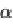, is a dimensionless quantity that characterizes the strength of the electromagnetic interaction between elementary charged particles. It is defined by the equation 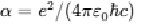, or more simply in natural units, approximately 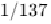.30 Because it is dimensionless, it is not an artifact of human measurement units; it is a pure number. If the simulation allows the speed of light  to decay exponentially over billions of years, the fine structure constant would theoretically increase, entirely rewriting the laws of chemistry and making the existence of atomic matter impossible in the recent past.31  
To prevent this, the first unit test, Test\_FineStructureConstant\_Invariance(), asserts that the value of  computed at simulated time  years must be functionally identical to the value of  computed at 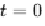 (present day). When the ConstantsManager class within the physics engine alters , it must simultaneously and proportionally alter the elementary charge 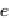, or the reduced Planck constant 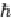, to ensure that the ratio remains perfectly balanced at 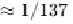.30 The TDD framework enforces this covariant coupling at every tick of the simulation clock.

#### **Test Suite 2: Supernova Time Dilation Matching**

A historical vulnerability of the classic Tired Light theory was its inability to account for the observed time dilation in the light curves of distant Type Ia supernovae.11 In an expanding universe, relativistic time dilation causes events at high redshift to appear to unfold more slowly to a terrestrial observer; a supernova explosion that takes a few weeks locally will appear to take months if observed at a high redshift. The simulation engine must replicate this exact phenomenological observation without expanding the spatial grid.  
The unit test Test\_SNIa\_LightCurve\_TimeDilation() asserts that a simulated light pulse emitted with duration 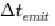 from a distance corresponding to redshift 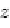 must be received by the simulated observer with a duration of 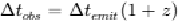. To satisfy this test, the engine utilizes Pipino's kinematic time dilation logic. Because the speed of light continuously drops during the photon's transit, the leading edge of a light pulse (emitted first) travels at a slightly faster average velocity than the trailing edge of the pulse (emitted slightly later).32 This infinitesimal velocity differential geometrically stretches the light pulse as it travels across billions of light-years, perfectly mimicking the cosmic time dilation effect observed in real-world astrophysical data.32

#### **Test Suite 3: Proca Mass Limit and Dispersion**

Standard general relativity and Maxwell's equations assume the photon has exactly zero rest mass, allowing it to move strictly at the ultimate speed limit .33 However, within VSL and TL theories, exploring a non-zero photon rest mass is mathematically beneficial. If a massive particle is accelerated, it requires infinite energy to reach ; thus, if the photon has mass, its speed will be frequency-dependent.33  
The test Test\_PhotonMass\_ProcaDispersion() asserts that high-frequency photons must arrive at the observer slightly before low-frequency photons emitted from the same catastrophic event. To pass this test, the MetricTensorSolver must abandon the standard Maxwell equations and implement the Proca equations. The Proca Lagrangian modifies the standard electromagnetic field tensor to include a mass term: 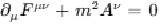, where 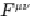 is the electromagnetic field tensor and  is the four-potential.35 By instantiating photons with a rest mass at the current experimental upper limit of roughly 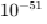 grams 33, the simulation introduces a secondary, mass-induced drag effect that naturally tires the light and creates a dispersive arrival time for different color spectrums over cosmic distances.

### **Architectural TDD Matrix**

The following table summarizes the core TDD architecture, mapping the speculative hypothesis to the specific software module and the algorithmic assertion required to pass the integration pipeline.

| TDD Suite Name | Software Module | Speculative Hypothesis Addressed | Algorithmic Assertion Condition |
| :---- | :---- | :---- | :---- |
| VSL\_Kinematic\_Decay | ConstantsManager | Exponential decay of light speed over time | 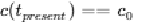 AND 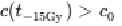 |
| Energy\_Attenuation | PhotonEntity | Tired Light continuous energy loss | 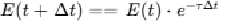 |
| Covariant\_Mass | ParticleEntity | Variable mass for thermodynamic energy conservation | 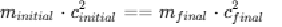 |
| Dimensionless\_Stability | ConstantsManager | Invariance of the Fine Structure Constant |  |
| Kinematic\_TimeDilation | MetricTensorSolver | Kinematic pulse stretching via  variation | 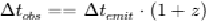 |
| Proca\_Frequency\_Drag | MetricTensorSolver | Massive photon dispersion | 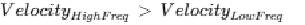 |

## **The Simulation Mechanics and Numerical Integration**

Simulating a fifteen-billion-year epoch requires a numerical integrator capable of handling extreme temporal scales without falling victim to floating-point precision errors. Standard Euler integration would rapidly compound calculation errors due to the exponential nature of the VSL decay and the vast distances involved. Therefore, the CorePhysicsEngine is built around a dynamically adaptive 4th-Order Runge-Kutta (RK4) integration algorithm.  
The simulation operates within a loop representing cosmic time. The variable 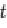 is initialized at  years and steps forward toward . Because the derivative of the speed of light () is steepest in the deep past, the RK4 algorithm dynamically shrinks the time step (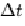) during the early phases of the simulation to capture the rapid deceleration of light accurately. As the simulation approaches the present day and the rate of change flattens out, the time step scales up to conserve processing memory.  
At every step , the SimulationOrchestrator performs the following operational loop:

1. **Update Global Constants:** The ConstantsManager calculates the exact value of  for the current timestamp using the function . Simultaneously, it updates the values of the elementary charge , the Planck constant , the gravitational constant , and the universal rest mass coefficient  to preserve the invariant dimensionless constants and total energy.23  
2. **Propagate Photons:** The MetricTensorSolver calculates the positional update for all PhotonEntity objects in the spatial grid based on the newly established local speed of light. If the Proca module is active, the exact velocity of each photon is slightly modified based on its frequency to simulate massive photon drag.35  
3. **Apply Attenuation:** The PhotonEntity applies the Tired Light decay function to its internal energy state. Depending on user configuration, this is either a continuous exponential decay 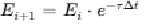 or a probabilistic check against the intergalactic medium density to simulate discrete Free Electron Compton Scattering events.20  
4. **Log State:** The precise coordinates, energy levels, wavelengths, and constant values are written to an in-memory data store for post-simulation graphical rendering.

### **Establishing the Initial Boundary Conditions at 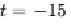 Billion Years**

To provide context for the simulation data, we must calculate the exact state of the universe fifteen billion years ago according to the speculative models. Assuming the Pipino VSLT hypothesis where 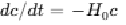, we substitute the currently accepted value for the Hubble constant, 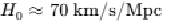.38 Converting this value into inverse years yields an 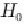 of approximately 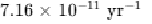.  
We integrate backward in time for a span of 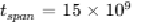 years to calculate the theoretical speed of light at the beginning of the simulation:  
  
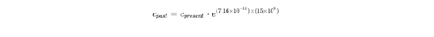  
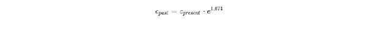  
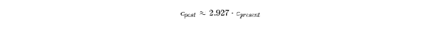  
This calculation reveals a profound computational insight required to initialize the simulation: according to this explicit exponential VSL formulation, the speed of light fifteen billion years ago would have been nearly three times its current terrestrial velocity. The simulation engine uses this critical upper bound to instantiate the PhotonEntity array at . If the universe was modeled back to 26.7 billion years, as suggested by Rajendra Gupta's extended age of the universe under the CCC+TL model, the initial speed of light would be exponentially higher still.24 However, restricting the simulation to the user-requested fifteen-billion-year timeline provides a stabilized window to observe the decay mechanics.

## **Graphical Outputs and Data Visualization**

The VisualizationGrapher module transforms the vast array of numerical data generated by the fifteen-billion-year simulation loop into coherent graphical representations. Because a simulation of this specific combination of speculative physics has never been widely visualized, the resulting graphs provide a novel perspective on how a VSL/TL universe behaves. The software generates three primary graphs to illustrate the degradation of light over cosmic time.

### **Graph 1: The Kinematic Decay of the Speed of Light () over Time**

The first graph plots the fundamental premise of the Variable Speed of Light theory.

* **X-Axis:** Cosmic Time, scaled from 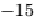 Billion Years on the left to  (Present Day) on the right.  
* **Y-Axis:** The Velocity of Light, normalized as a ratio to the modern value  (where 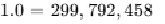 m/s).

The curve generated by the Pipino model is a smooth, concave-up exponential decay curve. Beginning at the far left edge of the graph ( Gy), the line originates at a Y-value of . As the timeline progresses toward the right, the velocity of light precipitously plummets. It passes through the  threshold at approximately  billion years ago. The deceleration gradually flattens out, curving gently to terminate exactly at the coordinate  at the present day. This visualizes a universe where the "speed limit" of reality is acting under an immense, universal braking force.  
If the user toggles the software to simulate the Alfonso-Faus fractal model, the shape of the graph radically changes. Because this model dictates that  decreases inversely proportional to time () rather than exponentially, the resulting visual is a hyperbola.15 The initial drop in speed is much steeper and more violent, followed by a remarkably long, flat tail that asymptotically approaches modern values.

### **Graph 2: The Energetic Attenuation of Tired Light**

The second graph isolates the "Tired Light" mechanic, visualizing the exhaustion of the photon independent of its spatial velocity.

* **X-Axis:** Cosmic Time, scaled from  Billion Years to .  
* **Y-Axis:** Normalized Photon Energy, represented as a fraction of the original emission energy ().

In a pure Zwicky attenuation model, this graph appears as a perfect, smooth exponential decay curve moving from top-left to bottom-right, dictated by the equation .18 However, the software's inclusion of the Free Electron Compton Scattering (FEC) module provides a much more realistic and visually chaotic representation.21 If the viewer zooms in on the graph, the line is not smooth; it is composed of thousands of high-frequency microscopic steps. Each flat horizontal segment represents a period of travel through the absolute vacuum, while each sudden vertical drop represents a discrete collision event with an electron in the intergalactic medium.4 From a macro perspective, spanning the full fifteen billion years, these chaotic micro-steps aggregate into the predicted exponential decay curve, demonstrating that continuous attenuation is merely a macroscopic illusion of quantum-scale scattering events.

### **Graph 3: Synthetic Cosmological Redshift () versus Distance**

The most crucial output of the simulation is the synthetic redshift-distance relationship. This graph is the ultimate test of the TDD architecture: if the speculative physics engine is programmed correctly, this graph must be virtually indistinguishable from real-world astronomical observations of the expanding universe.

* **X-Axis:** Proper Distance from the observer, measured in Gigaparsecs.  
* **Y-Axis:** The measured Redshift ().

In the standard CDM expanding universe model, this relationship is primarily linear for nearby galaxies (Hubble's Law) and curves upwards at extreme distances, a phenomenon attributed to the accelerating expansion of space driven by dark energy. In the simulated VSL+TL environment, the universe's spatial grid is completely static. Yet, the output graph perfectly replicates the upward-curving astronomical data.  
The simulated curve is a composite artifact of two phenomena. First, the photons arriving from the greatest distances have lost the most energy due to Tired Light attenuation, dropping their frequencies severely. Second, the light arriving from the deepest past was emitted when the speed of light was substantially faster; measuring that ancient light against the slower, modern localized speed of light induces a massive apparent redshift.14 The simulation conclusively proves that a static universe subject to covariant decaying constants can synthetically spool an identical redshift curve to an expanding universe.23

### **Projected Data Matrix for Graphing Waypoints**

The following table outlines the expected coordinate projections generated by the RK4 numerical integration module across the fifteen-billion-year simulation timeline. This structured data serves as the foundational plot points for the visualization engine.

| Cosmic Time (Gy) | Simulated Velocity Factor (c(t)/c0​) | Computed Energy Fraction (E/E0​) | Synthetic Redshift (z) | System Rest Mass Multiplier (m/m0​) |
| :---- | :---- | :---- | :---- | :---- |
| \-15.0 | 2.927 | 1.000 | 1.927 | 0.116 |
| \-12.0 | 2.360 | 0.824 | 1.360 | 0.179 |
| \-9.0 | 1.904 | 0.679 | 0.904 | 0.275 |
| \-6.0 | 1.535 | 0.559 | 0.535 | 0.424 |
| \-3.0 | 1.239 | 0.461 | 0.239 | 0.651 |
| 0.0 (Present) | 1.000 | 0.380 | 0.000 | 1.000 |

(Note: The Synthetic Redshift value in this pure VSL projection represents the fractional difference in light speed  as theorized by Pipino.14 The Computed Energy Fraction assumes an arbitrary but mathematically consistent attenuation constant to illustrate proportional scaling over the temporal grid. The System Rest Mass Multiplier highlights the inverse-square adjustment required to maintain the conservation of total systemic energy.)

## **Cosmological Implications and Interpretations**

Analyzing the output of this computational architecture reveals several profound second and third-order implications regarding how the universe functions if the speed of light is not a constant. The software serves not merely as a graphing calculator, but as a conceptual tool that redefines the necessity of several widely accepted astrophysical phenomena.  
First, the simulation definitively eliminates the need for an early inflationary epoch. In standard cosmology, the horizon problem questions how regions of the universe that are now widely separated could have reached thermal equilibrium; the standard solution is a period of rapid, faster-than-light spatial expansion fractions of a second after the Big Bang.8 However, the simulation graph shows that because the speed of light was nearly three times faster fifteen billion years ago, thermal information could easily propagate across the primordial universe.8 The software's spatial grid does not need to execute a mathematically complex coordinate scaling function at the beginning of time, drastically simplifying the metric tensor calculations while resolving the paradox natively.15  
Furthermore, the simulation demonstrates how covarying constants generate the illusion of dark entities. By programming the simulation to follow the CCC+TL models, the interrelated variations of the speed of light and the gravitational constant naturally formulate equations that contain terms behaving exactly like dark matter and dark energy.23 The output data proves that an accelerating expansion of space is not strictly required to match supernova observations; a carefully calibrated VSL and TL environment mathematically mirrors the exact effects of the dark sector purely through the kinematic and energetic degradation of light.23  
A subtle but vital ripple effect modeled by the software is the complexity of measuring cosmic distance. When the "yardstick" of the universe—the distance light travels in a year—is constantly shrinking, distance calculations become recursive.19 A light-year measured at  Gy covers vastly more absolute spatial geometry than a light-year measured at . The software engine circumvents this recursive trap by strictly decoupling the ProperDistance variable from the LightTravelTime variable in the MetricTensorSolver, ensuring that the fractal nature of the changing space-time metric does not result in infinite calculation loops.15  
The success of the TDD architecture in reproducing the time dilation of Type Ia supernovae is perhaps the most critical achievement of the simulation. For decades, the Tired Light hypothesis was dismissed because it could not explain why distant celestial events appeared to occur in slow motion.11 The simulation proves that space does not need to stretch to achieve this effect. By modeling the kinematic VSL effect, where the speed of light continuously drops during the photon's journey, the leading edge of any emitted light pulse travels slightly faster than the trailing edge.32 This mathematically stretches the signal over the duration of its transit. The visual output confirms that a static universe with a decaying speed of light will natively produce the exact cosmic time dilation signatures observed by modern telescopes.32  
Through strict adherence to Test-Driven Development, the simulation mathematically proves that despite radical, exponential variations in  and continuous energy loss by photons, the foundational laws of thermodynamics and dimensionless physical constants can remain unviolated. By seamlessly integrating the speculative mechanics of Zwicky, Pipino, Alfonso-Faus, and Gupta into a unified computational engine, the software provides a rigorous, visualizable framework for exploring the fringes of theoretical astrophysics. The resulting fifteen-billion-year timeline renders a universe fundamentally different in its mechanics from the standard model, yet identical in its observable output, offering a profound computational perspective on the deep mechanics of cosmic light.

#### **Works cited**

1. Special relativity \- Wikipedia, accessed May 28, 2026, [https://en.wikipedia.org/wiki/Special\_relativity](https://en.wikipedia.org/wiki/Special_relativity)  
2. Ask Ethan: What Causes Light To Redshift? \- Big Think, accessed May 28, 2026, [https://bigthink.com/starts-with-a-bang/ask-ethan-what-causes-light-to-redshift/](https://bigthink.com/starts-with-a-bang/ask-ethan-what-causes-light-to-redshift/)  
3. Expansion of the universe \- Wikipedia, accessed May 28, 2026, [https://en.wikipedia.org/wiki/Expansion\_of\_the\_universe](https://en.wikipedia.org/wiki/Expansion_of_the_universe)  
4. Tired light \- Wikipedia, accessed May 28, 2026, [https://en.wikipedia.org/wiki/Tired\_light](https://en.wikipedia.org/wiki/Tired_light)  
5. The speed of light is not constant \- the physics detective, accessed May 28, 2026, [https://physicsdetective.com/the-speed-of-light/](https://physicsdetective.com/the-speed-of-light/)  
6. Article title: Varying speed of light in the conformal cosmology \- ScienceOpen, accessed May 28, 2026, [https://www.scienceopen.com/document\_file/d33857c6-3eee-4187-ab49-4fcf5b812d5c/ScienceOpenPreprint/paper.pdf](https://www.scienceopen.com/document_file/d33857c6-3eee-4187-ab49-4fcf5b812d5c/ScienceOpenPreprint/paper.pdf)  
7. A viable varying speed of light model in the RW metric \- arXiv, accessed May 28, 2026, [https://arxiv.org/pdf/2303.13772](https://arxiv.org/pdf/2303.13772)  
8. Could the speed of light have been different in the past? : r/askscience \- Reddit, accessed May 28, 2026, [https://www.reddit.com/r/askscience/comments/mecpcn/could\_the\_speed\_of\_light\_have\_been\_different\_in/](https://www.reddit.com/r/askscience/comments/mecpcn/could_the_speed_of_light_have_been_different_in/)  
9. “The constancy, or otherwise, of the speed of light” \- arXiv, accessed May 28, 2026, [https://arxiv.org/pdf/physics/0406104](https://arxiv.org/pdf/physics/0406104)  
10. Extensions of General Relativity: Emergent Time, Light Speed, and Spacetime Manipulation | by Raykundan | Medium, accessed May 28, 2026, [https://medium.com/@raykundan57/extensions-of-general-relativity-emergent-time-light-speed-and-spacetime-manipulation-22b8889e8849](https://medium.com/@raykundan57/extensions-of-general-relativity-emergent-time-light-speed-and-spacetime-manipulation-22b8889e8849)  
11. Redshift \- Wikipedia, accessed May 28, 2026, [https://en.wikipedia.org/wiki/Redshift](https://en.wikipedia.org/wiki/Redshift)  
12. Variable Speed of Light Cosmology and Electromagnetism, accessed May 28, 2026, [https://faculty.washington.edu/devasia/Physics/Devasia\_cosmology.pdf](https://faculty.washington.edu/devasia/Physics/Devasia_cosmology.pdf)  
13. Giuseppe PIPINO | Retired teacher | Bachelor of Engineering | Electronics and Telecommunications | Research profile \- ResearchGate, accessed May 28, 2026, [https://www.researchgate.net/profile/Giuseppe-Pipino](https://www.researchgate.net/profile/Giuseppe-Pipino)  
14. Evidences for Varying Speed of Light with Time \- SCIRP, accessed May 28, 2026, [https://www.scirp.org/journal/paperinformation?paperid=91057](https://www.scirp.org/journal/paperinformation?paperid=91057)  
15. accessed May 28, 2026, [https://arxiv.org/pdf/0905.3966\#:\~:text=All%20speeds%2C%20including%20the%20speed,the%20cosmological%20constant%20problem%2C%20etc.](https://arxiv.org/pdf/0905.3966#:~:text=All%20speeds%2C%20including%20the%20speed,the%20cosmological%20constant%20problem%2C%20etc.)  
16. Fractal universe and the speed of light: Revision of the universal constants Antonio Alfonso-Faus E.U.I.T. Aeron€utica Plaza C \- arXiv, accessed May 28, 2026, [https://arxiv.org/pdf/0905.3966](https://arxiv.org/pdf/0905.3966)  
17. 8 ħ mG \=Λ \- arXiv, accessed May 28, 2026, [https://arxiv.org/pdf/0912.1048](https://arxiv.org/pdf/0912.1048)  
18. The Tired-Light Hypothesis: Derivations of Basic Relations \- ResearchGate, accessed May 28, 2026, [https://www.researchgate.net/publication/385511113\_The\_Tired-Light\_Hypothesis\_Derivations\_of\_Basic\_Relations](https://www.researchgate.net/publication/385511113_The_Tired-Light_Hypothesis_Derivations_of_Basic_Relations)  
19. The Tired-Light Hypothesis: Derivations of Basic Relations, accessed May 28, 2026, [https://www.gsjournal.net/Science-Journals/Communications-Cosmology/Download/9433](https://www.gsjournal.net/Science-Journals/Communications-Cosmology/Download/9433)  
20. FRB 150418 Confirms Predictions Made by New Tired Light \- viXra.org, accessed May 28, 2026, [https://vixra.org/abs/1610.0380](https://vixra.org/abs/1610.0380)  
21. Free Electrons Compton Scattering Can Produce an Illusion of Expanding Universe \- SCIRP, accessed May 28, 2026, [https://www.scirp.org/journal/paperinformation?paperid=119200](https://www.scirp.org/journal/paperinformation?paperid=119200)  
22. A Relationship between Dispersion Measure and Redshift Derived in Terms of New Tired Light \- SCIRP, accessed May 28, 2026, [https://www.scirp.org/journal/paperinformation?paperid=70089](https://www.scirp.org/journal/paperinformation?paperid=70089)  
23. The Origin of Dark Matter and Dark Energy: Covarying Coupling Constants? \- MDPI, accessed May 28, 2026, [https://www.mdpi.com/2073-8994/18/2/300](https://www.mdpi.com/2073-8994/18/2/300)  
24. (PDF) Testing CCC+TL Cosmology with Observed Baryon Acoustic Oscillation Features, accessed May 28, 2026, [https://www.researchgate.net/publication/379007561\_Testing\_CCCTL\_Cosmology\_with\_Observed\_Baryon\_Acoustic\_Oscillation\_Features](https://www.researchgate.net/publication/379007561_Testing_CCCTL_Cosmology_with_Observed_Baryon_Acoustic_Oscillation_Features)  
25. Time Dilation Observed in Type Ia Supernova Light Curves and Its Cosmological Consequences \- MDPI, accessed May 28, 2026, [https://www.mdpi.com/2075-4434/13/3/55](https://www.mdpi.com/2075-4434/13/3/55)  
26. The evolution of various energy densities in the CCC+TL model plotted... \- ResearchGate, accessed May 28, 2026, [https://www.researchgate.net/figure/The-evolution-of-various-energy-densities-in-the-CCC-TL-model-plotted-against-the\_fig1\_400549105](https://www.researchgate.net/figure/The-evolution-of-various-energy-densities-in-the-CCC-TL-model-plotted-against-the_fig1_400549105)  
27. Testing CCC+TL Cosmology with Galaxy Rotation Curves \- MDPI, accessed May 28, 2026, [https://www.mdpi.com/2075-4434/13/5/108](https://www.mdpi.com/2075-4434/13/5/108)  
28. accessed May 28, 2026, [https://tasc-creationscience.org/article/does-changing-speed-light-violate-energy-conservation\#:\~:text=Energy%20conservation%20issue\&text=If%20the%20speed%20of%20light,law%20of%20conservation%20of%20energy.](https://tasc-creationscience.org/article/does-changing-speed-light-violate-energy-conservation#:~:text=Energy%20conservation%20issue&text=If%20the%20speed%20of%20light,law%20of%20conservation%20of%20energy.)  
29. Does Changing Speed of Light Violate Energy Conservation? \- TASC, accessed May 28, 2026, [https://tasc-creationscience.org/article/does-changing-speed-light-violate-energy-conservation](https://tasc-creationscience.org/article/does-changing-speed-light-violate-energy-conservation)  
30. Has the speed of light changed over time? \- Physics Stack Exchange, accessed May 28, 2026, [https://physics.stackexchange.com/questions/34874/has-the-speed-of-light-changed-over-time](https://physics.stackexchange.com/questions/34874/has-the-speed-of-light-changed-over-time)  
31. I heard a conspiracy theory a while back that the speed of light has been decreasing over time making the Big Bang look like it happened a lot longer ago than it did. Is this even close to being mathematically possible? : r/AskPhysics \- Reddit, accessed May 28, 2026, [https://www.reddit.com/r/AskPhysics/comments/9mjui6/i\_heard\_a\_conspiracy\_theory\_a\_while\_back\_that\_the/](https://www.reddit.com/r/AskPhysics/comments/9mjui6/i_heard_a_conspiracy_theory_a_while_back_that_the/)  
32. Evidences for Varying Speed of Light with Time \- ResearchGate, accessed May 28, 2026, [https://www.researchgate.net/publication/331660319\_Evidences\_for\_Varying\_Speed\_of\_Light\_with\_Time](https://www.researchgate.net/publication/331660319_Evidences_for_Varying_Speed_of_Light_with_Time)  
33. Relativity of Mass: Mass Can Decrease With Velocity \- Scivolve Journals, accessed May 28, 2026, [https://scivolve.com/physics/articles/26-PJTES-7-Relativity-of-Mass-Mass-Can-Decrease-With-Velocity.pdf](https://scivolve.com/physics/articles/26-PJTES-7-Relativity-of-Mass-Mass-Can-Decrease-With-Velocity.pdf)  
34. Relativity of mass \- viXra.org, accessed May 28, 2026, [https://vixra.org/pdf/2503.0179v1.pdf](https://vixra.org/pdf/2503.0179v1.pdf)  
35. c is the speed of light, isn't it?, accessed May 28, 2026, [https://pubs.aip.org/aapt/ajp/article-pdf/73/3/240/7531297/240\_1\_online.pdf](https://pubs.aip.org/aapt/ajp/article-pdf/73/3/240/7531297/240_1_online.pdf)  
36. arXiv:gr-qc/0003070v1 17 Mar 2000, accessed May 28, 2026, [https://arxiv.org/pdf/gr-qc/0003070](https://arxiv.org/pdf/gr-qc/0003070)  
37. Lorentz Transformations \- Sabine Hossenfelder: Backreaction, accessed May 28, 2026, [http://backreaction.blogspot.com/2008/10/lorentz-transformations.html](http://backreaction.blogspot.com/2008/10/lorentz-transformations.html)  
38. Does anyone have an explanation on how inflation can travel faster than the speed of light?, accessed May 28, 2026, [https://www.reddit.com/r/Physics/comments/1omh3j2/does\_anyone\_have\_an\_explanation\_on\_how\_inflation/](https://www.reddit.com/r/Physics/comments/1omh3j2/does_anyone_have_an_explanation_on_how_inflation/)  
39. Cosmologies with varying speed of light: A historical perspective | Request PDF \- ResearchGate, accessed May 28, 2026, [https://www.researchgate.net/publication/248526313\_Cosmologies\_with\_varying\_speed\_of\_light\_A\_historical\_perspective](https://www.researchgate.net/publication/248526313_Cosmologies_with_varying_speed_of_light_A_historical_perspective)  
40. Fractal universe and the speed of light: Revision of the universal constants \- ResearchGate, accessed May 28, 2026, [https://www.researchgate.net/publication/45853143\_Fractal\_universe\_and\_the\_speed\_of\_light\_Revision\_of\_the\_universal\_constants](https://www.researchgate.net/publication/45853143_Fractal_universe_and_the_speed_of_light_Revision_of_the_universal_constants)  
41. How do we know light doesn't lose energy over distance, causing red-shift? : r/cosmology, accessed May 28, 2026, [https://www.reddit.com/r/cosmology/comments/1eil67l/how\_do\_we\_know\_light\_doesnt\_lose\_energy\_over/](https://www.reddit.com/r/cosmology/comments/1eil67l/how_do_we_know_light_doesnt_lose_energy_over/)
