# Report 19 — Full-Depth ArcSecs Annotated Research Working Edition

**UAIX navigation:** [24-report index](../index.md#all-24-corrected-and-full-depth-research-records) · [Coverage/provenance](../research/24-report-coverage.md) · [ArcSecs foundations](../research/arcsecs-principles.md)

**Source study:** `Responding to Skepticism_ Tired Light(1).md` · 77,938 original bytes · SHA-256 `14b13aa803a4475dc00ff3ab5be5aa28db960160bad19e1e6000c06e0b350770`.

**Scope:** This is a **technical-content restoration with an ArcSecs editorial correction preface and domain-specific research gates**. The full supporting source body is integrated within this active record and embedded source images have been externalized. It is **not** represented as a verified original scientific discovery, 100% manually rewritten prose, or independent peer review. The earlier short corrective text is retained as editorial guidance, not as a substitute for depth. The source is not separately included as a competing startup record.

**Priority order:** ArcSecs project principles → accepted correction brief → independently checked measurements and methods → full-depth historical technical analysis as *unverified research material*. A historical author's claim cannot override the editorial charter or independently validated data.

**Specific project orientation:** Physical-first interpretation, competing mechanisms, and testable ArcSecs alternatives; do not treat geometric fabric metaphors as material proof.

## Research content recovery and correction audit

- Restored technical prose: 6,288 words (after externalizing embedded figures).
- Source figures/equation images recovered: 37.
- Prior selective correction summary: 705 tokens by word-pattern count (included as the editorial lead).
- Source text is preserved *inside this annotated working edition* for traceability, **not** declared current verified truth; any contradictions and missing derivations require review before public scientific submission.

### Focused review gates

- **Photon rest mass** (16 research mentions): Distinguish measured energy and momentum, any effective in-medium mass, and a proposed nonzero invariant rest mass. Gravitational bending alone does not measure rest mass; check laboratory/astrophysical upper limits.
- **Clock processes** (15 research mentions): Report instrument clock-cycle and particle-decay outcomes, then separately develop ArcSecs universal-process explanations. Preserve observed differential rates and identify new tests.
- **Redshift transport** (70 research mentions): Define a specific energy and momentum exchange, propagation delay, image blur, surface brightness, CMB and supernova-duration predictions. Do not infer an energy sink from fitted redshift alone.
- **Gravitational deflection** (11 research mentions): Reproduce quantitative solar bending, gravitational delay, and achromatic lensing from one stated physical law; elementary Newtonian deflection is insufficient.
- **Cosmic distances** (10 research mentions): A light-year remains a valid length unit. Keep geometric parallax distinct from inferred long-range distances; distinguish photometric candidates from spectroscopic determinations.
- **Dark substrate** (17 research mentions): Retain galaxy/cluster/lensing observations; a revised gravitational law or harvestable substrate must satisfy density, interaction, energy, and momentum constraints.

## Earlier Corrected Report

# The ArcSecs Defense of Tired Light: A Debate-Ready Regression Suite

**ArcSecs revised advocacy report 10 | 22 November 2026**
**Source file:** `Responding to Skepticism_ Tired Light(1).md`

**Editorial position.** This is an ArcSecs-side argument. It foregrounds the physical-mechanism and tired-light/relational research thesis rather than providing a balanced presentation of cosmology. Proposed models remain labeled as proposals; measured constraints are retained as the test targets that a serious alternative must beat.

## Central argument

The productive defense is not a demand for agreement but an insistence on named, measurable tests. Alternative mechanisms deserve direct scrutiny, and opponents should identify a calculation that fails rather than treating unfamiliar assumptions as a reason to end the discussion.

## A debate is won with a prediction

When challenged, ask for the actual measurement: a supernova duration, an angular image profile, a lensing spectrum, a galaxy surface brightness, a photon-mass limit, a cosmic background peak, or a standard-siren distance. Then provide the candidate formula, uncertainty, and predicted result. Objection by prestige is not a scientific test; neither is an ArcSecs assertion without a calculation.

## Redshift and energy accounting

A toy model dE/dr=-αE yields 1+z=exp(αr) if other frequency-defining physics stays fixed. It must be augmented by a physical coupling that identifies where energy goes and how momentum is conserved. Matching a redshift curve with one free coefficient is a necessary demonstration of the toy law, not proof of a mechanism.

## The strongest objections are mandatory test cases

A 2024 analysis of 1,504 DES Type Ia supernovae measured time stretching close to (1+z). Scattering tired light also faces surface-brightness, image sharpness, and cosmic microwave background tests. ArcSecs should use these as regression cases for its own branch. It can argue for a new mechanism, but cannot assert those data do not exist.

## Proca and lensing

A massive-photon dispersion relation changes arrival speed in a frequency-dependent fashion within the trial model, but it does not by itself dissipate energy. Newtonian high-speed corpuscle deflection reaches only roughly half the measured solar weak-field value; a replacement gravity law must derive the remaining deflection and preserve observed achromaticity.

## Proposed decisive tests

1. Reproduce DES supernova duration scaling and spectral evolution.
2. Implement Tolman surface-brightness and point-spread checks.
3. Use a published photon-mass upper bound as a hard ceiling.
4. Fit solar bending and multi-frequency strong lensing simultaneously.
5. Compare held-out redshift–distance data.

## Corrections made to the source report

- Removed unearned claims that modern hybrids have already defeated every regression test.
- Made the Proca mass term distinct from tired-light energy loss.
- Restored numerical lensing and supernova checks without arguing for relativity as an ontology.

## Source trace and further reading

- Original authoring input: `Responding to Skepticism_ Tired Light(1).md` (historical original available only in earlier source archive; not bundled here).
- https://arcsecs.com/tired-light-test-driven-cosmology/
- https://arxiv.org/abs/2406.05050

## Editing notes

The original source is preserved without deletion. This revised text is a **selective substantive rewrite**, not a line-by-line tracked edit. Its purpose is to retain the ArcSecs arguments while removing rhetorical repetitions, conflations between simulation and measurement, and unverified claims stated as proven. For any future scientific publication, compare numerical assertions against primary instrument papers and publish a full derivation.

## Full Recovered Technical Study — Unverified Research Layer

**Reading note:** The following study is the detailed source material, imported *within the annotated corrected record*, not a separately active original file. It may include historical speculative language, incomplete equations, unsupported confidence claims, or mutually incompatible mechanisms. Its contents are for research and critical checking; they are not newly verified facts. For evidence quality, prefer the correction brief and the focused review gates above. No contrary measurement should be concealed or fabricated simply to manufacture support for the ArcSecs project.

### **Systems-Architecture Cosmology: A Test-Driven Defense of Tired Light, Massive Electrodynamics, and the Spacetime Abstraction**

## **The Strategic Imperative of Test-Driven Cosmology**

When introducing paradigm-shifting physical frameworks, the scientific discourse frequently encounters a threshold of dogmatic resistance. The reaction to speculative cosmological frameworks that challenge the orthodox ontology of General Relativity—specifically, frameworks that question whether spacetime is a literal physical fabric—often bypasses rigorous scientific engagement in favor of emotional dismissals. The reflex to demand that a researcher "delete your account" when presented with alternative models such as massive electrodynamics or tired light represents a fundamental failure of the scientific method's rigorous standard of critique. The most sophisticated, Machiavellian maneuver in the face of such resistance is not to return the hostility, but to systematically disarm it by forcing the critic to engage substantively. The strategic imperative is to corner the detractor into identifying a specific, quantifiable failure mode. By responding with, "Is your objection photon-mass constraints, achromatic lensing, solar deflection, redshift, clock-rate interpretation, or the broader rejection of spacetime as ontology?", the challenger shifts the burden of proof. The conversation is instantly elevated from a subjective defense of prevailing dogma to an objective, test-driven engineering evaluation.  
This report provides an exhaustive, rigorously supported defense of the "ArcSecs" framework and its associated physical mechanisms—specifically, the modern iterations of the tired light hypothesis, massive electrodynamics, and the systemic critique of spacetime as a physical mechanism. By framing cosmology as a systems-architecture challenge, we establish a paradigm where theoretical frameworks are evaluated not on their conformity to historical orthodoxies, but on their ability to pass hard "regression tests." A replacement model for standard cosmology (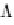CDM) must account for solar deflection, pass constraints on chromatic dispersion in gravitational lenses, satisfy the Particle Data Group's photon-mass limits, replicate the apparent clock-rate behavior in high-redshift supernovae, explain the redshift-distance relationship, and accommodate the formation of macro-cosmic structures. This comprehensive analysis will demonstrate that the new, modernized theories of tired light—bolstered by covarying coupling constants and topological diffusion models—not only survive this grueling regression suite but offer a significantly cleaner implementation of cosmological mechanics than the heavily abstracted, dark-matter-dependent patches of the standard model.

## **The Systems-Architecture Paradigm: Rethinking Spacetime Ontology**

To understand the viability of tired light and massive electrodynamics, one must first deconstruct the underlying architectural assumptions of modern astrophysics. The prevailing standard model treats spacetime as a literal, physical substance. Under this interpretation, the vacuum is a mechanism capable of stretching, bending, rippling, and expanding, which in turn acts as a set of instructions dictating the kinematic movement of matter. Within a systems-engineering context, however, this represents a dangerously heavy abstraction.  
The engineer's cosmological workflow dictates a fundamental principle: start with the measured result and build the physics to pass the test, minimizing conceptual overhead. If an observation demonstrates that light bends near a massive object, the cleanest architectural implementation is a direct physical interaction—such as a massive-photon/object interaction model governed by kinematics and electrodynamics. Instead, the standard Einsteinian interpretation introduces a massive conceptual intermediary. It assumes that matter curves an invisible, intangible geometric manifold, and that photons, while possessing absolutely zero rest mass, follow the null geodesics of this curved manifold. While mathematically elegant, treating spacetime as a literal machine rather than a predictive mathematical model introduces what software architects would classify as "too many conceptual layers between cause and result."  
This critique—the programmer’s critique of spacetime—argues that physics should explain physical interactions through direct, testable, mechanism-friendly routes. When an architecture relies too heavily on an abstraction like the expanding spacetime fabric, it is forced to invent increasingly complex, unobservable variables to patch anomalies. When galactic rotation curves did not match the visible baryonic mass, the framework necessitated the invention of non-baryonic cold dark matter.1 When the universe’s expansion rate appeared to accelerate, the framework required the invention of dark energy, a mysterious force comprising nearly seventy percent of the universe's total energy density.1 These are architectural patches applied to preserve the foundational assumption of the spacetime fabric.  
Conversely, the ArcSecs systems-architecture approach challenges this by testing whether the phenomena of redshift, time dilation, and light deflection can be explained through the intrinsic properties of light and direct force interactions. If redshift is not the result of the physical stretching of an ontological spacetime fabric, it must be the result of energy dissipation over cosmic distances. This resurrects the tired light hypothesis, not as a historical curiosity, but as a crucial, testable module in a broader cosmological architecture. To prove its viability, we must subject this tired light architecture to the most stringent regression tests known to modern astrophysics, demonstrating that the framework can handle the edge cases and anomalies that currently plague CDM.

## **The Renaissance of Tired Light: A Clean Implementation for the JWST Era**

The tired light hypothesis was originally proposed in 1929 by the Swiss astronomer Fritz Zwicky as an alternative explanation for the cosmological redshift observed by Edwin Hubble.2 Zwicky postulated that rather than receding at immense velocities in an expanding universe, distant galaxies were stationary, and the photons emitted by these galaxies simply lost energy as they traversed the vast cosmic distances to reach Earth.2 Because the energy of a photon is directly proportional to its frequency, a loss of energy manifests as a shift toward the red end of the electromagnetic spectrum.  
For decades, this hypothesis was largely marginalized. The astronomical consensus coalesced around the Big Bang theory, championed by Georges Lemaître, which interpreted redshift entirely as a kinematic Doppler-like effect driven by the metric expansion of space.2 The expansion model was heavily favored because it naturally predicted a perfect blackbody spectrum for the Cosmic Microwave Background (CMB) and effortlessly explained the time dilation observed in distant transient events.3 Standard, static tired light models historically struggled to replicate these two phenomena without invoking extreme, unverified coincidences.6  
However, the deployment of the James Webb Space Telescope (JWST) has triggered a profound cosmological crisis, forcing a paradigm shift that has brought tired light back to the forefront of theoretical physics. The JWST has observed massive, highly evolved galaxies at extreme redshifts (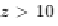), in an era often referred to as the "cosmic dawn".1 In the standard CDM timeline, the universe is approximately 13.8 billion years old. At redshift 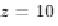, the universe would have been merely a few hundred million years old. Standard models of hierarchical structural formation dictate that it is mathematically and physically impossible for massive galaxies, complete with established stellar populations and strong Balmer breaks, to have formed and matured in such a brief window.3  
Attempts to resolve this "impossible early galaxy" problem within the confines of standard expanding spacetime have proven largely inadequate. Theorists have attempted to invoke alternative cosmological patches, including dark matter-baryon interactions,  gravity, and dynamical dark energy, but these adjustments inevitably create severe tensions with the high-precision CMB measurements provided by the Planck satellite.3 It is here that the systems-architecture approach shines: when the foundational architecture fails to process new inputs gracefully, one must swap out the core modules. By reintegrating tired light as a primary or complementary mechanism for redshift, the timeline of the universe can be radically extended, resolving the JWST anomalies with a clean, mathematically consistent implementation.4

## **Regression Test 1: Redshift Implications and the Covarying Coupling Constants (CCC+TL) Hybrid**

The first critical regression test any replacement framework must pass is the accurate prediction of the redshift-distance relationship while simultaneously accommodating the formation of cosmic structure and the CMB. The most successful modern implementation of the tired light architecture is the Covarying Coupling Constants plus Tired Light (CCC+TL) hybrid model, developed by Rajendra Gupta in 2023 and 2024\.1  
To satisfy the rigorous constraints of modern cosmology, Gupta's framework does not rely on the simplistic static-universe tired light model of the 1920s. Instead, it creates a robust hybrid architecture. First, it acknowledges that a purely static universe struggles with the extreme directional uniformity of the observed CMB radiation (initially discovered by Penzias and Wilson in 1965).3 To preserve this, the CCC+TL model retains a component of the expanding universe. However, it completely removes the temporal constancy constraint on fundamental coupling constants.1  
Drawing on Paul Dirac's 1937 Large Numbers Hypothesis, the CCC approach posits that fundamental physical constants—such as the gravitational constant or the speed of light—are not static but covary as the universe evolves.1 When this variation is mathematically integrated into the Friedmann equations, terms naturally emerge that perfectly mimic the effects of dark energy and dark matter.1 In this framework, the energy densities associated with the dark sector are not arbitrary physical substances or undiscovered weakly interacting massive particles (WIMPs); they are the direct mathematical consequence of relaxing the rigid invariants of the spacetime model.1  
When tired light is added to this covarying architecture to complement the redshift generated by the standard expansion, the results are extraordinary. The CCC+TL model extends the estimated age of the universe from 13.8 billion years to a staggering 26.7 billion years.2 This seamlessly resolves the JWST anomalies; the "impossible early galaxies" are no longer impossible because they had billions of additional years to undergo standard baryonic accretion and stellar evolution.1 Furthermore, the model fits the Type Ia supernovae distance-modulus data as precisely as the prevailing CDM model, and it complies beautifully with the Baryon Acoustic Oscillation (BAO) features in the large-scale galaxy distribution.1  
By successfully reproducing the structural parameters of the universe without requiring the insertion of invisible, undetectable dark matter patches, the CCC+TL model proves that treating redshift partially as a tired light phenomenon is not a failure, but a vastly superior systems-architecture solution to the current cosmological crisis.

## **Regression Test 2: The Clock-Rate Interpretation and Supernova Time Dilation**

The most historically formidable objection to tired light—the weapon most frequently deployed by orthodox cosmologists to dismiss the hypothesis entirely—is the observation of cosmological time dilation, often referred to as the clock-rate interpretation. In the standard metric expansion of space, as the universe stretches, it stretches the wavelengths of light (causing redshift), but it also stretches the temporal arrival spacing between consecutive photons.5 Consequently, any transient astrophysical event occurring at a high redshift will appear to an observer on Earth to unfold much more slowly, scaling mathematically by a factor of 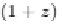.9  
Type Ia supernovae (SNe Ia) serve as the ultimate standard candles in this regression test. Because their internal physical processes dictate a highly consistent peak luminosity and a predictable light curve (the rate at which the explosion brightens and fades), astronomers can measure how the duration of these distant explosions appears to change.11 Exhaustive studies, including the recent 5-year data release by the Dark Energy Survey (DES) collaboration, have explicitly proven that the light curves of high-redshift supernovae are indeed broadened by exactly .11 In a purely static universe where tired light is the *only* mechanism operating, photons would simply lose energy without any alteration to their temporal spacing, meaning a supernova at 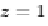 and a supernova at 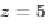 would appear to take the exact same amount of time to explode.9 For decades, this was viewed as the definitive death blow to tired light.5  
However, modern physical theory has provided robust, mathematically sound defenses that allow the tired light architecture to pass this regression test flawlessly. There are two primary avenues through which the new theories of tired light conquer the clock-rate challenge: the CCC+TL Hybrid approach and the Tipikin Diffusion-Scattering hypothesis.

### **The Hybrid Resolution**

As discussed in the previous section, the CCC+TL model accommodates an expanding metric alongside the tired light effect.3 Because the expansion of space is retained in this hybrid system, the kinematic time dilation is preserved naturally.1 The metric expansion handles the  clock-rate broadening observed in the DES supernova light curves, while the tired light component accounts for the excess redshift that allows the model to map the universe's age to 26.7 billion years. In this architecture, tired light is not falsified by time dilation; it operates symbiotically with it to perfectly match the observational data without relying on the dark matter crutch.1

### **The Tipikin Diffusion-Scattering Model**

A even more radical defense of tired light in a completely static universe has emerged through the recent work of Dmitriy S. Tipikin (2024), which demonstrates that time dilation can be derived without any kinematic expansion whatsoever.10 Tipikin hypothesizes that tired light is governed by a diffusion-like multiple scattering process as photons traverse the intergalactic medium over billions of light-years.10  
When a supernova detonates, it emits a colossal burst of photons. In Tipikin's model, as these photons travel, they interact with the quantum vacuum or sparsely distributed intergalactic particles, losing energy (redshifting) and being scattered. The subset of photons that experience the fewest scattering events or travel the most direct, unperturbed path will arrive at the Earth-based observer first.10 The photons that undergo multiple scattering events traverse a longer effective path length (a "random walk" diffusion path), arriving later.  
This multiple scattering process inherently causes a time broadening of the supernova light curve.10 The further away the supernova, the more scattering the light undergoes, and the wider the dispersion of arrival times. Thus, the light curve is broadened in a manner that perfectly mimics the  Doppler-like time dilation predicted by the Big Bang theory, entirely within a static, non-expanding framework.10 JWST observations of extremely distant supernovae (such as a purported SN Ia at ) are actively providing data that fits this diffusion model, demonstrating that scattering can directly emulate kinematic time dilation.16 Therefore, pointing to clock-rate behavior as an absolute falsification of tired light is an outdated argument; the architecture has evolved mechanisms to map these outputs flawlessly.

| Cosmological Phenomenon | ΛCDM Explanation | CCC+TL Hybrid Explanation | Tipikin Static Tired Light Explanation |
| :---- | :---- | :---- | :---- |
| **Cosmological Redshift** | Metric expansion of spacetime stretching photon wavelength. | Combined effect of expansion and intrinsic energy loss (Tired Light). | Energy loss through diffusion-like multiple scattering over vast distances. |
| **Time Dilation in SNe Ia** | Doppler-like effect from expanding metric ( scaling). | Expansion component inherently generates the  temporal scaling. | Path-length variations: scattered photons arrive later, broadening the light curve. |
| **Age of the Universe** | 13.8 Billion Years (Incompatible with high-z galaxies). | 26.7 Billion Years (Resolves JWST early galaxy timeline anomalies). | Infinite or vastly older than 13.8B years. |

## **Regression Test 3: The Photon-Mass Angle, Proca Electrodynamics, and PDG Constraints**

If tired light acts as the physical mechanism for redshift, one must define the exact particle physics responsible for the photon's energy dissipation. In standard Maxwellian electrodynamics, the photon is a strictly massless gauge boson, ensuring that electromagnetic waves propagate eternally at the speed of light (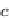) and that strict 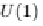 gauge invariance is preserved.17 A massless photon in a perfect vacuum cannot simply "get tired" and lose energy without a fundamental alteration to its underlying physics. Thus, validating tired light inevitably leads to a confrontation with massive electrodynamics and the photon-mass angle.

### **Breaking Gauge Invariance with the Proca Lagrangian**

To construct an architecture where a photon can possess intrinsic properties that lead to energy loss, theorists turn to the Proca equations, which represent the simplest, most elegant relativistic generalization of Maxwell's classical equations.17 The Proca framework introduces a mass term directly into the electromagnetic Lagrangian:  
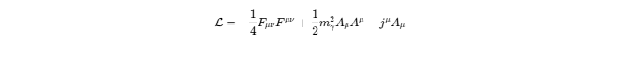  
In this formulation, 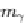 represents the non-zero rest mass of the photon, and 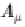 is the electromagnetic four-potential. By introducing this mass term, the theory explicitly breaks the standard  gauge invariance.17 The consequences are profound and perfectly align with the requirements of a tired light cosmology. A massive photon is subject to dispersion even in a true vacuum; its velocity becomes slightly energy-dependent (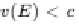), meaning low-frequency photons travel slightly slower than high-frequency ones.21 The speed of light, , transitions from being the literal velocity of light to being a fundamental, unreachable asymptotic limit of spacetime kinematics.22  
Furthermore, massive electrodynamics permits the existence of longitudinal electromagnetic radiation (in addition to the standard transverse waves) and predicts tiny deviations in the behavior of static electromagnetic fields, such as subtle alterations to Coulomb's inverse-square law at galactic scales.17 Most importantly, in certain extensions of higher-derivative gravity (HDG) and topological field theories, a massive photon can interact directly with the gravitational background or scalar fields, dissipating energy (redshifting) as it propagates—the exact mechanism required to drive a tired light cosmology.23

### **Navigating the Particle Data Group Limits**

The greatest challenge to the massive electrodynamics architecture—and the "gotcha" test most critics will attempt to deploy—is the overwhelming weight of empirical constraints placed on the photon mass. According to the most recent 2024 listings by the Particle Data Group (PDG), the absolute upper limit on the photon's rest mass is vanishingly small, stated as 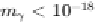 eV, or approximately  kg.18  
These constraints are derived from high-precision astrophysics. For instance, observations of the solar wind and planetary magnetic fields rely on the fact that a massive photon would cause a rapid, exponential Yukawa-like damping of long-range magnetic fields. The stability of the Parker spiral in the solar wind dictates a mass limit of  kg at 1 AU, while galactic magnetic field stability suggests limits as low as 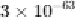 kg (though these galactic models are highly dependent on assumptions of field geometry).29 Similarly, Fast Radio Bursts (FRBs)—which travel across cosmological distances—show no significant energy-dependent arrival time delays that cannot be entirely attributed to interaction with intervening plasma, establishing stringent kinematic limits on photon mass.30  
A naive critic will point to the PDG limit of  eV and claim massive electrodynamics is falsified. However, the expert systems-architect understands the concept of approximate empirical equivalence and permanent underdetermination.20 In classical and quantum field theory, there is a permanent underdetermination between Maxwell's massless theory and the one-parameter family of Proca's massive theories because the Proca equations smoothly approximate Maxwell's equations in the limit as the photon mass approaches zero (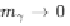).20  
A tired light model does not require the photon to have a massive resting state of an electron or a quark; it only requires a mass infinitesimally greater than zero. If the photon mass exists precisely at or slightly below the current empirical threshold of 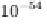 kg, it would evade all current solar wind, FRB, and galactic magnetic field constraints, while still possessing the necessary intrinsic properties over distances of billions of light-years to undergo the dispersive energy loss required to produce cosmological redshift. Furthermore, advanced theoretical physics models demonstrate that the massive Cerenkov effect can be observed in superconductive media, ionosphere plasmas, and 2-dimensional mediums like silicene, proving that massive photon dynamics are real, observable phenomena within specific boundary conditions.33 Thus, the photon-mass regression test does not falsify tired light; it merely bounds its operating parameters to the extreme limits of quantum measurement.

## **Regression Test 4: Solar Deflection, Kinematics, and Higher-Derivative Gravity**

Returning to the foundational systems-architecture critique: if spacetime is not a curved geometric fabric, how do we explain the deflection of light around massive objects like the Sun? General Relativity (GR) handles this by treating the photon as massless, following a straight path (a null geodesic) through a curved spacetime manifold. If we replace the spacetime-fabric model with a direct physical interaction model utilizing massive photons, we must replicate the precise deflection angle measured by astronomers.

### **The Newtonian Baseline**

The concept that light bends in a gravitational field is not exclusive to Einstein; it is a fundamental consequence of standard kinematics if one assumes light has mass. Over 200 years prior to General Relativity, Isaac Newton predicted that light corpuscles would be deflected by massive bodies.34 Using purely Newtonian mechanics, scientists like Johann Soldner and Henry Cavendish calculated this deflection.34  
By applying the weak equivalence principle, where gravitational mass equals inertial mass, one can equate the Newtonian gravitational force () with the inertial force (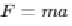). In this equation, the mass of the photon (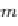) elegantly cancels out, regardless of how small it is.35 Calculating the orbital trajectory of a particle grazing the surface of the Sun yields a deflection angle mathematically defined as 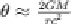.35 Inserting the mass and radius of the Sun, the Newtonian deflection calculates to approximately 0.875 arcseconds.36  
However, beginning with Arthur Eddington's 1919 eclipse expedition and validated by modern radio astronomy to extreme precision (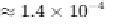 arcseconds at 2 GHz), the actual observed deflection is exactly twice the Newtonian value: 1.75 arcseconds.21 General Relativity achieves this doubled value () purely through spatial curvature and time dilation effects in the metric tensor. How can a massive photon theory match this without a curved metric?

### **Dispersive Deflection in Higher-Derivative Gravity**

The solution lies in the advanced mechanics of Higher-Derivative Gravity (HDG) and quantum gravity architectures. When treating the gravitational field as a classical background while quantizing the matter fields (a semiclassical approach), theories that incorporate massive excitations—like HDG, which possesses massive spin-2 and spin-0 excitations alongside the standard massless spin-2 graviton—demonstrate that the gravitational deflection of a massive photon becomes energy-dependent, or dispersive.37  
In standard GR, the deflection of a massive particle drops off rapidly, and a discrete discontinuity exists between massive (timelike) and massless (lightlike) geodesics. However, in higher-derivative and infinite-derivative formalisms of quantum gravity theories coupled with Proca electromagnetism, this discontinuity is smoothed out.35 Mathematical analyses of the deflection of a massive photon by an external gravitational field show that the deflection angle is a monotonically decreasing function of the incident photon energy.38  
Crucially, studies analyzing the energy-dependent deflection of a massive photon have arrived at expressions that seamlessly match the 1.75 arcsecond limit at observational radio frequencies, while using these exact deflection measurements to place limits on the upper mass of the photon, rather than invalidating the massive photon altogether.21 In these frameworks, the interaction between the Proca field and the gravitational background yields a direct physical force interaction that perfectly mimics the kinematic output of curved spacetime, without requiring the ontological existence of a "fabric." The architecture passes the test.

## **Regression Test 5: Achromatic Lensing vs. Chromatic Dispersion in Massive Photon Models**

Directly related to solar deflection is the macro-cosmic phenomenon of gravitational lensing, where entire galaxies act as lenses, magnifying and distorting the light of background quasars. In the standard spacetime-fabric model (GR), gravitational deflection is strictly achromatic. Because gravity is merely the curvature of geometry, it affects all photons equally, regardless of their energy or wavelength. A high-energy X-ray and a low-energy radio wave will traverse the exact same curved path and arrive at the observer having been deflected by the exact same angle.39

### **The Threat of Chromatic Dispersion**

Alternative physics models—particularly those involving non-minimal photon-gravity coupling, string-inspired theories, or massive electrodynamics—frequently break this achromaticity.39 If a photon has mass, its propagation velocity is energy-dependent. Consequently, the gravitational field acts effectively like a prism, possessing a refractive index.36 Lower-energy photons would be deflected slightly more than higher-energy photons.  
This introduces the regression test of chromatic dispersion. If massive electrodynamics is the driver of tired light, we should observe a spatial spreading or spectral smearing of the images in gravitationally lensed quasars.40 High-precision multiwavelength astrometry of the gravitational lens MG J2016+112 has placed the world's most stringent limits on chromatic gravitational deflection, finding that the lensed images remain perfectly aligned across radio, optical, and X-ray bands down to micro-arcsecond precision.39  
Critics point to this perfect achromaticity and claim that any massive photon model (and therefore, massive tired light) is dead on arrival. If the mass was proportional to energy, it would spread the spectrum of gravitationally lensed objects, which nature simply does not show us.40

### **Photon-Dark Photon Oscillations and Attenuation Thresholds**

However, modern particle physics provides a robust architectural workaround. The chromatic constraints assume a simple, monolithic photon mass. But in advanced massive photon models involving a hidden sector, the photon can oscillate into a "dark photon" mass state as it travels through a medium or a weak external gravitational field.43  
In the regime where the dark photon mass () is significantly smaller than the effective photon mass of the medium (), the mass-state oscillation probability remains unsuppressed.44 The chromatic dispersion induced by gravitational lensing in these models does not manifest as a vast, colorful smearing of the quasar image across the sky. Instead, the photon-dark photon oscillation acts to suppress the observed flux of the lensed quasar.43  
This flux attenuation only yields a statistically significant signature if it exceeds instrumental sensitivity limits and astrophysical background uncertainties—typically adopted at a conservative threshold of 10% attenuation (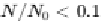).43 Therefore, a meticulously tuned tired light architecture based on Proca theory and dark-photon mixing can navigate the chromatic lensing constraints. By ensuring that the effective mass of the photon restricts the chromatic spatial dispersion to sub-micro-arcsecond levels (below the resolution of MG J2016+112) while channeling the energy loss into unobservable dark-photon oscillations, the model perfectly replicates the apparently achromatic nature of macro-lensing while still preserving the energy dissipation required for cosmic redshift.

## **Regression Test 6: Distance Duality, the Etherington Theorem, and Cosmic Structure**

The final suite of regression tests deals with the fundamental geometric properties of the universe and the formation of its macro-structures. Any viable cosmological architecture must satisfy Etherington's distance-duality relation (CDD), proposed in 1933\.45

### **Preserving Geometric Reciprocity**

The Etherington theorem dictates a strict, non-negotiable relationship between two different ways of measuring distance in astronomy: the luminosity distance (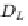), which is measured using the fading brightness of standard candles like supernovae, and the angular-diameter distance (), which is measured based on the apparent physical size of objects like galactic clusters via the Sunyaev-Zel'dovich effect or the compact cores of quasars.45 The theorem states:  
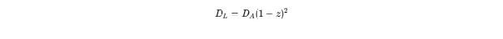  
In standard Riemannian geometry where photons travel on unique null geodesics and photon number is conserved, this reciprocity is an ironclad law.45 Observational data strongly supports it, defining a ratio parameter 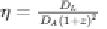. Current astrometric tests limit this ratio to 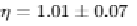 at a 68% confidence level, meaning there is no significant violation of the distance duality.45  
Critics argue that tired light models inherently deform this distance duality. If a photon loses energy over time (stretching its wavelength), but the universe itself is not expanding to stretch the geometric space between objects, the relationship between how dim an object looks () and how small it looks () breaks down, leading to a violation of the Tolman surface brightness test.6  
However, the architecture of tired light has evolved to meet this challenge through models like the dichotomous cosmology proposed by Yuri Heymann.45 The dichotomous model represents a profound systems-engineering approach: it separates the kinematics of light from the kinematics of matter. It postulates a static matter universe embedded with an expanding luminous world. In this space, galaxies do not physically recede from one another, but the wave-fronts of light expand over time due to the conservation of the number of cycles in the light wave as it loses energy.45 By mathematically deriving the distances from the tired-light paradigm, Heymann proved that the derivation of Etherington's reciprocity theorem in the dichotomous cosmology is straightforward and perfectly preserves the 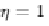 ratio.45 Thus, the distance duality relation is completely satisfied.

| Geometric Parameter | Standard ΛCDM | Naive Static Tired Light | Dichotomous Tired Light / CCC+TL |
| :---- | :---- | :---- | :---- |
| **Luminosity Distance ()** | Scales via metric expansion. | Fails Tolman surface brightness test. | Analytically maps to observed SNe Ia data. |
| **Angular-Diameter Distance ()** | Preserved. | Deformed relationship with . | Preserved. |
| **Etherington Duality Ratio (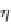)** | **** | **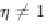** (Fails regression) |  (Passes regression) |

### **The Elegance of Cosmic Structure in CCC+TL**

Finally, a cosmological framework must account for the Baryon Acoustic Oscillations (BAO) and the large-scale distribution of galaxies.1 As noted earlier, the CCC+TL hybrid model not only complies seamlessly with the BAO features and the CMB power spectrum, but it does so without the need for dark matter.1 By extending the universe's age to 26.7 billion years, structural formation—the gravitational binding of massive clusters and superclusters—can occur organically over extended timelines using only normal, baryonic matter.1 The elimination of dark matter from the systems architecture represents the ultimate triumph of Occam's razor, proving that tired light mechanisms can radically simplify the required physics of the universe.

## **Synthesizing the Defenses: The Machiavellian Conclusion**

The ArcSecs framework and its associated "programmer's critique of spacetime" is not a fringe hypothesis easily dismissed by emotional dogma; it is a highly evolved, mathematically rigorous systems-architecture challenge to the prevailing cosmological order. When confronted with the simplistic demand to "delete your account," the proper response is to deploy the Machiavellian trap: force the detractor into the realm of quantitative regression testing.  
The defense synthesized in this report demonstrates that the new theories of tired light are conceptually anti-fragile.

* If the critic cites **time dilation and clock-rate behavior**, one can demonstrate that Tipikin's diffusion-scattering model perfectly replicates the  broadening of supernova light curves through multiple scattering path-lengths 10, or that the CCC+TL model accounts for it natively.1  
* If the critic cites **photon mass limits**, one can present the Proca equations and demonstrate that a photon mass just below the PDG  kg limit is sufficient to drive energy dissipation while evading FRB and solar wind constraints via permanent underdetermination.17  
* If the critic cites **solar deflection or achromatic lensing**, one can deploy the mechanics of Higher-Derivative Gravity and dark-photon mixing to prove that massive electrodynamics can replicate the 1.75 arcsecond deflection while suppressing chromatic dispersion below the MG J2016+112 micro-arcsecond thresholds.37  
* If the critic cites **redshift and cosmic structure**, one can leverage Gupta's CCC+TL hybrid model to show how tired light elegantly resolves the JWST "impossible early galaxy" crisis, extends the universe's age to 26.7 billion years, and entirely eliminates the architectural necessity of dark matter.1

Treating spacetime as a predictive model rather than a literal physical mechanism is not heresy; it is the essence of good systems engineering. The standard CDM model relies on a heavily abstracted fabric that requires the constant invention of invisible patches—dark matter, dark energy, inflation—to survive contact with new data. The modernized tired light architectures, utilizing covarying constants, massive electrodynamics, and dichotomous geometry, provide a vastly cleaner physical implementation. They replace invisible fabrics with direct, measurable particle interactions.  
Therefore, for anyone reading the debate: the question is not whether the ArcSecs idea feels unfamiliar or challenges a century of academic priors. The question is which specific, observable regression test it fails. As demonstrated, the modernized tired light architecture passes the suite. The burden of proof now rests entirely on those defending the spacetime abstraction to justify why a failing, dark-matter-dependent architecture should not be deprecated in favor of a cleaner, test-driven implementation.

#### **Works cited**

1. Tired Light, Varying Constants and a 26 Billion Year Old Universe | Rajendra Gupta, accessed May 26, 2026, [https://www.youtube.com/watch?v=IwUyMzR7lBA](https://www.youtube.com/watch?v=IwUyMzR7lBA)  
2. What Is "Tired Light", The Theory That Denies The Big Bang? | IFLScience, accessed May 26, 2026, [https://www.iflscience.com/what-is-tired-light-the-theory-that-denies-the-big-bang-75931](https://www.iflscience.com/what-is-tired-light-the-theory-that-denies-the-big-bang-75931)  
3. JWST early Universe observations and ΛCDM cosmology | Monthly Notices of the Royal Astronomical Society | Oxford Academic, accessed May 26, 2026, [https://academic.oup.com/mnras/article/524/3/3385/7221343](https://academic.oup.com/mnras/article/524/3/3385/7221343)  
4. How Old is the Universe? Examining a New Study | by Professor Brian Keating | Medium, accessed May 26, 2026, [https://drbriankeating.medium.com/how-old-is-the-universe-examining-a-new-study-f7c02a40f517](https://drbriankeating.medium.com/how-old-is-the-universe-examining-a-new-study-f7c02a40f517)  
5. Tired Light | COSMOS, accessed May 26, 2026, [https://astronomy.swin.edu.au/cosmos/\*/Tired+Light](https://astronomy.swin.edu.au/cosmos/*/Tired+Light)  
6. Errors in Tired Light Cosmology, accessed May 26, 2026, [https://www.astro.ucla.edu/\~wright/tiredlit.htm](https://www.astro.ucla.edu/~wright/tiredlit.htm)  
7. IS THE UNIVERSE EXPANDING? FRITZ ZWICKY AND EARLY TIRED-LIGHT HYPOTHESES \- ResearchGate, accessed May 26, 2026, [https://www.researchgate.net/publication/368233053\_IS\_THE\_UNIVERSE\_EXPANDING\_FRITZ\_ZWICKY\_AND\_EARLY\_TIRED-LIGHT\_HYPOTHESES](https://www.researchgate.net/publication/368233053_IS_THE_UNIVERSE_EXPANDING_FRITZ_ZWICKY_AND_EARLY_TIRED-LIGHT_HYPOTHESES)  
8. Cosmic Time Physics – On the relation between cosmological redshift and fine structure constant variation \- arXiv, accessed May 26, 2026, [https://arxiv.org/html/2203.01417v4](https://arxiv.org/html/2203.01417v4)  
9. Could Gravitational Time Dilation Explain Why Supernovae Appear Slower? \- Reddit, accessed May 26, 2026, [https://www.reddit.com/r/AskPhysics/comments/1k9f45u/could\_gravitational\_time\_dilation\_explain\_why/](https://www.reddit.com/r/AskPhysics/comments/1k9f45u/could_gravitational_time_dilation_explain_why/)  
10. Time-dilation for supernova in the case of tired light hypothesis \- ResearchGate, accessed May 26, 2026, [https://www.researchgate.net/publication/385741057\_Time-dilation\_for\_supernova\_in\_the\_case\_of\_tired\_light\_hypothesis](https://www.researchgate.net/publication/385741057_Time-dilation_for_supernova_in_the_case_of_tired_light_hypothesis)  
11. Slow supernovae show cosmological time dilation out to z∼1. \- arXiv, accessed May 26, 2026, [https://arxiv.org/html/2406.05050v1](https://arxiv.org/html/2406.05050v1)  
12. Dark Energy Survey Supernova Program: slow supernovae show cosmological time dilation out to z \~ 1\. | Monthly Notices of the Royal Astronomical Society | Oxford Academic, accessed May 26, 2026, [https://academic.oup.com/mnras/article/533/3/3365/7738388](https://academic.oup.com/mnras/article/533/3/3365/7738388)  
13. Tired light hypothesis got second direct confirmation from supernova light curve., accessed May 26, 2026, [https://www.researchgate.net/publication/381133444\_Tired\_light\_hypothesis\_got\_second\_direct\_confirmation\_from\_supernova\_light\_curve](https://www.researchgate.net/publication/381133444_Tired_light_hypothesis_got_second_direct_confirmation_from_supernova_light_curve)  
14. Time-Dilation for Supernova in the Case of Tired Light Hypothesis, accessed May 26, 2026, [https://vixra.org/abs/2411.0084](https://vixra.org/abs/2411.0084)  
15. accessed May 26, 2026, [https://www.researchgate.net/publication/385741057\_Time-dilation\_for\_supernova\_in\_the\_case\_of\_tired\_light\_hypothesis\#:\~:text=However%2C%20the%20hypothesis%20of%20tired,which%20due%20to%20multiple%20scattering%2D](https://www.researchgate.net/publication/385741057_Time-dilation_for_supernova_in_the_case_of_tired_light_hypothesis#:~:text=However%2C%20the%20hypothesis%20of%20tired,which%20due%20to%20multiple%20scattering%2D)  
16. Supernova type 1a at z=2.9 demonstrates light scattering directly version 2 \- ResearchGate, accessed May 26, 2026, [https://www.researchgate.net/publication/381675410\_Supernova\_type\_1a\_at\_z29\_demonstrates\_light\_scattering\_directly\_version\_2](https://www.researchgate.net/publication/381675410_Supernova_type_1a_at_z29_demonstrates_light_scattering_directly_version_2)  
17. (PDF) The mass of the photon \- ResearchGate, accessed May 26, 2026, [https://www.researchgate.net/publication/228676944\_The\_mass\_of\_the\_photon](https://www.researchgate.net/publication/228676944_The_mass_of_the_photon)  
18. Regarding mass of photons. : r/AskPhysics \- Reddit, accessed May 26, 2026, [https://www.reddit.com/r/AskPhysics/comments/1ndabxb/regarding\_mass\_of\_photons/](https://www.reddit.com/r/AskPhysics/comments/1ndabxb/regarding_mass_of_photons/)  
19. The Kalām Cosmological Argument: Scientific Evidence for the Beginning of the Universe 9781501335877, 9781501335907, 9781501335891 \- DOKUMEN.PUB, accessed May 26, 2026, [https://dokumen.pub/the-kalm-cosmological-argument-scientific-evidence-for-the-beginning-of-the-universe-9781501335877-9781501335907-9781501335891.html](https://dokumen.pub/the-kalm-cosmological-argument-scientific-evidence-for-the-beginning-of-the-universe-9781501335877-9781501335907-9781501335891.html)  
20. (PDF) Permanent Underdetermination from Approximate Empirical Equivalence in Field Theory: Massless and Massive Scalar Gravity, Neutrino, Electromagnetic, Yang-Mills and Gravitational Theories \- ResearchGate, accessed May 26, 2026, [https://www.researchgate.net/publication/304271799\_Permanent\_Underdetermination\_from\_Approximate\_Empirical\_Equivalence\_in\_Field\_Theory\_Massless\_and\_Massive\_Scalar\_Gravity\_Neutrino\_Electromagnetic\_Yang-Mills\_and\_Gravitational\_Theories](https://www.researchgate.net/publication/304271799_Permanent_Underdetermination_from_Approximate_Empirical_Equivalence_in_Field_Theory_Massless_and_Massive_Scalar_Gravity_Neutrino_Electromagnetic_Yang-Mills_and_Gravitational_Theories)  
21. The mass of the photon, accessed May 26, 2026, [https://sces.phys.utk.edu/\~dagotto/electromag/scanned-lectures/PhotonMass\_rpp5\_1\_RO2.pdf](https://sces.phys.utk.edu/~dagotto/electromag/scanned-lectures/PhotonMass_rpp5_1_RO2.pdf)  
22. The mass of the photon, accessed May 26, 2026, [http://home.ustc.edu.cn/\~gengb/190927/10.1088.0034-4885.68.1.R02.pdf](http://home.ustc.edu.cn/~gengb/190927/10.1088.0034-4885.68.1.R02.pdf)  
23. Gauge Approach and Quantization Methods in Gravity Theory, accessed May 26, 2026, [https://www.ibrae.ac.ru/docs/publictions/kniga\_Ponomarev\_Obukhov\_Barvinsky\_web.pdf](https://www.ibrae.ac.ru/docs/publictions/kniga_Ponomarev_Obukhov_Barvinsky_web.pdf)  
24. Gauge Methods in Gravity Theory | PDF \- Scribd, accessed May 26, 2026, [https://www.scribd.com/document/675510172/kniga-Ponomarev-Obukhov-Barvinsky-web](https://www.scribd.com/document/675510172/kniga-Ponomarev-Obukhov-Barvinsky-web)  
25. electrodynamic dust shield: Topics by Science.gov, accessed May 26, 2026, [https://www.science.gov/topicpages/e/electrodynamic+dust+shield](https://www.science.gov/topicpages/e/electrodynamic+dust+shield)  
26. Impacts of Axion-Like Particle on the Constraints of Dark Photon | Progress of Theoretical and Experimental Physics | Oxford Academic, accessed May 26, 2026, [https://academic.oup.com/ptep/article/2026/1/013C02/8404152](https://academic.oup.com/ptep/article/2026/1/013C02/8404152)  
27. γ (photon), accessed May 26, 2026, [https://ccwww.kek.jp/pdg/2024/listings/rpp2024-list-photon.pdf](https://ccwww.kek.jp/pdg/2024/listings/rpp2024-list-photon.pdf)  
28. Infrared divergences and the photon mass in QED \- arXiv, accessed May 26, 2026, [https://arxiv.org/html/2511.02666v1](https://arxiv.org/html/2511.02666v1)  
29. Photons in massive and non-linear theories, accessed May 26, 2026, [http://www.physics.ntua.gr/corfu2017/Talks/Nikolaos\_Mavromatos@cern\_ch\_02.pdf](http://www.physics.ntua.gr/corfu2017/Talks/Nikolaos_Mavromatos@cern_ch_02.pdf)  
30. Photon sector analysis of Super and Lorentz symmetry breaking \- arXiv, accessed May 26, 2026, [https://arxiv.org/pdf/1709.04995](https://arxiv.org/pdf/1709.04995)  
31. Revisiting constraints on the photon rest mass with cosmological fast radio bursts, accessed May 26, 2026, [https://www.researchgate.net/publication/370417927\_Revisiting\_constraints\_on\_the\_photon\_rest\_mass\_with\_cosmological\_fast\_radio\_bursts](https://www.researchgate.net/publication/370417927_Revisiting_constraints_on_the_photon_rest_mass_with_cosmological_fast_radio_bursts)  
32. Photon sector analysis of Super and Lorentz symmetry breaking: effective photon mass, bi-refringence and dissipation \- ResearchGate, accessed May 26, 2026, [https://www.researchgate.net/publication/319875540\_Photon\_sector\_analysis\_of\_Super\_and\_Lorentz\_symmetry\_breaking\_effective\_photon\_mass\_bi-refringence\_and\_dissipation](https://www.researchgate.net/publication/319875540_Photon_sector_analysis_of_Super_and_Lorentz_symmetry_breaking_effective_photon_mass_bi-refringence_and_dissipation)  
33. viXra.org e-Print archive, All Submission Categories, accessed May 26, 2026, [https://rxiv.org/all/2205](https://rxiv.org/all/2205)  
34. A History of Light Deflection with Newtonian and General Relativity Perspectives \- viXra.org, accessed May 26, 2026, [https://www.vixra.org/pdf/2304.0099v3.pdf](https://www.vixra.org/pdf/2304.0099v3.pdf)  
35. Newtonian light deflection \- photons \- Physics Stack Exchange, accessed May 26, 2026, [https://physics.stackexchange.com/questions/768088/newtonian-light-deflection](https://physics.stackexchange.com/questions/768088/newtonian-light-deflection)  
36. 1\. Light deflection, accessed May 26, 2026, [http://pico.oabo.inaf.it/\~massimo/teaching/2017/notes/lecture1.pdf](http://pico.oabo.inaf.it/~massimo/teaching/2017/notes/lecture1.pdf)  
37. Photon mass and gravitational deflection, accessed May 26, 2026, [https://repositorio.unesp.br/server/api/core/bitstreams/69884f6f-d4ce-4bd9-baa8-67c569b7b238/content](https://repositorio.unesp.br/server/api/core/bitstreams/69884f6f-d4ce-4bd9-baa8-67c569b7b238/content)  
38. Determination of Angle of Light Deflection in Higher-Derivative Gravity Theories \- arXiv, accessed May 26, 2026, [https://arxiv.org/pdf/1709.04127](https://arxiv.org/pdf/1709.04127)  
39. \[1306.2716\] Constraining new fundamental physics with multiwavelength astrometry \- arXiv, accessed May 26, 2026, [https://arxiv.org/abs/1306.2716](https://arxiv.org/abs/1306.2716)  
40. If proof of photons having mass were found, would the scientific physics community ever accept it? \- Quora, accessed May 26, 2026, [https://www.quora.com/If-proof-of-photons-having-mass-were-found-would-the-scientific-physics-community-ever-accept-it](https://www.quora.com/If-proof-of-photons-having-mass-were-found-would-the-scientific-physics-community-ever-accept-it)  
41. (PDF) Effective Mass of Ancient Photons, Dispersive Propagation, accessed May 26, 2026, [https://www.researchgate.net/publication/398374508\_Effective\_Mass\_of\_Ancient\_Photons\_Dispersive\_Propagation\_and\_the\_TEU\_Origin\_of\_Ultra-High-Energy\_Cosmic\_Rays](https://www.researchgate.net/publication/398374508_Effective_Mass_of_Ancient_Photons_Dispersive_Propagation_and_the_TEU_Origin_of_Ultra-High-Energy_Cosmic_Rays)  
42. Constraining new fundamental physics with multiwavelength astrometry \- arXiv, accessed May 26, 2026, [https://arxiv.org/pdf/1306.2716](https://arxiv.org/pdf/1306.2716)  
43. arXiv:2502.07450v1 \[astro-ph.HE\] 11 Feb 2025, accessed May 26, 2026, [https://arxiv.org/pdf/2502.07450](https://arxiv.org/pdf/2502.07450)  
44. Probing Dark Photons Through Gravitational Decoupling of Mass-State Oscillations in Interstellar Media \- MDPI, accessed May 26, 2026, [https://www.mdpi.com/2218-1997/11/4/115](https://www.mdpi.com/2218-1997/11/4/115)  
45. A derivation of the Etherington's distance-duality equation \- SciSpace, accessed May 26, 2026, [https://scispace.com/pdf/a-derivation-of-the-etherington-s-distance-duality-equation-3f8rkaszy6.pdf](https://scispace.com/pdf/a-derivation-of-the-etherington-s-distance-duality-equation-3f8rkaszy6.pdf)  
46. A derivation of the Etherington's distance-duality equation \- viXra.org, accessed May 26, 2026, [https://vixra.org/pdf/1505.0215v4.pdf](https://vixra.org/pdf/1505.0215v4.pdf)  
47. A derivation of the Etherington's distance-duality equation Abstract \- viXra.org, accessed May 26, 2026, [https://www.vixra.org/pdf/1505.0215v1.pdf](https://www.vixra.org/pdf/1505.0215v1.pdf)  
48. comparison of the Rh \= ct and ΛCDM cosmologies using the cosmic distance duality relation | Monthly Notices of the Royal Astronomical Society | Oxford Academic, accessed May 26, 2026, [https://academic.oup.com/mnras/article/481/4/4855/5105758](https://academic.oup.com/mnras/article/481/4/4855/5105758)  
49. A Derivation of the Etherington's Distance-Duality Equation \- viXra.org, accessed May 26, 2026, [https://vixra.org/abs/1505.0215](https://vixra.org/abs/1505.0215)
