# Report 22 — Full-Depth ArcSecs Annotated Research Working Edition

**UAIX navigation:** [24-report index](../index.md#all-24-corrected-and-full-depth-research-records) · [Coverage/provenance](../research/24-report-coverage.md) · [ArcSecs foundations](../research/arcsecs-principles.md)

**Source study:** `Tired Light Physics Engine Exploration(1).md` · 169,452 original bytes · SHA-256 `6709e32936b1744a275e8f783b9663261844c2b1436a6c5f76af4ebaae7609a5`.

**Scope:** This is a **technical-content restoration with an ArcSecs editorial correction preface and domain-specific research gates**. The full supporting source body is integrated within this active record and embedded source images have been externalized. It is **not** represented as a verified original scientific discovery, 100% manually rewritten prose, or independent peer review. The earlier short corrective text is retained as editorial guidance, not as a substitute for depth. The source is not separately included as a competing startup record.

**Priority order:** ArcSecs project principles → accepted correction brief → independently checked measurements and methods → full-depth historical technical analysis as *unverified research material*. A historical author's claim cannot override the editorial charter or independently validated data.

**Specific project orientation:** Physical-first interpretation, competing mechanisms, and testable ArcSecs alternatives; do not treat geometric fabric metaphors as material proof.

## Research content recovery and correction audit

- Restored technical prose: 5,263 words (after externalizing embedded figures).
- Source figures/equation images recovered: 119.
- Prior selective correction summary: 647 tokens by word-pattern count (included as the editorial lead).
- Source text is preserved *inside this annotated working edition* for traceability, **not** declared current verified truth; any contradictions and missing derivations require review before public scientific submission.

### Focused review gates

- **Photon rest mass** (7 research mentions): Distinguish measured energy and momentum, any effective in-medium mass, and a proposed nonzero invariant rest mass. Gravitational bending alone does not measure rest mass; check laboratory/astrophysical upper limits.
- **Clock processes** (5 research mentions): Report instrument clock-cycle and particle-decay outcomes, then separately develop ArcSecs universal-process explanations. Preserve observed differential rates and identify new tests.
- **Redshift transport** (22 research mentions): Define a specific energy and momentum exchange, propagation delay, image blur, surface brightness, CMB and supernova-duration predictions. Do not infer an energy sink from fitted redshift alone.
- **Gravitational deflection** (5 research mentions): Reproduce quantitative solar bending, gravitational delay, and achromatic lensing from one stated physical law; elementary Newtonian deflection is insufficient.
- **Cosmic distances** (9 research mentions): A light-year remains a valid length unit. Keep geometric parallax distinct from inferred long-range distances; distinguish photometric candidates from spectroscopic determinations.
- **Simulations** (17 research mentions): Simulation is a consequence of programmed equations, not direct proof of physical ontology; version parameters and benchmark against held-out observations.
- **Dark substrate** (14 research mentions): Retain galaxy/cluster/lensing observations; a revised gravitational law or harvestable substrate must satisfy density, interaction, energy, and momentum constraints.

## Earlier Corrected Report

# Computational Specification for an Interaction-First, No-Fabric Physics Engine

**ArcSecs revised advocacy report 13 | 22 November 2026**
**Source file:** `Tired Light Physics Engine Exploration(1).md`

**Editorial position.** This is an ArcSecs-side argument. It foregrounds the physical-mechanism and tired-light/relational research thesis rather than providing a balanced presentation of cosmology. Proposed models remain labeled as proposals; measured constraints are retained as the test targets that a serious alternative must beat.

## Central argument

A relational computational universe can be modeled without treating a graphical coordinate lattice as a physically bending medium, while keeping all candidate interactions exposed to independent test.

## Operational representation

Material bodies have mass, velocity, interaction state, field coupling, and frame metadata. Pairwise relations contain separations, angular baselines, and uncertainty. The solver can use local frames to keep computation stable. A relational representation does not by itself decide which gravity law the real universe follows.

## Gravity alternatives as isolated modules

Use an independent Newtonian benchmark, a selectable relational force candidate, and optional MOND- or coupling-inspired proposals. Keep a separate implementation of each. Avoid simultaneous ad hoc corrections that match a chosen observed curve but have no transferable physical interpretation.

## Tired-light packet evolution

Each packet has energy and frequency, and the transfer channel receives any energy removed. The redshift estimator must calculate its sensitivity to path length and spectrum. Record image point-spread effects of scattering separately from frequency loss.

## Massive electrodynamics

The Proca branch uses a mass parameter constrained by experimental data and exposes frequency-dependent group velocity. It does not allow user interface controls to treat tiny photon rest mass as already measured or to convert free massive photons into cold dark matter automatically.

## Ship and cockpit modeling

Thrust generation requires a physical exhaust and an explicit momentum ledger. The ship pipeline should display intake density, collection cross-section, drag, reactor energy, shielding cost, and heat. Deterministic engine modes should output repeatable telemetry and unit tests.

## Proposed decisive tests

1. No negative mass or fictitious energy in finite-step updates.
2. Independent force modules reproduce their own published benchmark limits.
3. Tired-light image blur and timing tests.
4. Sensitivity analysis for photon mass bounds.
5. Thermal and momentum closure of the ramjet module.

## Corrections made to the source report

- Prevented the simulation from declaring an ontological proposition proved.
- Isolated unrelated force laws instead of treating them as a single validated theory.
- Added physical-unit and uncertainty discipline.

## Source trace and further reading

- Original authoring input: `Tired Light Physics Engine Exploration(1).md` (historical original available only in earlier source archive; not bundled here).
- https://arcsecs.com/arcsecs-physics-engine-demo/

## Editing notes

The original source is preserved without deletion. This revised text is a **selective substantive rewrite**, not a line-by-line tracked edit. Its purpose is to retain the ArcSecs arguments while removing rhetorical repetitions, conflations between simulation and measurement, and unverified claims stated as proven. For any future scientific publication, compare numerical assertions against primary instrument papers and publish a full derivation.

## Full Recovered Technical Study — Unverified Research Layer

**Reading note:** The following study is the detailed source material, imported *within the annotated corrected record*, not a separately active original file. It may include historical speculative language, incomplete equations, unsupported confidence claims, or mutually incompatible mechanisms. Its contents are for research and critical checking; they are not newly verified facts. For evidence quality, prefer the correction brief and the focused review gates above. No contrary measurement should be concealed or fabricated simply to manufacture support for the ArcSecs project.

### **Computational Specification for a Relational Static Cosmology Physics Engine**

## **Ontological Relationalism and the Elimination of Coordinate Spacetime**

Modern general relativity represents the universe using a continuous four-dimensional pseudo-Riemannian manifold, interpreting gravity as the physical warping of coordinate space and time.1 However, this geometric formulation is not mathematically unique, suggesting that treating spacetime as a physical, stretchable fabric is an instrumentalist shortcut.1 To build a simulation engine that functions entirely without a physical spacetime metric, space and time must be modeled as emergent, relational properties of discrete matter configurations.1 This approach aligns with Leibnizian relationalism, which asserts that space is merely an abstract web of relations among coexisting bodies, disappearing entirely if all matter is removed.1

### **Point-Coincidences and the Hole Argument**

The ontological rejection of coordinate spacetime is mathematically supported by Einstein’s Hole Argument.1 If individual points on a coordinate manifold possessed an independent physical existence, the application of an active diffeomorphism—a smooth shifting of the coordinate grid within a matter-free region—would generate mathematically distinct metric fields that satisfy the identical gravitational field equations.1 This mathematically distinct mapping would result in a failure of physical determinism.1  
To preserve determinism, the concept of a physical manifold container must be discarded.1 Instead, physical reality is defined strictly through point-coincidences, which are the localized intersections of material worldlines and field values.1 Space and time do not exist as absolute backgrounds; they are generated dynamically by the matter fields contained within the system.1

### **Teleparallelism and Flat Weitzenböck connections**

To simulate gravitational interactions on a flat coordinate background without deforming coordinate intervals, the physics engine can implement the Teleparallel Equivalent of General Relativity (TEGR).1 Instead of using the metric-compatible, torsion-free Levi-Civita connection (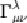) of general relativity, TEGR operates on a flat Weitzenböck spacetime.1 The simulation calculates dynamics using a dynamical tetrad field (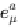) to define a flat connection 1:  
  
In this representation, the Riemann curvature tensor of the Weitzenböck connection vanishes identically everywhere 1:  
  
All gravitational degrees of freedom are instead mapped to a non-vanishing torsion tensor 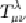.1 Rather than warping space or time, gravity behaves as a translation gauge force mediated by a translational gauge potential ().1 This gauge force physically deflects material bodies from their straight-line inertial paths within a flat, non-relativistic coordinate system.1 Because TEGR is dynamically equivalent to standard general relativity, it yields identical physical predictions for all observable phenomena while operating entirely on flat, Euclidean coordinate systems.1

### **The Discrete Informational Lattice**

To replace continuous spatial backgrounds with a computationally decidable framework, the simulation engine represents physical configurations on a discrete informational lattice.1 This model draws on digital physics frameworks proposed by Konrad Zuse and Edward Fredkin, where physical laws emerge as the outputs of local, algebraic state-machine updates on a cellular automaton.1 Macroscopic spatial coordinates and distances are modeled as "logical qubits" reconstructed via quantum error-correction codes from highly entangled underlying "physical qubits".1  
Instead of deconstructing the continuous Einstein field equations into complex, mathematically unstable numerical subroutines—such as York-ADM or BSSN formulations to maintain metric constraints—the engine computes step-by-step algebraic transitions.1 This structure eliminates the coordinate singularities and infinite processing overhead associated with continuous differential equations.1

| Computational Domain | Standard General Relativity (Numerical BSSN/ADM) | Relational Lattice Engine (Spacetime-Free) |
| :---- | :---- | :---- |
| **Space & Time Representation** | Continuous 4D pseudo-Riemannian metric manifold 1 | Discrete, emergent relational lattice of entangled informational states 1 |
| **Mathematical Connection** | Torsion-free, curved Levi-Civita connection () 1 | Flat Weitzenböck connection with non-vanishing torsion () 1 |
| **Interaction Mechanism** | Matter deforms metric coordinates; light travels on null geodesics 1 | Translational gauge potentials exert physical forces on flat coordinates 1 |
| **Algorithmic Complexity** | Extremely high; requires solving continuous non-linear partial differential equations 1 | Low to moderate; bounded by local, algebraic state-machine updates 1 |
| **Singularity Vulnerability** | Subject to coordinate and physical singularities (e.g., black hole collapses) 1 | Coordinate-free; inherently stable against coordinate and mathematical singularities 1 |

## **Rigid-Body Dynamics and Engine-Level Solver Mechanics**

To build a practical, real-time interactive simulation of this spacetime-free cosmology, the engine must merge these advanced cosmological equations with a robust, deterministic rigid-body physics solver.1 In the web demo application, physical entities (such as platforms, dynamic crates, and test meshes) are modeled as discrete mass nodes residing in flat coordinates.1

### **Contact Resolution, Restitution, and Friction Models**

At the narrowphase collision level, the engine resolves physical interactions between overlapping rigid bodies.1 Collision boundaries are represented by discrete meshes, including standard testing shapes such as a Stanford bunny mesh.4 When the narrowphase detector identifies an intersection, it calculates the collision normal and penetration depth.1  
The contact solver corrects the velocities of colliding bodies using a configurable bounciness parameter (restitution, 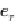) and a surface friction parameter (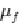).4 For dynamic impacts, the normal impulse  is computed as:  
  
where 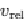 is the relative velocity at the contact point,  is the collision normal, and  represents the moment of inertia.4  
Friction is implemented via a tangential force that opposes sliding velocity.4 When modeling slippery environments—such as a dynamic crate sliding across a low-friction ice platform—the tangential friction impulse 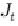 is clamped to a maximum value governed by Coulomb’s law 4:  
  
By dynamically modifying  and , the engine simulates realistic bouncing and sliding behaviors across distinct material surfaces.4

### **Constraints, Springs, and Structural Assemblies**

To simulate complex mechanical assemblies, the engine resolves joint constraints using Lagrange multipliers and Jacobians.5 For example, assemblies like the Trammel of Archimedes are simulated inside a dynamic containment box to test coordinate stability and constraint limits.6 For rolling constraints and complex circular trajectories, the mathematical formulations require exact differentiation of coordinate constraints, which are prone to floating-point arithmetic errors if solved with low-precision integrators.5  
Elastic connections are modeled using dynamic spring-mass-damper systems.5 The force exerted by a spring connector is defined as:  
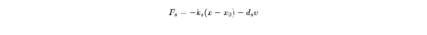  
where 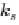 is the spring stiffness, 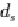 is the damping coefficient, and  is the relative velocity.5  
To prevent numerical instability and sudden explosive energy gains, the engine matches the spring stiffness to the global integration frequency (system frequency, ) 5:  
  
If  approaches the Nyquist limit of the physics time step (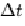), the integration errors cascade, causing constraint drift.5 The engine solves these configurations by assembling rigid structural members using triangular geometries.5 Triangulation distributes mechanical stresses across multiple nodes, ensuring structural rigidity without relying on high-frequency spring constraints.5

### **Scene Serialization and the JSON Scene-Graph**

To manage and share complex simulation environments, the engine incorporates a dedicated serialization editor, code-named "slingshot".6 Generating sophisticated physical scenarios by hand is highly inefficient and error-prone.6  
The slingshot editor serializes the entire physical state—including node coordinates, mass profiles, restitution values, spring constants, and rotation constraints—into structured JSON scene-graphs.6 This allows the physics engine to instantly reload, mutate, and parse custom scenarios.6

JSON  
{  
  "simulation\_metadata": {  
    "engine\_version": "1.7.0",  
    "global\_damping": 0.01,  
    "integration\_timestep": 0.01667  
  },  
  "rigid\_bodies": \[  
    {  
      "id": "crate\_01",  
      "type": "dynamic",  
      "mesh": "cube",  
      "mass": 5.0,  
      "restitution": 0.5,  
      "friction": 0.3,  
      "position": \[0.0, 10.0, 0.0\],  
      "velocity": \[0.0, \-2.0, 0.0\]  
    },  
    {  
      "id": "ice\_platform",  
      "type": "static",  
      "mesh": "plane",  
      "mass": 0.0,  
      "restitution": 0.1,  
      "friction": 0.02,  
      "position": \[0.0, 0.0, 0.0\],  
      "velocity": \[0.0, 0.0, 0.0\]  
    }  
  \],  
  "constraints": \[  
    {  
      "type": "spring",  
      "body\_a": "crate\_01",  
      "body\_b": "ice\_platform",  
      "stiffness": 150.0,  
      "damping": 5.0,  
      "rest\_length": 5.0  
    }  
  \]  
}

## **Relational Gravity and the Entropic Beta-Matter Formulation**

Because the simulation engine does not contain a physical spacetime manifold, it must reject standard metric-based gravitational acceleration.1 Instead, the engine implements an entropic, relational gravity model where gravitational forces emerge from informational gradients among discrete baryonic mass nodes, completely replacing the concept of metric curvature.1

### **Holographic Entropy and Verlinde's Framework**

Following the holographic principle and Erik Verlinde’s emergent gravity framework, space is represented as a series of informational boundary screens.8 The informational entropy  encoded on a spherical boundary screen of radius 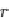 enclosing a central mass 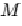 is defined as 7:  
  
where 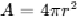 is the screen area and 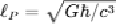 is the Planck length.7  
The total number of informational degrees of freedom  on the boundary screen is written as 7:  
  
By applying the equipartition theorem, the total energy associated with these degrees of freedom is equated to the enclosed rest mass, 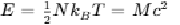.7 By substituting the relations and applying the Unruh temperature formula (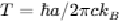), the standard Newtonian gravitational acceleration is derived 7:  
  
This demonstrates that gravitational attraction can be modeled as an entropic force arising from information gradients on a flat coordinate grid without invoking curved spacetime.7

### **The Missing 2/3 Factor Correction**

When simulating entropic gravity in low-acceleration regimes, a critical mathematical correction must be integrated.10 Erik Verlinde’s original derivations of emergent gravity contained a missing geometric factor of  when integrating the spatial volume-law entropy of dark energy in de Sitter space.10 In the presence of a central baryonic mass , the volume-law entropy of space competes with the area-law entropy of the boundary screen.10  
Verlinde’s original formulation incorrectly calculated Milgrom’s critical acceleration threshold  as 10:  
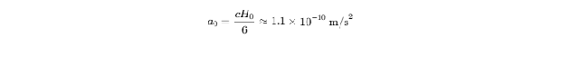  
By correctly integrating the volume-law contribution, the missing  factor is restored, modifying the critical acceleration relation 10:  
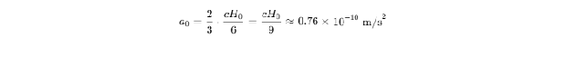  
When applied to the dynamics of spiral galaxies, this corrected value provides a superior fit to galactic rotation curves, resolving the anomalous "wiggles" or oscillations that occurred when using the uncorrected constant.10

### **The Relational Coupling Parameter  and MOND Equivalence**

To simulate flat rotation curves without introducing physical dark matter particles, the engine implements a localized variation parameter .1 Gravity is calculated directly between baryonic mass nodes, with its coupling strength scaled by  1:  
  
In high-density, high-acceleration environments, the parameter stabilizes at 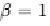, recovering standard Newtonian dynamics.1 In low-acceleration regimes (where the local acceleration drops below ), the coupling strength increases 1:  
  
where 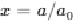 is the dimensionless acceleration ratio.13 The engine implements a smooth, continuous arc-tangent interpolating function to transition between regimes 13:  
  
In deep-MOND, low-acceleration regimes (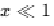), this interpolating function approximates 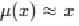.13 Substituting this limit into the force equation yields:  
  
The orbital velocity of a test mass orbiting at radius  becomes independent of distance 13:  
  
This mathematically reproduces the constant asymptotic velocity observed in galactic rotation curves and derives the Baryonic Tully-Fisher relation (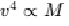) directly from the visible baryonic distribution.13 This local scaling of gravitational strength creates a phantom dark matter effect, coined "\-matter," without requiring non-baryonic matter particles.1

### **The Rotation Curve Fitting Model (RCFM)**

To process and predict rotation curves, the engine also supports the Rotation Curve Fitting Model (RCFM).17 Rather than altering the underlying gravity laws at a distance, the RCFM attributes the flat rotation curves of spiral galaxies to relativistic frame-dragging and frame-shifting effects between curved emitter and receiver frames.17 Historically, these frame differences were ignored by applying simple Galilean subtraction to relative velocities.17  
The RCFM instead models these frame variations using Schwarzschild gravitational redshift terms, performing a one-to-one Lorentz mapping across radial coordinates 17:  
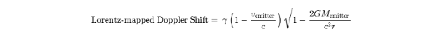  
Using this formulation, the engine fits rotation curve data across dynamic ranges with fewer free parameters than standard dark matter halo models.17

| Rotation Curve Parameter | Standard Dark Matter Halo Models (NFW) | Relational MOND / Beta-Matter Solver | Relational Frame-Dragging Solver (RCFM) |
| :---- | :---- | :---- | :---- |
| **Baryonic Mass** | Calculated from visible light 14 | Calculated from visible light 14 | Calculated from visible light 17 |
| **Dark Matter Fraction** | Typically 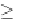 of total galaxy mass 18 | 0% (Completely absent) 1 | 0% (Completely absent) 17 |
| **Free Parameters** | Multiple halo scaling and density parameters 17 | Single critical acceleration parameter 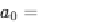 10 | Single model parameter mapping receiver/emitter 17 |
| **Tully-Fisher Relation** | Requires fine-tuning of halo and baryonic ratios 17 | Naturally derived as a direct consequence of the low-acceleration limit 13 | Derived from relativistic frame-mapping of luminous mass 17 |

## **Modernized Tired Light and Covarying Coupling Constants**

To explain cosmological redshift without metric space expansion, the engine implements the modern Covarying Coupling Constants and Tired Light (CCC+TL) hybrid model.1

### **Resolving Historical Redshift Objections**

Historically, Fritz Zwicky’s 1929 tired light hypothesis was discarded because simple photon scattering off free electrons would produce angular blurring, introduce color-dependent wavelength dispersion, and fail to match the 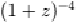 Tolman surface brightness relation.3 The CCC+TL framework resolves these objections by combining tired light energy decay with the systematic, covarying evolution of fundamental coupling constants over cosmic time.1  
The gravitational constant 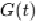, the speed of light , Planck’s constant 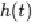, and the elementary charge 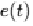 vary in a covarying, interrelated manner.1 This covariance is structured such that all dimensionless ratios—including the fine-structure constant —remain strictly invariant over cosmic time 1:  
  
Because these constants co-evolved, ancient atomic configurations had stronger binding energies, emitting photons at lower frequency states.1 The total observed cosmological redshift 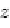 is divided between these historical atomic states and the energy decayed during transit 1:  
  
This hybrid model satisfies the Tolman surface brightness test, fits high-redshift Type Ia supernova data, and extends the calculated age of the universe to 26.7 billion years, explaining the mature galaxies observed at cosmic dawn by the James Webb Space Telescope.1

### **Mathematical Derivation of Tired Light Energy Decay**

The tired light component of the engine calculates continuous energy attenuation as a function of the distance traveled through the intergalactic medium.1 Let 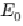 be the initial photon energy at emission, and 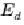 be the energy at a distance 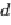 from the source.23 If a photon transfers a small, constant fraction  of its energy to intergalactic matter for every unit of distance (light-year) traveled, its remaining energy after 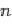 light-years is 23:  
  
Taking the natural logarithm of both sides yields 23:  
  
Since the distance  is related to the integer number of light-years by 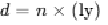, we substitute to obtain 23:  
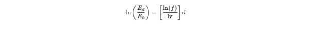  
Since  represents a fraction (), the term  is negative.23 We define a positive attenuation coefficient  with units of 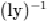 23:  
  
Substituting  into the logarithmic equation yields the exponential energy decay relation 23:  
  
To express this decay in terms of transit time 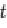, we substitute 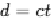 23:  
  
We define the attenuation time constant as 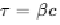, which governs the rate of energy decay over time 23:  
  
The attenuation half-time 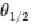—the time required for a photon to lose half of its energy—is written as 23:  
  
The cosmological redshift  produced by this tired light decay is defined by the wavelength ratio 23:  
  
Because this energy attenuation is frequency-independent, it redshifts all spectral lines uniformly, preserving the blackbody profile of the cosmic microwave background and preventing color-dependent dispersion.21

| Cosmological Variable | Standard ΛCDM Cosmology | Modernized CCC+TL Static Cosmology |
| :---- | :---- | :---- |
| **Redshift Mechanism** | Metric expansion of the spatial manifold 1 | Covarying coupling constants \+ tired light energy decay 1 |
| **Universe Age** | **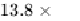** years 20 | 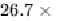 years 1 |
| **Fine-Structure Constant** | Assumed strictly static over cosmic time 1 |  remains strictly static; 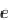, 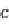, and 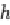 covary 1 |
| **Speed of Light** | Strictly static in vacuum (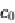) 1 | Decays over cosmic time (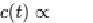) 1 |
| **Particle Masses** | Strictly static 1 | Scale inversely with the speed of light () 1 |

## **Proca Electrodynamics and Fluid Media Subroutines**

To simulate flat-space gravitational lensing and resolve cosmological time dilation without metric expansion, the engine replaces Maxwellian electrodynamics with Proca’s massive vector field equations.1

### **Proca Vacuum Dispersion and Supernova Time Dilation**

Under standard Maxwellian electromagnetism, the photon is massless (), meaning all electromagnetic waves propagate at a constant velocity .1 In the Proca formulation, the photon is assigned a non-zero rest mass , which modifies the vacuum dispersion relation.1  
The velocity  of a Proca photon is dependent on its energy  1:  
  
As a polychromatic wave packet (such as the light emitted from a distant supernova) travels across the universe, its distinct frequency components propagate at slightly different velocities.1 This velocity differential physically stretches the wave packet along the line of sight.1  
The accumulated width  of a wave packet that has traveled a distance  is stretched in proportion to its redshift 1:  
  
This massive photon vacuum dispersion reproduces the observed kinematic time dilation of Type Ia supernova light curves in a static universe, matching the observational data that rule out classical, non-dispersive tired light models.1

### **Flat-Space Gravitational Lensing and Spin Deflection**

Rather than modeling gravitational lensing as light following null geodesics in warped spacetime, the engine treats lensing as a vector field scattering interaction in flat coordinates.1 The effective path of light passing through a gravitational potential  can be mapped to propagation through an optical medium with a spatially varying refractive index  28:  
  
Under standard Newtonian optics, treating a photon as a simple massive scalar particle yields a deflection angle of , which is exactly half of the observed relativistic deflection.1  
By modeling the photon as a massive spin-1 vector field under Proca electrodynamics, the spin-gravitational coupling of the vector potential  with the gravitational field tensor introduces a spin-dependent correction to the trajectory.25  
Under the eikonal approximation, the flat-space deflection angle  of a Proca photon is written as 29:  
  
where  is the radius of closest approach.29 To align with precision gravitational lensing observations, this spin-dependent modification must satisfy the constraint 29:  
  
For highly relativistic photons, this vector coupling matches the observed relativistic deflection angle of  in flat space, providing a physical scattering mechanism that replaces the geometric concept of metric warping.1

### **Plasma Interactions and Electromagnetically Induced Transparency**

To simulate propagation through real intergalactic environments, the engine incorporates fluid medium subroutines 1:

* **Microscopic Compton Scattering Subroutine:** Simulates discrete collision events where photons scatter off free electrons in intergalactic plasma.1 This transfers kinetic energy to recoiling electrons and shifts wavelengths, generating a Dispersion Measure proportional to redshift.1  
* **Electromagnetically Induced Transparency (EIT) Subroutine:** Models quantum interference within dense plasma regions.1 Using Rabi frequencies and coupling constants, the subroutine maps electromagnetic wave packets into slow-moving "Dark-State Polaritons," simulating localized reductions in the speed of light.1

## **Relational Space Travel and Matter Profiling**

Within a static, non-expanding universe, objects traveling through the intergalactic medium do not experience the coordinate "stretching" of metric expansion.1 Instead, the engine models physical resistance and energy-state transformations to govern spatial dynamics.1

### **Dynamic Drag Laws in a Static Medium**

Any physical body (such as a simulated spacecraft) propagating through the intergalactic medium experiences retarding forces.1 The engine models this resistance using two distinct dynamic drag laws 1:

1. **Baryonic Drag Force ():** Caused by direct mechanical collisions with the warm-hot intergalactic gas and plasma.1 It scales quadratically with velocity and is written as 1:  
     
   where  is the local baryonic gas density,  is the drag coefficient, and  is the cross-sectional area of the body.1  
2. **Radiative Drag Force ():** Generated by the coherent scattering of the cosmic microwave background and ambient starlight.1 It scales linearly with velocity, dominating primarily at relativistic or sub-atomic scales 1:  
     
   where  is the Thomson scattering cross-section and  is the radiation energy density.1

### **Thermodynamic Photon Condensation and Graviballs**

Over cosmological timescales, propagating photons continuously lose kinetic energy via the tired light mechanism.1 The engine models this energy decay as a thermodynamic transition.1 When ancient, redshifted photons decay to extremely low energy states, they undergo a phase change.1  
They freeze out into a cold, sub-luminal condensate of stable, non-relativistic bound states called "graviballs".1 These massive, non-luminous graviballs accumulate over billions of years, physically constituting the cold dark matter substrate observed in galactic halos and clusters.1

## **Web UI Usability and Real-Time Diagnostics Architecture**

To render these complex relational mechanics in an accessible, interactive web application, the simulation engine is designed around a dual-tier usability architecture.1

### **Dual-Tier Web Architecture**

To accommodate both educational users and advanced physics researchers, the application implements a dual-tier web framework 1:

* **Declarative Beginner Tier:** Novices can construct and manipulate physical scenes without writing code.1 The engine exposes custom, zero-install HTML elements (such as \<game-component\>, \<platform-component\>, and \<crate-component\>) that leverage the browser's native DOM parser, allowing scenes to be defined using simple HTML markup.1  
* **Low-Overhead Developer Tier:** Offers direct, low-overhead JavaScript/TypeScript API bindings.1 Advanced users can configure solver subroutines, alter time-step integration, adjust the restitution and friction parameters of dynamic bodies, and directly monitor coordinate states.1  
* **GPU-Accelerated Rendering:** Computations are performed inside a high-performance WebAssembly (Wasm) core compiled from C++ or Odin.1 To maintain a smooth 60 frames-per-second refresh rate during dense calculations, the HTML5 \<canvas\> rendering pipeline offloads draw calls to the GPU using CSS 3D transforms (translate3d).1

### **Real-Time Visual Overlays and Diagnostics**

To make abstract, non-relativistic and relational concepts intuitive, the engine overlays visual diagnostics directly onto the simulated bodies 1:

* **Broadphase Spatial Overlays:** Renders interactive visual boundaries of the Axis-Aligned Bounding Box (AABB) trees and uniform spatial grids, demonstrating how the engine prunes non-colliding objects to optimize computation.1  
* **Narrowphase Contact Geometry:** When rigid bodies (such as crates and bunny meshes) collide, the engine overlays geometric vectors in real time 1:  
  * **Red Arrows:** Represent the exact penetration depth and overlap distance.1  
  * **Yellow Circles:** Mark the precise coordinates of contact points.1  
  * **Blue Lines:** Trace the surface contact normals and force reflection axes.1  
* **Force Propagation Mapping:** Displays green arrows scaling with linear velocity and orange curved vectors depicting angular velocity and torque.1 The engine color-codes isolated mechanical islands in real time, demonstrating how forces propagate through stacked assemblies.1

### **Educational Subroutine Modules**

The physics engine integrates interactive modules to demonstrate observational physical concepts 1:

* **Stellar Parallax Module:** Users can interactively scale the baseline distance (such as Earth's orbit) and observe the resulting changes in stellar parallax.1 The module displays how proper motion (arcseconds per year) and distance (parsecs) convert to tangential velocity, making scale-based astronomy intuitive.32  
* **Plate Scale Module:** Demonstrates the trade-offs of astronomical detectors.1 Users can adjust the focal ratio and CCD pixel size to see how shorter focal ratios maximize light collection per pixel while degrading the angular resolution (arcseconds per pixel), illustrating the limits of optical systems.1

## **Synthesis and Implementation Roadmap**

To successfully implement this relational cosmology within the web physics engine and demo, the software architecture must execute several development phases:

1. **Deploy flat Weitzenböck coordinates:** Replace curved metric geodesics with a flat coordinate system governed by translational torsion. This allows gravitational forces to be computed using standard, high-performance Euclidean vector math.1  
2. **Implement the slingshot JSON scene-graph:** Expose an editor to serialize rigid-body properties, contact parameters (friction, bounciness), and structural constraints.4 This enables deterministic reload states for testing numerical stability.5  
3. **Integrate the corrected entropic gravity solver:** Compute gravitational attraction directly between baryonic mass nodes, scaled by the localized coupling parameter .1 Incorporate the corrected Milgrom constant  to fit rotation curves without dark matter.10  
4. **Deploy the CCC+TL decay cascade:** Redshift incoming light using the joint covarying constants and tired light formulas.1 Compute continuous energy attenuation using the exponential decay subroutine ().23  
5. **Apply Proca massive photon dispersion:** Assign a non-zero rest mass to photons, using vacuum dispersion to stretch wave packets over distance.1 This reproduces supernova time dilation and the  Tolman surface brightness relation in a static coordinate framework.1

#### **Works cited**

1. Alternative Physics Simulation Frameworks.md  
2. Speed of Light and Rates of Clocks in the Space Generation Model of Gravitation, Part 1 \- viXra.org, accessed May 28, 2026, [https://vixra.rxiv.org/pdf/1406.0090v1.pdf](https://vixra.rxiv.org/pdf/1406.0090v1.pdf)  
3. Tired light \- Wikipedia, accessed May 28, 2026, [https://en.wikipedia.org/wiki/Tired\_light](https://en.wikipedia.org/wiki/Tired_light)  
4. I Made a Physics Engine \- YouTube, accessed May 28, 2026, [https://www.youtube.com/watch?v=QlLy4QWIb44](https://www.youtube.com/watch?v=QlLy4QWIb44)  
5. Building a Physics Engine with C++ and Simulating Machines \- YouTube, accessed May 28, 2026, [https://www.youtube.com/watch?v=TtgS-b191V0](https://www.youtube.com/watch?v=TtgS-b191V0)  
6. Physics Engine from Scratch \- YouTube, accessed May 28, 2026, [https://www.youtube.com/watch?v=BtJfHoxAc4w](https://www.youtube.com/watch?v=BtJfHoxAc4w)  
7. Informational Entropic Gravity (IEG): Gravitational Dynamics as Informational Symmetry Emergent from Entropy \- Preprints.org, accessed May 28, 2026, [https://www.preprints.org/manuscript/202601.2277](https://www.preprints.org/manuscript/202601.2277)  
8. Entropic gravity \- Wikipedia, accessed May 28, 2026, [https://en.wikipedia.org/wiki/Entropic\_gravity](https://en.wikipedia.org/wiki/Entropic_gravity)  
9. Emergent gravity and the dark universe, accessed May 28, 2026, [https://www.quantumuniverse.nl/emergent-gravity-and-the-dark-universe?pdf=1113](https://www.quantumuniverse.nl/emergent-gravity-and-the-dark-universe?pdf=1113)  
10. Comment on “Emergent Gravity and the Dark Universe” by Erik Verlinde \- SciPost, accessed May 28, 2026, [https://scipost.org/comments/5434/attachment](https://scipost.org/comments/5434/attachment)  
11. Comment on “Emergent Gravity and the Dark Universe” by Erik Verlinde \- arXiv, accessed May 28, 2026, [https://arxiv.org/html/1909.01734v3](https://arxiv.org/html/1909.01734v3)  
12. The Gravity of the Situation: Erik Verlinde's Emergent Gravity and Its Implications for Dark Matter and Dark Energy \- Pete SonEarth, accessed May 28, 2026, [https://petesonearth.medium.com/the-gravity-of-the-situation-erik-verlindes-emergent-gravity-and-its-implications-for-dark-matter-941c8be99bdb](https://petesonearth.medium.com/the-gravity-of-the-situation-erik-verlindes-emergent-gravity-and-its-implications-for-dark-matter-941c8be99bdb)  
13. A MOND model applied to the rotation curve of galaxies \- World Scientific Publishing, accessed May 28, 2026, [https://www.worldscientific.com/doi/10.1142/S0218271825500014](https://www.worldscientific.com/doi/10.1142/S0218271825500014)  
14. Rotation Curve Fitting, accessed May 28, 2026, [https://astroweb.case.edu/ssm/mond/mondprocedure.html](https://astroweb.case.edu/ssm/mond/mondprocedure.html)  
15. A MOND model applied to the rotation curve of galaxies \- arXiv, accessed May 28, 2026, [https://arxiv.org/html/2502.20599v1](https://arxiv.org/html/2502.20599v1)  
16. The MOND paradigm of modified dynamics \- Scholarpedia, accessed May 28, 2026, [http://www.scholarpedia.org/article/The\_MOND\_paradigm\_of\_modified\_dynamics](http://www.scholarpedia.org/article/The_MOND_paradigm_of_modified_dynamics)  
17. Rotation Curve Fitting Model \- arXiv, accessed May 28, 2026, [https://arxiv.org/html/2310.04372v4](https://arxiv.org/html/2310.04372v4)  
18. Dark Matter in Galaxies and Clusters \- Status of Dark Matter in the Universe \- Katherine Freese \- Caltech, accessed May 28, 2026, [https://ned.ipac.caltech.edu/level5/Sept17/Freese/Freese2.html](https://ned.ipac.caltech.edu/level5/Sept17/Freese/Freese2.html)  
19. Cosmic Microwave Background Radiation within the Zwicky Tired Light Hypothesis \- arXiv, accessed May 28, 2026, [https://arxiv.org/html/2504.10510v1](https://arxiv.org/html/2504.10510v1)  
20. (PDF) Testing CCC+TL Cosmology with Observed Baryon Acoustic Oscillation Features, accessed May 28, 2026, [https://www.researchgate.net/publication/379007561\_Testing\_CCCTL\_Cosmology\_with\_Observed\_Baryon\_Acoustic\_Oscillation\_Features](https://www.researchgate.net/publication/379007561_Testing_CCCTL_Cosmology_with_Observed_Baryon_Acoustic_Oscillation_Features)  
21. Tired Light Is Solved | by Michael Aaron Cody \- Medium, accessed May 28, 2026, [https://medium.com/@mac123456/tired-light-solved-7fb837b1aa6c](https://medium.com/@mac123456/tired-light-solved-7fb837b1aa6c)  
22. The evolution of various energy densities in the CCC+TL model plotted... \- ResearchGate, accessed May 28, 2026, [https://www.researchgate.net/figure/The-evolution-of-various-energy-densities-in-the-CCC-TL-model-plotted-against-the\_fig1\_400549105](https://www.researchgate.net/figure/The-evolution-of-various-energy-densities-in-the-CCC-TL-model-plotted-against-the_fig1_400549105)  
23. The Tired-Light Hypothesis: Derivations of Basic Relations, accessed May 28, 2026, [https://www.gsjournal.net/Science-Journals/Communications-Cosmology/Download/9433](https://www.gsjournal.net/Science-Journals/Communications-Cosmology/Download/9433)  
24. Redshift \- Wikipedia, accessed May 28, 2026, [https://en.wikipedia.org/wiki/Redshift](https://en.wikipedia.org/wiki/Redshift)  
25. Dynamical and observational properties of weakly Proca-charged black holes \- arXiv, accessed May 28, 2026, [https://arxiv.org/html/2601.19409v1](https://arxiv.org/html/2601.19409v1)  
26. Force Acting on the Photon. Elementary Theory and Astrophysical Implications \- SCIRP, accessed May 28, 2026, [https://www.scirp.org/journal/paperinformation?paperid=146055](https://www.scirp.org/journal/paperinformation?paperid=146055)  
27. Errors in Tired Light Cosmology, accessed May 28, 2026, [https://www.astro.ucla.edu/\~wright/tiredlit.htm](https://www.astro.ucla.edu/~wright/tiredlit.htm)  
28. Gravitational Lensing as an Optical Framework for Modified Gravity Theories \- arXiv, accessed May 28, 2026, [https://arxiv.org/html/2604.06791v1](https://arxiv.org/html/2604.06791v1)  
29. Closing a window for massive photons \- SciSpace, accessed May 28, 2026, [https://scispace.com/pdf/closing-a-window-for-massive-photons-3upv0qlei7.pdf](https://scispace.com/pdf/closing-a-window-for-massive-photons-3upv0qlei7.pdf)  
30. PhysicsEngine\[v1.7.0\] Demo : r/learnjavascript \- Reddit, accessed May 28, 2026, [https://www.reddit.com/r/learnjavascript/comments/1t7l22a/physicsenginev170\_demo/](https://www.reddit.com/r/learnjavascript/comments/1t7l22a/physicsenginev170_demo/)  
31. Parsec confusion \- astronomy \- Physics Stack Exchange, accessed May 28, 2026, [https://physics.stackexchange.com/questions/762253/parsec-confusion](https://physics.stackexchange.com/questions/762253/parsec-confusion)  
32. Re: parsecs and arcsecs \- UCLA Physics & Astronomy, accessed May 28, 2026, [https://www.physics.ucla.edu/wwwboard/voh/fall97\_quarter/physics/3\_Huffman/messages/6.html](https://www.physics.ucla.edu/wwwboard/voh/fall97_quarter/physics/3_Huffman/messages/6.html)  
33. How do I apply specific astronomy concepts I have learned to calculations? | Wyzant Ask An Expert, accessed May 28, 2026, [https://www.wyzant.com/resources/answers/952462/how-do-i-apply-specific-astronomy-concepts-i-have-learned-to-calculations](https://www.wyzant.com/resources/answers/952462/how-do-i-apply-specific-astronomy-concepts-i-have-learned-to-calculations)  
34. Angular resolution \- Wikipedia, accessed May 28, 2026, [https://en.wikipedia.org/wiki/Angular\_resolution](https://en.wikipedia.org/wiki/Angular_resolution)
