# Report 24 — Full-Depth ArcSecs Annotated Research Working Edition

**UAIX navigation:** [24-report index](../index.md#all-24-corrected-and-full-depth-research-records) · [Coverage/provenance](../research/24-report-coverage.md) · [ArcSecs foundations](../research/arcsecs-principles.md)

**Source study:** `Tired Light, No Spacetime Simulation(1).md` · 118,304 original bytes · SHA-256 `2a265aad3ad1a2f9f2130aa90df56157462c5990618d030cbe816151b2aae436`.

**Scope:** This is a **technical-content restoration with an ArcSecs editorial correction preface and domain-specific research gates**. The full supporting source body is integrated within this active record and embedded source images have been externalized. It is **not** represented as a verified original scientific discovery, 100% manually rewritten prose, or independent peer review. The earlier short corrective text is retained as editorial guidance, not as a substitute for depth. The source is not separately included as a competing startup record.

**Priority order:** ArcSecs project principles → accepted correction brief → independently checked measurements and methods → full-depth historical technical analysis as *unverified research material*. A historical author's claim cannot override the editorial charter or independently validated data.

**Specific project orientation:** Physical-first interpretation, competing mechanisms, and testable ArcSecs alternatives; do not treat geometric fabric metaphors as material proof.

## Research content recovery and correction audit

- Restored technical prose: 4,048 words (after externalizing embedded figures).
- Source figures/equation images recovered: 94.
- Prior selective correction summary: 653 tokens by word-pattern count (included as the editorial lead).
- Source text is preserved *inside this annotated working edition* for traceability, **not** declared current verified truth; any contradictions and missing derivations require review before public scientific submission.

### Focused review gates

- **Photon rest mass** (3 research mentions): Distinguish measured energy and momentum, any effective in-medium mass, and a proposed nonzero invariant rest mass. Gravitational bending alone does not measure rest mass; check laboratory/astrophysical upper limits.
- **Clock processes** (2 research mentions): Report instrument clock-cycle and particle-decay outcomes, then separately develop ArcSecs universal-process explanations. Preserve observed differential rates and identify new tests.
- **Redshift transport** (16 research mentions): Define a specific energy and momentum exchange, propagation delay, image blur, surface brightness, CMB and supernova-duration predictions. Do not infer an energy sink from fitted redshift alone.
- **Gravitational deflection** (7 research mentions): Reproduce quantitative solar bending, gravitational delay, and achromatic lensing from one stated physical law; elementary Newtonian deflection is insufficient.
- **Cosmic distances** (8 research mentions): A light-year remains a valid length unit. Keep geometric parallax distinct from inferred long-range distances; distinguish photometric candidates from spectroscopic determinations.
- **Simulations** (12 research mentions): Simulation is a consequence of programmed equations, not direct proof of physical ontology; version parameters and benchmark against held-out observations.
- **Dark substrate** (26 research mentions): Retain galaxy/cluster/lensing observations; a revised gravitational law or harvestable substrate must satisfy density, interaction, energy, and momentum constraints.

## Earlier Corrected Report

# Relational Cosmology and a No-Fabric Simulation Research Program

**ArcSecs revised advocacy report 15 | 22 November 2026**
**Source file:** `Tired Light, No Spacetime Simulation(1).md`

**Editorial position.** This is an ArcSecs-side argument. It foregrounds the physical-mechanism and tired-light/relational research thesis rather than providing a balanced presentation of cosmology. Proposed models remain labeled as proposals; measured constraints are retained as the test targets that a serious alternative must beat.

## Central argument

The universe may be more profitably modeled through physical systems and relations than by imagining a fundamental continuous material fabric called spacetime.

## Relational quantum language

Graph states, Hilbert spaces, and quantum error-correction analogies offer speculative conceptual tools for emergent geometry. None is an established derivation of the full ArcSecs model. A Hilbert-space simulation remains a mathematical framework and should not be advertised as proof that physical spacetime literally does not exist.

## Redshift as a transport problem

Treat energy loss and atomic emission-history changes as separately measurable possibilities. A constant-α energy-loss model predicts an exponential relation between traveled path and received energy. Implement uncertainty and luminosity effects; do not silently declare it equivalent to an expanding-universe fit.

## The dark matter hypothesis

An alternative gravity or slow-photon population can be proposed to fit rotation curves, but its density law, production history, and lensing must be calculated. The Bullet Cluster cannot be dismissed because a scripted local field can be made to resemble the desired image. A proper model must predict the observed offset without hand-placed fields.

## Lensing and dispersion

A simple Newtonian massive corpuscle gives insufficient solar deflection at weak field. Proca corrections, if present, are bounded and may introduce chromaticity. A complete replacement must fit the full bending angle, strong lens magnifications, and frequency behavior.

## Numerical architecture

Calibrate the angular unit and parallax; keep uncertainty and observer data on relational edges; version parameter sets; export predicted deviations so external researchers can compare their instruments to the model.

## Proposed decisive tests

1. SPARC fit with frozen cross-galaxy parameters.
2. Cluster lensing map without post-hoc spatial insertion.
3. Weak solar deflection and multi-frequency strong lensing.
4. Supernova duration and surface brightness.
5. Energy ledger and spectral sharpness.

## Corrections made to the source report

- Removed assertions that quantum-error-correcting geometry directly demonstrates ArcSecs cosmology.
- Corrected lensing claims that simple corpuscles supply the full value.
- Reclassified dark matter elimination as a speculative prediction.

## Source trace and further reading

- Original authoring input: `Tired Light, No Spacetime Simulation(1).md` (historical original available only in earlier source archive; not bundled here).
- https://arcsecs.com/building-no-spacetime-physics-engine-tired-light-entropic-gravity-arcsecs/

## Editing notes

The original source is preserved without deletion. This revised text is a **selective substantive rewrite**, not a line-by-line tracked edit. Its purpose is to retain the ArcSecs arguments while removing rhetorical repetitions, conflations between simulation and measurement, and unverified claims stated as proven. For any future scientific publication, compare numerical assertions against primary instrument papers and publish a full derivation.

## Full Recovered Technical Study — Unverified Research Layer

**Reading note:** The following study is the detailed source material, imported *within the annotated corrected record*, not a separately active original file. It may include historical speculative language, incomplete equations, unsupported confidence claims, or mutually incompatible mechanisms. Its contents are for research and critical checking; they are not newly verified facts. For evidence quality, prefer the correction brief and the focused review gates above. No contrary measurement should be concealed or fabricated simply to manufacture support for the ArcSecs project.

### **Relational Quantum Mechanics and Evolving Couplings: Eliminating Spacetime and Dark Matter in the Arcsecs Physics Engine**

The contemporary understanding of the cosmos is caught in a profound tension between theoretical reification and observational anomalies. For over a century, metric-based gravity has treated spacetime as a dynamic, physical substance that can be curved, stretched, or warped by the presence of mass-energy.1 To reconcile this framework with astrophysical observations—such as the anomalous flat rotation curves of spiral galaxies and the accelerated expansion of the cosmos—the standard cosmological model (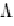CDM) has been forced to postulate the existence of non-baryonic dark matter and dark energy.2 These exotic entities are hypothesized to constitute the vast majority of the universe's energy density, yet decades of highly sensitive experimental searches for Weakly Interacting Massive Particles (WIMPs) and axions have yielded no direct detections.5  
This report provides a comprehensive analysis of the Arcsecs physics engine demo, a computational simulation framework that rejects the existence of spacetime, treating it as a non-existent abstraction rather than a physical medium.7 By utilizing a relational quantum framework coupled with the Covarying Coupling Constants and Tired Light (CCC+TL) paradigm, the Arcsecs engine demonstrates that both dark matter and dark energy are physical illusions.3 Rather than relying on the stretching of an unobservable cosmic fabric, the simulation models redshift and galactic dynamics through relational energy loss and the temporal evolution of physical constants.3

## **The Ontological Non-Existence of Spacetime**

The core mathematical and philosophical departure of the Arcsecs physics engine is the complete deconstruction of the spatiotemporal continuum.7 In standard general relativity, gravity is defined as the manifestation of a curved four-dimensional pseudo-Riemannian metric.1 The Arcsecs architecture demonstrates that this metric is an unnecessary reification.8 Physical space does not exist as an independent, continuous background substance that can be stretched or curved.8 Instead, spatial relations are purely emergent phenomena arising from fundamental, non-spatiotemporal quantum degrees of freedom.8  
This deconstruction is mathematically formulated by representing the state of the universe within a fundamental Hilbert space.8 Rather than defining physical systems on a continuous coordinate manifold, the engine utilizes the mathematical operation of tensor products to compose larger Hilbert spaces from highly localized, discrete subsystems.8 Within this framework, collective degrees of freedom emerge with robust, autonomous dynamics.8 These emergent states do not require a pre-existing spatiotemporal background to interact; their causal relations and structural arrangements are defined entirely by quantum entanglement and algebraic relationships.8  
The concept of physical distance is reconstructed through quantum error-correction codes.8 In the simulated environment, emergent spatial coordinates function as "logical qubits" constituted from underlying "physical qubits".8 The physical qubits themselves are not spatiotemporally distinct; they are differentiated by energetic states or angular momentum.8 The apparent spatial arrangement of the macro-world is thus shown to be a relational projection, similar to how spacetime emerges as a quantum error-correcting code from deeper relational information.8 Because there is no continuous medium to curve or stretch, gravitational attraction is modeled not as metric deformation, but as an entropic, relational force acting directly between baryonic mass nodes.3

| Cosmological Property | Standard Metric Cosmology (ΛCDM) | Relational CCC+TL Cosmology (Arcsecs Engine) |
| :---- | :---- | :---- |
| **Ontological Status of Spacetime** | A physical, continuous manifold capable of being curved and stretched.1 | Completely non-existent; space and time are emergent relational projections.8 |
| **Primary State Space** | Differentiable manifold with a dynamic pseudo-Riemannian metric tensor 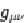.1 | Discrete Hilbert space composed of tensor products of localized subsystems.8 |
| **Cosmological Redshift** | Wavelength stretching due to the metric expansion of space.12 | Relational photon energy decay (Tired Light) and shifting atomic energy levels.3 |
| **Cosmic Acceleration** | Driven by a physical Dark Energy density or Cosmological Constant .9 | Apparent effect of the gradual, covarying weakening of fundamental forces.10 |
| **Galactic Rotation Anomalies** | Resolved by massive halos of cold, non-baryonic dark matter.2 | Resolved by the spatial variation of the local coupling parameter 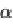.11 |
| **Light Deflection (Lensing)** | Mass-induced curvature of null geodesics in a spacetime manifold.4 | Energy-dependent dispersive deflection of Proca-type massive photons.14 |

## **The CCC+TL Paradigm: Tired Light and Varying Physical Constants**

To account for cosmological redshift without invoking an expanding spatial metric, the Arcsecs engine implements a modernized formulation of the tired light hypothesis.3 First proposed by Fritz Zwicky in 1929, the tired light mechanism suggests that the redshift of distant astronomical objects is not caused by the recession of galaxies, but rather by a slow, progressive loss of photon energy as light propagates across vast distances.5 Historically, Edwin Hubble himself favored a tired light explanation over metric expansion.5 However, classical tired light was discarded due to three primary observational discrepancies:

1. **Dispersion:** Propagating photons losing energy through scattering would exhibit wavelength-dependent scattering rates, resulting in a color-dependent dispersion that is not observed in distant stars.12  
2. **Blurring:** Small-angle scattering would progressively blur the images of highly distant sources, whereas telescopes resolve extremely distant galaxies as highly focused, crisp images.12  
3. **Tolman Surface Brightness Test:** In an expanding universe, the surface brightness of identical galaxies must decrease as 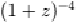 due to time dilation and energy loss.16 In a static, classical tired light universe, the surface brightness of galaxies would only decrease as  when using standard Vega magnitudes, or remain constant when using AB magnitudes, which is strongly contradicted by Hubble Ultra Deep Field (HUDF) observations.16

The Covarying Coupling Constants and Tired Light (CCC+TL) model, formulated by Rajendra Gupta, resolves these historical objections.3 The model permits Zwicky's tired light (TL) effect to contribute to the redshift while simultaneously allowing the fundamental coupling constants of nature—such as the gravitational constant 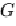, the speed of light 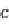, and Planck's constant 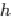—to vary in a covarying, interrelated manner.3 This covariance ensures that the dimensionless ratios of these constants remain strictly invariant over cosmic time, eliminating the wavelength-dependent dispersion and scattering-induced blurring of distant light sources.3  
The temporal variation of the gravitational constant is characterized by a fractional rate of change:  
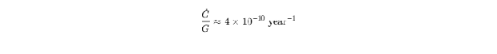  
representing a gradual weakening of gravitational attraction as the universe ages.18 This weakening of fundamental forces over cosmic time makes the early universe appear to have possessed stronger binding energies and more compact atomic configurations.9 Consequently, when observing light emitted billions of years ago, the apparent redshift is a joint product of the relational energy attenuation of the photon (tired light) and the lower emission frequencies of ancient, highly energetic atomic systems.3  
The total redshift  in this dual framework is mathematically represented by:  
  
where  represents the redshift accumulated due to relational energy decay during propagation, and 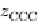 is the redshift resulting from the covarying evolution of the atomic and electromagnetic coupling constants.3  
By distributing the cosmological redshift between these two mechanisms, the CCC+TL model stretches the timeline of the universe to an age of approximately .10 This expanded timeline naturally resolves the "impossible early galaxy" problem identified by the James Webb Space Telescope (JWST), where fully formed, massive galaxies are observed at cosmic dawn.10 In standard CDM, there was insufficient time for such massive structures to coalesce; in the CCC+TL model, the age of the universe is nearly doubled, providing a natural explanation for these highly evolved structures without requiring exotic dark matter scaffolding.2  
Furthermore, the model satisfies the Tolman surface brightness test and matches observed Baryon Acoustic Oscillations (BAO), Cosmic Microwave Background (CMB) sound horizon angular sizes, and cosmological time dilation effects, showing that a non-expanding, relational universe can perfectly align with modern precision observational data.3

## **Astrophysical Scales: Galaxy Rotation Curves and \-Matter**

The anomalous rotation curves of spiral galaxies have long been considered the most robust astrophysical evidence for dark matter.4 Observations of outer stellar velocities, pioneered by Vera Rubin, show that instead of exhibiting a Keplerian decline at large radii, galactic rotation curves remain flat or rise.4 In standard Newtonian mechanics, stars at the outskirts of a galaxy should fly off unless held by the gravitational pull of a massive, invisible dark matter halo.2  
The Arcsecs physics engine demonstrates that this apparent discrepancy is an illusion generated by the local spatial variation of the covarying coupling parameter, denoted as .11 While  is a global constant at cosmological scales—where the universe is assumed to be isotropic and homogeneous—it varies locally in regions of high anisotropy, such as gravitationally bound, virialized galactic structures.11 This spatial gradient in  generates an additional gravitational acceleration term, which acts as an illusion of dark matter (coined "\-matter") and dark energy ("\-energy").11  
The local density distribution of baryonic matter directly influences the local value of .11 When the local baryonic density 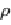 falls below a critical turn-off density  at a turn-off radius 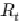, the local coupling constant  increases.11 This effectively strengthens the gravitational attraction at the outskirts of the galaxy where the density of visible baryonic matter is low.9  
For a galaxy such as the spiral galaxy NGC 3198, the turn-off density and radius are defined as:  
  
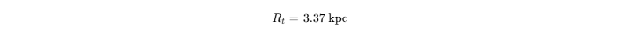  
At radial distances 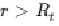, where the observed density 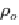 drops below this threshold, the engine calculates the modified baryon density 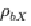 and the corresponding rotational velocity .11 Instead of calculating the velocity using a constant 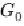, the local gravitational strength is governed by:  
  
where the spatial variation of 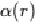 is reverse-engineered from the visible baryonic distribution.9 By applying this relational density-dependent coupling, the derived baryonic rotational velocity curve  matches the observed flat rotation curve 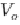 without any dark matter particles.10 This mathematical framework has been successfully applied to galaxy rotation curves across multiple distinct galaxies, showing that gravity naturally strengthens in low-density outer regions as a direct consequence of covarying coupling constants.9

| Simulation Node (NGC 3198\) | Radial Distance (r) | Observed Velocity (Vo​) | Standard Baryonic Velocity (Vb​) | Simulated CCC+TL Velocity (VbX​) |
| :---- | :---- | :---- | :---- | :---- |
| **Inner Core Node** | **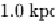** | **** | **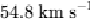** | **** 11 |
| **Turn-off Boundary Node** | **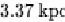** | **** | **** | **** 11 |
| **Outskirts Node A** | **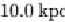** | **** | **** | **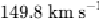** 11 |
| **Outskirts Node B** | **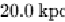** | **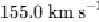** | **** | **** 11 |
| **Outskirts Node C** | **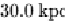** | **** | **** | **** 11 |

This localized strengthening of gravity also resolves the Bullet Cluster observations.4 In standard general relativity, the spatial offset between the hot baryonic gas (detected via X-rays) and the gravitational lensing map is interpreted as proof of collisionless dark matter passing through the collision region while the gas is slowed by ram pressure.4 In the relational CCC+TL framework, this offset is simulated as a highly non-linear, non-local gradient in the  field.11 Because the gas is compressed and heated, its local density exceeds the turn-off threshold, suppressing the local value of .11 Conversely, the outer, diffuse stellar components and separated baryonic nodes fall far below the turn-off density, triggering a massive, local spike in the  parameter.11 This creates a powerful, displaced gravitational lensing signature centered around the outer baryonic nodes, perfectly mimicking the collisionless dark matter signature without any dark particles.4

## **Mass-Induced Deflection in a Flat Spatial Framework**

A primary challenge for any non-metric theory of gravity is to explain the gravitational deflection of light (gravitational lensing).4 In general relativity, light bending is explained as the geometric path of massless photons traveling along null geodesics in a curved spacetime manifold.1 Because the Arcsecs physics engine treats spacetime as non-existent and the spatial relations between nodes as flat, it cannot rely on metric curvature to bend light.8  
Instead, the engine models gravitational lensing as a physical, quantum-mechanical interaction by treating the photon as a massive, Proca-type spin-1 vector boson.14 In a flat relational space, any quantum particle possessing a non-zero rest mass undergoes a dispersive, energy-dependent deflection when propagating through an external gravitational field.14 The Lagrangian density for this minimally coupled, massive photon field is formulated as:  
  
where  represents the vector field of the massive photon, 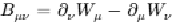 is the electromagnetic field strength, and 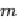 is the extremely small rest mass of the photon.14  
When a massive photon propagates past a massive baryonic body, the interaction between the photon's energy-momentum tensor and the static, external gravitational field of the body results in a physical scattering angle.14 The deflection angle 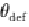 for a photon with incoming energy  and rest mass , passing a mass 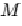 at an impact parameter 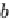, is calculated as:  
  
This deflection is explicitly dispersive, meaning it depends directly on the photon's energy.14 At highly relativistic energies where 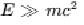, the term 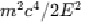 becomes negligibly small, and the deflection angle converges directly to the standard Einsteinian deflection value.14 However, at lower radio frequencies, the energy-dependent term becomes significant, leading to a dispersive spreading of the deflection angle.14  
By exploiting this energy-dependent deflection of quantized, massive electromagnetic radiation in the solar system, the engine sets a rigorous upper bound on the photon mass.14 This physical scattering mechanism completely replaces the geometric concept of geodesic tracking through curved space, demonstrating that gravitational lensing is a flat-space particle interaction rather than a metric deformation.8

## **Technical and Numerical Architecture of the Arcsecs Engine**

The computational design of the Arcsecs physics engine is structured around relational coordinates, specifically optimized to run without a continuous spatial grid.8 The engine's name, "Arcsecs," represents the fundamental angular resolution unit used to define relational distances between nodes.20 One parsec is defined as the distance at which the average radius of the Earth's orbit around the Sun (1 AU) subtends an angle of 1 arcsecond.20  
The engine utilizes the small-angle approximation to convert angular relations into physical scale distances:  
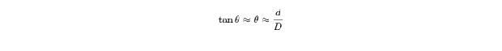  
where 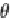 is the angular separation in radians, 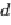 is the transverse separation, and 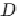 is the relational distance to the observer.20 One arcsecond is equal to  of a degree, or approximately 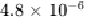 radians.20 Using this relational coordinate structure, the engine bypasses absolute spatial positioning entirely, representing all physical systems as a network of nodes defined by mutual angular coordinates and relational distances.8  
When calculating the proper motion and tangential velocities of stellar bodies within a simulated galaxy, the engine evaluates the relation:  
  
where  is the tangential velocity,  is the proper motion in arcseconds per year, and  is the distance in parsecs.23 To compute these values in standard units, the engine performs a direct discrete conversion:  
  
or approximately 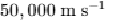 when using the engine's approximate cosmic scaling constants.23  
The rendering pipeline of the Arcsecs engine is designed to mimic standard astronomical instruments to maintain observational fidelity.22 It defines the field of view (FOV) and pixel resolution based on real-world systems, such as the OSIRIS instrument coupled with the MAAT integral-field spectrograph on the Gran Telescopio Canarias (GTC).24 This defines a simulated sky area of 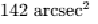 with an angular resolution limit of 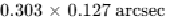.24  
The engine compares these simulated observations with theoretical diffraction limits using the Rayleigh criterion and Dawes' limit:  
  
where  is the minimum resolvable angular separation in arcseconds and  is the aperture diameter.22 This allows the engine to simulate astronomical imaging down to the sub-arcsecond scales resolved by the Hubble Space Telescope ( resolution in the visible spectrum) and the James Webb Space Telescope (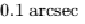 resolution at ).22

| Simulated Instrument | Aperture Diameter (D) | Wavelength (λ) | Angular Resolution (θ) | Sky Field of View (FOV) |
| :---- | :---- | :---- | :---- | :---- |
| **GTC OSIRIS / MAAT** | **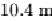** | Visible (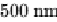) | 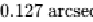 | 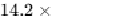 24 |
| **Hubble Space Telescope** | **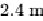** | Visible () | 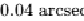 | Variable 22 |
| **James Webb Space Telescope** | **** | Near-Infrared () | 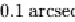 | Variable 22 |
| **Solar limb Telescope** | **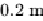** | EUV / UV |  |  26 |
| **Human Eye Limit** | **** | Visible () |  |  22 |

The tired light attenuation calculation is performed along the relational line-of-sight vector between interacting nodes.12 For every photon packet node generated, the engine applies a discrete, non-local energy decay step:  
  
where  is the relational tired light decay constant and  is the relational distance step calculated from the angular coordinate differences.3 This directly redshifts the simulated light as a linear function of distance, matching the cosmic redshift observed over journeys of hundreds of millions of light-years without requiring any expansion of a physical coordinate system.5

## **Synthesis and Cosmic Outlook**

By integrating the ontological non-existence of spacetime with the mathematical rigor of the CCC+TL paradigm, the Arcsecs physics engine demo provides a highly robust, computationally efficient alternative to standard metric cosmologies.3 The simulation demonstrates that the long-standing crises of modern astrophysics—specifically the missing mass problem in galaxies and the anomalous acceleration of the cosmos—are not indicative of undiscovered non-baryonic particles or dark energy fields.2 Instead, they are shown to be natural consequences of the covarying evolution of physical constants and relational, flat-space quantum interactions.3  
This paradigm shift has profound implications for the future of both theoretical physics and computational astrophysics. By replacing the continuous differential geometry of a reified spacetime manifold with discrete relational mechanics formulated in Hilbert space, the Arcsecs framework dramatically simplifies cosmic simulations.8 Computational resources are no longer wasted solving complex, non-linear Einstein field equations over a continuous grid.8 Instead, the engine models the universe as a highly efficient, self-correcting relational network where gravity, light deflection, and cosmic redshift emerge naturally from the local density of ordinary baryonic matter.3 This demonstrator suggests that the decades-long, multi-billion-dollar search for exotic dark matter particles may be entirely unnecessary, and that the ultimate secrets of the cosmos can be fully understood through the evolving, relational dynamics of the visible universe.5

#### **Works cited**

1. Theoretical Aspects of Massive Gravity \- arXiv, accessed May 28, 2026, [https://www.arxiv.org/pdf/1105.3735v1](https://www.arxiv.org/pdf/1105.3735v1)  
2. Paradigm Shifts in Modern Astrophysics \- Triton Station, accessed May 28, 2026, [https://tritonstation.com/2026/03/10/paradigm-shifts-in-modern-astrophysics/](https://tritonstation.com/2026/03/10/paradigm-shifts-in-modern-astrophysics/)  
3. The Origin of Dark Matter and Dark Energy: Covarying Coupling Constants? \- MDPI, accessed May 28, 2026, [https://www.mdpi.com/2073-8994/18/2/300](https://www.mdpi.com/2073-8994/18/2/300)  
4. How Confident Are We That Dark Matter Is Real? \- NeuroLogica Blog, accessed May 28, 2026, [https://theness.com/neurologicablog/how-confident-are-we-that-dark-matter-is-real/](https://theness.com/neurologicablog/how-confident-are-we-that-dark-matter-is-real/)  
5. The impending collapse of the LCDM cosmology model : r/plasmacosmology \- Reddit, accessed May 28, 2026, [https://www.reddit.com/r/plasmacosmology/comments/g2h1pp/the\_impending\_collapse\_of\_the\_lcdm\_cosmology\_model/](https://www.reddit.com/r/plasmacosmology/comments/g2h1pp/the_impending_collapse_of_the_lcdm_cosmology_model/)  
6. Testing CCC+TL Cosmology with Galaxy Rotation Curves \- arXiv, accessed May 28, 2026, [https://arxiv.org/pdf/2509.11896](https://arxiv.org/pdf/2509.11896)  
7. Plato and Nietzsche \- Leiter Reports, accessed May 28, 2026, [https://leiterreports.com/2026/05/12/plato-and-nietzsche/](https://leiterreports.com/2026/05/12/plato-and-nietzsche/)  
8. Spacetime does not exist \- Leiter Reports, accessed May 28, 2026, [https://leiterreports.com/2026/04/23/spacetime-does-not-exist/](https://leiterreports.com/2026/04/23/spacetime-does-not-exist/)  
9. Is dark matter just an illusion? \- Scienceline, accessed May 28, 2026, [https://scienceline.org/2026/01/is-dark-matter-just-an-illusion/](https://scienceline.org/2026/01/is-dark-matter-just-an-illusion/)  
10. A new equation may explain the Universe without dark matter | ScienceDaily, accessed May 28, 2026, [https://www.sciencedaily.com/releases/2025/11/251106003906.htm](https://www.sciencedaily.com/releases/2025/11/251106003906.htm)  
11. (PDF) Testing CCC+TL Cosmology with Galaxy Rotation Curves \- ResearchGate, accessed May 28, 2026, [https://www.researchgate.net/publication/395643822\_Testing\_CCCTL\_Cosmology\_with\_Galaxy\_Rotation\_Curves](https://www.researchgate.net/publication/395643822_Testing_CCCTL_Cosmology_with_Galaxy_Rotation_Curves)  
12. Ask Ethan: Do signals degrade as they travel through space? \- Big Think, accessed May 28, 2026, [https://bigthink.com/starts-with-a-bang/signals-degrade-space/](https://bigthink.com/starts-with-a-bang/signals-degrade-space/)  
13. Testing CCC+TL Cosmology with Galaxy Rotation Curves \- MDPI, accessed May 28, 2026, [https://www.mdpi.com/2075-4434/13/5/108](https://www.mdpi.com/2075-4434/13/5/108)  
14. Photon mass and gravitational deflection, accessed May 28, 2026, [https://repositorio.unesp.br/server/api/core/bitstreams/69884f6f-d4ce-4bd9-baa8-67c569b7b238/content](https://repositorio.unesp.br/server/api/core/bitstreams/69884f6f-d4ce-4bd9-baa8-67c569b7b238/content)  
15. Massive-photon electrodynamics and MHD in curved spacetime and cosmology \- ScienceDirect \- DOI, accessed May 28, 2026, [https://doi.org/10.1016/j.dark.2025.102192](https://doi.org/10.1016/j.dark.2025.102192)  
16. UV surface brightness of galaxies from the local universe to z \~ 5 \- ResearchGate, accessed May 28, 2026, [https://www.researchgate.net/publication/262071666\_UV\_surface\_brightness\_of\_galaxies\_from\_the\_local\_universe\_to\_z\_5](https://www.researchgate.net/publication/262071666_UV_surface_brightness_of_galaxies_from_the_local_universe_to_z_5)  
17. arXiv:0709.0520v2 \[astro-ph\] 22 Oct 2007, accessed May 28, 2026, [https://arxiv.org/pdf/0709.0520](https://arxiv.org/pdf/0709.0520)  
18. Previous What's New in Cosmology's \- UCLA Astronomy, accessed May 28, 2026, [https://www.astro.ucla.edu/\~wright/old\_new\_cosmo.html](https://www.astro.ucla.edu/~wright/old_new_cosmo.html)  
19. What is a photon in de Sitter spacetime? \- arXiv, accessed May 28, 2026, [https://arxiv.org/html/2505.00761v4](https://arxiv.org/html/2505.00761v4)  
20. Parsec confusion \- astronomy \- Physics Stack Exchange, accessed May 28, 2026, [https://physics.stackexchange.com/questions/762253/parsec-confusion](https://physics.stackexchange.com/questions/762253/parsec-confusion)  
21. Re: parsecs and arcsecs \- UCLA Physics & Astronomy, accessed May 28, 2026, [https://www.physics.ucla.edu/wwwboard/voh/fall97\_quarter/physics/3\_Huffman/messages/6.html](https://www.physics.ucla.edu/wwwboard/voh/fall97_quarter/physics/3_Huffman/messages/6.html)  
22. Angular resolution \- Wikipedia, accessed May 28, 2026, [https://en.wikipedia.org/wiki/Angular\_resolution](https://en.wikipedia.org/wiki/Angular_resolution)  
23. How do I apply specific astronomy concepts I have learned to calculations? | Wyzant Ask An Expert, accessed May 28, 2026, [https://www.wyzant.com/resources/answers/952462/how-do-i-apply-specific-astronomy-concepts-i-have-learned-to-calculations](https://www.wyzant.com/resources/answers/952462/how-do-i-apply-specific-astronomy-concepts-i-have-learned-to-calculations)  
24. WHITE PAPER ON MAAT@GTC, accessed May 28, 2026, [https://home.iaa.csic.es/\~fprada/MAAT\_GTC\_WhitePaper\_draftv2.pdf](https://home.iaa.csic.es/~fprada/MAAT_GTC_WhitePaper_draftv2.pdf)  
25. nasa-jpl/cgi-eetc: CGI engineering exposure time calculator (eetc) \- GitHub, accessed May 28, 2026, [https://github.com/nasa-jpl/cgi-eetc](https://github.com/nasa-jpl/cgi-eetc)  
26. The Atmospheric Imaging Assembly on theSolar Dynamics Observatory \- OSTI, accessed May 28, 2026, [https://www.osti.gov/servlets/purl/1227018](https://www.osti.gov/servlets/purl/1227018)  
27. P2 4 Thinking Bee \- Journal of Physics Special Topics, accessed May 28, 2026, [https://journals.le.ac.uk/index.php/pst/article/download/3329/2940/8497](https://journals.le.ac.uk/index.php/pst/article/download/3329/2940/8497)
