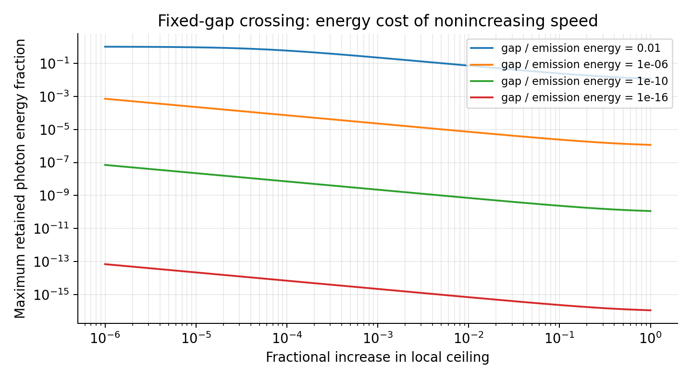
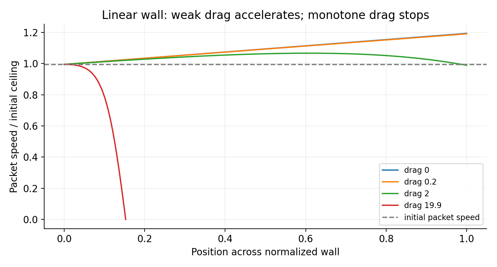

# Part XXX — exact monotonicity and energy requirements at a domain wall

## Motivation and scope

The C-01 shell calculation allows a higher local characteristic speed outside a restrictive wall. The research charter requires a photon to slow after emission, so we need a mechanism that carries its propagation history through a changing environment. This section derives a necessary energy bound and an exact controlled crossing test. It does not propose that the actual universe has the illustrative wall or that fixed-gap drag is the final aging mechanism. The result is a diagnostic for future candidates.

## Static wall with a fixed positive gap

Write the packet Hamiltonian and signed momentum equation in one dimension as

$$E(x,p)=\sqrt{C^2(x)p^2+\Delta^2},\quad \dot x=v=\partial_pE,\quad \dot p=-\partial_x E-\gamma p,$$

where $p>0$, $\Delta>0$ is a constant rest-energy gap, and $\gamma\geq0$ is a momentum relaxation rate. This is a fixed-gap control, not fixed invariant rest mass if $C$ varies. The static field performs no net Hamiltonian work on $E$: the Hamiltonian terms cancel in the total derivative. Define $q=\Delta^2/E^2$. Then

$$\dot E=-\gamma pv=-\gamma E(1-q),\quad v=C\sqrt{1-q},$$

$$\frac{d\ln v}{dT}=\frac{d\ln C}{dT}-\gamma q.$$

In a region where $C$ increases along the path, monotone slowing requires $\gamma q\geq d\ln C/dT$. Small $q$ makes the slowing efficiency very weak. This is independent of any prescribed maximum-speed clamp. The energy extracted is recorded as a reservoir intake $\dot B=\gamma E(1-q)$; $E+B$ is constant in this reduced model. The static wall is external and the momentum receiver is not simulated, so this is not a closed matter-field action.

## Endpoint energy bound

Let $s=C_1/C_e>1$, $\varepsilon=\Delta/E_e\in(0,1)$ and $r=E_1/E_e$. Nonincreasing speed necessarily gives

$$C_1\sqrt{1-\varepsilon^2/r^2}\leq C_e\sqrt{1-\varepsilon^2}.$$

Solving for the largest possible retained energy yields

$$\boxed{r\leq \frac{\varepsilon s}{\sqrt{s^2-1+\varepsilon^2}}.}$$

Equality gives the same final and initial speed, not proof of monotonicity throughout the journey. In a fixed-gap packet the energy cannot fall below $\Delta$. The bound shows that even a modest increase in $C$ can force the arrival energy close to the gap. For $s=1.1$ and $\varepsilon=10^{-16}$, the retained fraction can be at most $2.4004\times10^{-16}$. The required loss is nearly all the emitted energy. If a photon remains in the original observational band, passive momentum drag in this fixed-gap model cannot provide such a crossing.

| Local ceiling ratio $s$ | Max. retained fraction, gap fraction $10^{-6}$ | Max. retained fraction, gap fraction $10^{-16}$ |
|:--|--:|--:|
| 1.001 | $2.238\times10^{-5}$ | $2.238\times10^{-15}$ |
| 1.01 | $7.124\times10^{-6}$ | $7.124\times10^{-16}$ |
| 1.10 | $2.400\times10^{-6}$ | $2.400\times10^{-16}$ |
| $\sqrt{2}$ | $1.414\times10^{-6}$ | $1.414\times10^{-16}$ |

{width=92%}

## Linear-wall crossing: exact solution and feasibility

Normalize $C_e=E_e=1$ and wall thickness to one; dimensionless time is wall thickness divided by $C_e$. Let $C(x)=1+\kappa x$ for $0\leq x\leq1$, with $\kappa=s-1>0$. Put $y=\operatorname{arcosh}(E/\Delta)$, so $v=C\tanh y$. Dividing the energy equation by $\dot x>0$ gives $dy/dx=-\gamma/C(x)$. At constant drag the solution is

$$y(x)=y_e-\frac{\gamma}{\kappa}\ln(1+\kappa x),\qquad y_e=\operatorname{arcosh}(1/\varepsilon).$$

It is valid until the momentum vanishes. To arrive at the far wall with positive speed requires $\gamma<\kappa y_e/\ln s$. From the speed derivative, monotone slowing already at entry requires $\gamma\geq\kappa\sinh y_e\cosh y_e$. Since $y(x)$ decreases, that lower bound suffices for monotonicity while the photon continues moving. Both conditions can hold only if

$$\boxed{\ln s<\frac{y_e}{\sinh y_e\cosh y_e}=\frac{\varepsilon^2\operatorname{arcosh}(1/\varepsilon)}{\sqrt{1-\varepsilon^2}}.}$$

As the positive gap fraction becomes very small, the allowed ceiling increase scales as $\varepsilon^2\ln(2/\varepsilon)$. For $\varepsilon=0.1$ and $s=1.2$, monotonic entry requires $\gamma\geq19.89975$, but a crossing requires $\gamma<3.28345$. No constant drag satisfies both. Even a drag that delivers a slower photon at the far wall may violate the required trajectory history by allowing initial acceleration.

| Constant drag | Traverses wall? | Final position | Final speed | Final energy |
|--:|:--|--:|--:|--:|
| 0 | Yes | 1 | 1.193985 | 1.000000 |
| 0.2 | Yes | 1 | 1.191348 | 0.834252 |
| 2 | Yes | 1 | 0.989129 | 0.176619 |
| 19.89975 | No | 0.152700 | $\simeq0$ | 0.100000 |

The last solution asymptotically stops within the wall. The $\gamma=2$ case ends below its initial speed but initially accelerates. The four independently integrated trajectories agree with the analytic rapidity expression to $4.19\times10^{-12}$ maximum absolute error, and the integrated energy ledger closes to $8.72\times10^{-12}$. Sixteen endpoint identities and all reachability checks pass. No real-wall normalization, microscopic bath or observational inference is claimed.

{width=92%}

## Variable gap: constructive design target

If $\Delta$ varies along a path, then the exact algebraic identity is

$$\frac{d\ln v}{dT}=\frac{d\ln C}{dT}+\frac{q}{1-q}\left(\frac{d\ln E}{dT}-\frac{d\ln\Delta}{dT}\right).$$

A possible candidate could increase a positive effective gap while accounting for the energy required to dress the radiation. Endpoint monotonicity requires

$$\frac{\Delta_1}{E_e}\geq r\sqrt{1-\frac{1-\varepsilon^2}{s^2}}.$$

For $s=1.1$, initial gap fraction $10^{-16}$, and $r=1/2$, the final gap must be at least 0.2083 of the original energy. For optical or radio radiation that is a significant constitutive change, with associated dispersion and atomic/detector constraints. This is an explicit target for a dynamic gap or alternative history-state theory, not a measured gap or a permission to change fundamental invariant photon mass. A microscopic theory must distinguish invariant mass from environmental dressing, derive emission and detection, and account for work from the regulator and reservoir. A reversible wall effect cannot substitute for irreversible aging.

**Part XXX decision.** Retain C-01's physical ceiling and the research requirement of monotone post-emission slowing. Use the fixed-gap wall as a quantitative exclusion control for candidate mechanisms; do not promote constant drag as the physical solution. Next derive a causal, energy-and-momentum-accounted history field with a positive photon mass and independent emission and wall boundary conditions.

