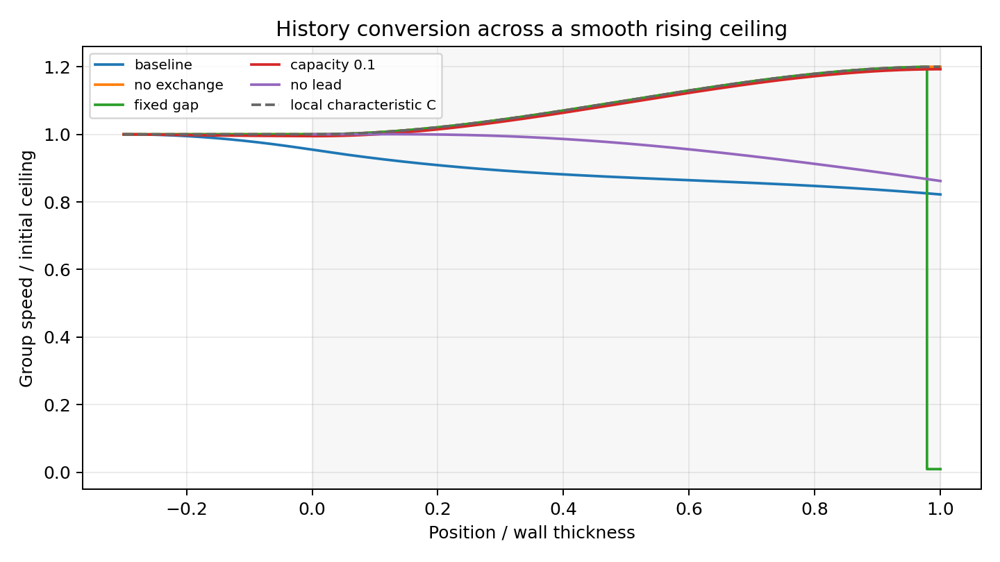
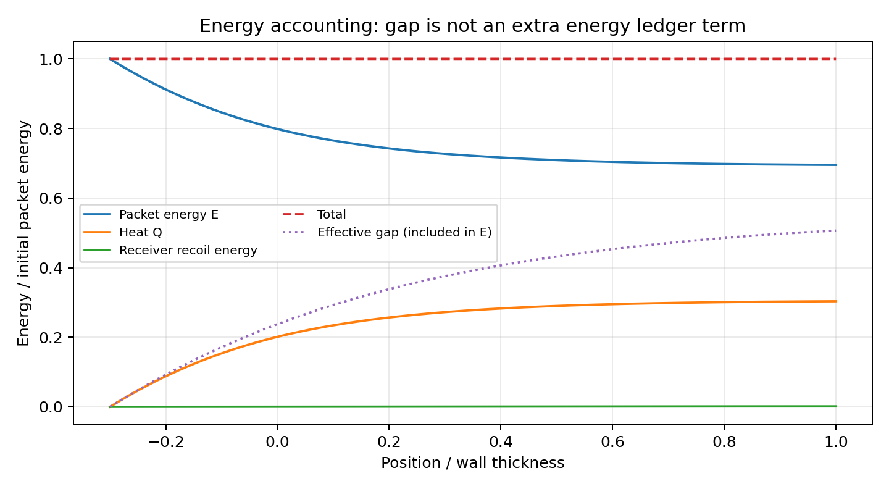

# Part XXXI — irreversible momentum-to-gap conversion with finite capacity and recoil

**Status:** new analytical and executed reduced packet model, not a microscopic photon theory or an observational fit. The twelve foundations and the investigator's C-01 clarification are unchanged. This follows the exact fixed-gap restriction in Part XXX. The central question remains what establishes the initial local emission ceiling, and why a packet subsequently slows rather than acquiring a higher speed when its environment changes.

## 1. Candidate physical mechanism and declared assumptions

Retain a positive reference gap $\Delta_0=m_0 C_e^2$ with $m_0>0$ and $C_e$ the reference characteristic speed. Introduce a physical dressing/conversion coordinate $a\geq0$ (momentum units) and $\Delta(a)=\Delta_0+\beta a$, with $\beta>0$ in speed units. The effective gap is **not** identified with a changing fundamental invariant photon mass. The conversion law is a phenomenological irreversible constitutive law; a local field theory generating it remains open. A small bare gap can make the initial group speed arbitrarily close to the characteristic, but an exact finite-energy equality remains unresolved. Adopt one spatial coordinate and constant ordering time $T$. The illustrative wall is a prescribed static regulator, not a self-consistent bubble; its material support receives the wall reaction momentum. The local characteristic is $C(x)>0$. Assume positive forward momentum throughout the benchmark.

The reduced packet Hamiltonian is

$$E=\sqrt{C(x)^2p^2+\Delta(a)^2},\qquad v=\partial_p E=\frac{C^2p}{E},\quad E_a=\frac{\beta\Delta}{E},\quad E_x=\frac{CC'p^2}{E}.$$

An effective finite receiver has momentum $P=a$ (zero initially), inertial coefficient $M>0$, recoil energy $P^2/(2M)$ and velocity $U=P/M$. This nonrelativistic receiver is appropriate only for small $U$ in the selected normalization. $Q$ is irreversible internal energy deposited into that receiver. This is a lumped receiver approximation along the trajectory, not a solved spatial bath, nor a claim of instantaneous transport across the universe. It deliberately separates the internal dressing coordinate (whose energy is already included in $E$) from the deposited heat. Let $A$ be the energy release per transferred momentum:

$$A=v-E_a-U.$$

For mobility $K>0$ and capacity $a_{\max}>0$, choose the one-way conversion law

$$\dot a=K\max(A,0)\max(1-a/a_{\max},0).$$

This supplies a dissipative branch with nonnegative heat production. It is not a speed clamp: it depends on the energetic driving force and capacity, not on the sign of the desired speed derivative. Its absence of reverse conversion requires an underlying physical rectification process, not yet derived; detailed balance, noise and finite-temperature emission remain tasks. The evolution equations are

$$\dot x=v,\qquad \dot p=-E_x-\dot a,\qquad \dot P=\dot a,\qquad \dot Q=A\dot a,\qquad \dot W=E_x,$$

where $W$ is reaction momentum received by the externally held wall. $P=a$ and $W(0)=Q(0)=0$. A finite wall recoil model would require its own dynamics and energy; $W$ is a ledger for the fixed-wall approximation, not a claim that a finite freely moving wall accepts momentum at zero energy cost.

## 2. Conservation, passivity and monotonicity

The Hamiltonian work terms cancel for a static wall, leaving

$$\dot E=-(v-E_a)\dot a,\quad \frac{d}{dT}\left(E+\frac{P^2}{2M}+Q\right)=0,\quad \frac{d}{dT}(p+P+W)=0.$$

Whenever conversion occurs, $A>0$, so $\dot Q\geq0$ and $\dot E\leq0$. At zero affinity or capacity exhaustion the exchange stops. The model does not require an unbounded heat sink in a single-packet calculation. It does not establish a steady cosmological bath. At fixed $a$ the positive gap gives $v<C$ for every finite positive $p$; the fastest causal characteristic of a full coupled field theory has not yet been established.

Differentiating the velocity along the evolution gives the exact trajectory identity

$$\boxed{\dot v=\frac{v^2C'}{C}-\frac{C^2\Delta(\Delta+\beta p)}{E^3}\dot a.}$$

The first term is the conservative wall response; the second is recoil plus internal dressing. In a uniform environment the second term is nonpositive. For a rising wall, nonincreasing speed requires

$$\dot a\geq\frac{v^2 C'E^3}{C^3\Delta(\Delta+\beta p)}\qquad(C'>0).$$

This is a necessary and sufficient *instantaneous* condition under this reduced model. It is evaluated after solving the dynamics, not used to force the velocity. When the initial gap is very small, an abrupt positive gradient can overwhelm the conversion response; the rate also falls toward zero when capacity or affinity is exhausted. Unlike fixed-gap drag, $\beta p$ can substantially increase the slowing term after conversion grows. The model does not establish monotonicity across arbitrary environments.

At arrival, for $s=C_1/C_e>1$, the Part XXX endpoint condition generalizes to

$$\Delta_1\geq E_1\sqrt{1-(v_e/C_1)^2}.$$

This is a useful gap budget, not sufficient to guarantee monotonic history. Since $a\leq a_{\max}$, $\Delta_1\leq\Delta_0+\beta a_{\max}$. For a monotone-in-position wall with $C\leq C_1$ and forward motion, the integrated energy equation implies $E_1\geq E_e-C_1 a_{\max}$, since $v-E_a\leq C_1$ during conversion. Combining the two yields the necessary finite-capacity condition

$$\boxed{E_e\leq C_1 a_{\max}+\frac{\Delta_0+\beta a_{\max}}{\sqrt{1-(v_e/C_1)^2}}.}$$

The bound is implicit because $v_e$ depends on $E_e$. At fixed $s>1$, as $E_e$ becomes large the denominator tends to $\sqrt{1-s^{-2}}>0$. Hence any fixed finite capacity excludes monotonic crossing for sufficiently large emission energy, no matter how large the mobility. This is an analytical design constraint: a universal model needs an independently justified energy-dependent capacity, multiple local exchange degrees of freedom, or another mechanism. It is not a license to tune a separate parameter per observed frequency.

## 3. Executed smooth-wall benchmark

Use units $C_e=1$, reference packet energy $E_e=1$ and wall thickness $L_w=1$; time unit $L_w/C_e$, momentum unit $E_e/C_e$. At $x=-0.3$, set $a=P=Q=W=0$ and $p=\sqrt{1-\Delta_0^2}$ with $\Delta_0=10^{-6}$. For $0\leq x\leq1$ set $C=1+0.2(3x^2-2x^3)$, extended constantly on each side. Choose $\beta=1$, $K=1$, $M=100$, $a_{\max}=2$. These are dimensionless example parameters, not cosmological calibrations. The lead region permits the same physical conversion before the wall, without a special change of law at the boundary. Integrate the autonomous reduced ODEs until $x=1$ or stopping, with adaptive tolerances, dense samples and a refined repeat.

| Quantity | Baseline result |
|:--|--:|
| Arrival time | 1.445830 |
| Initial group speed / $C_e$ | 0.9999999999995 |
| Final group speed / $C_e$ | 0.822104 |
| Final characteristic / $C_e$ | 1.2 |
| Final packet energy / $E_e$ | 0.695303 |
| Final effective gap / $E_e$ | 0.506501 |
| Required minimum final gap / $E_e$ | 0.384343 |
| Deposited heat / $E_e$ | 0.303415 |
| Receiver recoil energy / $E_e$ | 0.001283 |
| Wall reaction momentum / $(E_e/C_e)$ | 0.096548 |
| Maximum sampled $\dot v$ | $-1.0\times10^{-6}$ |

The packet crosses with positive momentum, retains 69.53% of its original energy, and has no sampled positive speed derivative in the baseline and refined trajectories. This is materially different from the fixed-gap restriction, but does not certify the continuous trajectory by interval arithmetic or show a physically realizable microscopic coupling. It also requires a large dressed gap: about 72.85% of arrival energy. It is not automatically an observable ordinary photon of the same spectral band. The energy sum includes the gap only once. The receiver reaches a speed about 0.0051 in reference units, consistent with the selected nonrelativistic recoil approximation.

{width=94%}

{width=94%}

## 4. Controls, sensitivity and limitations

Every named case below used the same constitutive equations, varying only indicated inputs. Energy columns are fractions of that run's own emission energy; group velocities are relative to the same initial characteristic. Monotonicity is diagnosed by maximum sampled analytical derivative, not just endpoint speed. A case with a smaller final speed can still reaccelerate during flight.

| Test | Retained energy | Final speed | Maximum sampled $\dot v$ |
|:--|--:|--:|--:|
| Baseline | 0.695303 | 0.822104 | $-1.0\times10^{-6}$ |
| Bare gap $10^{-16}$ | 0.695302 | 0.822104 | $-1.0\times10^{-16}$ |
| No exchange | 1.000000 | 1.200000 | 0.331516 |
| Fixed gap ($\beta=0$) | $\simeq10^{-6}$ | 0.009415 | 0.331516 |
| No lead region | 0.685254 | 0.862014 | 0.005392 |
| Capacity 0.1 | 0.905467 | 1.192659 | 0.327398 |
| Capacity 0.3 | 0.762609 | 1.111477 | 0.240912 |
| Capacity 0.5 | 0.709826 | 0.991140 | 0.102976 |
| Emission energy 0.5 | 0.704646 | 0.775935 | 0.052114 |
| Emission energy 2 | 0.712777 | 1.023823 | 0.132119 |
| Emission energy 4 | 0.801443 | 1.156046 | 0.277769 |
| Steeper rise ($s=1.4$) | 0.682339 | 0.892637 | 0.057749 |
| Receiver mass 1 | 0.714528 | 1.005138 | 0.124076 |
| Linear instead of smooth wall | 0.694422 | 0.824817 | $-1.0\times10^{-6}$ |

The receiver-mass-1 stress test may exceed the low-speed range of its nonrelativistic recoil approximation; it is not a relativistically valid material prediction. The emission-energy scan fixes the absolute bare gap, coupling and capacity: it deliberately does not rescale the parameters to make every packet pass. It demonstrates a substantial chromatic transport problem. The very small positive gap control shows that the result is controlled by dressing, not by a large assumed bare photon mass. A 27-case grid over $\beta\in\{0.5,1,2\}$, $K\in\{0.5,1,2\}$ and lead length $\in\{0.1,0.3,0.6\}$ yielded 8 traversals with no positive sampled derivative at tolerance $10^{-10}$. This is a local exploration, not a fit or a probability for cosmic conditions.

The complete 42 runs (15 named and 27 grid cases) passed 135 assertions, including ledger residuals, nonnegative heat, capacity and local group ceiling, baseline/refinement comparisons, finite-difference derivative identity and controls. Maximum absolute energy residual across all cases was $2.16\times10^{-8}$ and momentum residual $8.89\times10^{-16}$. Baseline energy discrepancy under refinement was $4.98\times10^{-10}$; group speed discrepancy $5.96\times10^{-10}$. A centered finite-difference derivative check on regular sample intervals agreed to $5.23\times10^{-8}$. All checks concern the declared reduced ODE, not data or the validity of its phenomenological assumptions.

## 5. Consequences for C-01, clocks and distance predictions

The model creates a real history coordinate and a thermodynamic accounting law instead of imposing a nonincreasing speed by clipping it. Its successes are restricted to the tested configurations. A fresh packet is near the reference characteristic only under the small bare-gap approximation; the origin of $C_e$ is still the C-01 regulator problem. A variable gap and receiver need a local hyperbolic physical field model with positive energy, causal characteristics, atomic emission and absorption, and wall backreaction. The one-way law must be derived or replaced with a physical irreversible mechanism, including finite-temperature fluctuation and detailed-balance conditions. It cannot be inferred from the existence of a bookkeeping coordinate alone.

For stationary source and receiver, with independent identical packets and identical initial bath state at each emission, the autonomous trajectory has the same travel time for each emission. Thus arrival intervals equal emission intervals in constant $T$, even if energy changes substantially. If physical clock rates or medium histories differ, derive those changes independently. There is no demonstrated connection from this gap energy to a detected atomic line frequency. Interpreting $E_1/E_e$ as a measured redshift without detector physics would be premature. No brightness, angular-distance or Foundation 12 correction is derived here. The Part XXVI joint optical constraints remain active. The same model must ultimately predict all frequency channels with common material parameters.

## 6. Next research gate

Retain the passivity identity, finite-capacity bound and tested history-coordinate mechanism as conditional design tools. Do not promote the large effective gap as a measured fundamental photon mass. Construct a local moving reservoir with finite density, continuity, energy and momentum flux, backreaction on the C-01 regulator, and a stable gauge-compatible radiation action; derive the coarse-grained mobility and conversion law. Evaluate multi-frequency propagation, repeated-packet bath saturation, coherent linewidth and detection. Only then calculate physical recession, clock counts and two-direction 3D ray maps from a common state. No prior observational constraints are removed.

Reproduction: `python code/history_conversion.py`; see `appendices/history_cases.csv`, `history_scan.csv`, `history_baseline.csv`, and `part_xxxi_verification.txt`. This report is a new internal derivation based on the verified Part XXX equations, not a new external literature or observational survey.
